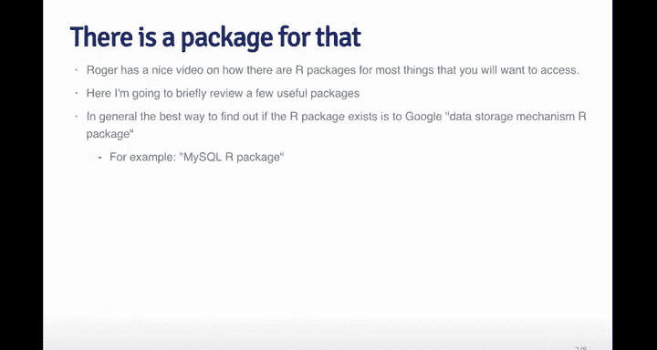
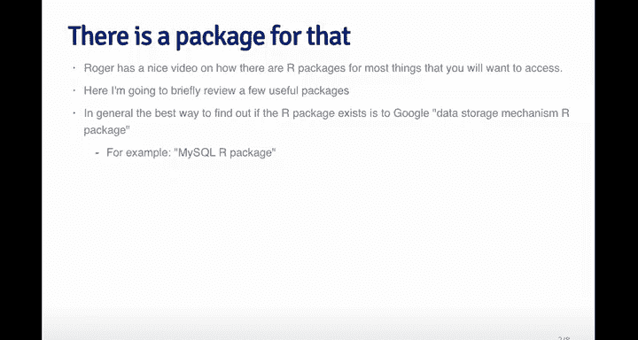
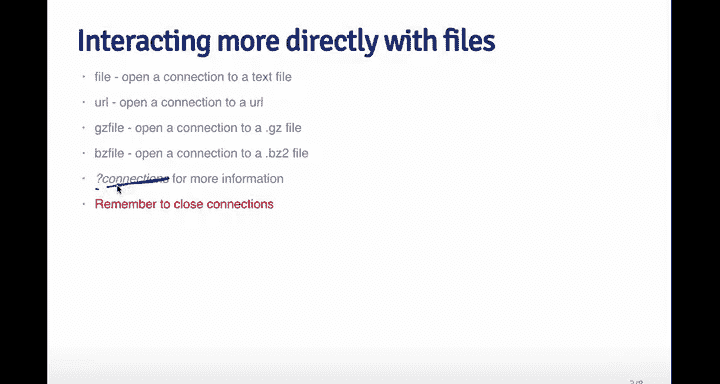
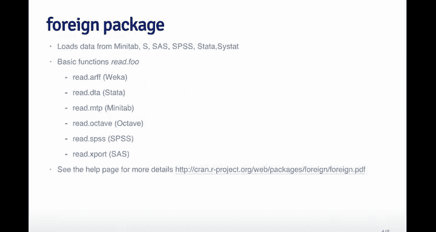
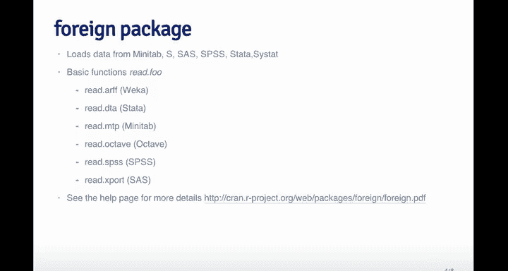
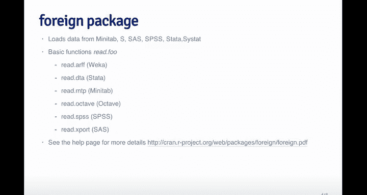
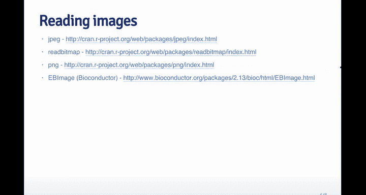
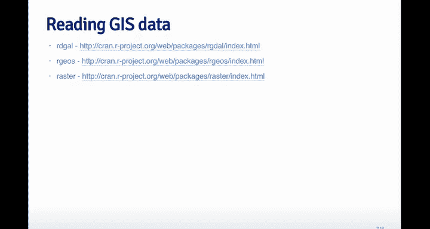
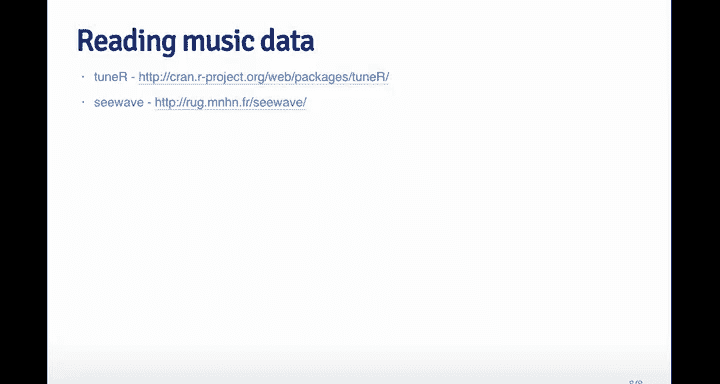

# 约翰霍普金斯大学《数据科学R语言基础｜Data Science： Foundations using R》中英字幕（deepseek - P87：13_从其他来源读取.zh_en - GPT中英字幕课程资源 - BV1tsFQemEts

SoSo far we've covered reading data from a large number of sources。

 whether it's from different file types like the XML or JSON files or whether it's from different sources like HF5 or MySQL While I've covered a few of the highlights。

 I think that there's a large number of other places where you might want to be able to get data from and I have by no means comprehensively covered all of the different R packages that can be used to access those data Roger has a really nice advertising video on how there's an R package for everything kind of modeled on the Apple there's an app for everything here I'm going to briefly review a few useful packages I know about。

 but you should by no means consider this a comprehensive list。

In general， I found the best way to find out if an R package exists is to Google data storage mechanism followed by our package。

If you just type R sometimes I haven't been able to find it with a search， so for example。

 I might type MySQL R package and that usually comes up with the very first tape being the most interesting package。

I found that almost every kind of data type that you might want to have access to。

 as long as it's relatively common， there's an R package for accessing the data。

If you want to interact directly with files， we've seen how to use URL in the Getting data lecture so far。

 but you can also use the file function to access a connection to a particular file that's already localized on your computer。

You can also use GZ file and BZ file to access zipped files that might land on your computer。

 and then if you do question mark connections， you can learn a lot more about opening connections to files both locally and remotely。

The forum package is very useful if you work with people who use other programming languages or other statistical programming languages。

 so it loads data from files for miniTabSPSS and a bunch of others so the basic functions read like read and then dotfo whereF is the extension for the particular file from the particular programming language so for example it's DTA for Stata and if it's an octave file it's do octave and if it's spPSS it's do spPSS and then you can read dot export files from SAS for example。

 if you want to see a lot more about this you can go read about the foreign package in the help file which is pretty self-explanatory and I've been able to read most files from other programming languages。

There's also a large number of other database packages， so for example。

 Postgres SQL provides a D compliant database connection from R。

 and so here's a tutorial actually at this first link and then the second link is the help file there's also the RODVC which provides interfaces to multiple databases including Postgres MySQL Microsoft access and SQL light there's a tutorial here that's very nice as well and then a help file that will you walk you through most of the functions。

If you use MongoDB， there's actually a very nice package called R Mongo。

 and then there's also another package， R MongoDB， which can be used to interface with MongoDB and extract data from that database。

Again， you're going to be sending queries very similar to the way you were doing with the RISQL package。

 you're going to actually send queries to the database using the database's own syntax。

 so if you're going to use the R package you have to learn just a little bit about the syntax for the database to be able to extract data。

You can also read other things that aren't necessarily data in the traditional format in terms of text files and so forth。

 you can read directly images with JpeEG， Read Bitmap， Ping， these are all PNG。

 these are all functions that allow you to access image files and load them into R directly and manipulate them。

 the EBI image package in bioconductor is also very nice for analyzing and manipulating image data。

You can read GIS data， so this is geographic information systems data。

 you can read it with a variety of different packages that will allow you to access and play with different kinds of GIS data that are exported by proprietary and nonproprietary software Another cool thing that you can read is directly from MP3s so you can use either the tune R or the Cwa packages to actually read musical data and do analysis there's a lot of nice musical processing software in R that you can use to analyze those data and come up with interesting cool new analysis as well So like I said。

 this is just a list of the packages that I thought of off the top of my head。

 but whatever your application is you can just Google the R package that will allow you to access the data there's always an R package for that。

