# 约翰霍普金斯大学《数据科学R语言基础｜Data Science： Foundations using R》中英字幕（deepseek - P88：14_子集和排序.zh_en - GPT中英字幕课程资源 - BV1tsFQemEts

Once you've loaded your data into R， then what you might want to do is manipulate that data so you can set it up to be a tidy data。

 variables in the columns and observations in the rows and only the observations that you want to be able to analyze。

So this first part of this lecture is just going to recover some of the information that you've already seen about subsetting that you've probably seen in your our programming class in case that you don't remember it on the top of your head so what I'm going to do is I'm going create a data frame here and I'm going to create that data frame with three variables that are labeled bare one Ver2 and Ver3 and then what I'm going to do is I'm actually going scramble up those variables so that they're not in a specific order and I'm going make some of the values be missing so I'm going to make some of the values in NA once I've done all that I see that this is the data set that I've created so you can see in any of the columns the values aren't necessarily in order and you can see that for variable2 there's a couple of missing values with the NAs。

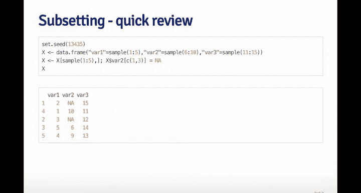

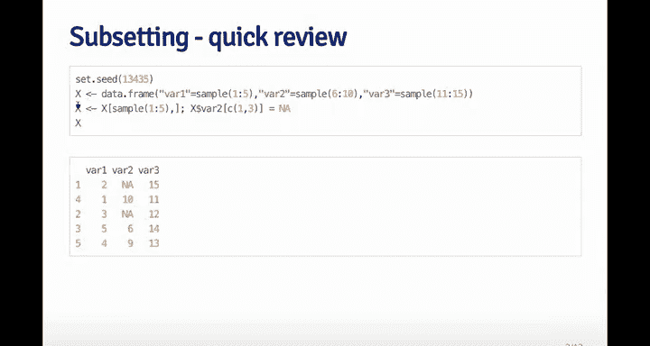

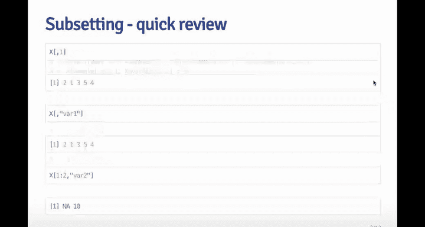

So the first thing that I can do is I can subset a specific column by doing x comma1 where I have x open bracket comma1 and what that'll do is actually open up just the first column of that data frame。

 the other thing that I can do is if I want to subset by a column I can again do x open bracket comma and then I can actually use the variable name before the closed bracket to subset out just that column I can subset by both rows and columns at the same time。

 so for example， this command here， x open bracket one column2 comma ver 2 will actually output the first two rows of x and first and the second column of X。

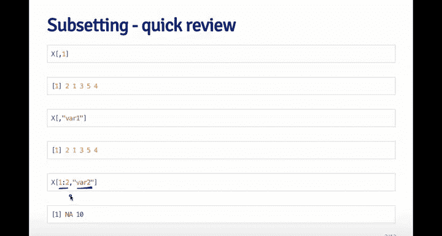

So you can sub both on rows and columns at the same time。

So the other things that you can do is you can subset using logical statements， so for example。

 suppose I want to find out all the rows of x where variable1 is less than or equal to3。

And variable 3 is greater than 11 so to define those rows。

 I can pass it this logical argument like that to subsetting the rows and I end up with just the rows where both of those conditions are met I can also use an or so I can try to find the places the rows where variable1 is less than or equal to3 or using this pipe command here variable 3 is greater than 15 and the result is this data frame here where one or the other of those two conditions is met。

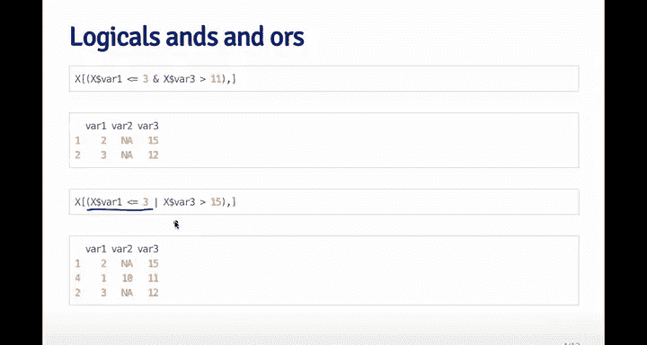

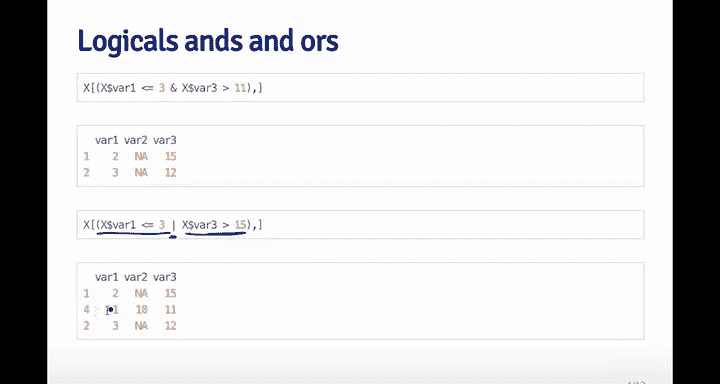

Finally， if I'm dealing with NA values， subsetting on NAAs will not produce the actual rows。

 and so what you want to do is you want to use the W command。

 so if you use which it will return the indices where variable 2 is greater than eight in this case。

 and so when it returns those indices where variable 2 is greater than8。

 it doesn't return the NAs and so you can subset the data。

 even dealing with the NAs that you might have。

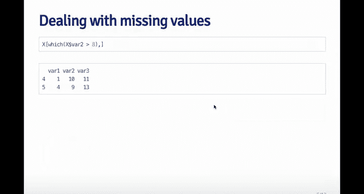

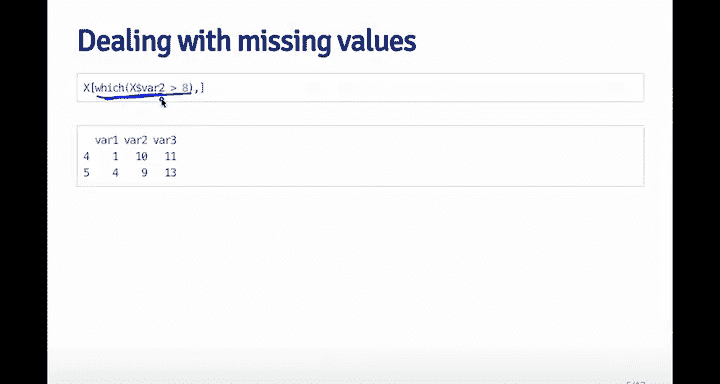

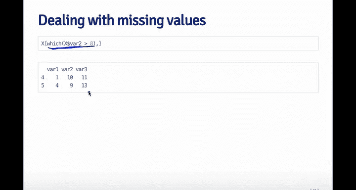

You can also sort variables， so using the sort command。

 so if you type sort and then pass it X of variable1， it will sort the values in or increasing order。

 you can tell it to sort them in decreasing order with the parameter decreasing set equal to true。

And then the other thing you can do is when you're dealing with a variable that has missing values。

 you can tell it to put all the NA values at the end of the sort， so you can say NA。

 last equals true。

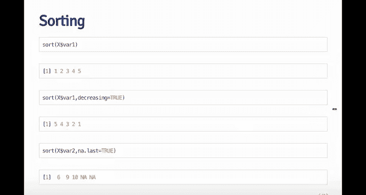

The other thing that you can do is you can actually order a data frame by a particular variable。

 so suppose that I want to order the data frame and otherwise I want to sort all of these rows by the values of variable 1 so that the values of variable 1 or an increasing order as I go down so what I can do is I can take this function order and apply it to that variable1 and then pass the result of that ordering as the selection to the rows of the matrix X and what that'll do is reorder the rows so that variable 1 is in increasing order。

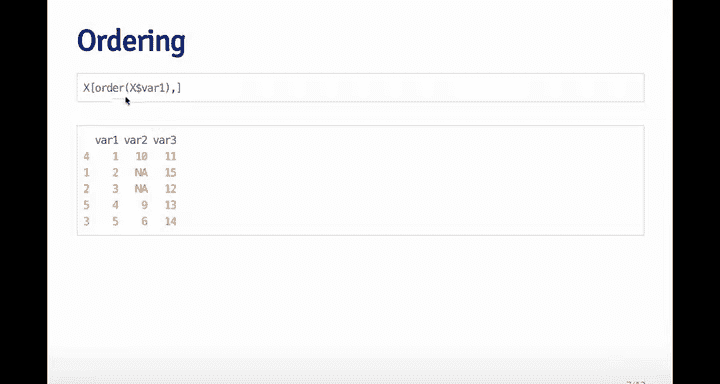

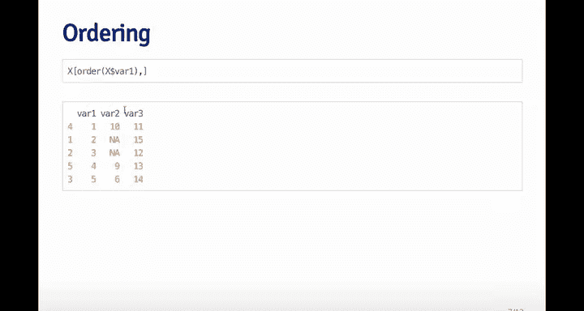

You can also order by multiple variables， so for example you can pass it variable1 and variable 3 and so what it'll do is it'll first sort so that variable 1 is an increasing order and then if there are multiple values of variable one that are the same。

 it will sort the values of variable three and increasing order within those values。

 so it sorts the first variable first and the second variable within the first variable。

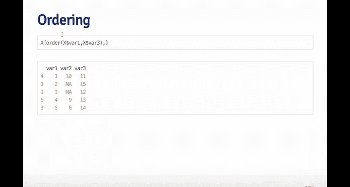

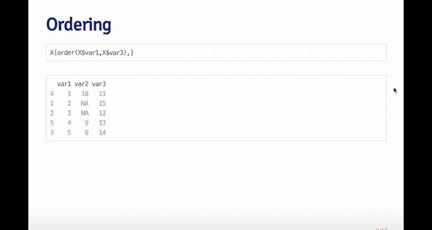

You can actually do that the same thing with the plier package。

 which is a package written by Hadley Wickham and what you can do is once you've loaded that library。

 you can use the Ar command so the arrange command takes a data frame and then you can tell it a variable and that variable will be the variable that the data frame is sorted on so now you can see we've sorted on variable one and so variable one is an increasing order here you can also tell it to do decreasing order by just passing to the arrange command。

 the data frame and variable one but wrapped with the DESC function which will tell it to put it in descending order。

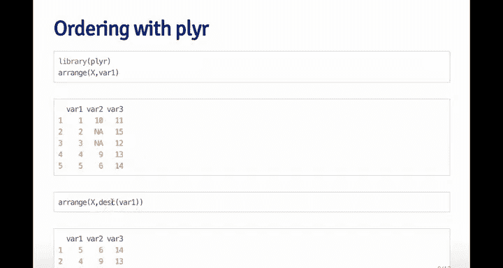

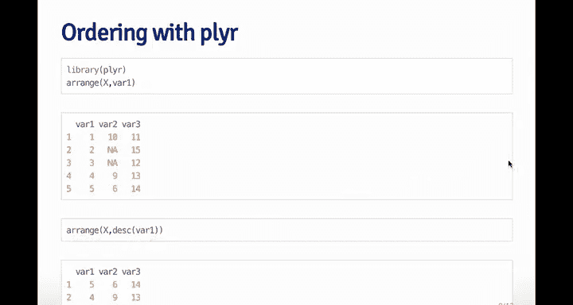

You can also add rows and columns to data frames， quite straightforward process。

 so you just basically say x of variable4， so this is a variable that wasn't in the data frame before。

 we're going to assign to that variable， a new vector that's a random normal vector of length the same dimension as the number of rows of the data。

 and then you can see that that variable has just been added to the data like that。

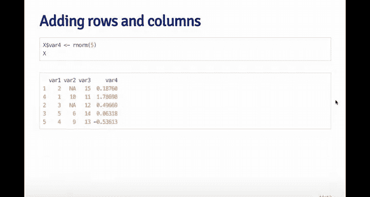

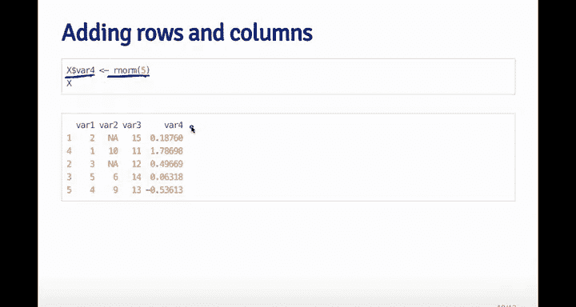

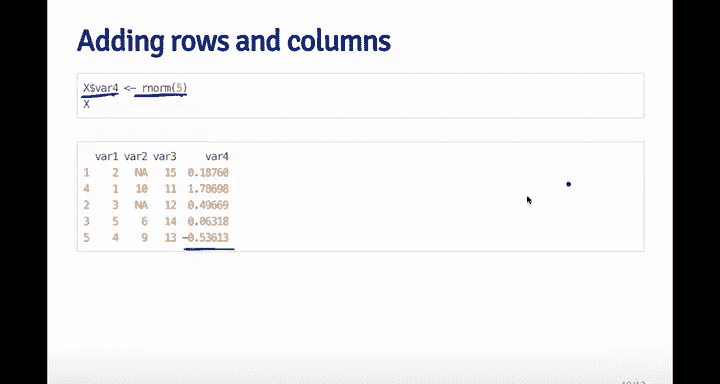

Another way that you could do this is by using the C B command。

 so what that will do is it'll take the data set， the data frame X。

 and it will column bind the new vector to it will basically add a column on the right hand side of X。

If I put these in in the other order， if I put R norm of5 here， and then x second。

 what it would do is it would bind that column to the left side of X， which is sort of intuitive。

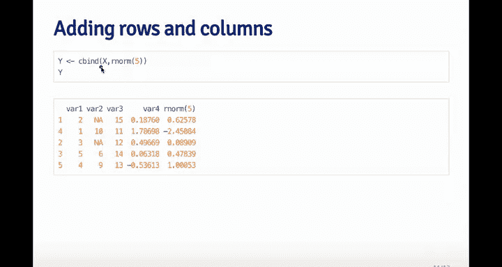

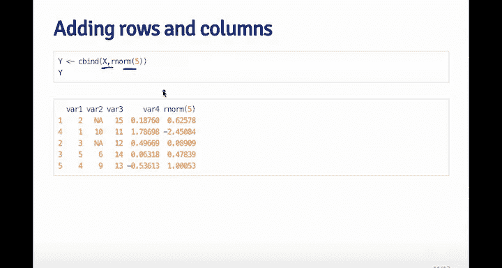

If you want to bind rows， you can use the R bind command。

 so it's the same command only with an R at the beginning and so if you put the R norm at the end。

 what it'll do is it'll bind it to the bottom of the data frame and if you put it before it'll bind it to the top of the data frame。

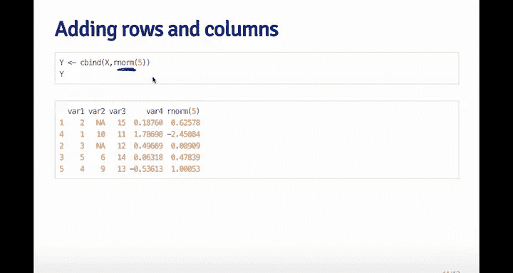

There are a lot more notes that are to be had on subsetting and reordering and sorting in the R programming course in the data science track。

 and I've taken some of these information from these nice set of lecture notes by Andrew Gaffe who teaches a Windsor Institute here at the Johns Hopkins School of Public Health and you can check out his lecture notes for more information as well。

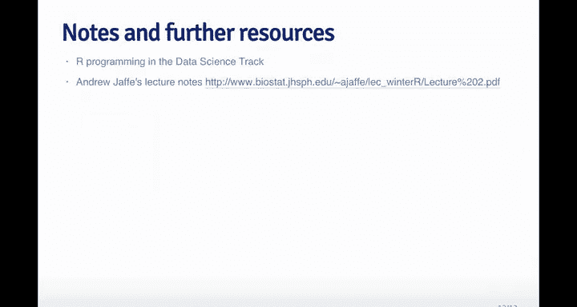

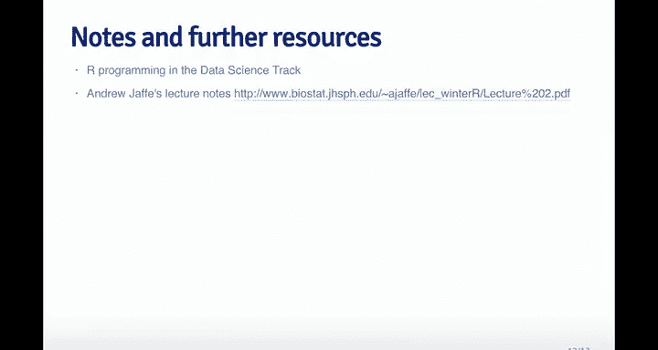