# 约翰霍普金斯大学《数据科学R语言基础｜Data Science： Foundations using R》中英字幕（deepseek - P91：17_重塑数据.zh_en - GPT中英字幕课程资源 - BV1tsFQemEts

Often the do that you load into R will not necessarily be ti， it'll be shaped in some strange way。

 there will be a variable in a row or there'll be something else going on。

 And so the first thing that you might need to do is reshape the data into the format that you'd like to have it in。

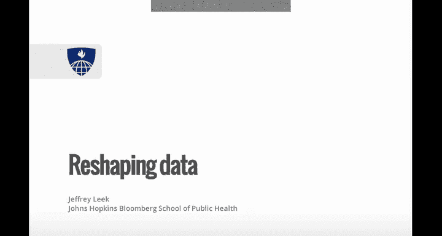

So the goal remember is tidy data so tiD data has several principles。

 for example we would like every variable to form its own column。

 every observation to form its own row， and each table or file to store data about only one kind of observation we're going to focus on the first two components of this when we're doing data reshaping。

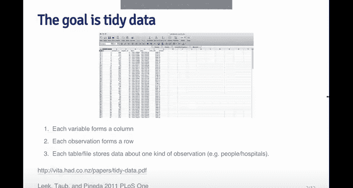

So we're going to start off by looking at this empty cars data。

 so this is a data that's one of the standard dataset sets in R and so we have a bunch of different cars over here in the rows and then there's a bunch of different variables that we've observed about them。

 their NPG， the number of cylinders， the horsepower and so forth and so what we're going to do is deal with reshaping this data a little bit。

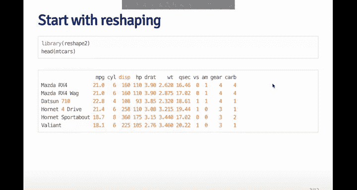

So the first thing that we can do is we can melt the data and so when we're melting a data。

 what we're going to do is we're going to pass the data frame that we have empty cars。

 we're going to actually pass it to this melt function and we're going to tell it which of the variables are ID variables and which of the variables are measure variables and so what that can do then is it's going to create a bunch of ID values and so for example it's going to create an ID value for car name for gear and for cylinders because we've said those are ID variables here and then it's going to basically melt all the rest of the values and so this is a very tall skinny data frame so that in this variable column you will see bothmpG and HP so it's basically reshape the data so that it's tall and skinny and so there's one row for every MPG and one row for every HP。

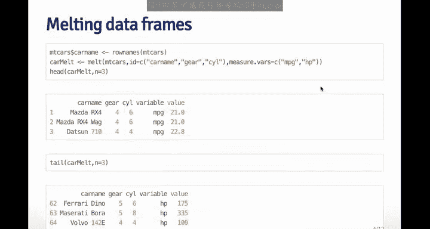

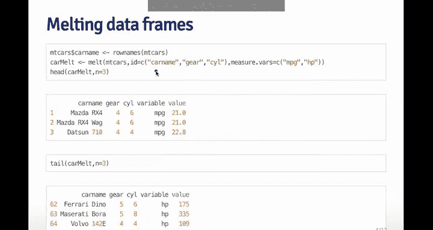

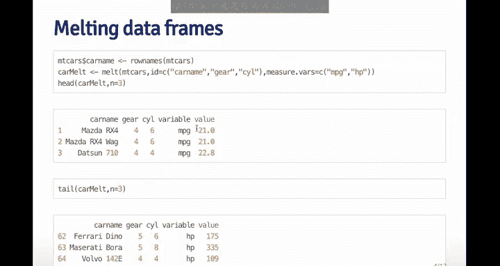

So for example， at the top of this data we see it's only the MPG values and at the bottom of the data we see it's only the HP values。

 this is now a tall skinny data set。

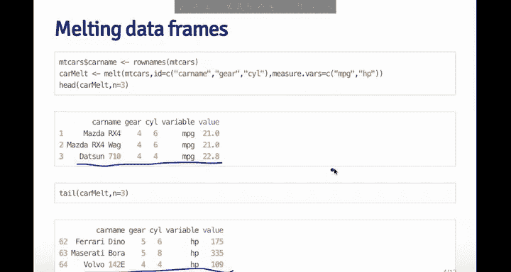

So once we've melted the data we can recast it in a bunch of different ways we can basically reformat the data into different sort of shapes。

 so to do that we're going to use the Dcast function。

 the Dcast function will recast the data into a particular shape into a particular data frame。

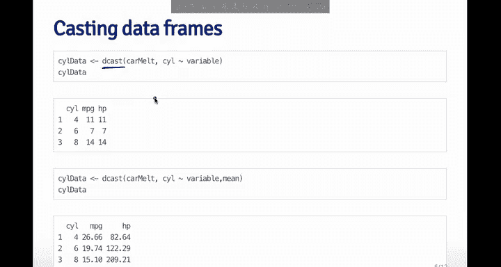

So here what we're going to do is we're going to pass it the melted dataset。

 the car melted dataset set， and suppose， for example。

 that we wanted to see the cylinders and we wanted to see that broken down by the different variables what this will do is it's going to put the different values on the left hand side in the rows and it's going to put the values in the right hand side in the columns so on the right hand side is variable remember for variable we said it was MPG and HP so you get that in the two columns here and then in the rows we get the different cylinders going down here and the thing that it does is it summarizes the data set so you can see this data is much smaller than the original dataset and by default it does it by length so what it says is that for four cylinders we have 11 measures of NPG and 11 measures of horsepower for six cylinders we have seven measures of NPG and seven measures of horsepower and so forth。

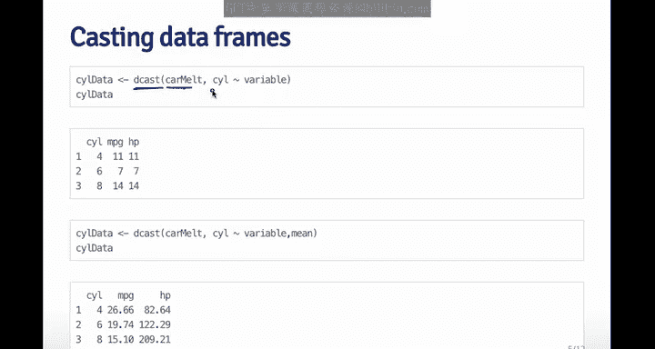

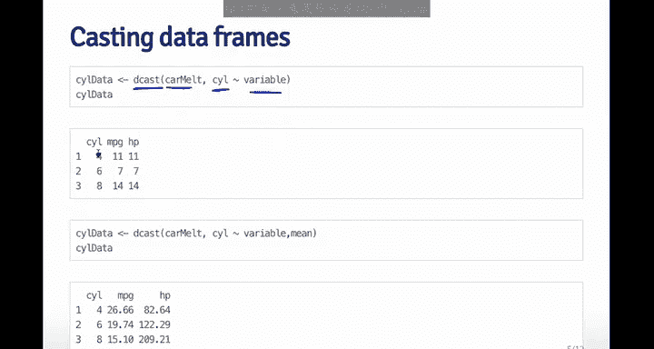

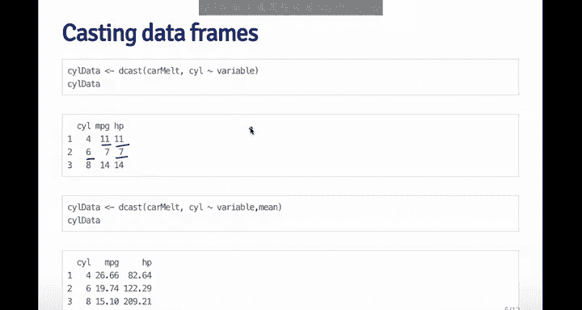

We can also pass it a different function， a different way to summarize the data， so again。

 if we tell it to recast the data in this way， it will put cylinders in the rows and the variable in the columns。

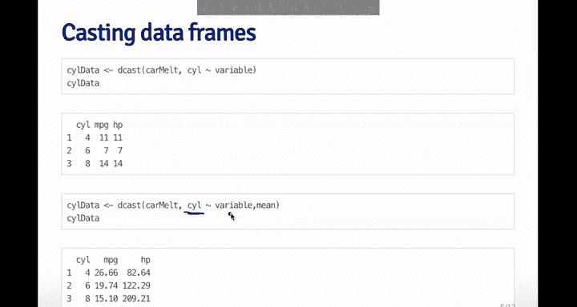

And then what we can tell it to do is take the mean for each value so for example now we can say for the four cylinder car。

 the mean miles per gallon is 26。66 and the mean horsepower is 82。64。 mean。

 for an eight cylinder car there's a much lower mean miles per gallon and a much higher horsepower and so what this is basically doing is it's taking the data and resummarizing it in different ways and reorganizing it in different ways。

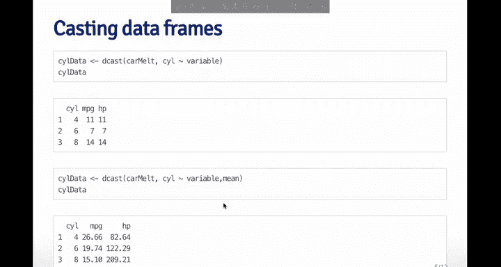

Another thing that you might want to do is average values within a particular factor。

 So this is a very common thing to do。 So this is now looking at an insect sprays data。

 So what we have now is different kinds of sprays， So in this case the spray is A or B or C or D or E or F and then it's the count of the number of insects that you see with that different spray and so one thing that you might want to do is take the sum of the count of index insects that you see for each of the different sprays。

 So to do that what you could do is you could take the insect count variable and pass it to T apply and you could say I would like to T apply that means apply along an index a particular function。

 So I'm going to apply to count along the index spray the function sum What that's going to do is within each value of spray it will sum of the counts and so you get the sum for A and the sum for B and the sum for C。

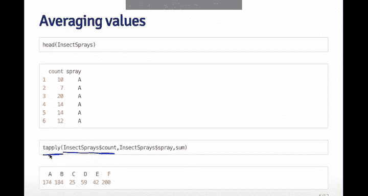

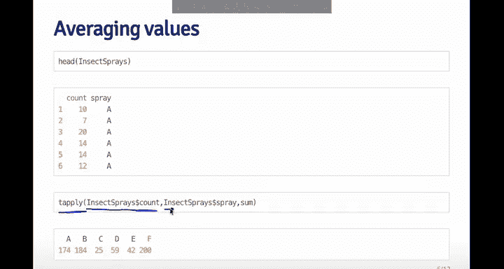

That's one very brief shorthand way of calculating those sums。

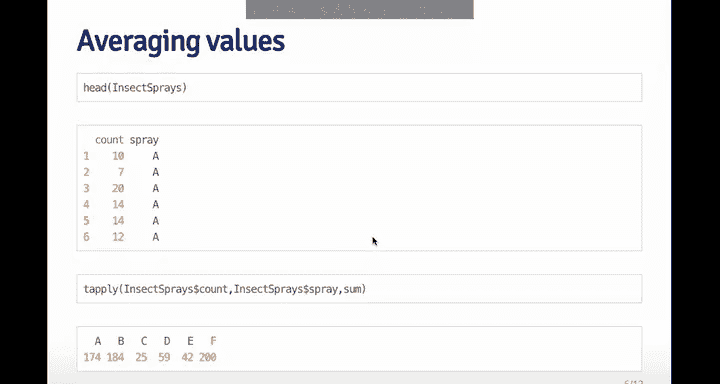

Another way is what's called split apply combined， so you can imagine that what you want to do is you want to take the insect spray counts and you want to split them up by each of the different sprays。

 so you can do that with a split function and R and what you end up now is with a list where you get the list of the values for A。

 the list of the values for B， the list of the values for C and so forth。

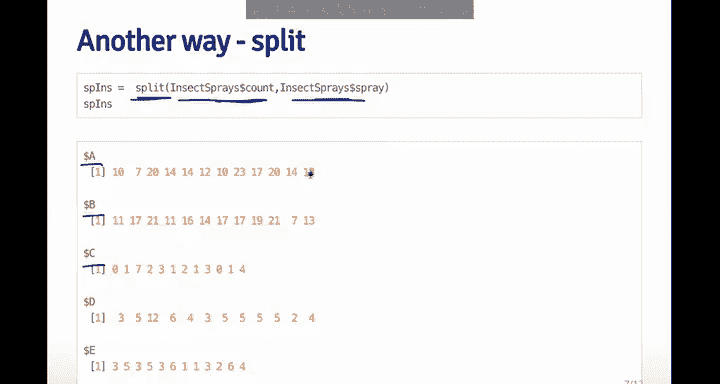

So that's the split part of the split applied combined。

 Then what you can do is you can apply to that list of functions。

 So here we have the list of different values for each of the different sprays and we can use L apply to apply across that list。

 So each element of the list， we're going to apply the sum。 So again， we get the same values out。

 we've summed up the counts for A， summed up the counts for B summed up the counts for C and so forth。

 And now we actually have a list but we may want to go back to a vector so that it's easier to manipulate an R and so then we do combining we basically unlist the list that we got when we did the apply after the split。

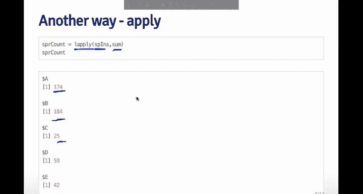

One thing that will combine a couple of those steps together。

 so after you've taken the data and you've split it up， you can actually just use the Sly command。

 which will do both the apply and the combined components of the split apply combined。

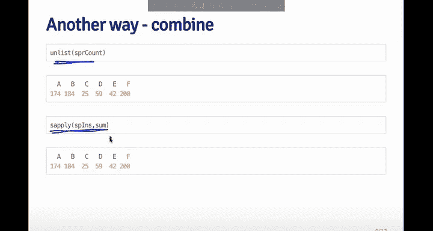

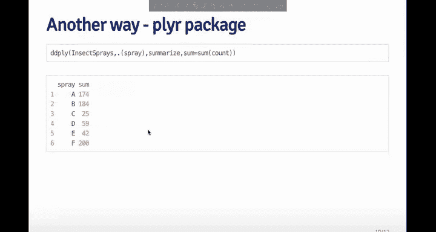

The plier package provides a nice interface for doing this sort of action in one step。

 so we take the In phrase data set and we pass it to the function DD Ply。

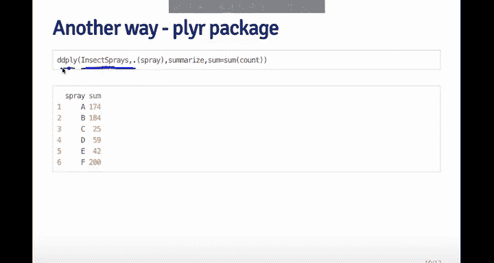

And then what we do is we say， okay， these are the variables that we'd like to summarize and you have to use dot and then parentheses so that you don't have to use quotation marks around spray。

Then you're going to say we want to summarize this variable and how do we want to summarize it。

 we want to provide a sum， so basically we sum up the count of within that spray variable and you get C here the same sort of process has been applied a split applied combined process。

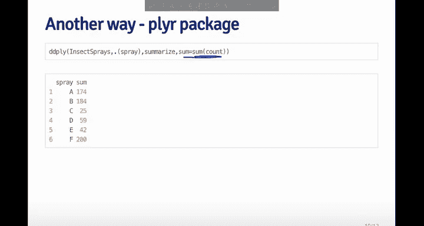

This is kind of nice because you can also use it to calculate the values and apply them to each variable。

 So for example， suppose you want to be able to subtract off the mean or the total count from the actual count for every variable what you can do is you can actually calculate a spray sums variable that's the same length as the original data set。

 So again I passed DD apply the insect sprays data frame and I say I want to summarize the spray variable and I want to summarize the counts and I want to sum them up but now I've passed it this a function。

 So when I say sum here， I'm actually calculating the sum as the a function applied to count where the sub function is sum。

 And so what ends up happening is spray sums ends up being the same dimension as the original insect sprays data。

 So for every time I see an a in the spray I get the sum。😊。

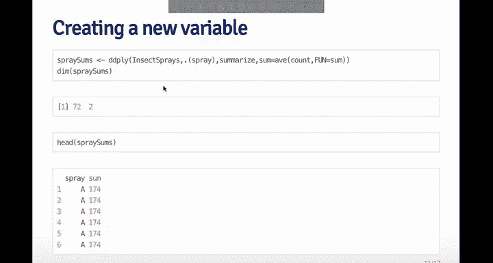

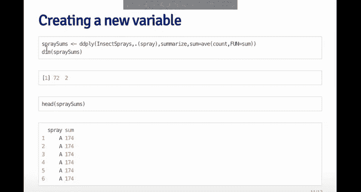

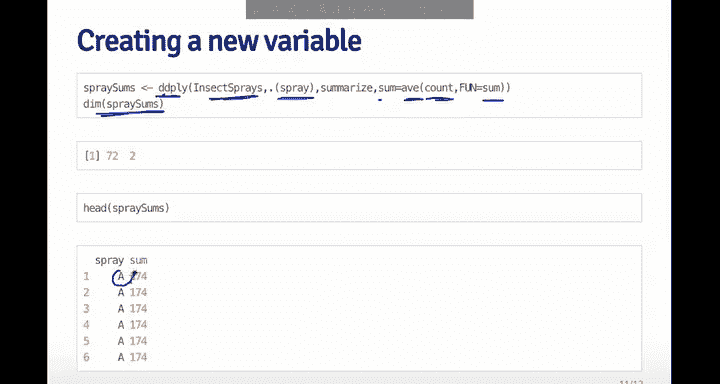

all of the a values so in other words， instead of having a data set where you just see the sum for a once。

 you see the sum for a for every value of a in the data set and so that now this variable can be added to the data and used to do different analyses。

For more information on how to reshape data you can see the plier tutorial there's also a really nice reshape tutorial here on a slidesshare and a good plier primer is on our bloggers here some other functions that you might want to be aware of or acast which just like we were using Dcast a minute ago to take a melted data and turn it into a data frame aA turns it into an array。

 possibly multiple dimensional and then arranged you can use for reordering data sets without using the order commands like we saw in previous lectures just like you can use mutate to add new variables so you can use a combination of DDPly and mutate in order to add new variables that are summaries of the previous variables。

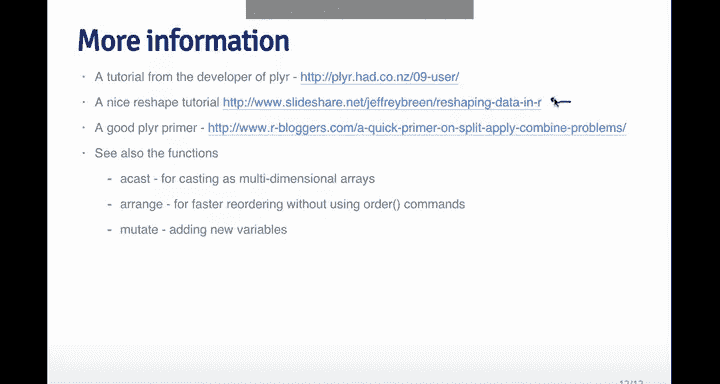

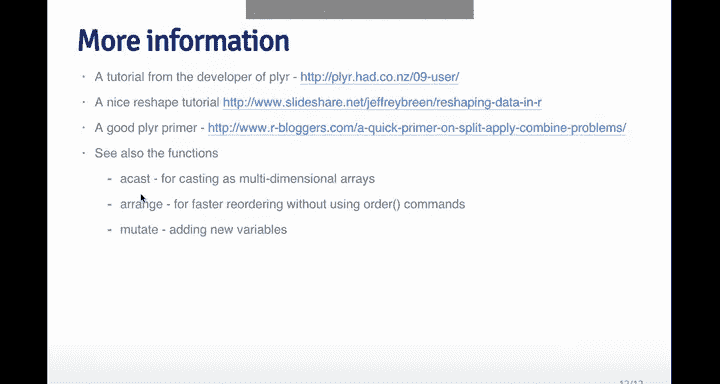

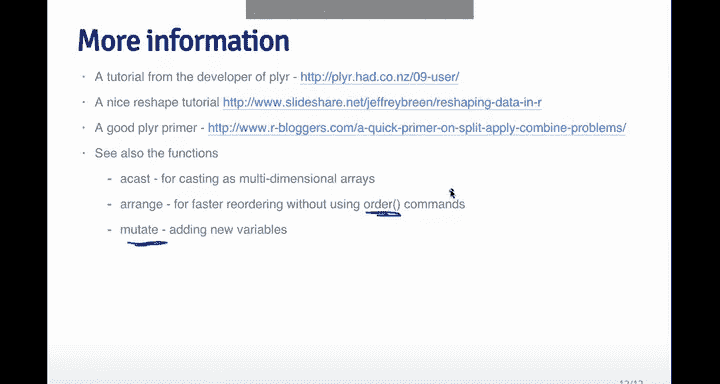