# 约翰霍普金斯大学《数据科学R语言基础｜Data Science： Foundations using R》中英字幕（deepseek - P95：21_编辑文本变量.zh_en - GPT中英字幕课程资源 - BV1tsFQemEts

A very common data cleaning step is to have text variables that are in sort of a nasty format or have extra spaces or periods or underscores that you need to remove。

 And so this lecture is going to be about how do you manipulate those texts programmatically in order to get nice。

 decent variable names， but also text in the actual data set itself。

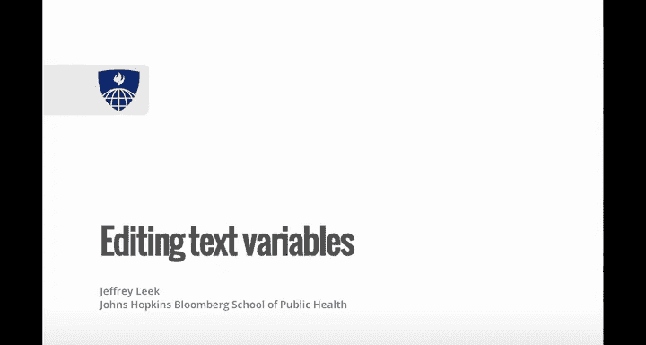

So again we're going to go back to this Baltimore fixed camera data because I can't stop thinking about all the speeding tickets that I get so again the first thing that we're going to do is download the data from the web so we're going to check and see if this data directory exists and if it doesn't we're going create it then we're going to download the data from this URL and we're going read it into R with Re。

csV and so first thing that we can do is look at the names of this camera data and so this is the column names and you can see for example。

 one of them is this variable crosstreet and it has a capitalized asset in it。

This seems like not a big deal， but every time that you're going to type that into R you might see have this extra capital letter and you might miss it and so R might give you an error so one thing that you might want to do is make all of the letters lowercase and so one way to do that with R is to just use to lower so you can make the names all be only lowercase letters by using the to lower command。

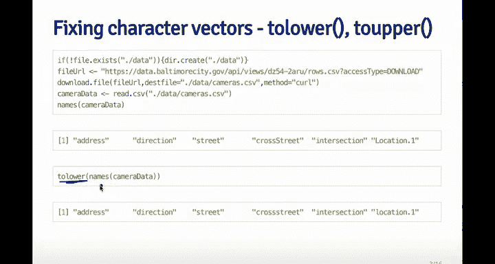

There's also a two upper command if you need that in order to make the letters all uppercase。

Another thing that you might want to do is separate out variables that have。

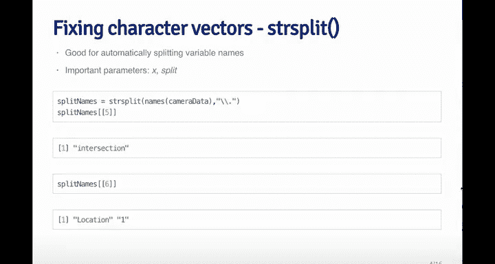

Values that are separated by periods， so if we go back to this page you can see for example that this location variable here it's separated with a dot and that often happens when you have variable names loaded into R from files。

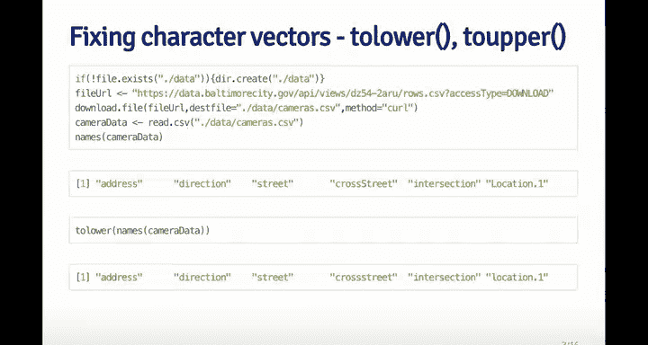

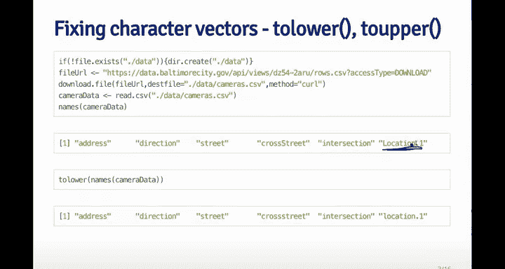

So what we can use is something called the string split command so it's SRS PI and so then we can pass it the names of our data and we can tell it to split on periods So here I have to use this escape character because the period is a reserve character and so what I get if I look at this data or that comes out split names which is just a list you can look at say the fifth element and that's the element corresponding to the intersection variable and you can see that nothing happened there is just one variable because there were no periods in that variable name but if you look at the sixth element of that list。

 you see that the location variable has now been split into two components。

 the location and the one and the dot has been removed So we've been able to split that variable out。

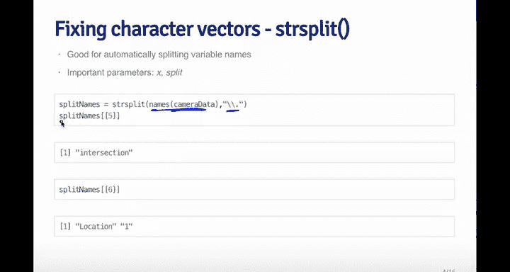

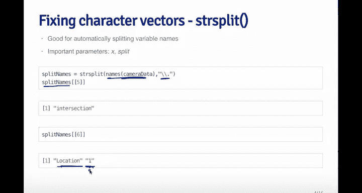

So one thing that you might want to be able to do then is go through and subset out and just take the part of the variable name that doesn't have the dot in it。

I want to give you a very quick aside on lists because the functions that we're going to talk about in a minute depend on that and we want to make sure that we remember how they work so here I'm creating a variable my list and I'm doing that by passing it letters numbers and a matrix and so if I look at the list I can see that it has these three different components to it including some named components。

So I can select out the first element of the list and it returns the letters。

 I can actually subset by the named variables， or I can actually subset out just the vector by just taking the first element of that list。

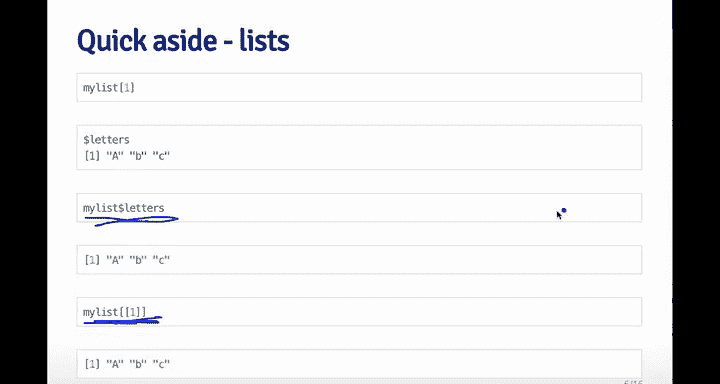

So one thing that I might want to be able to do is actually remove all the periods and then only get the first part of the variable name so you can see if I took the sixth element of this list。

 remember it had two parts to it， it had the location and then it also had the one that came after the dot so if I just take the first element of this list element。

 then I get just the location value。And so what I can do is I can write a function called first element and first element will just take the first value that comes out of that list and so I can use S apply to split name apply to the split names。

 which is a list， I can apply the first element function which will go through and to each element of that list。

 it will take the first element out in this case itll take out just the variable names and when you look at location。

 you'll see that it has removed the period from that location so that's one way that you can remove say periods from names in data frames。

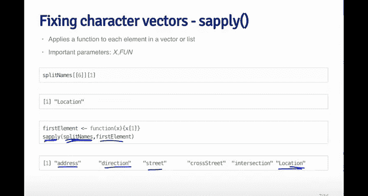

I'm going to go back to this peer view experiment data to show you some other ways that you can manipulate sort of text variables in order to get the answers that you need。

So again， I'm going to download the data from the internet and I'm going to store it into two data frames。

 one is the reviews data frame and one is the solutions data frame where reviews is the set of problems that have been reviewed by peers in this experiment and solutions is the set of the SAT questions that have been submitted by people so I can see the data set again looks like this and so a couple of things that I might want to be able to do is substitute out say characters so in this case I can see that a couple of the variable names are solution ID and reviewer ID and they have these underscores in them and so I might want to remove the underscores from those variables also from this variable time left over here and so one thing that I can do is I can use the subcommand I can say every time that you find an underscore。

 replace it with nothing in the names of reviews and what you end up with these variable names where all of the underscore。

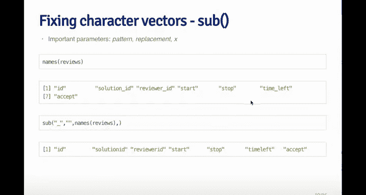

This had been removed。I can also use G subub to replace multiple instances of a particular character So for example。

 suppose I have a variable name that has multiple underscores in it。

 if I use sub it will just replace the first underscore so if I say substitute underscore with nothing in test name it will find the first underscore replace it but leave the next two underscores alone if I use G subub on the other hand it will replace all of the underscores so you just get one variable like this you can use that to replace underscores and variable names so that you have nice clean variable names or you can also have this happen in actual the text values that you have in your data the next ten I'm going to cover is searching for specific values and variable names or in variables themselves So here I'm going to go back to the camera data。

 the fixed camera data and I'm going to look at the intersection variable so one thing that I might want to be able to do is find all of the intersections that include the alameda is one of the roads so what I'm going to do。

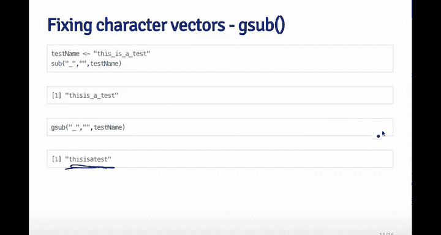

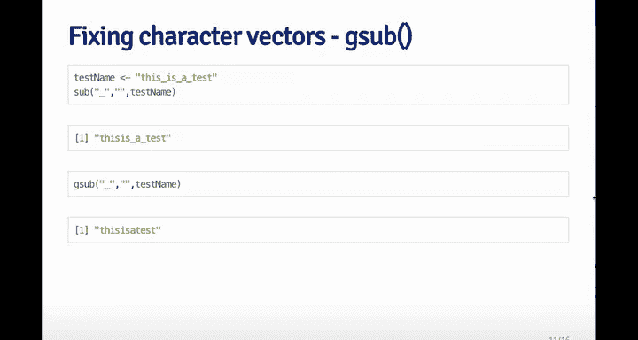

I'm going to use the Gr function， the GP will set take as input a search string that you want to look for。

 the alameda and it will look through this variable and find all of the instances in that vector where the alameda appears so it appears in the fourth。

 fifth and 36th element of the intersection variable。

The other thing that I can use is the Grepel command with an L at the end of the GP and so what that will do is it will look for this version the alameda。

 it will look for it in this intersection variable and it will return a vector that's true whenever alameda appears and false whenever alameda doesn't appear and so in this case you can see that in three of the times the alameda appears and so if I make a table of the true and false values it's true to three of the times。

So the other thing that you can do is you can sort of subset， so for example。

 suppose I want to find all the cases where alameda appears in the intersection。

 and then I want to say if alameda doesn't appear， then I want to subset to only that subset of the data。

 I can do that using this Gpl command so you can use that to subset your data based on certain searches that you want to be able to find。

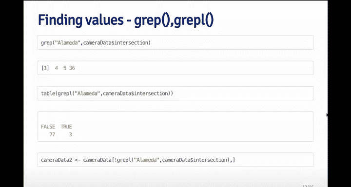

A little bit more about GrP， you can also use a value equal true as one of the parameters sent to GrEP and what that will do is instead of telling you which of the elements that alameda appears in。

 it will actually return the values where alameda appears So you can see these are the three intersections where the alameda appears in the camera data The other thing that you can do is you can look for values that don't appear。

 So say for example， Jeff Street does not appear in the intersection data and so it will return into Ge0 when that value does not appear。

 if you look at the length of that it actually turns out to be0 So that's a nice way to check so suppose you want to check and see if a particular value appears in a vector。

 you can look you can grep for that value and then look the length of the vector and if it's equal to0。

 then you can say that that value doesn't appear。

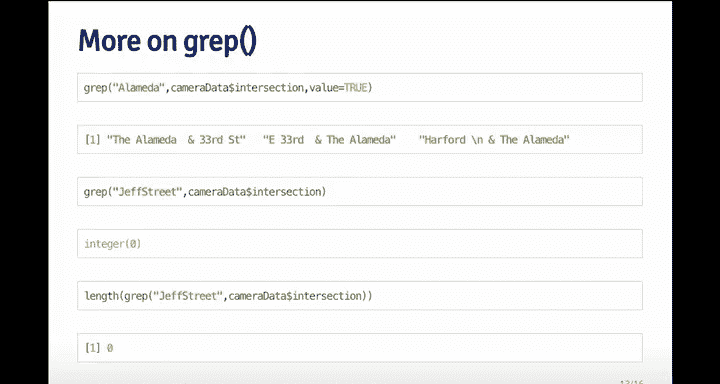

A couple of other useful string functions appear both in the stringer package and in the base package。

 so the NCHAR will tell you the number of characters that appear in a particular string so there are 12 characters in my name here The other thing that you can do is you can take out part of the string so in this case I want to take this string and I want to find the first through the seventh letters in that case that's just my first name。

Another thing that you can do is you can paste two strings together。

 so suppose I have these two strings and I apply the paste function to them。

 I get one string that's separated by a space。You can actually set the separation with the set argument as EP。

A very useful version when you're doing data analysis is often you just want to paste things together with no space in between and the way that you do that there's actually a separate function called paste zero with pasts things together without any space in between。

In the stringer package， there's a very nice function called string trim and what it'll do is it'll trim off any excess space that appears at the end of a string so you get a nice string without excess space at the beginning or the end。

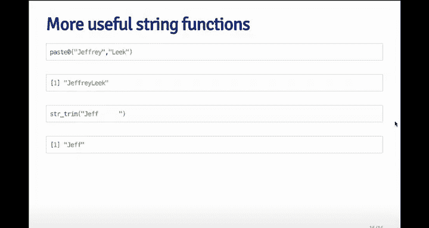

So a couple of important points about text and data sets。

 whenever possible you'd like to have all lowercase because missing caps can lead to very difficult to find bugs in data analysis。

 you'd like them to be descriptive， so in other words you'd like it to say diagnosis as opposed to DX。

You'd like the variable names not to be duplicated and not to have underscores or dots or white spaces。

 which we showed you how to remove。Varis with charactericcho values should usually be made into factor variables as we've talked about creating factor variables。

 although this depends a little bit on the application， they should also be descriptive。

 so for example， you want to if you have a true and false variable。

 they should be labeled as true and false instead of0 and 1 or 1 and0 and male and female should be labeled as such as opposed to M versus F and0 versus1。

 it just makes it easier to see what's going on in the data。

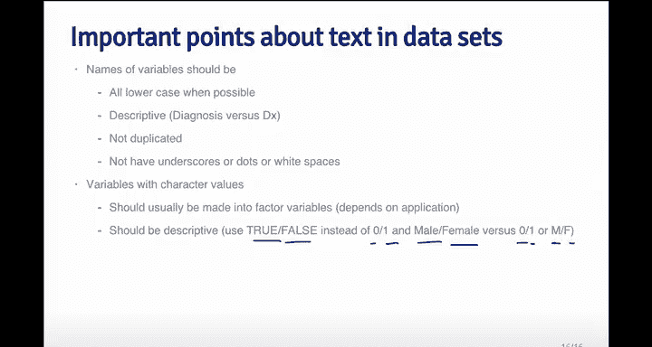