# 约翰霍普金斯大学《数据科学R语言基础｜Data Science： Foundations using R》中英字幕（deepseek - P97：23_正则表达式II.zh_en - GPT中英字幕课程资源 - BV1tsFQemEts

This is a continuation of our lecture， on regular expressions。

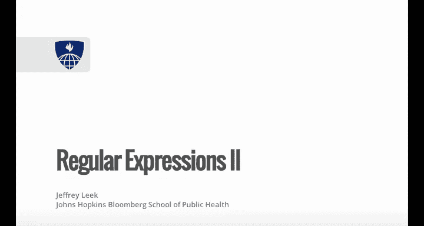

So we're going to continue talking about metacharacters。

 which we can think of as the grammar where the literals are actually the words in the language that we're going to be talking about。

So another meta characteract is actually just the dot。

 and so the dot means it could be any character。 So if you search for the term9 dot 11。

What that's going to look for is any place where it seasons 9， followed by any possible character。

 followed by an 11。So it matches all of these phrases because there's a nine and an 11 separated by exactly one character in all of these different examples。

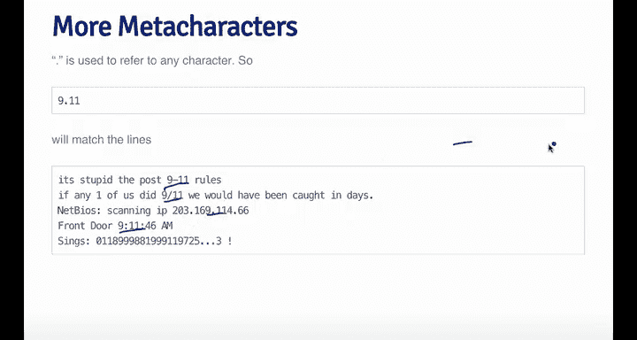

Another metacharacter is the or metacharact。 And so what it can do be used is combine two different expressions。

 The sub expressions are called alternatives。 So here it's combining the expression flood and the expression fire and they are the two alternatives。

 So it will match all of these lines because there's either fire or flood in every single line that we see here。

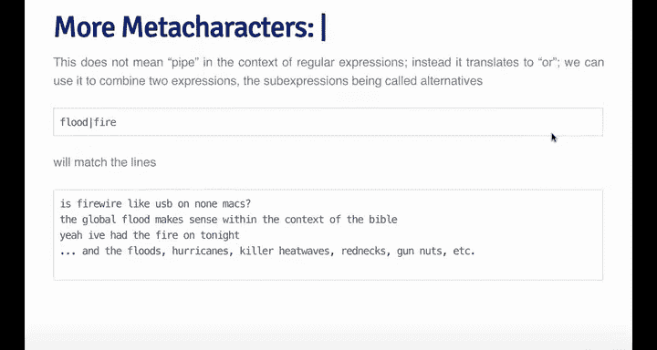

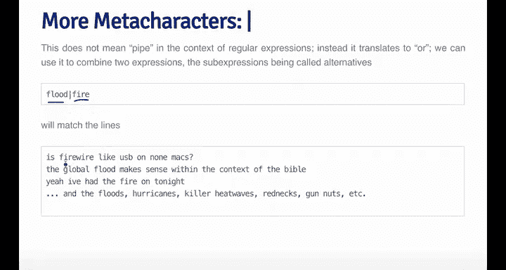

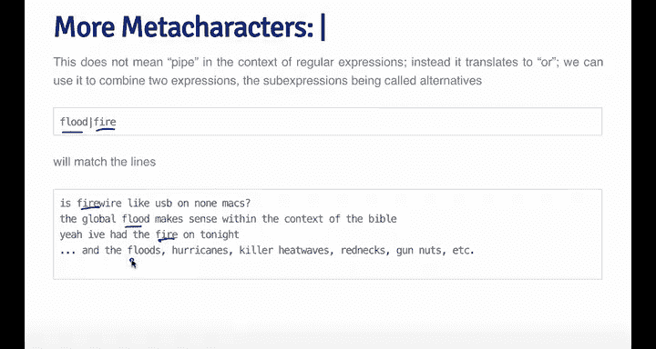

You can include up to any number of alternatives that you'd like。 so here it can match flood。

 earthquake， hurricane or cold fire。 So all of these different lines get matched。

 even though it's a different character that it's or a different literal that's identifying in every single one。

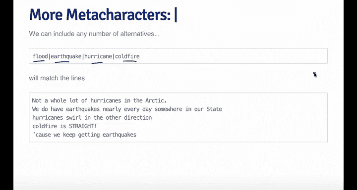

The alternatives can also be expressions， regular expressions and not just literals。 So， for example。

 what we're searching for here is the beginning of the line and then either a capital or lowercase good or anywhere in the line。

 a bad。 So， for example， here you see good at the beginning of the line。

And here you see bad and it doesn't have to necessarily be at the beginning of the line。

 because the alternative here doesn't have a carrot at the beginning。

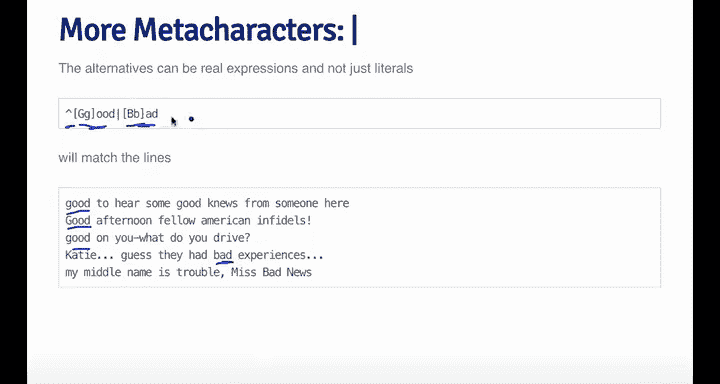

An alternative is to include parentheses to make sure to constrain the alternatives。

 so here we're looking at the beginning of the line and you have to have either good or bad lowercase or uppercase at the beginning of the line。

 but in this case we've now constrained， even if we're looking for bad it has to find it at the beginning of the line。

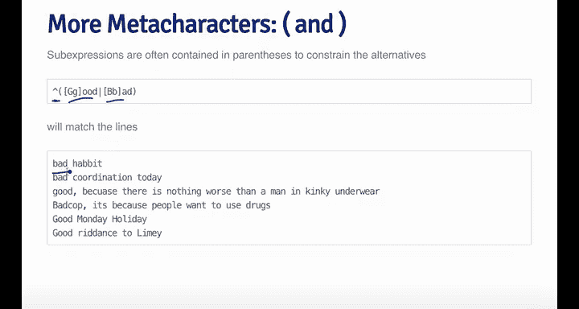

If you have a question mark that follows a parentheses like this。

 it suggests that the indicated expression is optional。

 so here we have a lowercase or capital W and then we have a period and it's an optional in this particular phrase so we're looking for George Bush with potentially the W in the middle but it'll match this line because it doesn't necessarily have to have the W in the middle to be able to find it。

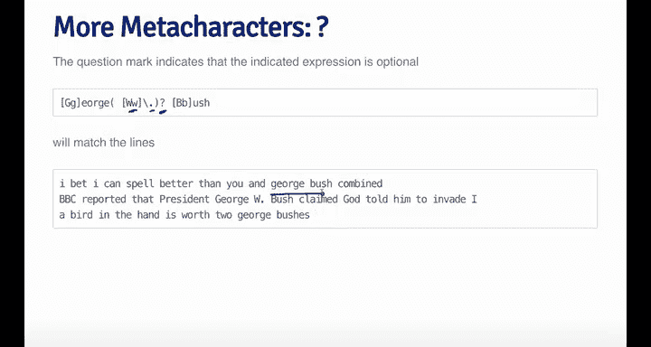

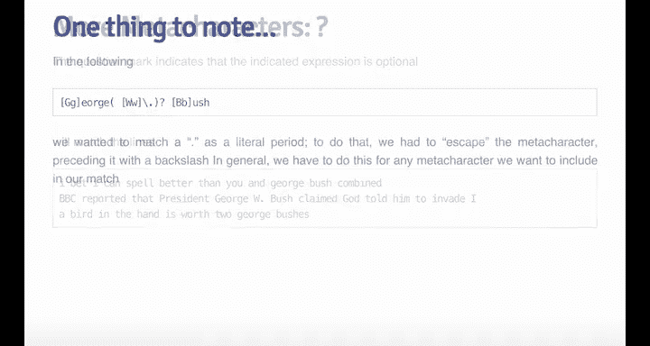

Something to note is that here we actually had to escape the character dot and that's because dot it can be viewed as a metacharact and so by adding this backslash what we've done is said。

 don't consider this to be a meta characteract， consider it to be the literal dot。

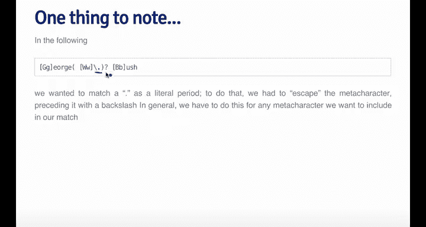

So more metacharacters are star and the plus signs， so star means repeat any number of times。

 including none of the item and plus means at least one of the item。

 so here we are searching for something between parentheses and it can be any character repeated any number of times。

 so that will match everything from something like this where you have a phrase in between the parentheses to something like this where you just have parentheses with absolutely nothing in between because the star can include including no repetition at all。

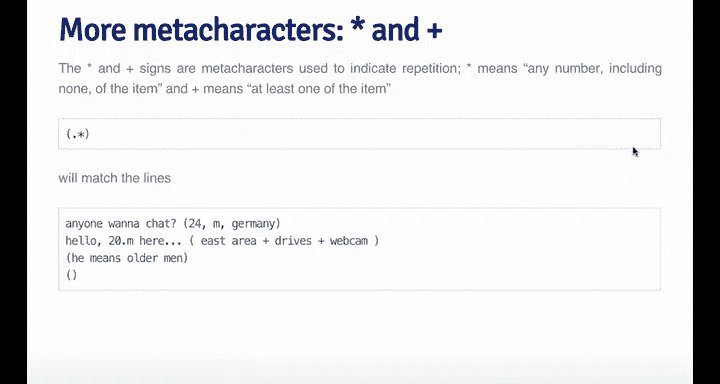

Remember the plus sign includes at least one of the item， so for example。

 here we're looking for at least one number followed by any number of characters followed by at least one number again so here we see one number followed by some large number of characters followed by another number again。

 we see this again here and so this allows us to look for any possible combination of numbers that are separated by something other than numbers we can use the curly brackets as interval qualifiers to let us specify both the minimum and the maximum number of times to match an expression。

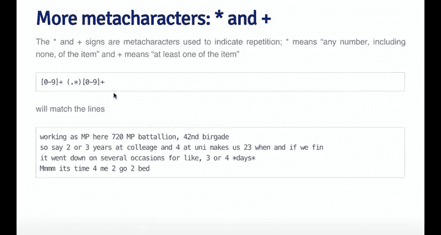

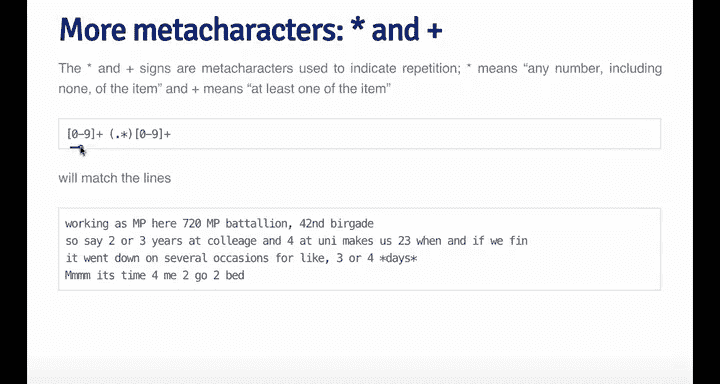

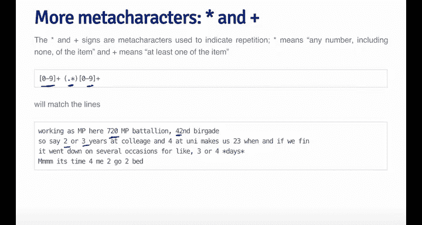

So here what we're looking for is Bush， either capital or lowercase， and at the end， debate。

 and in between what we're looking for is at least one space。

Followed by something that's not a space， followed by at least one space。

 And we want to see that between one and five times。 In other words。

 we want to see something like space word， space up between one and five times。

 So that will match all of these， because in this case。

 there are five words that occur between Bush and debates In this case。

 there are three words that occur between Bush and debates and so forth。

 So as long as there is between one and five word like objects between the two we'll discover it with this regular expression。

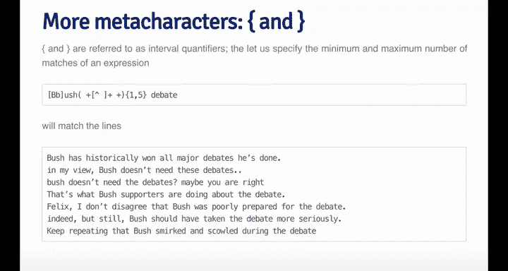

If you use M comma and within the curly bracket， that means at least M times but not more than n matches。

 If you only use one number M， it means exactly that many matches。 If you use M comma。

 that means at least M matches to that。

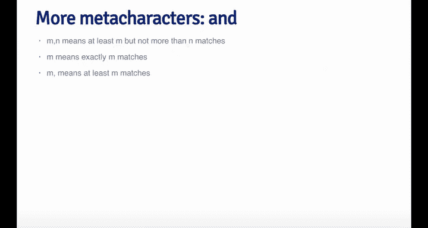

Regular expression。In most implementations of regular expressions。

 the parentheses not only limit the scope of the alternatives provided by this or。

 but they can also be used to remember the text matched by the subexpression。

We refer to the match text with escaped numbers like escape one， escape two， and so forth。

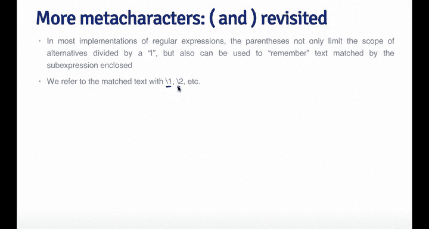

So for example， here， what we're looking for is a space followed by some at least one but possibly more characters。

 followed by at least one space followed by the exact same match that we saw within the parentheses。

So for example， here we see night space， night， which will match this part plus a space and then a replication of the exact same phrase。

 so that'll happen again with blah， blah， blah， or so so itchy and so forth。

 so that's looking for repetition of a particular phrase。

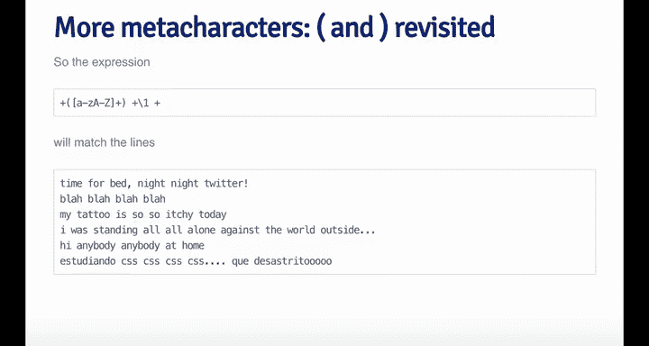

The star is greedy， so it always matches the longest possible string that satisfies a regular expression so in this case we're starting at the beginning of a string。

 and we're looking for an S followed by some possibly large number of characters followed by another S。

 and so it's going to match the entire phrase here because it goes for the longest possible string that satisfies the expression。

 and that's true for all of these phrases because they all start with an S and end with an S。

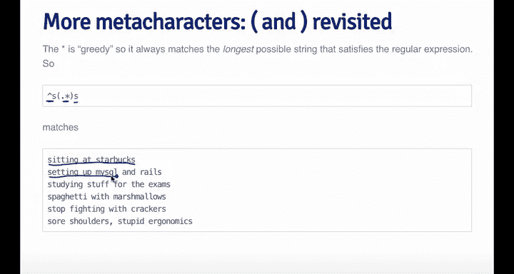

If we want to make it less greedy then what we can do is we can actually use this question mark to change the greediness of the star。

 so now we start with the S， now we follow up with some smaller number of characters it's not going to try to find the maximum length of the string followed by something with an s at the end of the string。

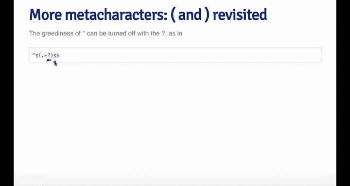

So in summary， regular expressions are used in many different languages， not just in R。

 they're composed of literals， that's the actual text that you're looking for and metacharacters which allows us to look at alternatives or look at specific places in the line or look at places where there are spaces。

And find classes of characters ors。Text processing via your regular expression is particularly powerful when you're dealing with sort of unfriendly sources。

 so sources where the data maybe you're in free text format or in a structured data format where you're trying to just get access to a particular phrase。

They're typically used with the functions Gapp old sub and G subub like we've talked about when we're searching for strings or trying to do some kind of text processing to either the variable names or to the variables themselves。

I'd like to thank Mark Hansen for some of the lecture material in this lecture。

 for Roger Pang for putting it together。

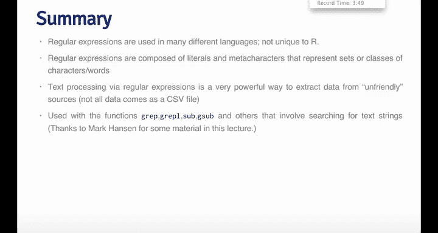