# 约翰霍普金斯大学《数据科学R语言基础｜Data Science： Foundations using R》中英字幕（deepseek - P98：24_处理日期.zh_en - GPT中英字幕课程资源 - BV1tsFQemEts

This lecture is about working with dates， dates can be sometimes a little bit tricky to work with this data because they have all sorts of quirks like starting over after the end of a week or starting over after the end of the month and so forth。

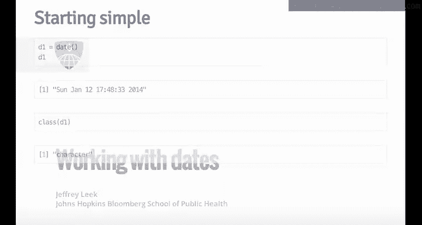

So we're going to start really simple， we're going to look at the date function。

 so this is the date function right here and if you call it。

 you actually get the time that is happening right then。

 so this is the time that the slides were processed。

The class of this variable is actually just a character。

 so the date function just returns a character that gives you the date and time。

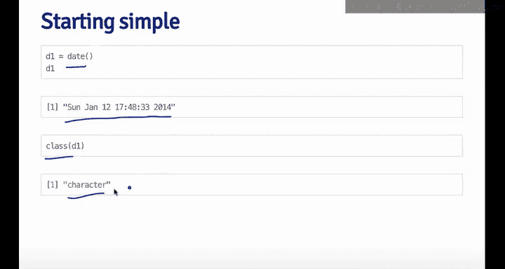

But in general it's not always so simple， so for example， if you use the SIS date function。

 you actually end up with something here that looks a little bit just like a date just like you saw before but maybe without the time and if you look at the class of this variable here。

 it's actually a date variable so it has some different properties that make it a little bit nicer in terms of analyzing date data but a little bit more difficult or tricky than dealing with just text files in some respects。

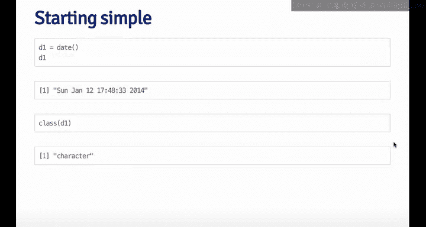

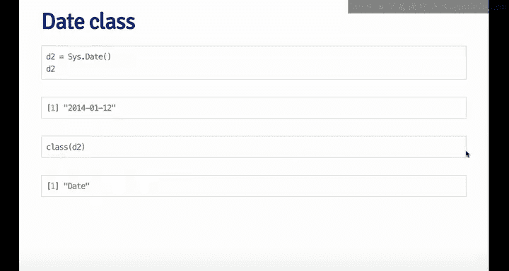

So the first thing that we might want to do is reformat that into a different format so for example we would use the format function and we would apply it to that date and then we would say we would like to see the abbreviation for the day。

 the abbreviation for the month and then the actual date that you've seen and so that gives you Sunday。

 January 12 just like this you can use different characters and within these quotes and so for example you can get the day as a number。

 you can get percent A is abbreviated weekday， capital percent A is unabbbreviated weekday。

 lowercase percent am is month zero to 12 and so forth so you can use all of this to get the dates into any format that is nice and visually appealing to you。

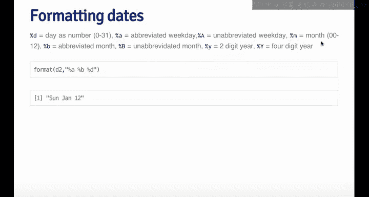

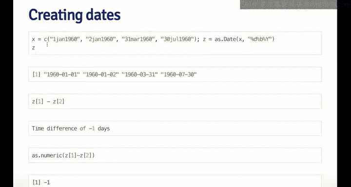

You can also take character vectors like this， so here's a character vector where I have a bunch of different dates and I can turn them into dates by telling the function as that date that you should be looking for a day。

 you should be looking for a month and then you should be looking for a year。

And so what that will then do is turn these into dates the nice thing about these is that then you can sort of manipulate them and figure out how far apart they are among other things。

 so for example， if I look at the difference in time between the first day and the second day。

 there's a time difference of negative one days so if I subtract off the second day from the first day and one day behind and so you can actually turn that into a numeric variables you can actually get the differences between dates in terms of the number of days apart that they are very easily using dates。

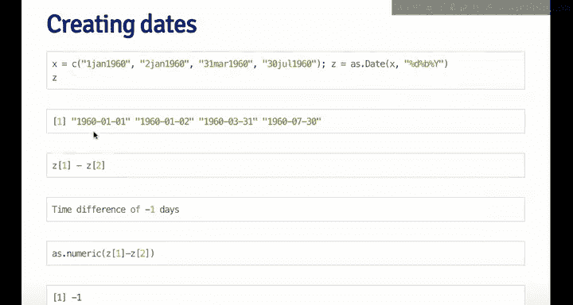

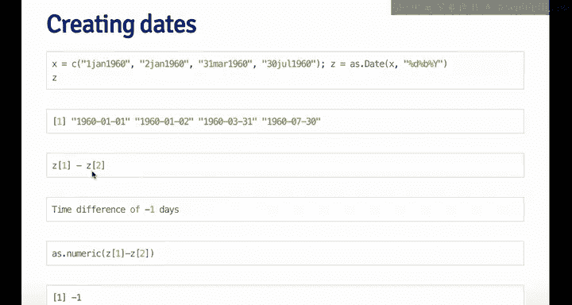

You can also convert them to Julian as well as to other different variables so for example。

 if you want to know what weekday it is， you can use the weekdays function and it'll tell you that this date happened on a Sunday you can find the months so that happens during January and you can turn it into a Julian date and so what that is is the number of days that have occurred since the origin and it'll tell you here what the origin is in this case the origin is the first of January 1970 so that's the number of days that have occurred since the origin date。

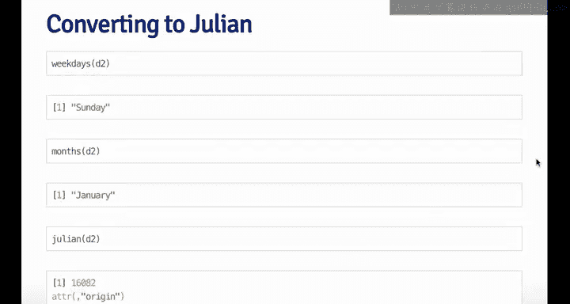

The luber date package is actually very nice and makes working with dates even simpler than it is with the Asdot date function among others。

 so if you load the luber date library， then what you can do is convert a number to date and you can do that regardless of what the format is so if you tell it YMD that means it's going to look for the year first followed by the month followed by the date in any sort of the standard format that you might imagine so in this case it's going to find 2014 then 01 then 08 and turn that into a date。

You can also tell it to look for the month first and then the day and the year with the MDY function。

 so that's month， day year and it'll turn it into a date as well。

 or you can tell it to look for day month year so that's going to find the day is three and the month is four and the year is 2013。

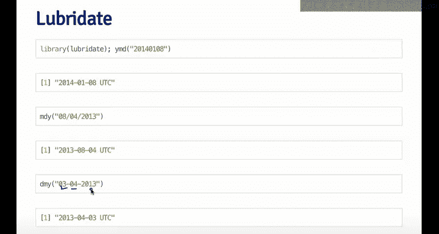

So it's very nice because you don't actually have to format the dates or the characters before you turn them into dates。

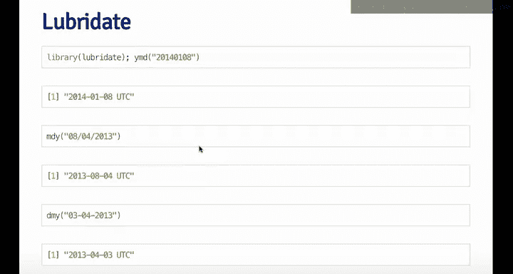

You can also do the same thing with time， so you're going to start with year month day and then you're going to have an underscore and then hours minute seconds will' turn this into a time。

 including hours and minutes and seconds。

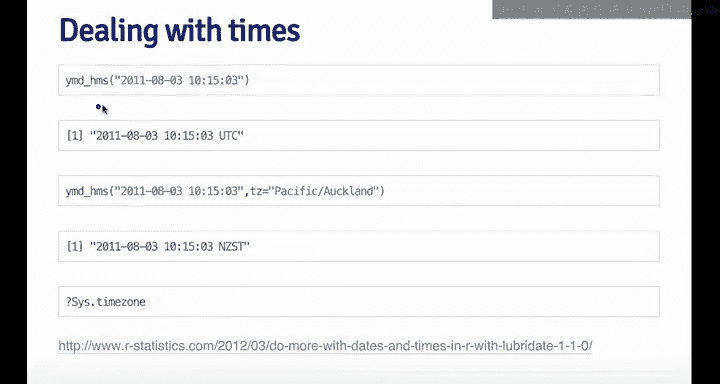

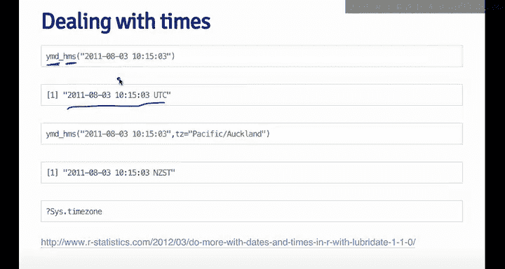

If this was in a different order， so if it started with seconds， then minutes and hours。

 you could make this YMD underscore seconds， minutes， hours， SMH。

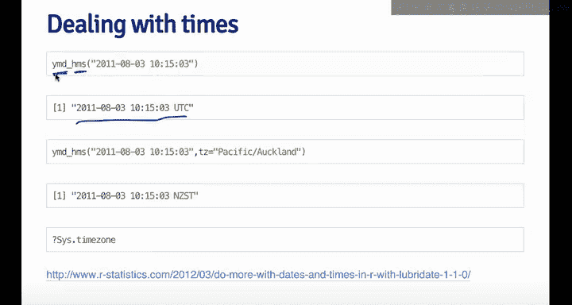

And so you can also set the time zone， so here's a date or a time that you would like to turn into a date object and you can do that by setting the time zone to be a specific time zone and I'm getting this from this tutorial that was on statistics。

com about luerdate。

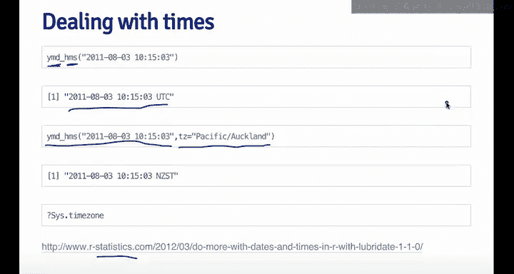

And so if you want to learn more about how to set time zones and what time zones are and R。

 you can look at question mark system time zone。

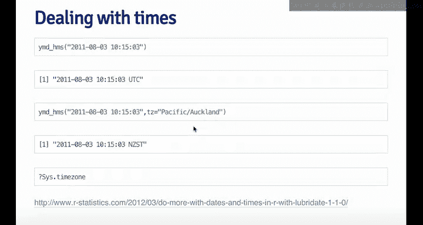

Some functions have slightly different syntax， so if you're using the base date manipulation functions。

 you use weekday， but if you are using the luber date package。

 you're going to use W day like this to get the weekday and this will give you sort of a number here。

 which is going to be three and then if you want to know the weekday in terms of the actual abbreviation。

 you're going to have to say label equals true， and then it'll tell you that it's Tuesday。

 the third day of the week according to the levels that have been defined for this variable。

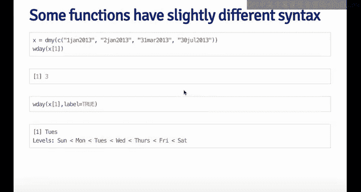

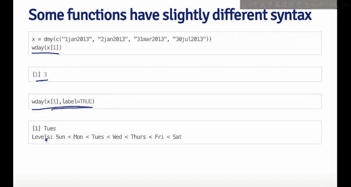

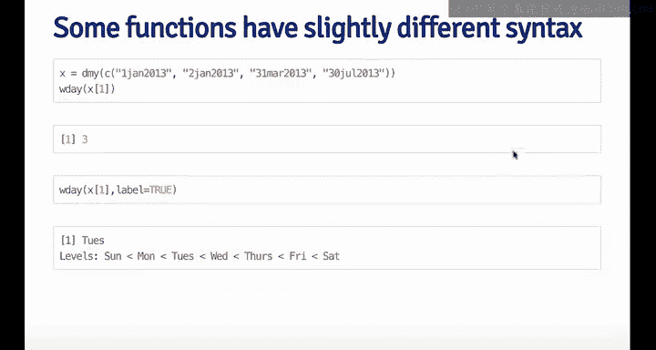

So a lot more information is available on this very nice luber date tutorial from which I borrowed some of the information for this。

 you can also find similar content in the Luber date package vignette and ultimately you want your dates to be of the class Posix CT or Pos LT and so for more information type question marks PossX LT and that'll give you a little bit more information about how to deal with dates this will become relevant later when we do some modeling in the prediction class that deal with dates as well。

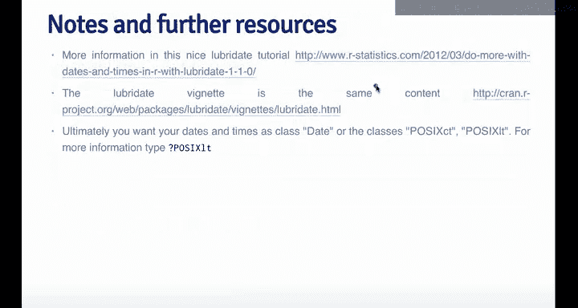

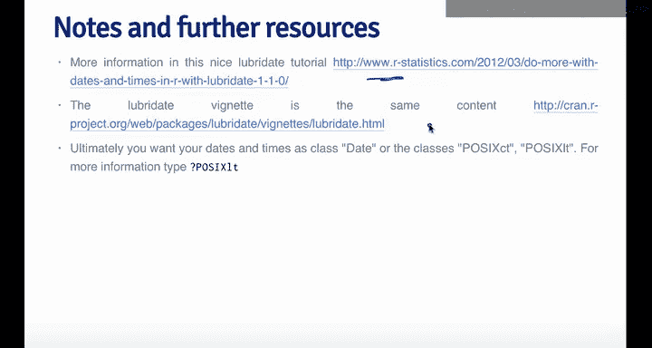

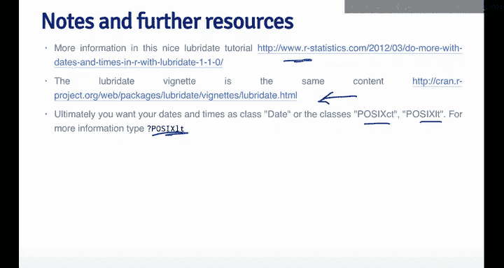