# 约翰霍普金斯大学《数据科学R语言基础｜Data Science： Foundations using R》中英字幕（deepseek - P9：8_R包.zh_en - GPT中英字幕课程资源 - BV1tsFQemEts

Now that we've installed R and R studio and have a basic understanding of how they work together。

 we can get at what makes R so special packages so far。

 anything we've played around within an R uses the base R system base R or everything included in R when you download it has rather basic functionality for statistics and plotting but it can sometimes be limiting to expand upon our's basic functionality。

 people have developed packages a package is a collection of functions。

 data and code conveniently provided in a nice complete format for you at the time of writing。

 there are just over 14，300 packages available to download each with their own specialized functions and code。

 all for some different purpose， a package is not to be confused with a library。

 these two terms are often conflated in colloquial speech about R a library is the place where the package is located on your computer to think of an analogy。

 a library is well a library and a package is a book within the library。

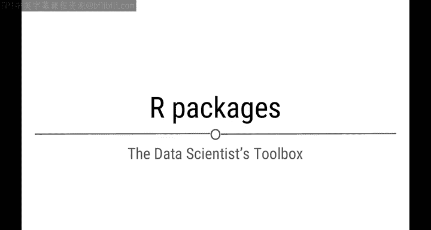

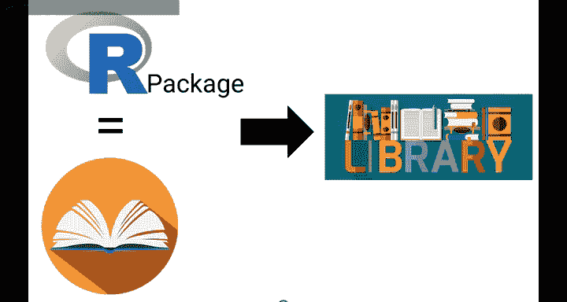

The library is where the book slash packages are located。

Packages are what make R so unique not only does base R have some great functionality but these packages greatly expand its functionality and perhaps most special of all each package is developed and published by the R community at large and deposited in repositories a repository is a central location where many developed packages are located and available for download there are three big repositories。

 they are the comprehensive R archive network or Crran。

 which is our's main repository with over 12100 packages available there is also the bioconductor repository which is mainly for bioinformatic focus packages and finally there is Github a very popular open source repository that is not our specific so you know where to find packages but there are so many of them how can you find a package that will do what you are trying to do in R there are a few different avenues for exploring packages First Crran groups all of its packages by their functionality s topic into 35。

It calls this its task view This at least allows you to narrow the packages you can look through to a topic relevant to your interests Second。

 there is a great website， our documentation which is a search engine for packages and functions from Crran bioconor and Github that is the big three repositories If you have a task in mind this is a great way to search for specific packages to help you accomplish that task it also has a task view like Crran that allows you to browse themes more often。

 if you have a specific task in mind Googling that task followed by our package is a great place to start from there。

 looking at tutorials， vignettes and forms for people already doing what you want to do is a great way to find relevant packages。

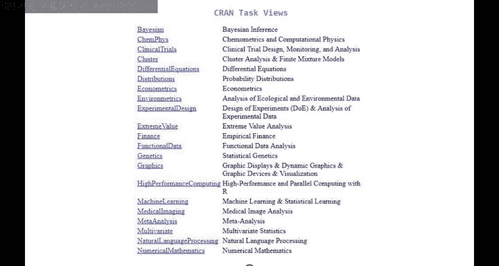

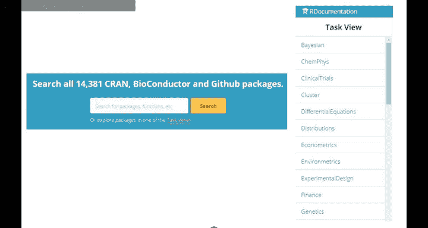

Great， you've found a package you want how do you install it If you are installing from the Crran Reository use the install packages function with the name of the package you want to install in quotes between the parentheses note you can use either single or double quotes For example。

 if you want to install the package Gpl2 you would use install packages open parenthesis Gpl2clo parenthesis try doing so in your R console this command downloads the GGpl2 package from Crranan and installs it on your computer If you want to install multiple packages at once you can do so by using a character vector with the names of the packages separated by commas as formatted here if you want to use our studio's graphical interface to install packages go to the tools menu and the first option should be install packages。

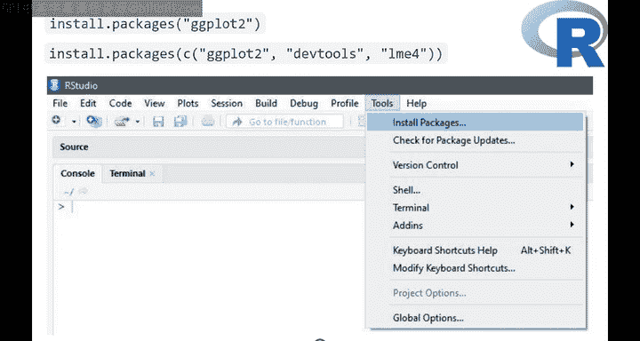

If installing from Crran， select it as the repository and type the desired packages in the appropriate box。

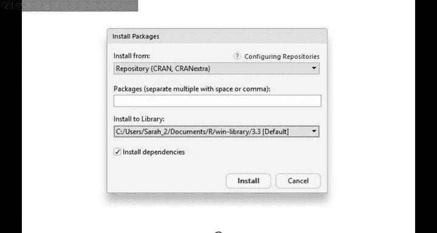

The bioconductor repository uses their own method to install packages First。

 to get the basic functions required to install through bioconductor use sourceTtps colon//Bconductor。

org/bieaL。 this makes the main install function of bioconductor bioL available to you Following this you call the package you want to install and quotes between the parentheses of the bioCL command as seen here for the genomic ranges package installing from Github is a more specific case that you probably won't run into two often In the event you want to do this。

 you first must find the package you want on Github and take note of both the package name and the author of the package The general workflow is installing the devtools package only if you don't already have devtools installed If you've been following along with this lesson you may have installed it when we were practicing installations using the R console then you load the devtools package using the library function。

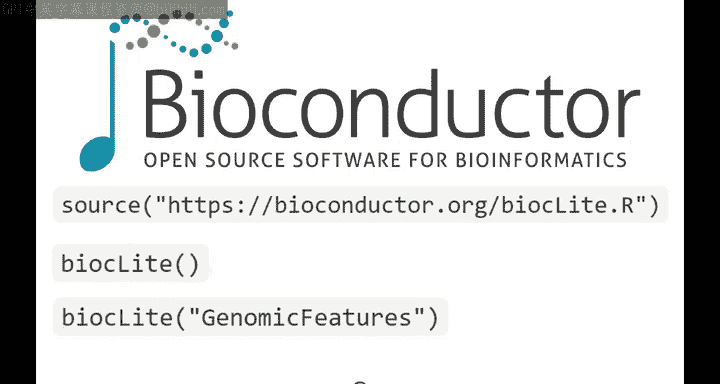

O more on what this command is doing in a few seconds and finally。

 using the command install underscore GiHub calling the author's GiHub username followed by the package name installing a package does not make its functions immediately available to you First you must load the package into R to do so。

 use the library function Think of this like any other software you install on your computer just because you've installed a program doesn't mean it's automatically running。

 you have to open the program Sam with R you've installed it。

 but now you have to open it For example to open the GGpl2 package。

 you would use the library function and call GGpl2 Note do not put the package name and quotes  Unlike when you are installing the packages。

 the library command does not accept package names and quotes  There is an order to loading packages some packages require other packages to be loaded first Aka dependencies that packages manual help pages will help you。

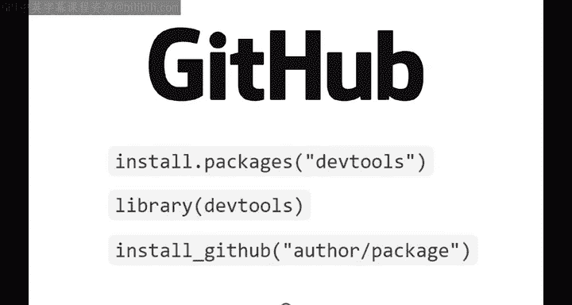

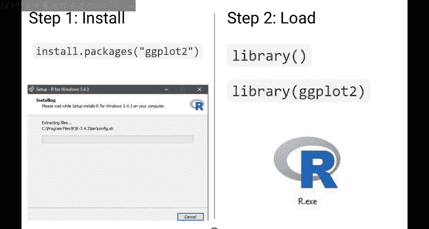

OutIn finding that order if they are pickgy。If you want to load a package using the Rt interface in the lowerright quadrant there is a tab called packages that lists at all of the packages in a brief description as well as the version number of all of the packages you have installed to load a package just click on the checkbox beside the package name once you've got a package there are a few things you might need to know how to do if you aren't sure if you've already installed a package or want to check with packages are installed。

 you can use either of the install packages or library commands with nothing between the parentheses to check in ourSt that package tab introduced earlier is another way to look at all of the packages you have installed you can check what packages need an update with a call to the function old packages This will identify all packages that have been updated since you installed them s last updated them to update all packages use update packages If you only want to update a specific package just use once again install packages within the Rt interface。

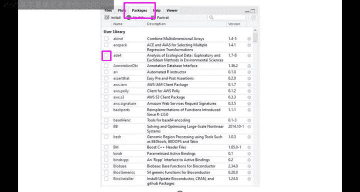

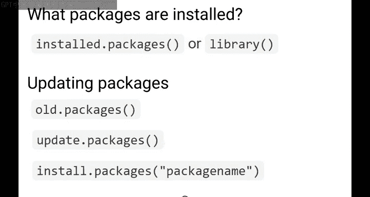

Still in that packages tab， you can click update which will list all of the packages that are not up to dateate It gives you the option to update all of your packages or allows you to select specific packages you will want to periodically check in on your packages and check if you've fallen out of date be careful though sometimes an update can change the functionality of certain functions so if you rerun some old code the command may be changed or perhaps even outright gone and you will need to update your code2 Sometimes you want to unload a package in the middle of a script The package you have loaded may not play nicely with another package you want to use to unload a given package you can use the detaach function For example。

 you would type detach package Gpl2 then unload equals through in the format shown This would unload the GGpl2 package that we load it earlier within the Rt interface in the packages tab you can simply unload the package by unchecking the box beside the package name if you no。

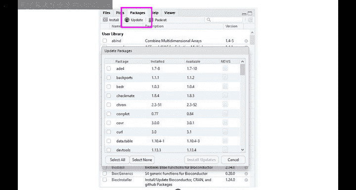

want to have a package installed。 you can simply uninstall it using the function remove dot packages For example。

 remove packages followed by GG plot2 Try that but then actually reinstall the GGpl2 package It's a super useful plotting package Within our studio in the packages tab clicking on the X at the end of a packages row will uninstall that package Sometimes when you are looking at a package that you might want to install you will see that it requires a certain version of R to run to know if you can use that package you need to know what version of R you are running One way to know your R version is to check when you first open R or R studio the first thing outputs in the console tells you what version of R is currently running If you didn't pay attention at the beginning。

 you can type version into the console and it will output information on the R version you are running Another helpful command is session info It will tell you what version of R you are running along with a listing of all of the packages you have loaded the output of this command is a great。

include when posting a question to forums， it tells potential helpers a lot of information about your OS R and the packages。

 plus their version numbers that you are using。In all of this information about packages。

 we have not actually discussed how to use a package's functions First。

 you need to know what functions are included within a package to do this。

 you can look at the Manor helpp pages included in all well-made packages in the console you can use the help function to access a packages help files try using the help function calling package equals GGpl2 and you will see all of the many functions that GGpl2 provides within the RSt interface you can access the help files through the packages tab again。

 clicking on any package name should open up the associated help files in the help tab found in that same quadrant beside the packages tab clicking on any one of these help pages will take you to that functions help page that tells you what that function is for and how to use it Once you know what function within a package you want to use you simply call it in the console like any other function we've been using throughout this lesson Once a package has been loaded it is as if it were a part of the baseR function。

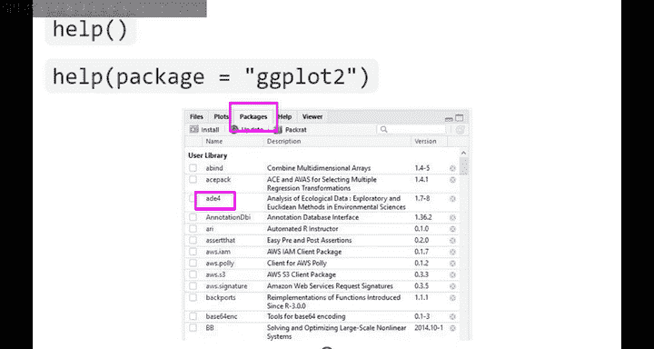

If you still have questions about what functions within a package are right for you or how to use them。

 many packages include vignettes These are extended help files that include an overview of the package in its functions。

 but often they go the extra mile and include detailed examples of how to use the functions in plain words that you can follow along with to see how to use the package to see the vignettes included in a package。

 you can use the browse vignettes function For example。

 let's look at the vignettes included in GG plot2 using browse vignettes followed by GG plot2 You should see that there are two included vignettes。

 Exing GG plot2 and aesthetic specifications Exp the aesthetic specifications vignette is a great example of how vignettes can be helpful。

 clear instructions on how to use the included functions。

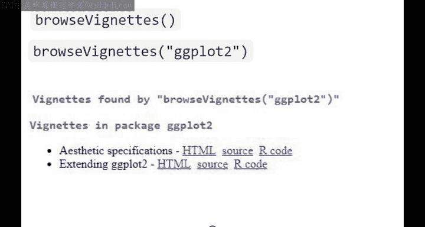

In this lesson， we've explored our packages in depth， we examined what a packages is。

 and how it differs from a library， what repositories are。

 and how to find a package relevant to your interests。

 we investigated all aspects of how packages work， how to install them。

 from the various repositories， how to load them， how to check which packages are installed。

 and how to update， uninstall and unload packages， we took a small detour and looked at how to check with version of R you have。

 which is often an important detail to know when installing packages。

 and finally we spent some time learning how to explore help files and vignettes。

 which often give you a good idea of how to use a package in all of its functions。

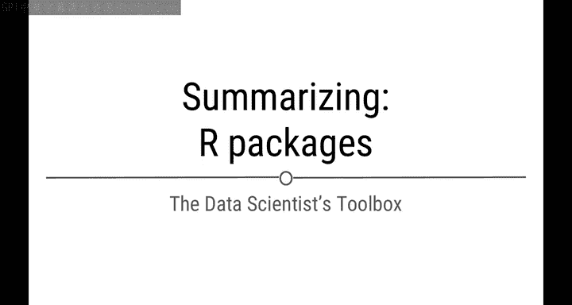