# 约翰霍普金斯大学《数据科学：统计和机器学习｜Data Science： Statistics and Machine Learning》中英字幕 - P102：21_提升法.zh_en - GPT中英字幕课程资源 - BV1jsAAeNE3k

This lecture is about boosting， which along with random forests。

 is one of the most accurate out of the box classifiers that you can use。

The basic idea here is to take a large number of possibly weak predictors。

 and we're going to take those possibly weak predictors and weight them in a way that takes advantage of their strengths and add them up。

When we weight them and add them up we're sort of doing the same kind of idea that we did with bagging for regression trees or that we did with random forests where we're taking a large number of classifiers and sort of averaging them and then by averaging them together we get a stronger predictor。

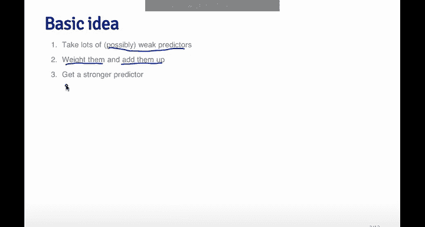

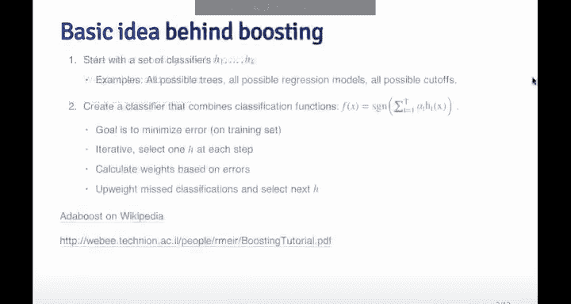

So the basic idea here is to take K classifiers， these come from usually from the same kind of class of classifiers。

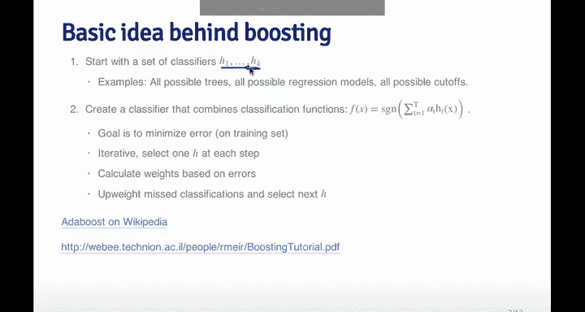

And so some ideas might be using all possible classification trees or all possible regression models or all possible cutoffs where you just divide the data into different points。

You then create a classifier that combines these classification functions together and weights them together。

 so Al subt here is a weight times the classifier Ht of x。

 and so this weighted set of classifiers gives you a prediction for the new point that's our f of x。

The goal here is to minimize error on the training set。

 and so this is iterative at each step we take exactly one H。

 we calculate weights for the next step based on the errors that we get from that original H。

 and then we up misclassifications and select the next H and move on。

The most famous boosting algorithm is probably add a boost and here you can read about it on Wikipedia。

 you can also read this very nice tutorial on boosting here that will also give us some of the material for the rest of these lecture notes。

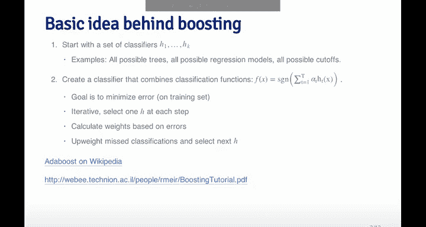

So here's a really simple example。 Suppose we're trying to separate the blue plus signs from the red minus signs。

 and we have two variables to predict with。 So here I plotted variable  one on the x axis and variable 2 on the y axis。

 We haven't named them because this is just a very simple example。

 And so the idea is can we build a classifier that separates these variables from each other。

 We could start off with a really simple classifier。

 we could say just draw a line a vertical line and say which vertical line separates these points well。

 here's a classifier that says anything to the left of this vertical line is a blue plus and anything to the right is a red minus。

 And so you can see we misclassify these three points up here in the top right。

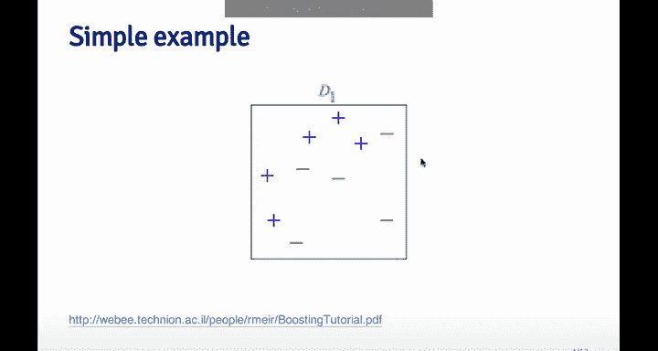

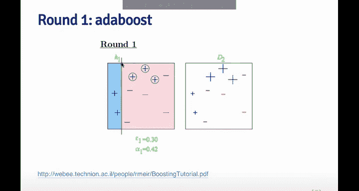

So the thing that we would do is build that classifier， calculate the error rate。

 in this case we're missing about 30% of the points。

 and then we would up those points that we missed here I've shown that up weighting by drawing them in a larger scale。

 so those pluses are now uped for building the next classifier。

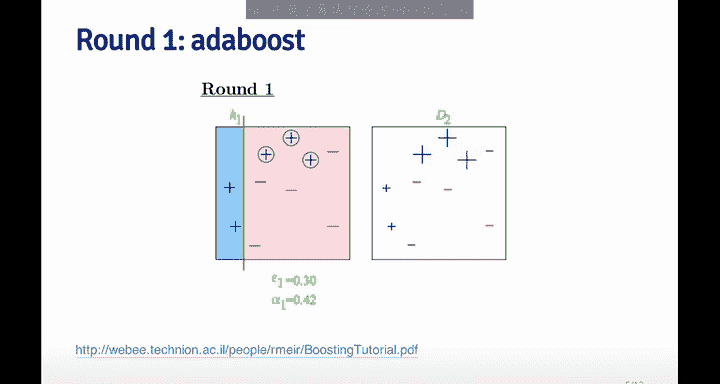

We would then build the next classifier and in this case。

Our second classifier would be one that drew a vertical line right over here。

 and so that vertical line would classify everything to the right of that line as a red minus and everything to the left as a blue plus and so here we again misclassify three points。

 these three right here and so those three points are now uped and are also drawn larger for the next iteration。

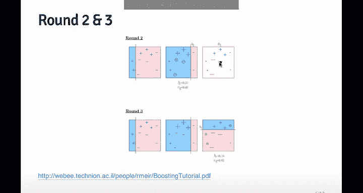

So we can again calculate the error rate and use that to calculate the weights for the next step。

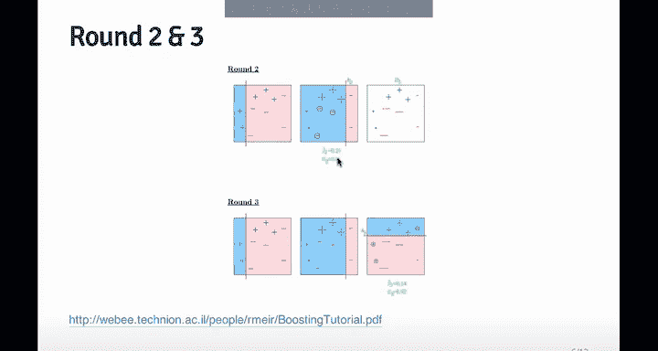

Then the third classifier will intentionally try to classify those points that we misclassified in the last couple of rounds。

 so for example these pluses and these minuses need to be correctly classified to do that we now draw a horizontal line and we say anything below that horizontal line is a red minus anything above is a blue plus then now we misclassify this point and these two points over here。

So then what we can do is we can take those classifiers and we can weight them and add them up and so what we do is we say we're going to classify a weighted combination of 0。

42 times the first vertical line plus 0。65 times the second vertical line plus 0。

92 times the classification given by this horizontal line so what that ends up doing is once you added these class rules up together you can see that our classifier works much better now we get to a much better classification when adding them up that gets all of the blue pluses and all of the red minuses together So in each case with each of our classifiers was quite simple。

 it was just a line across the plane and so it's actually quite a naive classifier but when you weight them and add them up you can get quite a strong classifier at the end of the day。

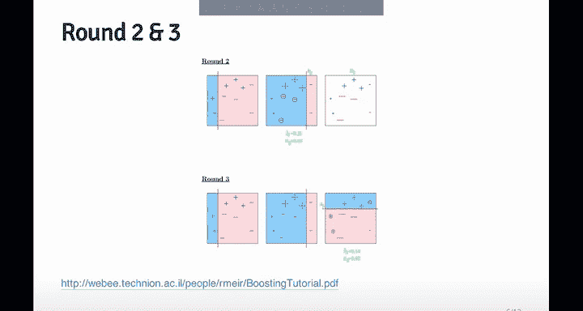

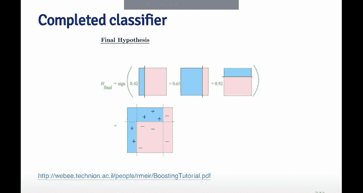

Boosting can be done with any subset of classifiers。

 in other words you can start with any sort of weak set of classifiers in the previous example where you just use straight lines to separate the plane。

A very large class is what's called gradient boosting and you can read more about that here R has multiple boosting libraries。

 so they basically depend on the different kind of classification functions and combination rules。

GBM package does boosting with trees。M boostt does model base boosting。

Added does additive logistic regression boosting。And Gamb boost does boosting for generalized additive models。

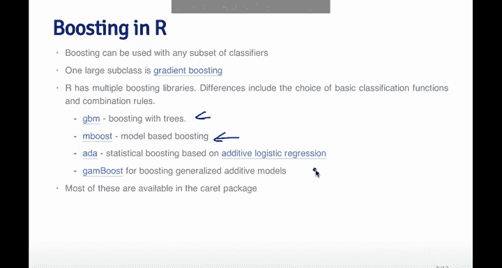

Most of these are available in the carrot package so you can use them directly by using the train function with Carrot。

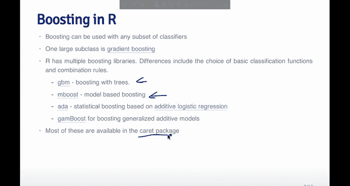

So here we're going to use the wage example to illustrate how you can apply a boosting algorithm。

 so here we're going to load the ISLR library and the wage data。

 the GGplloot2 library and the Carrot library。

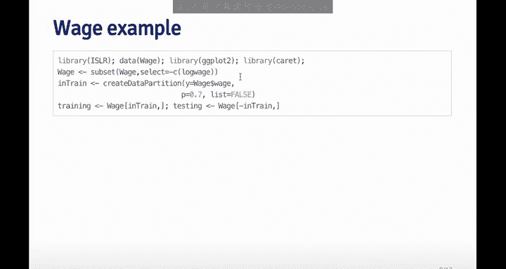

And then we're going to create a wage data set that removes the predictor that we care or the variable that we're trying to predict the log wage variable。

 and we create a training set and a testing set。

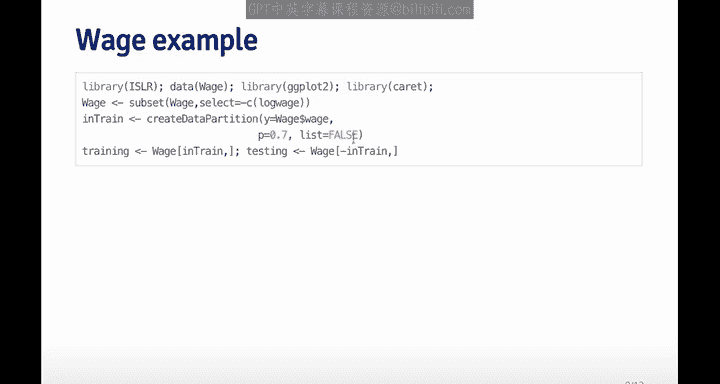

We can then model wage here， this wage variable as a function of all the remaining variables that's why there's this dot here and we can use GBM which does boosting with trees。

 and we use verbose equal to false here because this will produce a lot of output when you use method equals GBM if you don't say verbose equals false。

So when we print the model fit， you can see that there's a different numbers of trees that are used and different interaction depths and they're basically used together to build a boosted version of regression trees。

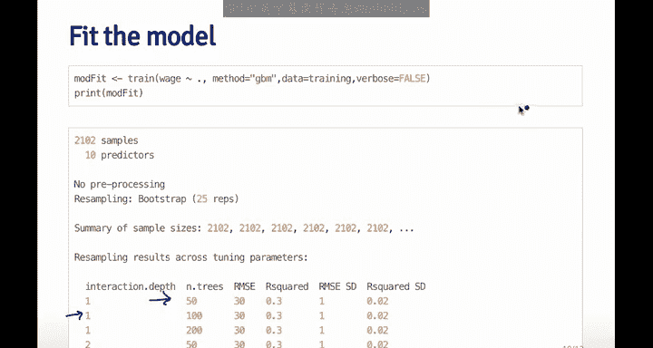

So here I'm plotting the predicted results from the testing set， so this is the using our model fit。

 we're predicting on the test set versus the wage variable in the test set。

 and you can see we get a reasonably good prediction although there still seems to be a lot of variability there。

 but the basic idea for fitting a boosting tree a boosted algorithm in general is to basically take these weak classifiers and average them together with weights in order to get a better classifier。

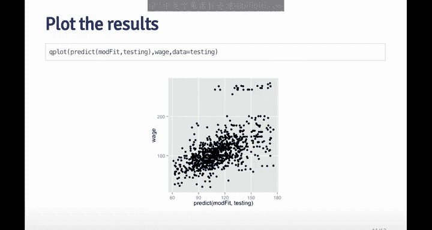

A lot of the information that I've given in this lecture can be found in this tutorial which also has even more in depth information if you are interested。

 here's a little bit more technical introduction to boosting from F Dunship area。

And then here are several more write ups about boosting and random forests。

 these are actually write ups from different prizes that have been won using a combination of random forests and boosting blended together in order to achieve maximal prediction accuracy。

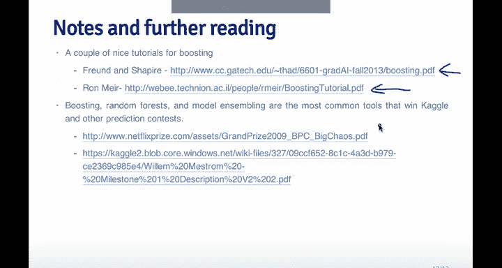