# 约翰霍普金斯大学《数据科学：统计和机器学习｜Data Science： Statistics and Machine Learning》中英字幕 - P104：23_正则化回归.zh_en - GPT中英字幕课程资源 - BV1jsAAeNE3k

This lecture is about regularized regression。 We learned about linear regression and generalized linear regression previously。

 but the basic idea here is to fit one of these regression models and then penalize or shrink the large coefficients corresponding to some of the predictor variables。

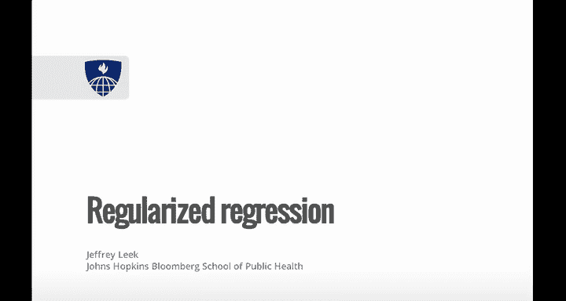

The reason why we might do this is because it might help with the bias variance trade off。

 If certain variables are highly correlated with each other。 for example。

 you might want one to include them both in the linear regression model as they will have a very high variance。

 which might slightly leaving one of them out might slightly bias your model。 In other words。

 you might lose a little bit of prediction capability。

 but you'll save a lot on the variance and therefore improve your prediction error。

 It can also help with model selection in certain cases for regularization techniques like the Laso。

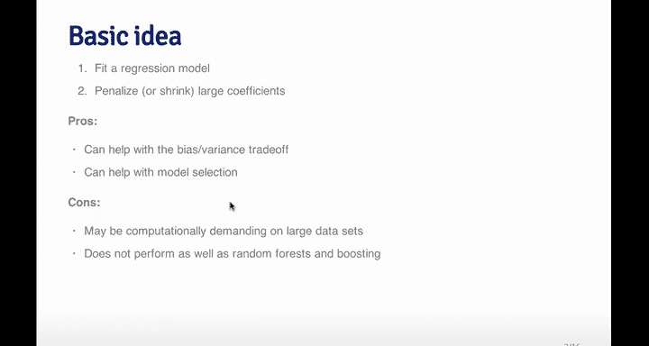

It may be computationally demanding on large data sets， and in general。

 it appears that it doesn't perform quite as well as random forests are boosting when applied to prediction in the wild。

 for example， in Cago competitions。

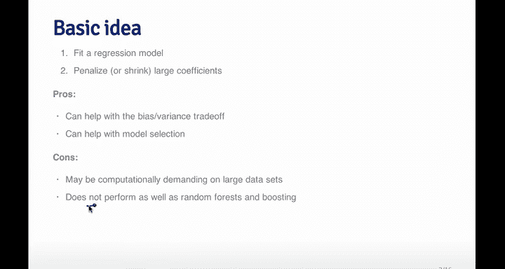

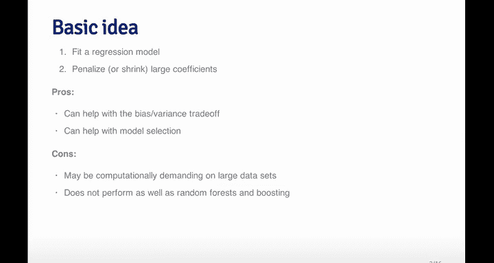

So as a motivating example， suppose we fit a very simple regression model so there's an outcome y and we're trying to predict it with two covariates x1 and x2。

 so we have an intercept terms so this is a constant plus another constant times x1 plus another constant times x2。

So assume that x1 and x2 are nearly perfectly correlated。

 in other words they're almost exactly the same variable。

The word for this when linear modeling is often called colinear。

You can then approximate this more complicated model by saying， well。

 what if we just include only x1 and multiply it by both the coefficients for x1 and x2？

It won't be exactly right because x1 and x2 aren't exactly the same variable。

 but it will be very close to right if x1 and x2 are very similar to each other。

The result may be that you still get a very good estimate of why the same almost as good as you would have gotten by including both predictors in the model。

And it will be a little bit biased because we chose to leave one of the predictors out。

 but we may reduce the variance if those two variables are highly correlated with each other。

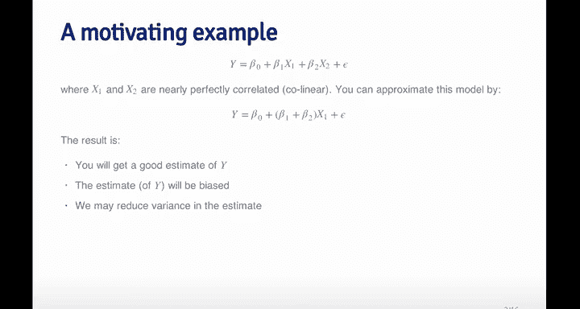

So here's an example with prostate cancer data in the elements of statistical learning library。

 we can load the prostate data and look at that data it has 97 observations on 10 variables and so one thing that we might want to be able to do is make a prediction about prostate cancer。

 PSA based on a large number of predictors in the data and so this is a very typical what happens when you build these models in practice。

 so suppose we predict with all possible combinations of predictor variables。

 we build a linear regression model for the outcome where we build one regression model for every possible combination of predictors。

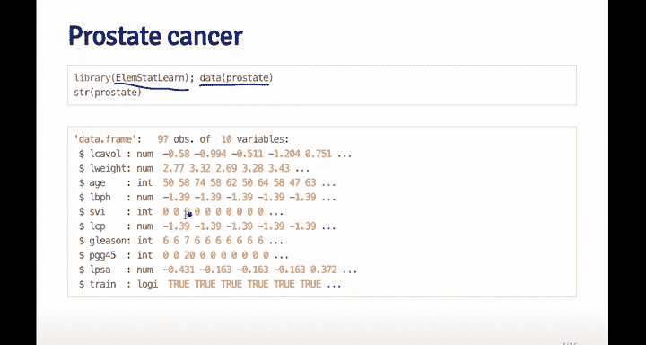

Then we can see as the number of predictors increases from left to right here。

 the training set error always goes down it has to go down as you include more predictors。

 the training set error will always decrease。

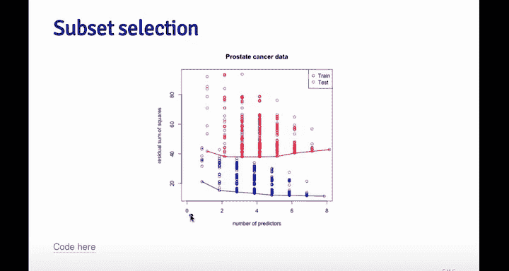

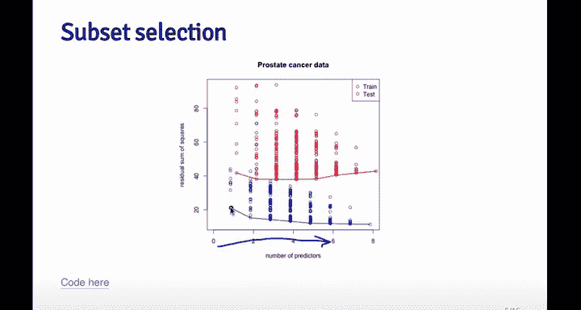

But this is the typical pattern of what you observe in real data that the test set data。

 on the other hand， that as the number of predictors increases， the test set error goes down。

 which is good， but then eventually it hits a plateau and it starts to go back up again。

 This is because we're overfitting the data in the training set eventually and we might not want to include so many predictors in our model。

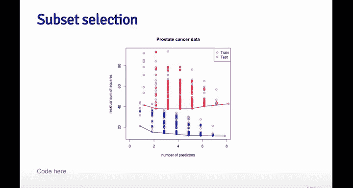

This is an incredibly common pattern， basically any measure of model complexity on the X axis versus the expected residual sum of squares or the predicted error。

 you can see that in the training set almost always the error goes monotonically down。

 in other words as you build more and more complicated models。

 the training error will always decrease， but on a testing set， the error will decrease for a while。

 eventually hit a minimum and then start to increase again as the model gets too complex and overfits the data。

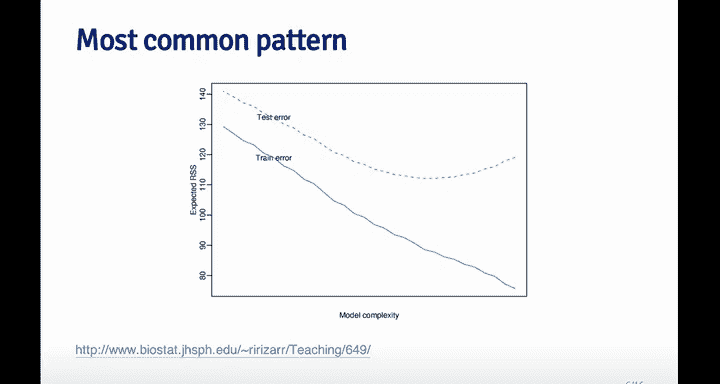

So in general， the best approach might be when you have enough data and you have enough computation time to split samples。

 so the idea is divide your data into training test and validation sets。

You treat the validation set as the test data， and you train every possible competing model。

 so all possible subsets on the training data and pick best the one that works best on the validation data set。

But now that we've used the validation set for training。

 we need to assess the error rate on a completely independent set。

 so we appropriately assess this performance by applying our prediction to the new data in the test set。

Sometimes you may reperform this splitting and analysis several times in order to get a better average estimate of what the out of sample error rate will be。

 but there are two common problems with this approach。

 one is that there might be limited data here we're breaking the data set up into three different data sets。

 it might not be possible to get a very good model fit when we've split the data that finally。

 second is computational complexity if you're trying all possible subsets of models that can be very complicated。

 especially if you have a lot of predictiveor variables。

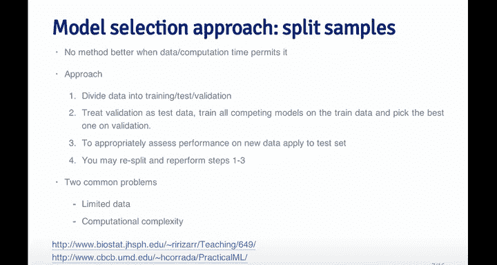

So another approach is to try to decompose the prediction error and see if there's another way that we can more directly get at。

 including only the variables that need to be included in the model so if we assume that the variable y can be predicted as a function of x plus some error term。

 then the expected prediction error is the expected difference between the outcome and the prediction of the outcome squared。

 and so F hat Lada here is the estimate from the training set using a particular set of tuning parameters lambmbda。

Then if we look at a new point， so we bring in a new data point and we look at the distance between our observed outcome and the prediction on the new data point。

 that can be decomposed after some algebra into irreducible error， the sigma squared， the bias。

 so this is the difference between our expected prediction and the truth。

And the variance of our estimate。So the question whenever you're building a prediction model。

 the goal is to reduce this overall quantity， so this is basically the expected mean squared error between our outcome and our prediction。

 and so the irreducible error can't usually be reduced it's a value that's just part of the data that you're collecting but you can trade off bias and variance and that's what the idea behind regularizer or aggression does。

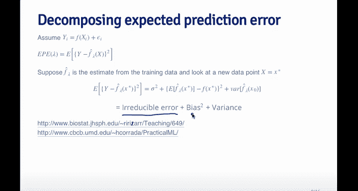

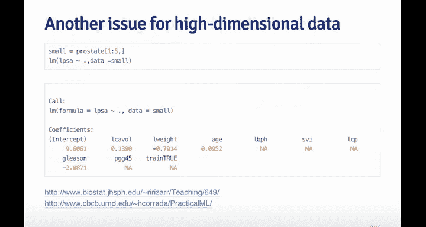

So another issue for high dimensional data is so suppose I'm just showing you a simple example of what happens when you have a lot of predictors。

 so here I'm subsetting just a small subset of the prostate data so imagine that I only had five observations in my training set。

It has more than five predictor variables， so I fit a linear model relating the outcome to all of these predictor variables and there are more than five。

 Then some of them will get estimates， but some of them will be NA。 In other words。

 R won't be able to estimate them because you have more predictors than you have samples。

 and so you have。Design matrix that cannot be inverted。

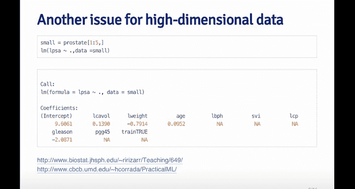

So here we have one approach to dealing with this problem is we can and the other problem of trying to select our model is we could take this model that we have and assume that it has a linear form like this so assume that it's a linear regression model like we've talked about before and then constrain only lambda of the coefficients to be non-zero and then the question is after we pick lambda。

 so suppose we say there are only three non-zero coefficients。

 then we have to try all the possible combinations of three coefficients that are non-zero and then fit the best model。

 so that's still computationally quite demanding。

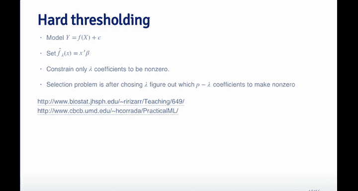

So another approach is to use regularized regression so if the beta J。

 so if our coefficients that we're fitting in the linear model are unconstrained， in other words。

 we don't claim that they have to have any particular form。

 they may explode if you have very highly correlated variables that you're using for prediction。

 and so they can be susceptible to high variance and the high variance means that you'll get predictions that aren't as accurate。

So to control the variance we might regularize or shrink the coefficient。

 so remember that what we might want to minimize is some kind of distance between our outcome that we have and our linear model。

 so here this is a distance between the outcome and the linear model fit squared。

 that's the residual sum of squares and then you might also add a penalty term here that says the penalty will basically say if the beta coefficients are too big it'll shrink them back down。

So the penalty is usually used to reduce complexity， it can be used to reduce variance。

 and it can respect some of the structure and the problem if you set the penalty up in the right way。

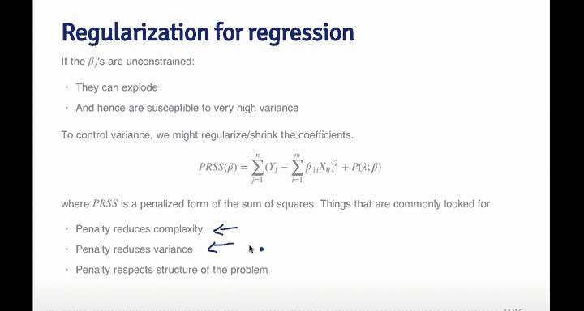

The first approach that was used in this sort of penalized regression is to fit the regression model here again we're penalizing a distance between our outcome y and our regression model here and then we also have a term here that is lambda times the sum of the beta j squares so what does this mean if the beta j squares are really big then this term will get too big and so we'll get we won't get a very good fit this whole quantity will end up being very big so it basically requires that some of the beta js be small。

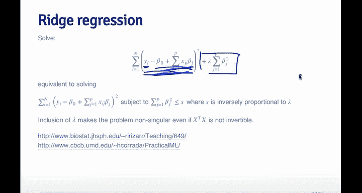

It's actually the equivalent to solving this problem where we're looking for the smallest sum of squared here and squ square differences here。

 subject to a particular constraint， a constraint that the sum of squared beta js is less than s。

So the idea here is that inclusion of this lambda coefficient may also even make the problem non-sing。

 even when the x transpose x is not invertible， in other words。

 in that model fit where we have more predictors than we do observations。

 the Rige regression model can still be fit。

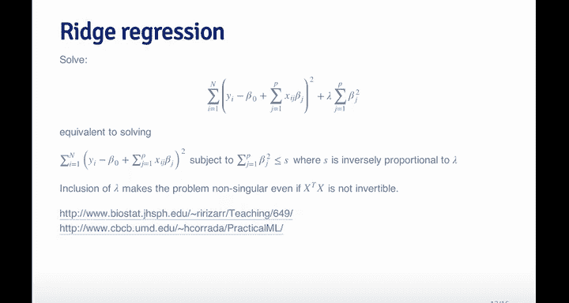

So this is what the coefficient path looks like and so what do I mean by a coefficient path for every different choice of lambda in that penalized regression problem on the previous page as lambda increases that means that we penalize the big betas more and more so we start off with the betas being equal to a certain set of values here when the lambda is equal to zero that's just the standard linear regression values and as you increase lambda all of the coefficients get closer to zero because we're penalizing the coefficients and making them smaller。

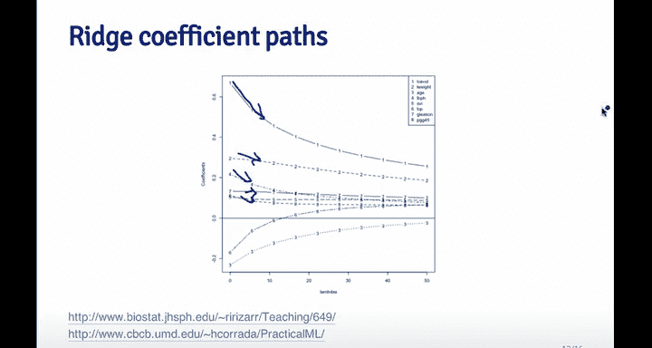

So the tuning parameter lambmbda controls the size of the coefficients Lambda controls the amount of regularization as lambmbda gets closer and closer to zero。

 we basically go back to the least square solution which is what you get from a standard linear model and as lambda goes to infinity we basically so in other words as lambda gets really big it penalizes the coefficients a lot。

 and so all of the coefficients go towards zero as the tuning parameter gets really big so picking that parameter can be done with cross validationation or other techniques to try to pick the optimal tuning parameter that trades off bias for variance。

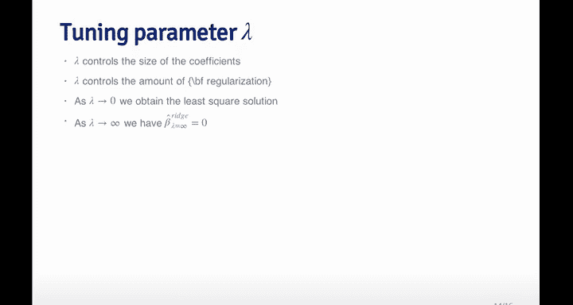

A similar approach can be done with a slight change of penalty so again here we might be solving the problem again this least squares problem。

 this is the standard trying to identify the beta values that make this distance to the outcome smallest and here we can constrain it subject to some of the absolute value of the beta js being less than some value。

You can also write that as a penalized regression of this form。

 so we're trying to solve this penalized sum of squares。So for orthoormal design matrices。

 which you can see on Wikipedia or theormal design matrix。

 the idea is that this actually has a closed form solution and the closed form solution is basically take the absolute value of the beta J and subtract off a gamma value and take only the positive part。

 in other words， if gamma is bigger than your least squares beta hat J。

 then this will be a negative number and you're taking only the positive part so you set it equal to zero。

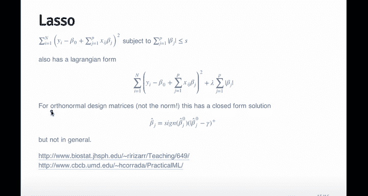

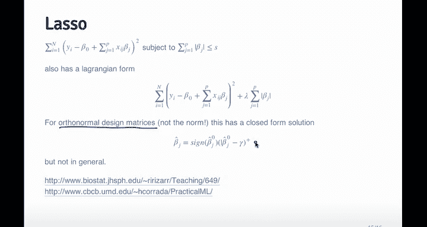

So if it's positive， though， if this absolute value of beta hat J is bigger than the gamma value。

 then this number will be a smaller positive number， it will be shrunk by the amount gamma。

 and then we multiply it by the sign of the original coefficient。So what is this doing。

 it's basically saying the Lasso shrinks all of the coefficients and sets some of them to exactly zero。

 and some people like this approach because it both shrinks coefficients and by setting something exactly to zero。

 it performs model selection for you in advance。

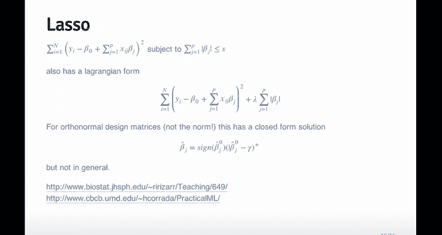

There are a really good set of lecture notes from Hectorcurrado Bravo that you can find here at this link。

 he also has a very nice list on a large number of penalized regression models。

And then the elements of statistical learning book covers this penalized regression idea in quite extensive detail if you want to follow along there。

 in Carrot， if you want to fit these models， you can set the method equal to Rige。

 lasso or relaxxO to fit different kinds of penalized regression models。

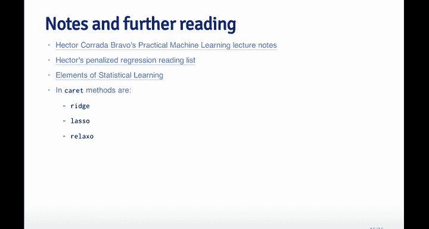