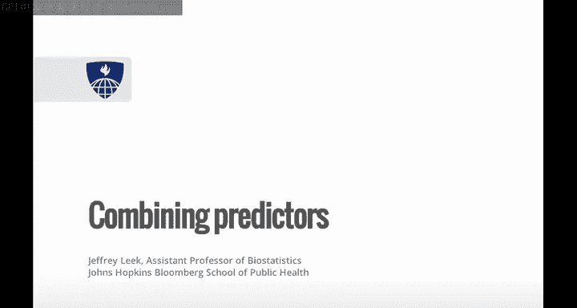
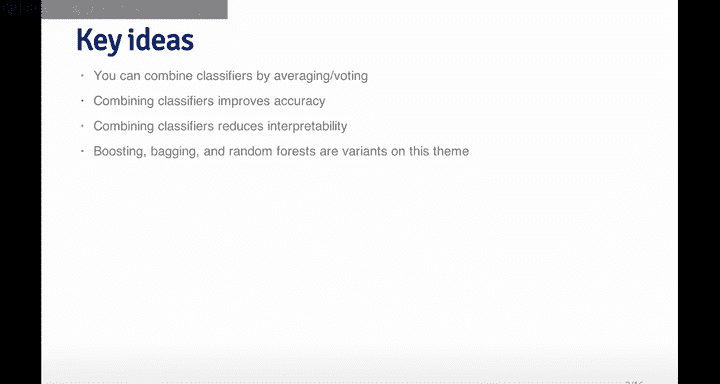
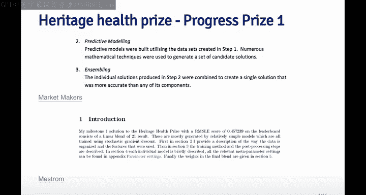
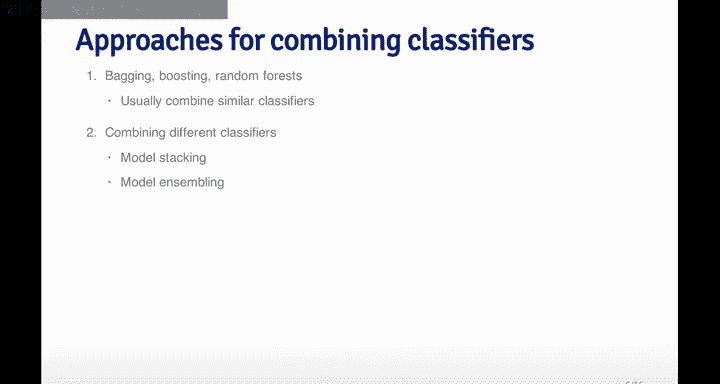
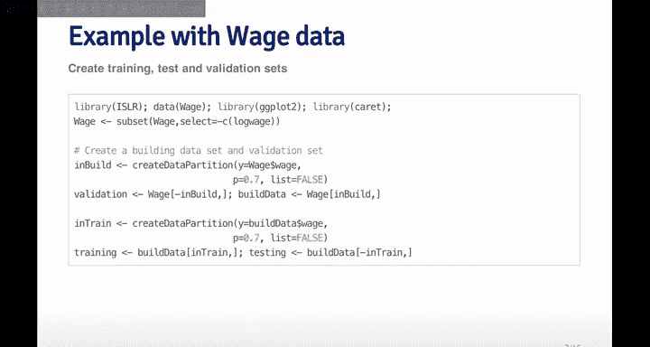
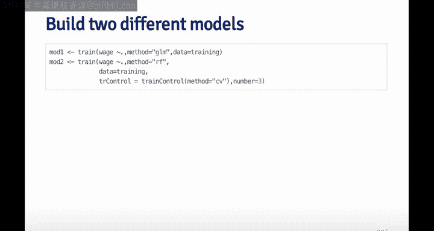
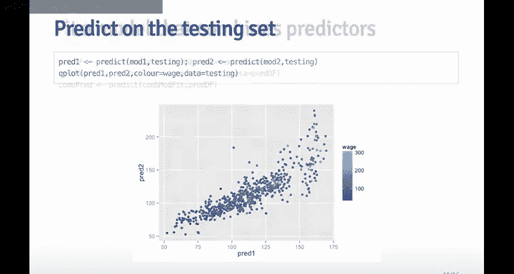
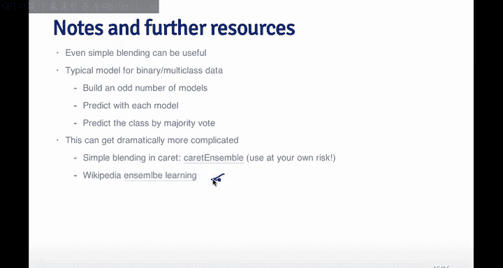
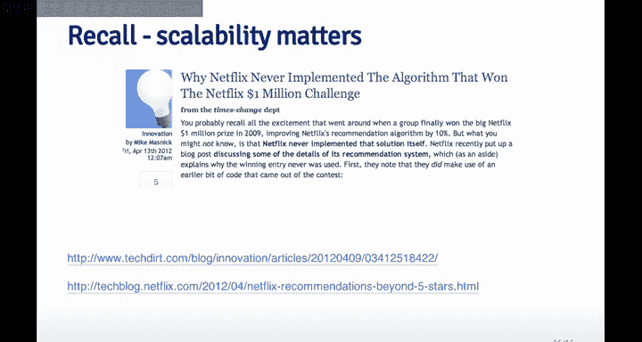

# 约翰霍普金斯大学《数据科学：统计和机器学习｜Data Science： Statistics and Machine Learning》中英字幕 - P105：24_组合预测器.zh_en - GPT中英字幕课程资源 - BV1jsAAeNE3k

This lecture is about combining predictors， it's sometimes called ensemmbling methods in learning。

And so the key idea here is that you can combine classifiers by averaging or voting and these can be classifiers that are very different so for example。

 you can combine a boosting classifier with a random forest with a linear regression model in general。

 combining classifiers together improves accuracy and it can also reduce interpretability so you have to be a little bit careful that the gain that you get in accuracy is worth the loss of interpretability。

Boosting bagging and random forests are all basically variants on this theme that you can average different classifiers together。

 but those are all examples where it's the same kind of classifier being averaged in every case。

So as an example of how successful this can be， the Netflix Pri was a million dollar prize that was basically the first major prediction competition that was run。

 and so the team that ended up winning was actually a blended combination of 107 different machine learning algorithms combined together in order to get the best score in this example。

The Heritage Health Prize was also won by methods that were enssembling from multiple different regression models and machine learning methods。

And so this was these are both of the links to the first progress prizes for the two teams that were in the lead。

 the Heritage Health Prize was a $3 million prize that was designed to try to predict whether people would go back to the hospital based on their previous hospitalization record。

So the basic intuition here you can think of as a majority vote。

 so suppose we have five completely independent classifiers。

 if the accuracy is 70% for each classifier then we can think that the accuracy for majority vote would be 10 times the majority vote being right for three out of the five classifiers for four out of the five classifiers or for all five classifiers and so it turns out that would be 83。

7% majority vote accuracy with 101 independent classifiers you'd get 99。9% majority vote accuracy。

So some approaches for combining classifiers basically use one approach is using similar classifiers and combining them together using something like bagging。

 boosting a random forest。Another approach is to combine different classifiers using model stacking or model ensembling。

 and we're going to talk a little bit about model stacking in this lecture。😊。

So here's an example with the wage data， so we're going to build the wage data set and we're going to leave out the log wage variable since we're trying to predict wage log wage would be a very good predictor and we build the validation set here and we also build a training set and a test set so I've separated into three different data sets here and that you'll see the importance of that in just a minute。

So the training set is the largest of the data sets， it has1474 examples。

 the test set has 628 and the validation set has 898 samples in it。

We then in the training set build in this case I'm using a GLM so this is a linear model and I'm building it in the training data and I'm basically predicting wage using all the other variables I'm also going to build a separate model also in the training data and I'm going to here use method equals random forest and so I'm fitting two different prediction models to the same data set。

I can then plot those predictions versus each other。

 so this is the predictions here preD1 is the predictions from the linear model and pre2 are the predictions from the random forest and you can see that they are close to each other but they don't exactly agree with each other and neither of them perfectly correlates with the wage variable which is the color of the dots in this particular picture。

So then what we can do is fit a model that combines the predictors so I basically build a new data consisting of the predictions from Model1 and the predictions from Model2 and then what I can do is I can create a wage variable which is on the test dataset the wage variable then I can fit a new model which relates this wage variable to the two predictions so now instead of just fitting a model that relates the covariates to the outcome I fit two separate prediction models for the outcome and now I'm fitting a regression model relating the outcome to the predictions from those two models and then I can predict from the combined dataset on new samples。

So I can look at the how well I do on the test set and so I can see that， for example。

 on the test set， the first predictor has an error of 827。1。

 and the second predictor has an error of 866， whereas the combined predictor has an error that's lower 813。

9。And I also want to try it out on the validation set because remember I use the test set to try to blend the two models together。

 so I fit a model on the test set so that's not a good representation of the out of sample error So now I basically create a prediction of my first model on the validation set and a prediction of my second model on the validation set。

I then create a data frame that contains those two predictions and now I predict using my model my combined model on the predictions in the validation data。

 so the covariates being passed in the model are the predictions from the two different models。

So here I can see the error from Model1， if I used it by itself would be 1003。

 the error for my second model would be 1068 and the combined model has a lower error even on the validation data set so stacking models in this way can improve accuracy by blending different models the strengths of different models together even simple blending like I've talked about here can be really useful and can improve accuracy。

The typical model blending for binary multiclass data involves building an odd number of models。

 predicting the outcome with each model and then assigning the ultimate class label based on majority vote this can get dramatically more complicated I found a package carrot ensemble the ensembles some of the carrot models together but it's a little bit in development so I'd say use it your own risk you can also read more about ensemble learning here at the Wikipedia page that I've linked to here。

One important point to keep in mind when doing model ensembling is that this can lead to increases in computational complexity。

 so it turns out that even though Netflix paid a million dollars to the team that won the prize。

 the solution， the Netflix million dollar solution was never actually implemented because it was too computationally intensive to apply to specific data sets。

 so recall from the earliest lectures of this class that there are tradeoffs and scalability versus accuracy that you have to pay attention to when building these prediction models。

