# 约翰霍普金斯大学《数据科学：统计和机器学习｜Data Science： Statistics and Machine Learning》中英字幕 - P106：25_预测.zh_en - GPT中英字幕课程资源 - BV1jsAAeNE3k

This lecture is about forecasting， which is a very specific kind of prediction problem and it's typically applied to things like time series data。

 So for example this is the stock information for Google on the NasdaAq and so it's the symbol GOOG and you can see over time that there's a price for this stock and it goes up and down So this introduces some very specific kinds of dependent structure and some additional challenges that must be taken into account when performing prediction。

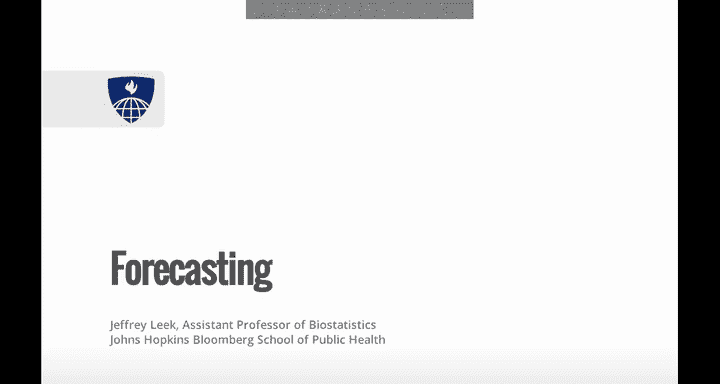

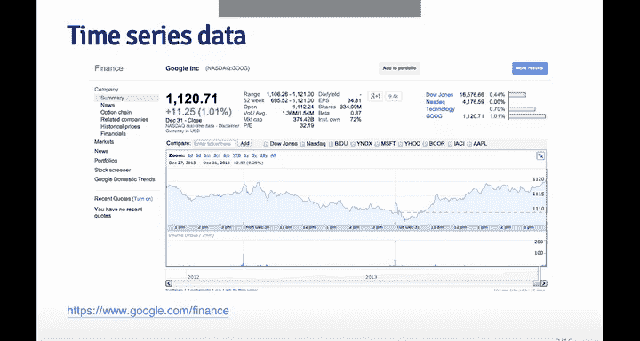

And so first of all the data are dependent over time and so that alone makes prediction a little bit more challenging than it is when you have independent examples。

 there are some also some specific pattern types that should be paid attention to trends such as longterm increases or decreases。

 seasonal patterns are very common in this kind of data， for example， seasonal patterns over weeks。

 months， years， etc， cycles， patterns that rise and fall periodically over a period that's longer than a year。

 for example。

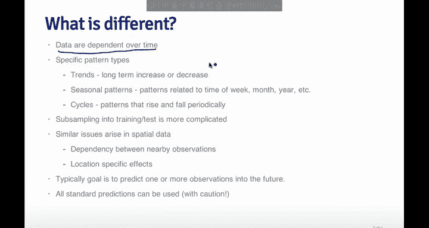

Here the subsampling into training and test can be a little bit more complicated because you can't just randomly assign samples into training and test。

 you have to take advantage of the fact that there's actually specific times that are being sampled and that points are dependent in time。

Similar issues arise in prediction of spatial data， for example。

 there's dependency between nearby observations and there may be location specific effects that have to be modeled when doing prediction。

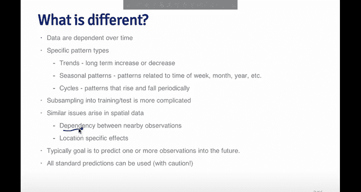

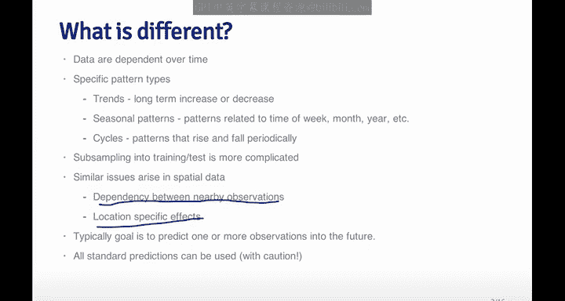

Typically the goal here is to predict one or more observations into the future。

 and all standard prediction algorithms can be used。

 but you have to be a little bit cautious about how you use them。

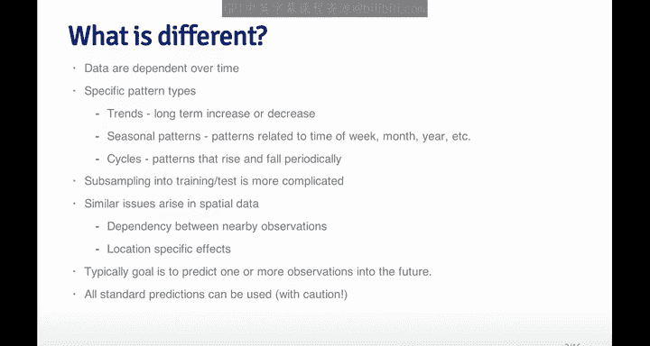

So one thing to be aware of is that you have to be careful of spurious correlations so time series can often be correlated for reasons that do not make them good for predicting one from the other。

 so if you look at you can go to Google correlate to correlate different words over time the frequency of different words over time and so for example here you can see a correlation between the Google stock price shown in blue and Solitaire network which is in red and so those don't necessarily have anything to do with each other at all。

 but they have a very high correlation you might think you might be able to predict one from the other even though in the future they might diverge substantially because they aren't necessarily related to each other at all。

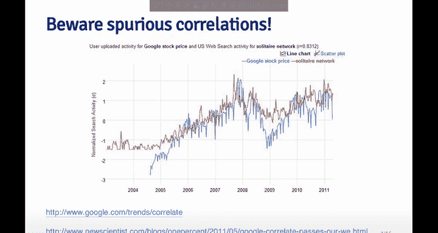

It's also very common in geographic analysis， this is actually a cartoon from XKCD that shows that heat maps。

 particularly population-based heat maps， have very similar shapes because of the place where many people live。

 so for example， the users of a particular site or the subscribers to a particular magazine or the consumers of a particular type of website may all appear in the very similar places because the highest density of population in the United States is over here on the Eastern seaboard and so you see very similar heat maps of a large number of individuals at all of those different places。

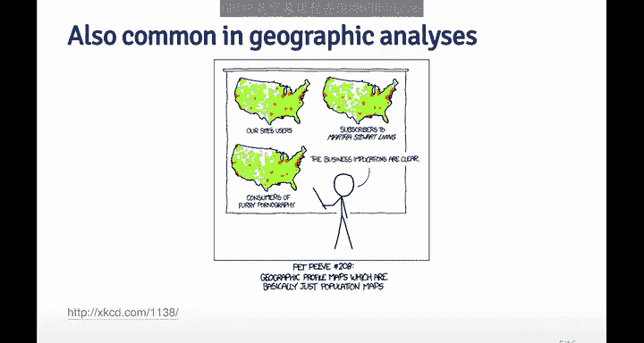

You should also be aware of extrapolation so this is a kind of a funny example that shows what happens if you extrapolate time series out without being careful about what could happen。

 so this shows on a log scale， the winning time of a large number of sorry of races that occurred at the Olympics。

 the blue times are men and the red times are women and these authors of this paper extrapolated out into the future and said that in 2156 that would be when women would run faster than men in this sprint and while we don't know when that winner or when that may or may not occur。

 one thing that was pointed out is that this kind of extrapolation is very dangerous。

 eventually at some time in the future both men and women would be predicted to run negative times for the 100 meters and so you have to be very careful about how far out you extrapolate from your data。

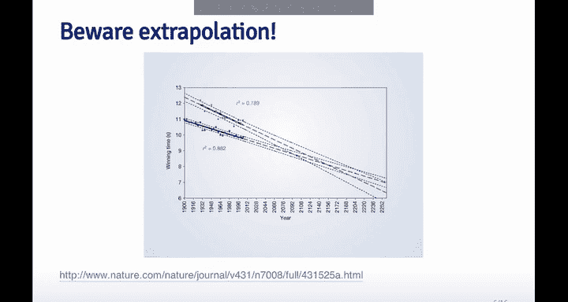

So I'm going to show a quick example of some forecasting using the Qua mod package and some Google data。

 so if I load this Qua mod package and I can load in a bunch of data from the Google stock symbol and I can get it from the Google Finance dataset and so if I look at this Google variable。

 I get the open， high， low close and volume information for a particular Google stock from the1t of January 2008 to December 31st 2013。

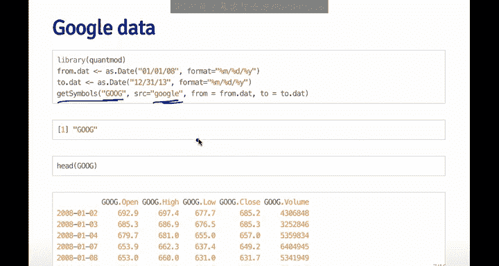

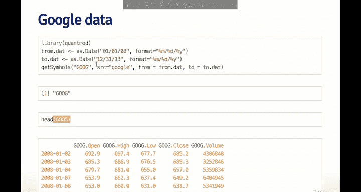

So I can summarize this monthly and store it as a time series so I can use the two monthly variable or function to convert that to a monthly time series and I can just take the opening information and then I can create a time series object using the TS function in R and if I plot that I can see here's the monthly opening prices for Google over a period of seven years。

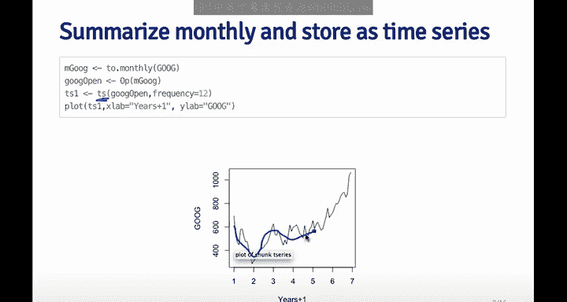

So an example time series decomposition would decompose this time series into a trend。

 any kind of consistent pattern， a seasonal pattern over time。

 and cyclic patterns where the data rises and falls over nonfi periods。

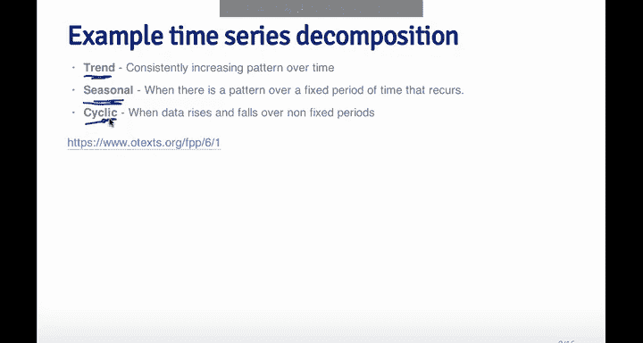

And so one way that we can do this is with the decompose function in R so if I decompose this in an additive way。

 then I can see that there's a trend variable that appears to be an upward trend of the Google stock price。

 there also appears to be a seasonal pattern as well as a more random cyclical pattern in the data so this is decomposing this series here into a series of different types of patterns in the data。

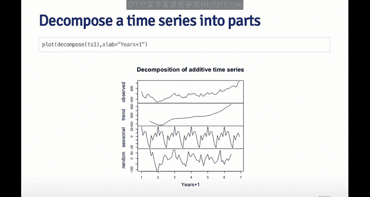

So here for training and test sets I have to build training and test sets that have consecutive time points。

 so here I'm building a training set that starts at time。1 and ends at time。

5 and then a test set that is the next consecutive set of points after that so that way I can always build a training set and apply it to a test set that have consecutive time points that show the same sort of trends that I observe in my data。

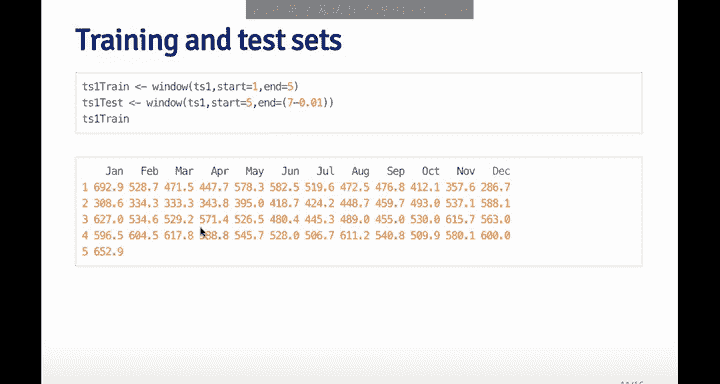

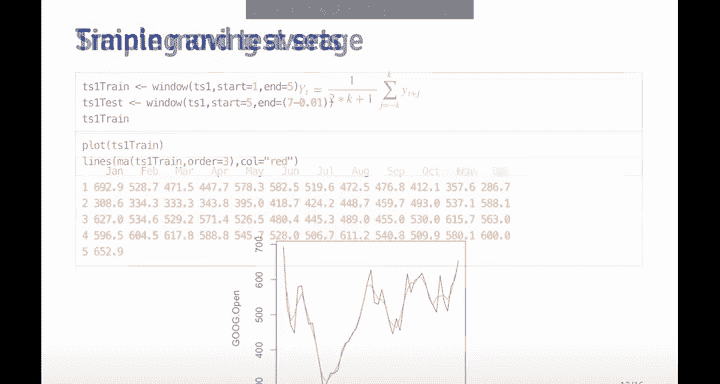

So there's a couple of different ways for doing forecasting， one is to do a simple moving average。

 which in other words it basically averages up all of the values for a particular time point。

 the prediction will be the average of the previous time points up to a particular time。

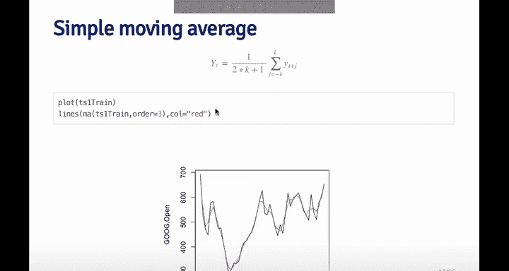

You can also do exponential smoothing in other words。

 basically we weight nearby time points as higher values or more heavily than time points that are farther away。

 so there's a large number of different classes of smoothing models that you can choose。

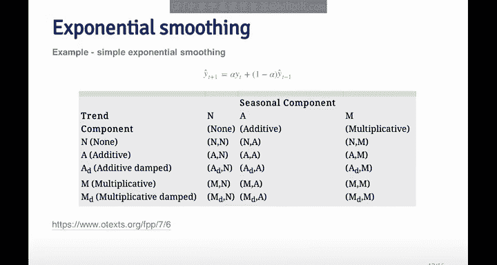

And for exponential smoothing， get you can fit a model where you have different choices for the different types of trends that you might want to fit。

 and then when you forecast， you can get a prediction that comes out of your forecasting model and you can also get sort of prediction bounds for what are the possible values that you could get from that prediction。

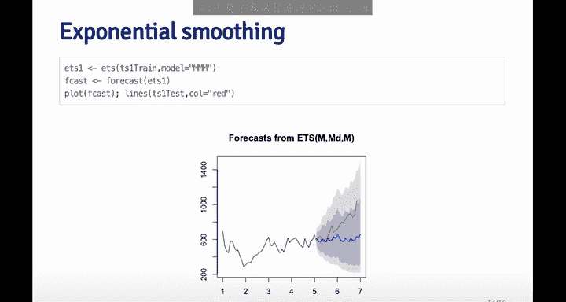

And you can get the accuracy using this accuracy function so you can basically get the accuracy of your forecast using your test set。

 and it'll give you root mean squared error and other metrics that are more appropriate for forecasting。

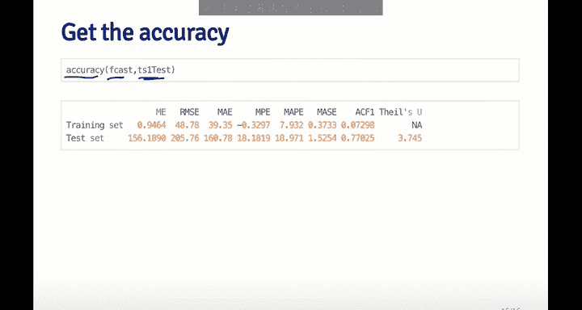

I've obviously gone through this very fast and so if you want more information。

 there's actually an entire field dedicated to forecasting and time series prediction。

 and I would highly recommend Rob Hinman's forecasting principles and practice this is a free book that's online and it's really really good and has a lot of information about how to get started in forecasting so the cautions are to be wary of spurious correlations。

 be very careful about how far you predict out into the future with extrapolation and be wary of dependencies like seasonal effects over time。

😊，If you would like information on forming financial prediction and financial forecasting。

 the Qua mod and Quado packages are also very useful in that area。

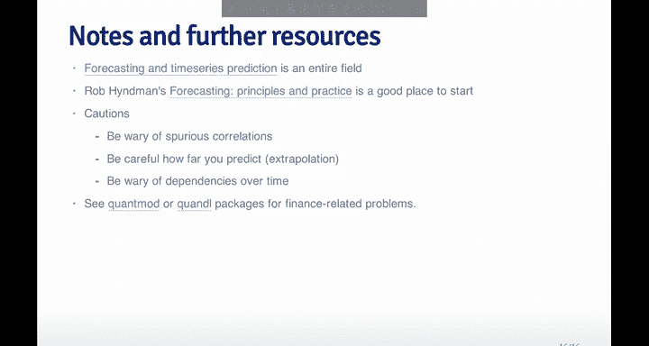