# 约翰霍普金斯大学《数据科学：统计和机器学习｜Data Science： Statistics and Machine Learning》中英字幕 - P107：26_无监督预测.zh_en - GPT中英字幕课程资源 - BV1jsAAeNE3k

So in the examples we've talked about so far in this class you often know what the labels are。

 in other words， you're trying to do supervised classification。

 you're trying to predict an outcome that you know what it is。

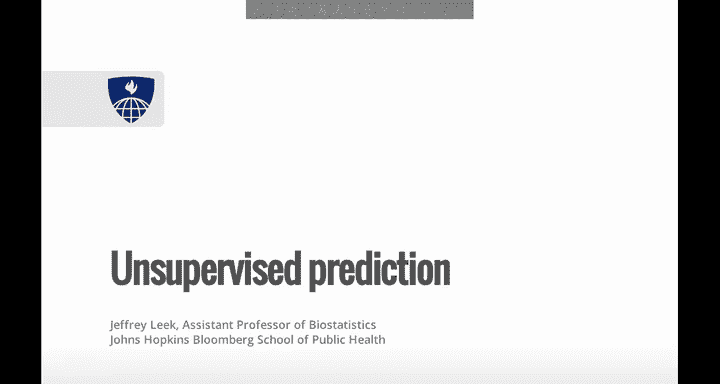

But sometimes you don't know the labels for prediction。

 so you have to discover those labels in advance。 So one way to do that is to create clusters from the data that you've observed to add names to those clusters and then build a predictor for those clusters in a new dataset you're going to predict the cluster and apply the name that you've come up with in the previous data this adds several levels of difficulty to the prediction problem。

 first of all， creating the clusters is not a perfectly noiseless process， second of all。

 coming up with the right names， in other words， interpreting the clusters well is an incredibly challenging problem。

 and if you take an exploratory data analysis in our data science specialization。

 you'll understand why。Building a predictor for the clusters is basically using the algorithms that we've learned throughout the course of this class as well as predicting on those clusters。

 so I'll just show you a quick example of how you can do this so if I load the IIS data and the GG plot library I can then create a training and test set for the IIS data just like I have in previous examples but I could ignore the species clusters。

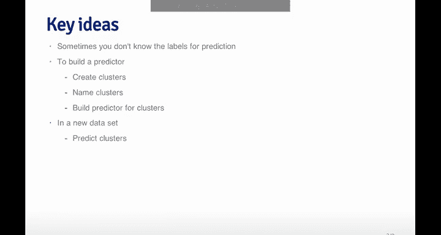

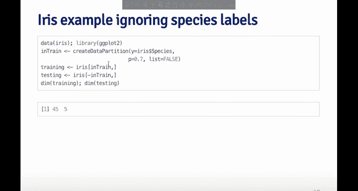

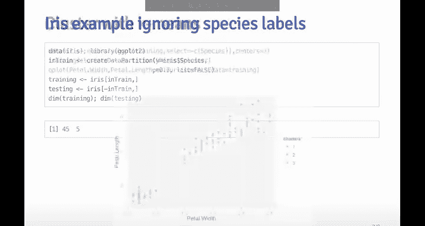

So one thing that I could do is I could perform actually a K means clustering if you remember that K means clustering from the exploratory data analysis section of the data science specialization if you don't。

 you can look it up on Wikipedia and the basic idea here is to basically create three different clusters。

 so I'm telling it to create three different clusters， ignoring the species information。

So then what I can do is I can basically assign to those clusters different colors and so here I plotted those three different clusters that are created by performing this K means clustering so there's a cluster here。

 a cluster here and a cluster here Those clusters actually are relatively close to the clusters you would get if you use the species labels themselves。

 but that's not a typical outcome Often it's very hard to label the clusters that you get。

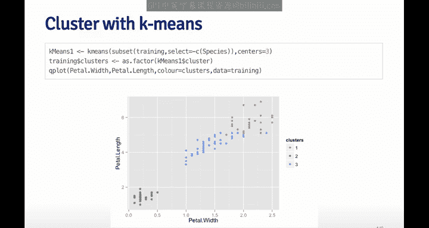

So in this case I can make a table of the cluster versus species and I can see that cluster2 corresponds to this species。

 cluster three corresponds to this species and cluster one corresponds to this species。

 so in general I wouldn't know what those species names were and I would have to come up with names for each of my clusters。

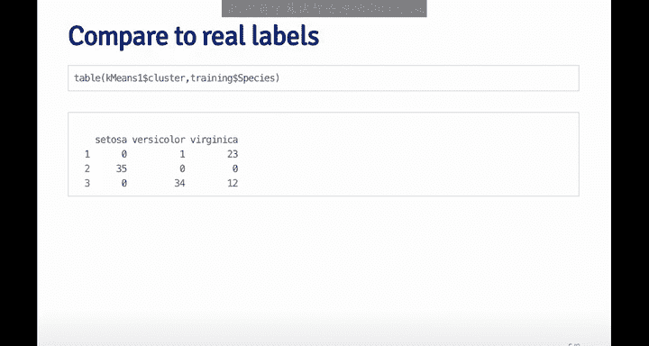

And then I can fit a model that relates the cluster variable that I've just created to all the predictor variables。

 and I could do it in the training set， in this case I'm doing it with a classification tree。

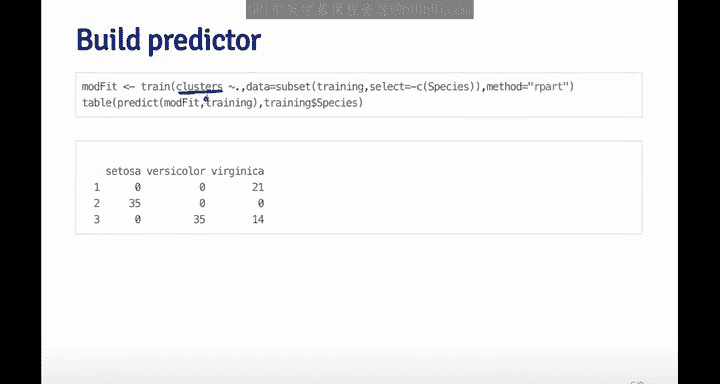

I can then do a prediction in the training set and I can see that I do a reasonably good job of predicting this class cluster and this cluster。

 but cluster one and cluster three sometimes get mixed up in my prediction model that's because I have both error or variation in my prediction building and error and variation in my cluster building so it ends up being quite a challenging problem to do unsupervised prediction in this way。

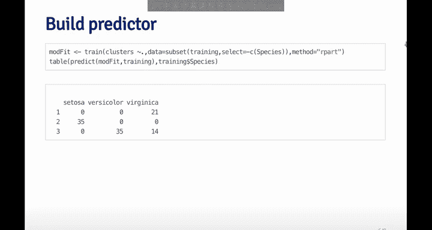

I can then apply it on the test dataset so if I predict on the test dataset in general I wouldn't know what the labels are。

 but here I'm showing what the labels are， so here I'm predicting on a new data and making a table versus the actual known species。

 and so I can see this actually does a quite a reasonable job here of predicting the different species into different clustered labels。

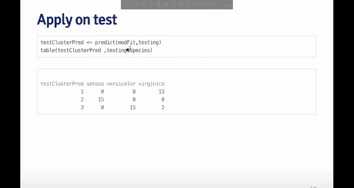

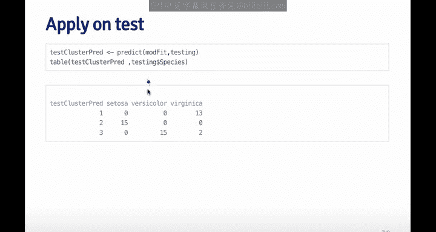

In general， this is quite a hard problem so a care must be taken in labeling the clusters and performing the unsupervised analysis and understanding how that works。

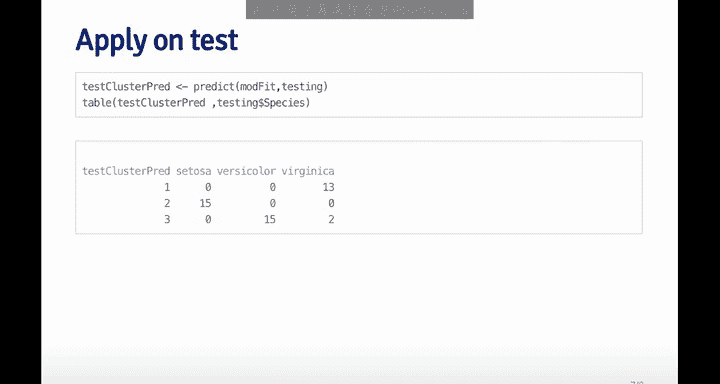

The CO underscore predict function in the clue package provides similar functionality of what I've just described here。

 but in general it makes a little bit more sense to sort of build your own approach if you're doing unsupervised prediction because you really need to think carefully about how you're going to define the clusters be very wary of overinterpretation of this type of clusters this is in fact an exploratory technique and so the clusters may change depend on the way that you've sampled the data This is actually one basic approach to building things like recommendation engines where you identify clusters of people that have similar tastes and assign their tastes to new individuals you can read more about unsupervised prediction in the elements of statistical learning and introduction to statistical learning。

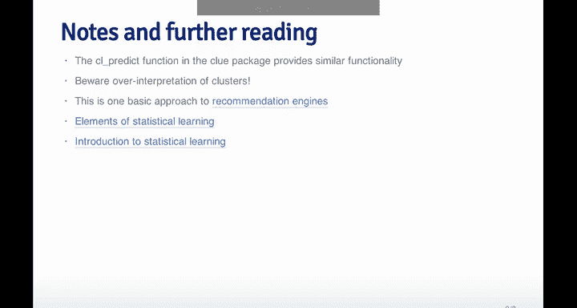

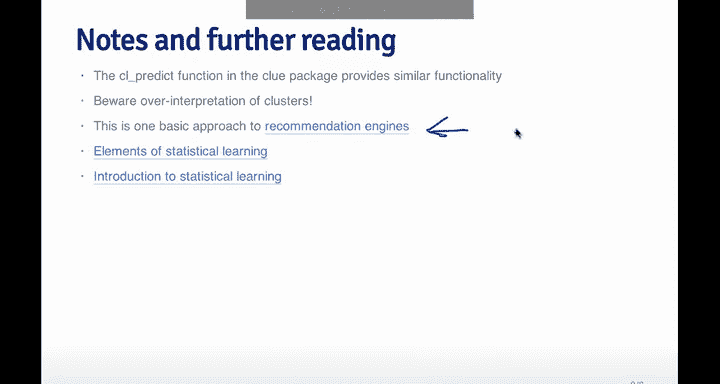

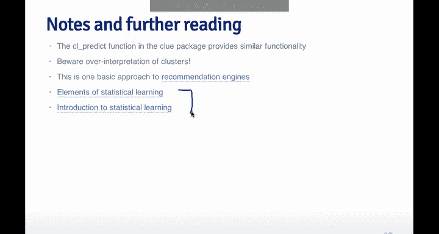