# 约翰霍普金斯大学《数据科学：统计和机器学习｜Data Science： Statistics and Machine Learning》中英字幕 - P110：2_Shiny 1 2.zh_en - GPT中英字幕课程资源 - BV1jsAAeNE3k

Okay， so let's go ahead and create our first app。 So you need a relatively recent version of our studio。

 or I think you should have a relatively recent version of our studio just because of some things like the following。

 so I think probably the easiest way to start is alt F or file and then new file and then shiny web app So when you click that it brings up a thing name it whatever you want。

 So you could name it my app or something like that。

 And then you can choose whether to have the files in a single file which we did not talk about or in two files。

 a Ui R and a server R file which we did talk about and will talk about。

 I'm going to recommend doing it this way， just because I always like to have I'd rather have many small files than one big file with lots of functions in it So I always tend to work that way。

 but also note that that it's not the files that it needs。 It's not Ui R and server R that it needs。

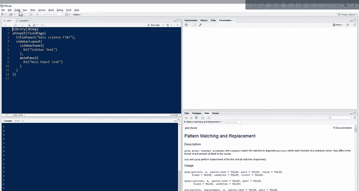

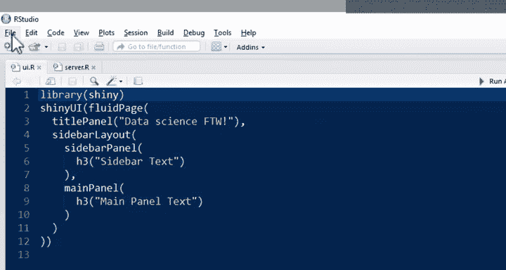

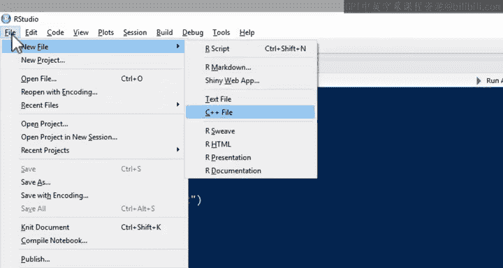

It's the name the specific named functions in the UI R and server。 R files that it actually needs。

 and you'll see those in a second。 I'm not going to create this because I've already done it。

 So when it creates it， it creates the directory and then it creates the two files。

 You can see him here's my UI R and server R Now I took the shiny prepopulated Ui R and server。

 R files and then just paste it in the versions from the lecture nodes。

 Okay so the key thing in the Ui R is you need to have the shiny Ui function you need to have library shiny。

 but you need to have this shiny shiny Ui function that's going that's going control the user interface。

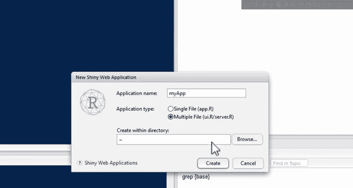

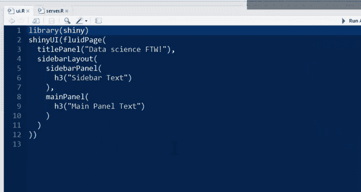

Okay。And then in the server。R you need something calledSny server。

 in this case our server is not going to do anything。Okay， now let's look at this shiny shiny UI。

Function a little bit in a little bit more detail。 Let's put a space right there。 Okay。

 so we have fluid page， which just describes the page type that we're going to use to create our user interface。

 So this is kind of a default。 And I would just suggest that you use it until you learn a little bit more。

 So title panel is you'll see where this comes up。 and it's going to say data science for the win。

 So this is just going to set one of the Gui elements。 And in this case， just a title。

 And then by default in fluid page， it's got a main panel and a side side panel。

 So here we're going to give it the sidebar layout。

 Okay so it's just saying what's going what's going to occur in the sidebar。

 So the sidebar panel is going to tell us what's going to occur in the sidebar。

 and H3 So H3 is going to give you the Hml third level index。

 So if you've learned a little bit of HTMLml just H3 is just going be。Smaller text than H2。

 which is just going be smaller text than H1。 So it's the heading level。 So third level heading。

 And it's just going to say sidebar text。 And this is where the sidebar goes。

 So and main panel is just going to be that center panel。 And we're also going to do that in H3。

 and it's gonna say main panel text okay so sidebar layout is just going say in my fluid page。

 I'm going have a sidebar type layout with with a part on the left that's going to give us navigation and things like that。

 and a part on the right， a main panel on the right that's going to have the main content。

 Okay And so just keep track of these three phrases。

 title title panel data science for the win sidebar sidebar text， main panel， main panel text。

 And so you'll see where it puts them all。 So there's two ways to run it。

 The easiest way is if you have a relatively recent version of our studio。

 you can just click run app。

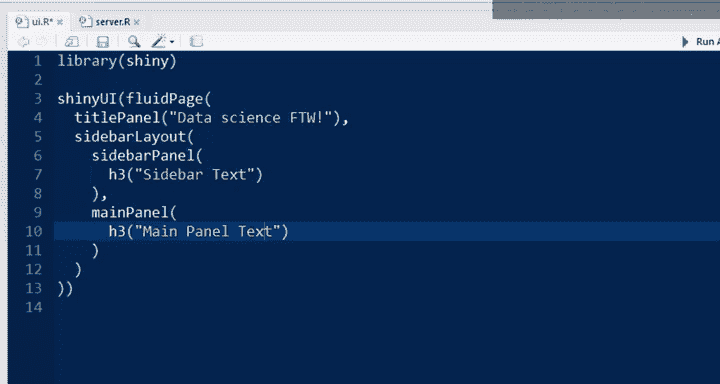

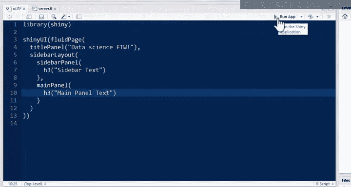

U， and I want to save them。

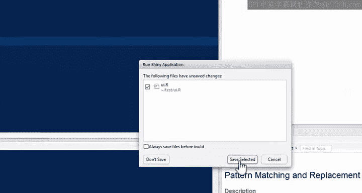

I should have clicked always say before build。 and there you go， there you see your elements。

 data science for the win in the title。This is in the sidebar and this is in the main panel。 Okay。

 so those are our three elements in our in our fluid page with the sidebar layout。

 Let me just show you the other way to run it。 We got。

 we got to switch to the directory where our Ui do R and server R are at。 So you know。

 you can just do alt S W return。 Okay， so that's alt S W return or click on session。

 click on set working directory and click on two source file location。 Okay。

 and then you just type run app。

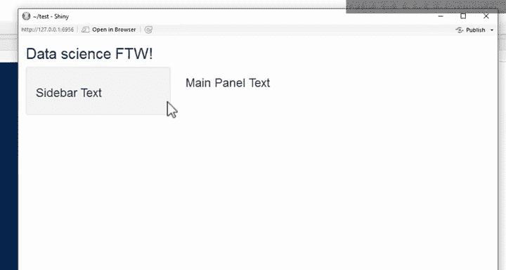

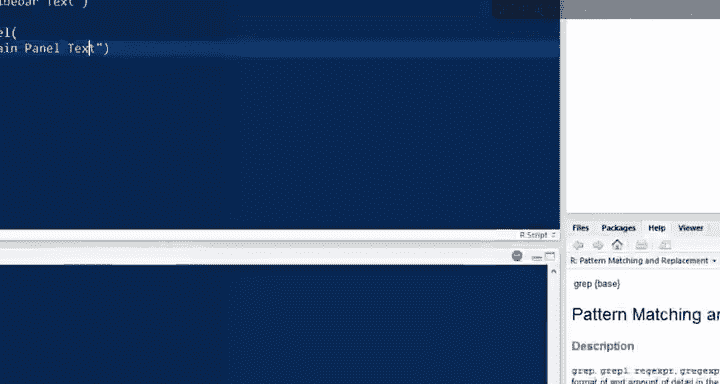

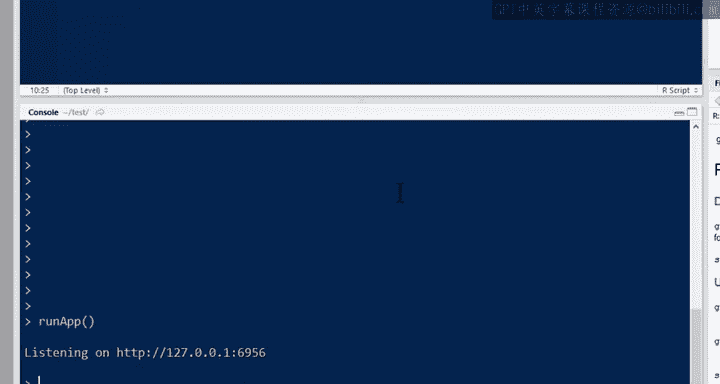

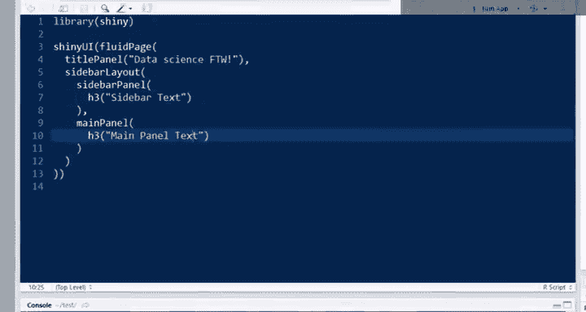

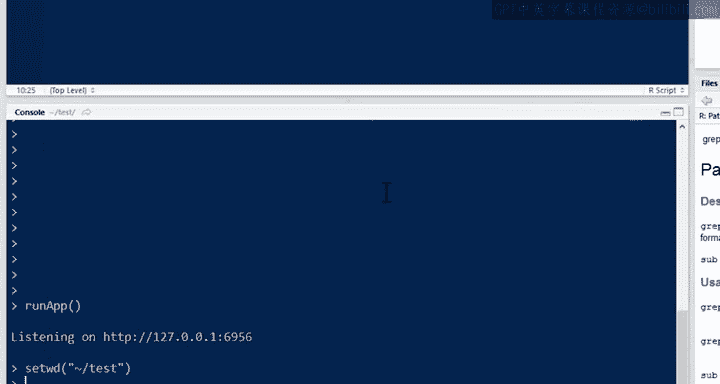

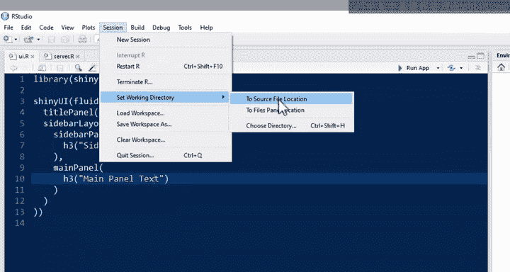

Open closed parents。 There you go。Okay， you can also， when you type in run app， you can。

 you can put in here the path to the app。 Okay， so if you'd rather do it that way。

 you could put in the path to the app and then you don't even have to be in the directory。

 Notice it's running it in our studio。 This is our studio bringing up the HTML page。

 let me show you one other thing。 So here it is running。 But if you look down here。

 it says listening on and it gives a URL。 So basically what it's doing Shi。

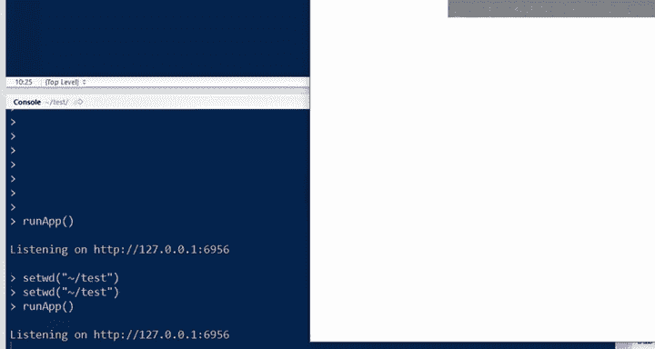

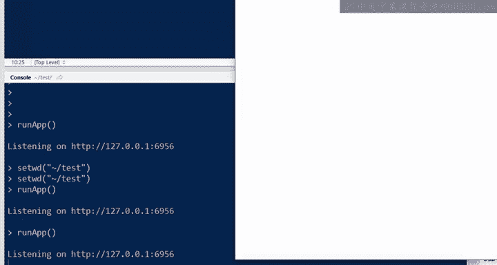

Just creating a little web server on your computer and that web page is just our studio's browser accessing that web server。

 So when you run and debug things locally， it's just going to create a little web server for you running locally and that our studio is going to be able to access then at some point we want to push it up into the internet so that it's running on a public web server so that anyone can access it。

 not just you on your computer， but this would also show you how the lowest and kind of easiest form of delivering a shiny app to another our studio user its to just give them the UI。

 R server。 R functions and all the other functions that they need to run it。

Just give it to them and they can run it just like you can。

 but that's not what we want in the long run。 we want it up and running on a web page。 Okay。

 all right， so we've done the first step and let's keep moving and see if we can populate and make our app a little bit more use。

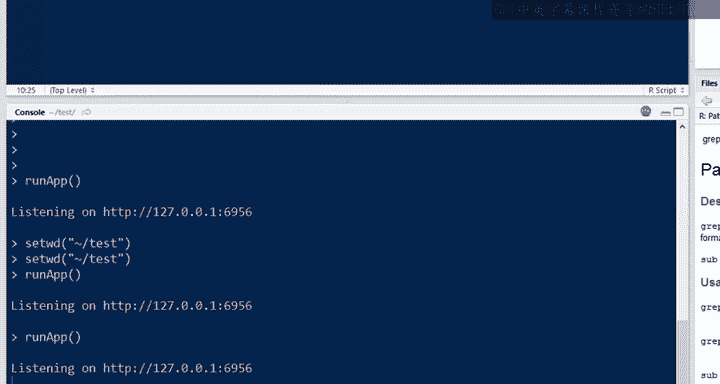