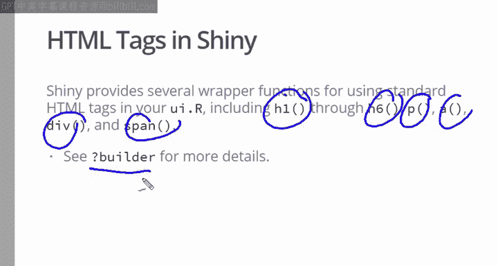
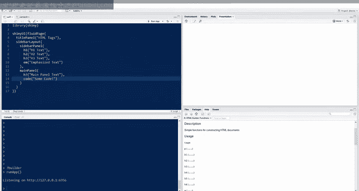
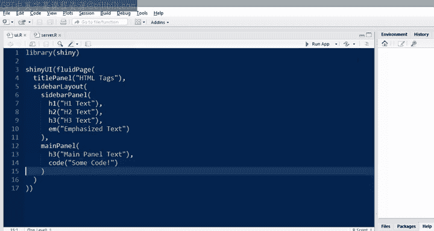
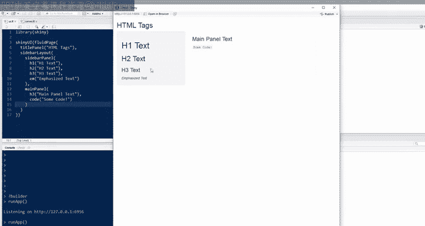
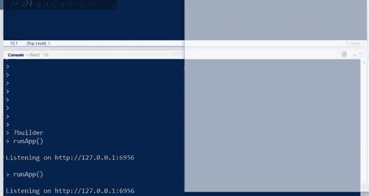
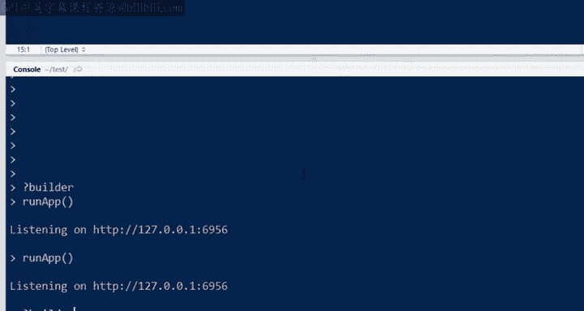
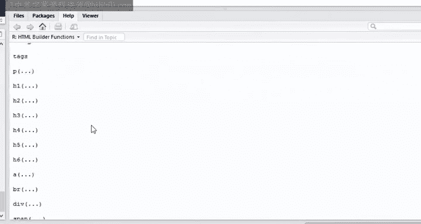
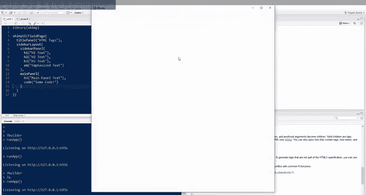
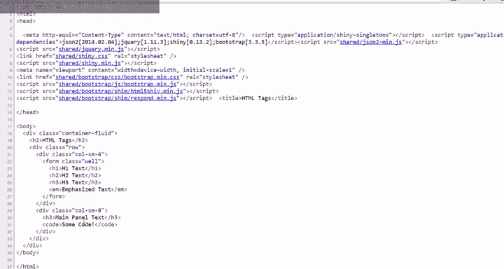

# 约翰霍普金斯大学《数据科学：统计和机器学习｜Data Science： Statistics and Machine Learning》中英字幕 - P111：3_Shiny 1 3.zh_en - GPT中英字幕课程资源 - BV1jsAAeNE3k

So。Remember that when we're building our shiny app。

 at least when we're using the default type workflow。

 we're going be using R to put in our HTML elements So most of the really or not most all of the really standard HTML tags exist in shiny so you have all the heading tags up so let me get my pen here we have all of our heading tags H1 through H6 the the little P hyperrefts and divs and spans and all the most common ones so if you do question mark builder it'll give just a complete list of all the various HTML tags you can use later on we' actually show you how you can use your own HTML file so that you can use whatever you want。

To build your shiny app and you can make your page as elaborate as you'd like for right now we're just going to be using the built in functions。

So in the next code example， I'm just going to show you the different headings and things like that。

So we're just going to show you the different kinds of HTML tags that we can use are just a subset of them so mostly I'm going to go over this one the formatting tags。

 so here in my UI。R function I have here I've just put a couple of the headings。

 I copied this code from the next slide on the slide deck。

Okay so here we have H1H2H3， these all occur in the sidebar layout。

 I give some emphasized text right here and here I give some code text which will put it in a monospace format you want to do that when you're displaying code you always want to display just like when you're editing code you always want it in a monospace format okay so you want to run the app now。

And there you can see it the different heading values and so on。 Okay， the main panel。

 the code listed in some mono space format。 So you can。

 you can look at all these things just by doing question mark builder。

Okay。And there we go。 These are all the different HTML tags that you have。 Another thing you can do。

 Let me run the app again。 So it's running。 Okay， let's， if you just click on open and browser。

 then I'll open it up in a web browser Okay and here is your HTML tags。

 but I just want to do control you。 So you can actually just see the the R code。

 then effectively creates a web page And here you can actually see the web page that it's created。

 you can see the jascript libraries that it loads up and so on to actually run shiny。

 but more importantly， so I probably wouldn't worry too much about the head。

 unless you're familiar with a little bit of jascript。

Most most of what this stuff is is style sheets in the Twitter stuff， the Twitter bootstrap stuff。

 which is the style， the formatting for all the buttons and style and everything that China uses。

 but also it has some of the input output things that shiny requires as well。

 but most of the stuff we're displaying is here。In this part in the body。

 and then you can just see how it uses the function and how it creates the HTML commands Okay so it's just translating your UI。

 R into this function right here， and this is a useful thing to do。

 especially when you start to do things like name buttons and things like that you can see how it actually goes into the HTML and in fact。

 if you're comfortable with shiny but not very comfortable with HTML。

 this will be a way to get you used to coding an HTML because I think at some point if you're going to want to develop fancy enough web pages that callr on the back end。

 even if you're using shiny as the mechanism for doing that。

 you probably are going to want to be developing your own web pages and not using a UI。 R。Okay。

 so hopefully this gets you a little bit of familiarity with using some of the HTML tags。

 play around with them and try and design just a simple web page with no interactivity。

 just a web page that shows what you like on it Okay and then next we're going to start working towards adding some buttons and some sliders and some graphs and calling are in the back end and some of the important things that Shi will do for us。

