# 约翰霍普金斯大学《数据科学：统计和机器学习｜Data Science： Statistics and Machine Learning》中英字幕 - P112：4_Shiny 1 4.zh_en - GPT中英字幕课程资源 - BV1jsAAeNE3k

So okay， our shiny app is only going to be useful if it can take in input values。

 do some R calculations， and then spit out the result of those calculations。Or results。

And so the first thing we need to be able to do is actually take in some input values。

 And so this next code demonstration， all we're going to do is create a slider。

 which has to occur in the user interface。 and then the values for those sliders that the user selects is going to be passed into the server function。

 which is then just going to send it back as is to the user interface function to redis it。 Okay。

 so this is just another building exercise， We're not going do anything with the input。

 other than spit it back at right back out at the user interface to display it as is。 So let's try。

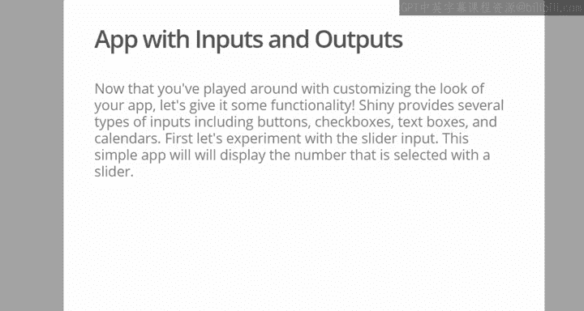

Okay， now let's see if we can get our shiny app to actually take in values from the user via the slider。

Put them to the server and then the server will return the values Okay， so I have my UI。R。

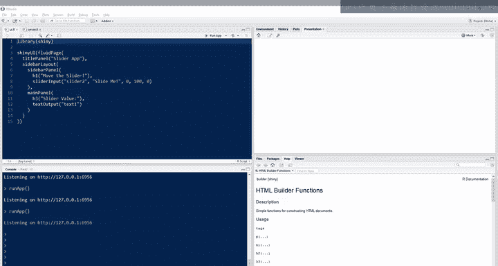

Shiny UI function here。 And in my sidebar layout on the sidebar part on the sidebar panel。

 I'm going have a slider。 So I'm going to give a user prompt that says move the slider and then slider input。

 this function right here is's going to create the slider and display it。

 and then I'm going to name I have it named slider 2。 Okay， so I've named the slider slider 2。

And then the command says slide me， Okay， it's going to go from 0 to 100。

 and it's going to have the starting value at0。 Okay。

 now let's talk about the main panel in a second。 Okay， so I take that slider value。 I input it。

 It's given a value called slider2， the input from the slider displayed to the user。 Okay。

 now my shiny server is a function that takes as its argument。

 a function that is that takes input and output。 Okay， then you have to have these curly braces。

 because you need to have。A function it's definingying a function so function has to be have the curly braces and then oh down here you have to remember to close with the curly braces and the shiny server parentheses Okay and then it's what it's going to do is it's going to take the input okay input is what's input from the UI。

 R。

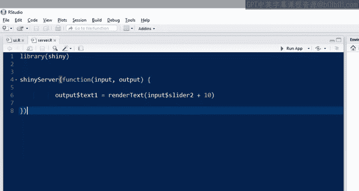

Shiny UI function， and it says take an input， oh and let's get rid of that real quick just so it's consistent with what's in the R markdown code。

From the slides。It's going to say take in slider two。And then what I want to do is just render it。

 In other words， display the text。And I'm going to name that output text1。 Okay。

 so then when we go back to Ui dot R in the main panel。

 it says here's the slider value and text output is text 1。

 So that same text that we labeled from the output from the server function is going get displayed in the main panel。

 So Let's run it and just see how how it looks。 Okay， so here it's the move the slider part。

 Here's the slider。 as I move it。 the slider value is displayed over here。

 So what's happening right is the slider is is receiving a value from the user。

 That value is given the label slider 2。 Okay， in the server dot R function。

 It's grabbing that from the slot input dollar sign slider 2， okay。

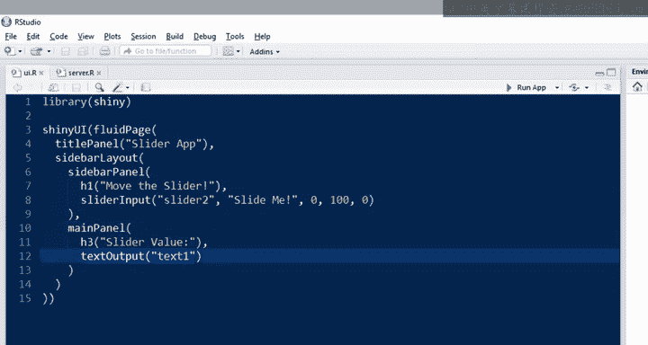

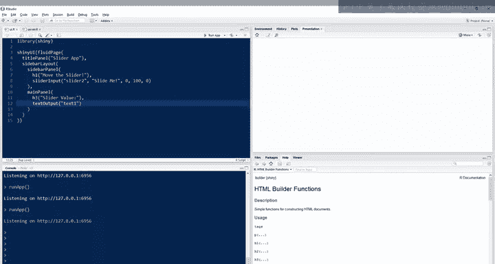

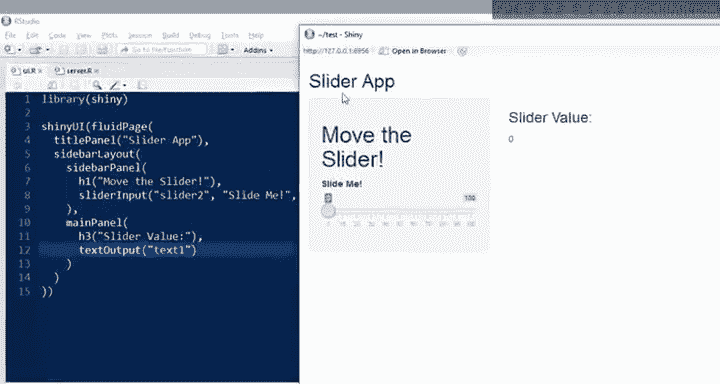

And then。It's spitting it back out as output dollar sign text 1。

 and then the UI R is displaying it now。

There's nothing in particular。 I want to emphasize there's nothing in particular about having the slider in the sidebar panel and the text in the main panel and that there's nothing in particular about this order。

 it's not sort of running the slider and then displaying it because this R code happens to occur later on in the text than this R code you could we could have had the slider output in the main panel and the slider I'm sorry the slider in the main panel and the output in the sidebar so that's an important thing to think about with shiny and reactive expressions。

 it's not kind of you don't want to think about it running linearly like a regular like a regular R program of course at some level it is because it is an R program but the way in which the server is going it's sort of running reactactiveively and kind of constantly going back and forth so you just want to kind of change your mindset about that a little bit then how it is in normal R programming。

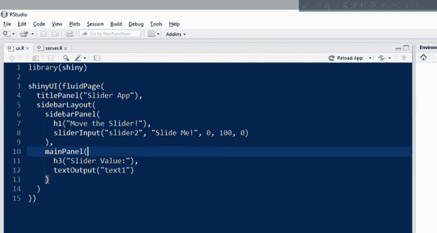

Now notice another thing is if I were to label this text， output dollar sign text， and rerun it。

OkayIt doesn't display anything because the label text doesn't mean anything to UI R。

 it's thinking it's text1 when it says text output， okay so let's reload it and then now it'll work。

 see it's displaying it again， same thing with the slider if I were to call this slider instead of slider2 or call a slider1 it doesn't display anything because there is I'm sorry it doesn't display anything because the render text from the UI or the server function is looking for slider2 and the UI has never put out anything called slider 2。

 anything labeled slider 2 so if I were to change this to slider1。

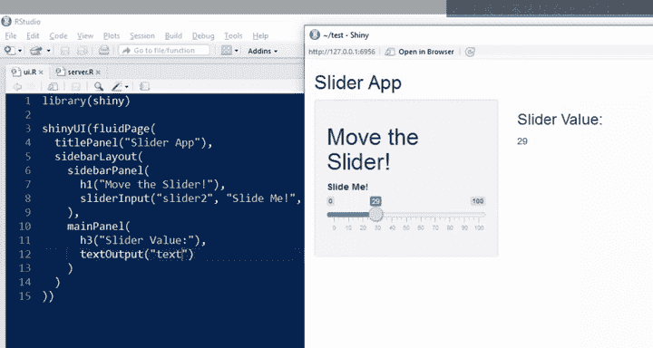

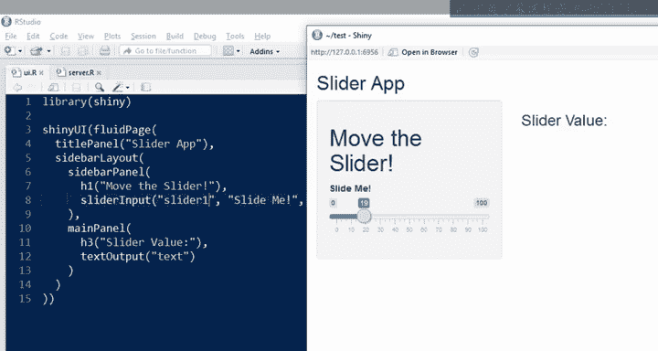

Reload it， it now works Okay， that so remember that your labels have to match up。

The last thing I'll do is just give you a sense of how you can start to use these things for manipulation。

 Let's just add 10 to the input of to the slider input and then show how we can now display okay。

 it's not doing much right 29 adds 10 and gives you 39。

 but you can see actually now what we've done is we've taken a value from the user used R to manipulate that input value in this case a very simple manipulation。

 Add 10 and then sent that back to the user interface to be displayed Okay and all all of these things are happening reactively Okay so try this out。

 create a slider or a checkdown box or a button or something like that。

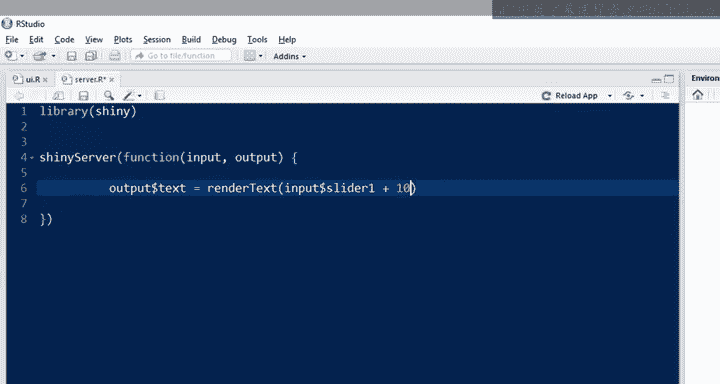

That gets an input and displays it back out and just so then we'll move on to the next step of actually trying to create like a prediction algorithm or we'll start to create where we actually manipulate these numbers in the server。

 R function。

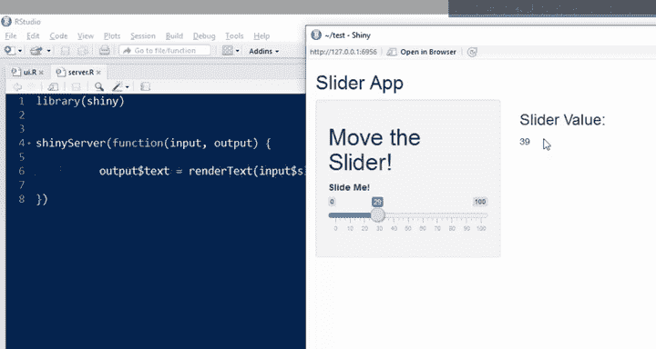