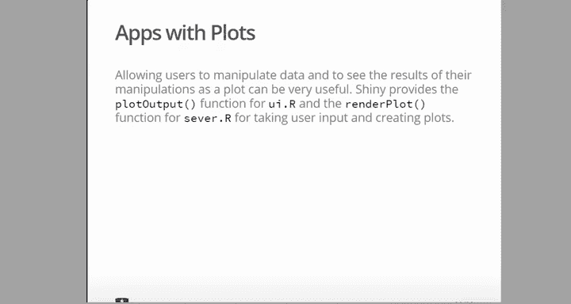
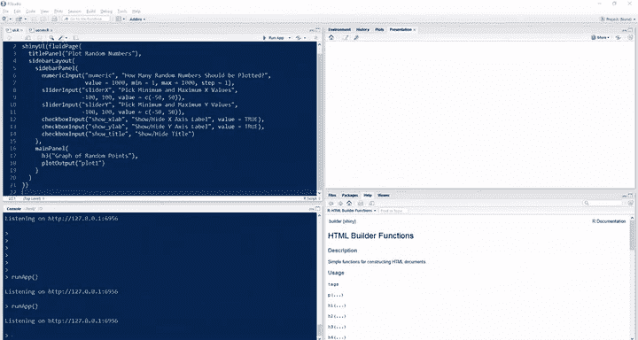
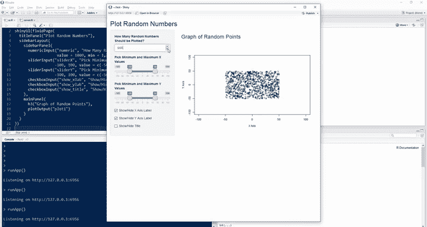
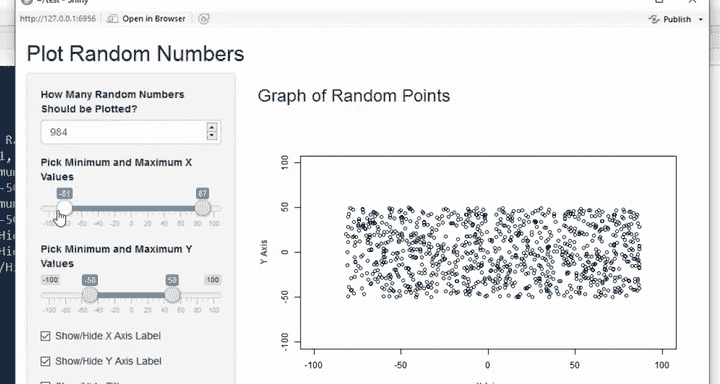
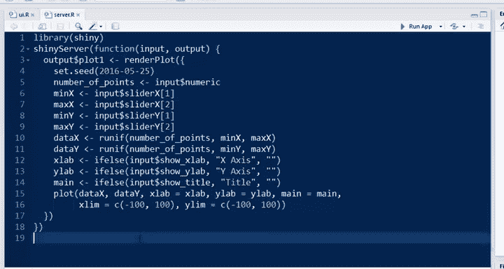
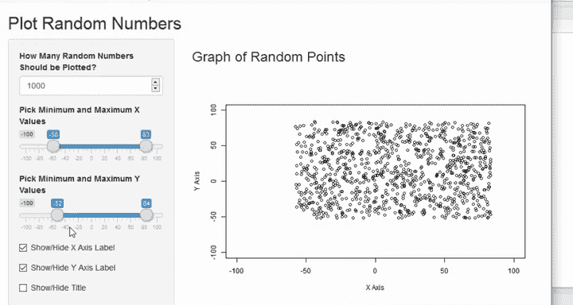

# 约翰霍普金斯大学《数据科学：统计和机器学习｜Data Science： Statistics and Machine Learning》中英字幕 - P113：5_Shiny 1 5.zh_en - GPT中英字幕课程资源 - BV1jsAAeNE3k

So now we're starting to get to the point where we actually can use Shiny in a way that would be helpful for us。

 And one of the main ways in which shinyny is useful is in creating interactive graphics are。

 by default， doesn't have a lot of capacity for creating interactive graphics。

 Shiinny really expands that capacity and gives you a nice way to disseminate your results because they're embedded in a web page that you could put out very broadly。

So in this case we're going to create an interactive plot。

 we're going to actually have a little bit more code in the server。

R functions and I think at this point， once you go through this example。

 you should hopefully be able to start using shinyny in a much more realistic way that would help you with your day to-day data science needs。

Okay， so let's get right to it。

Okay， so I've copied the code from the R Markdown document and let's just run it first and see the app before we start digging into its internal so what it basically does is it plots two sets of random uniforms so you input the number of uniforms and see this is a text box that also has an increment and decrement operator here on the。

Buttons on the right hand side， okay， and then。You have these sliders that can change the。

Range of the uniforms that you。generateerate both on the X axis and on the Y axis。

 Then you have these buttons that say show and hide the X axis label， show and hide the y axis label。

 show and hide the title。 So we have these three check boxes here。

 these two sliders okay and our numeric input right here。

 Okay and notice how the code is executed interactively right every time I change a value it's rerun the whole code whole set of code is rerun So that's something you're gonna to have to get used to with shiny is how to program with with this server calculations and its reactive coding which operates in my mind a little bit differently than standard highly linear R program。

 Okay so now let's go through the code and see how we accomplish this。

So I think it's usually best to start out going through the UI do R function， the shiny Ui function。

 Okay， so tidal pan， we know about that。 Okay， the numeric input， okay， it's。

Labeling that input numeric。And then here's the title and then it gives you the starting value and then it gives you the minimum and the maximum so you don't input values above or below that range and then the step size are for those little buttons when you push those little buttons。

 how much it steps okay， then we have the two sliders we've gone through the sliders before。Okay。

All right， and notice these sliders there like it had the double slider。

 had two it had the two values， okay， so you need the two values here and the two values here so that you could have the slider at the two points。

Then here's the Y slider basically the same thing， and then here's our three check boxes okay notice the just back to the sliders notice the first one was slider X。

 the first one was the second one with slider Y， and then these are have very obvious labels。

 show X lab， show Y labb， show title， okay。Then in the main panel。

 it's just going to show the graph and it's going to do plot output of plot1。

 So it's somewhere in our server function， we're gonna to have to created something called plot1 that is going to get sent back to our user interface。

 now in our server， shiny server。 It looks like it always does has function input output or curly braces because it's a function and then output dollar sign plot1。

 Okay， this is good。 This means that the output from our shiny server is going to have something labeled plot1。

 so that when we display it with the user interface， itll there will be a plot one there。

 And okay because it's a plot， the statement is render plot。

 Okay and then all of our reactive expressions， reactive means kind of interacting with the server with server calculations。

 they're gonna to have this notation where they have the curly the curly braces next to the parentheses from the render plot statement。

 So you've got to get used to writing these curly。s in reactive statements Okay so so you just get used to that code。

 Okay so here we're just setting a random number， setting a random number seed。

 Okay now we're just here we're just doing some regular R coding。 The number of points。

 We're just relabeling the input dollar sign numeric。 and that's just for convenience。

 So we don't have to actually refer to the input function to make our code look a little bit readable and honestly for pedagogical purposes here where I'm just showing you how you grab the numeric value from that numeric input Okay so the min for x。

 the max for x are the elements of the slider and these come out as input is a list and the slider x value is。

A vector。 And so the first element of the vector is that minimum value。

 The second element of the vector is the the right， the larger value。

 same thing for our two y points。 And so we're going to do those。

We're going to assign those all to variables because it would be a lot to type if we wanted to reuse those。

Every time， okay， and then our data， the list of random uniform numbers is just going to be our unitF that just generates a bunch of random uniform numbers。

 and this takes in the number of points。And the range between the min of the x and the max of the x。

 and then our data y， and that'll just return a vector of uniforms， data y， number of points。

 min of y max of y okay。The label。this is just an ifL statement。

The input show X lab is the checkbox is either going to be true or false as to whether or not it's checked and that's going to be in this label show X lab because remember that's what we labeled that checkbox okay。

 and then it's saying if that's true in other words， if showing the label。

 then give the label X axis if not。Give it nothing。 samee thing with Yla。

 So these are two just our variables that are going to be the text that we're going to display in in the plot。

Okay and the same thing with the title。 so the title is going to be if this is true。

 we're going to have the title labeled title， otherwise it's going to just be labeled nothing okay and then we give our plot。

 we're going to plot our X data with our Y data our X lab is going to be X lab where that is defined as either X axis or nothing Y lab is going to be Y lab where that's either going to be defined Y axis or nothing the main same thing with the main is either going to be title or nothing。

 and then our x limit is going to be set always set fixed at those values。

 That's why the the plot is always in the same space。

 Y limit is always this and then it' will return it okay so that's it。

Let's run it again now that we know what it's doing and look at it again。

So remember what it's doing as we change a value， okay， it's taking this value， right。

 this is input for the server， this is going to be input slider X。Value 1， okay。

 this is gonna be oh yeah， that's the minimum。 I think I said right earlier。

 but it should have been left。 This is gonna to be slider x value 2。 Okay。

 this is going be slider Y value1。 This is gonna to be slider Y value 2。

 This is going be true or false for show X lab。 This is going to be true or false for show Y lab。

 Okay， and so what's going on is as we put in these values。

 the shiny server is always checking for new things And every time it's got a new set of values。

 it's rerunning everything and rediplaying it going back and forth between the server and the Ui。

 Okay， so later on we'll show you how to put in a done button in case your calculations going on in the back end are much weightier And you don't want to run them immediately upon receiving new values。

 right now， this is such fast code。 that doesn't matter。

 But later on we'll show you how to put a done button that will help know in these instances where。

When you click a button it runs a gigantic Monte Carlo simulation or something like that。

 okay but this is a pretty nice handy little interactive graphic。

 I mean it's not doing anything very terribly meaningful but I think you could extend this to your setting where it's actually doing something quite meaningful。

Okay， so now your homework is go through this example， create a plot。

 maybe use some different kinds of inputs， don't just use sliders and numeric inputs。

 try some other kinds of inputs， and create an interactive graphic。

 a simple interactive graphic and shiny。