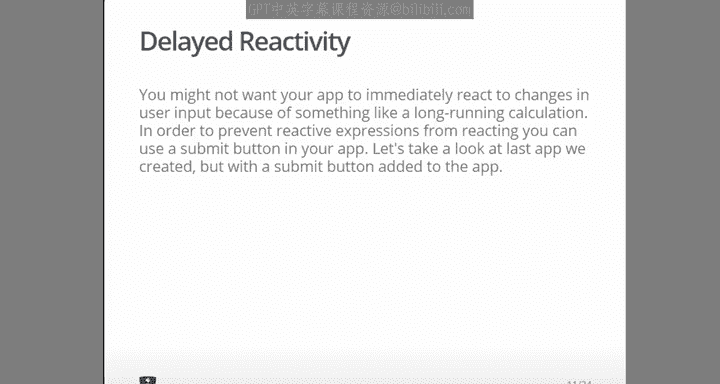
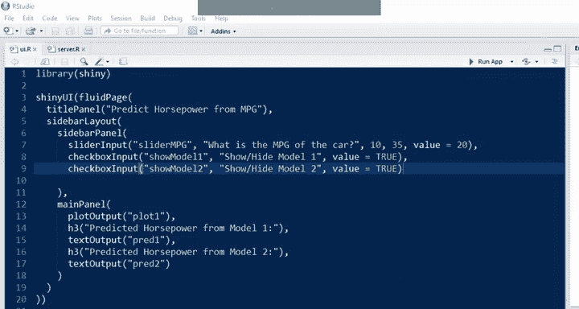
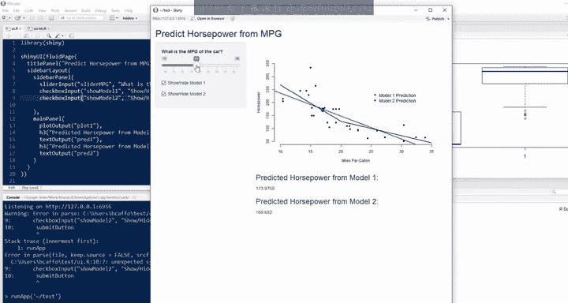
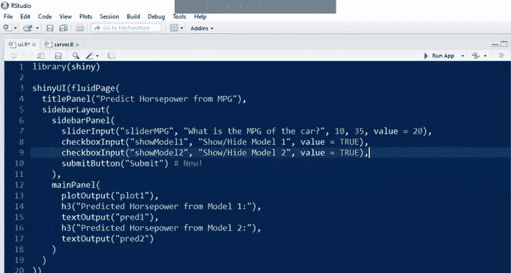
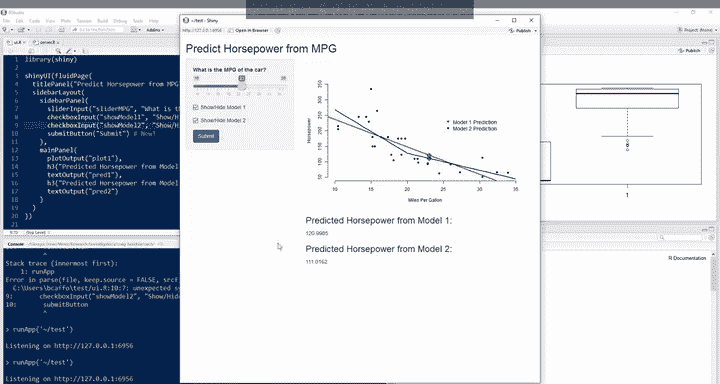
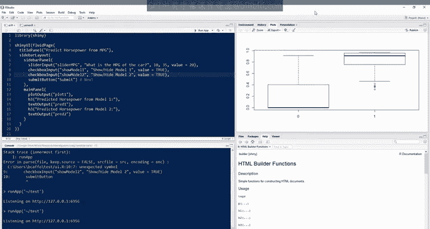

# 约翰霍普金斯大学《数据科学：统计和机器学习｜Data Science： Statistics and Machine Learning》中英字幕 - P116：8_Shiny 2 3.zh_en - GPT中英字幕课程资源 - BV1jsAAeNE3k

So the last thing that's kind of an important thing to cover in shiny is delayed reactivity。

 so we run into this problem a lot where we've developed an app。

And Shi reactivity and the way it works with reactivity。

 as soon as you're changing your slider values， it's automatically re executingecuting the code in the server functions。

And which is fine if what's going on in the server functions are really small quick calculations and often that's what you want。

 but sometimes your shiny app is running a large money carla simulation where it's doing bootstrapping or something computationally intensive and you want to have them set all the values then click a submit button or something like that so we're going to show you how to do this really quick it's only going to be one extra line of code。

Okay， here I have my code exactly from the previous example。And just set in the same exact way。

 So if I click Run app， you'll recognize the app， it just looks and as I change the slider。

 it goes ahead and reruns the code。

What we want to change now is to have a submit button。 So from the slides， I'm going to。Add this。

This one command， okay， submit button。Okay， so just the command here， submitit button。

And then the button value is called submitit， and then this actually receives a labeled input value called submit that you can use。

 for example， if the submit button is true in your server functions。Now。

One thing that's a very common mistake when you're doing shiny apps is not remembering that these are functional arguments。

 so not remembering that you have to have a comma after all these commands。 Okay。

 so notice our studio is kind enough， let me see。Before it was showing me that there was an error there you go。

See this little X there， that's that error。Expect a comma after the expression。Right there， okay。

 so without that comma wouldn't run okay， so now let's run the app。

And okay， see now we have a little submit button and as we change the value of the slider。

 notice it doesn't rerun， we have to click submit and then it reruns。Okay。

 so that's a very useful thing and again remember your submit button is a label button that you can refer back to in your server functions。

 so if you want calculations or things conditional on the server on the submitit button you can do that。

Okay， so that's a quick little handy thing that you can add into your shiny tools。

