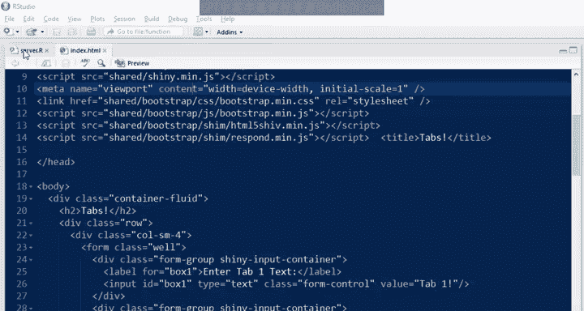
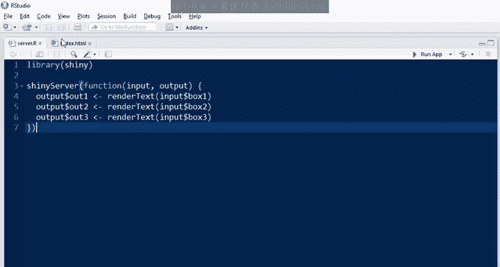
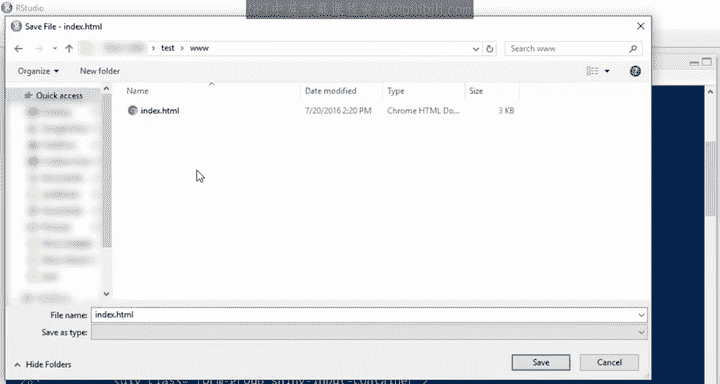
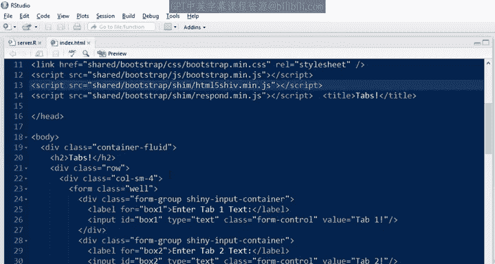
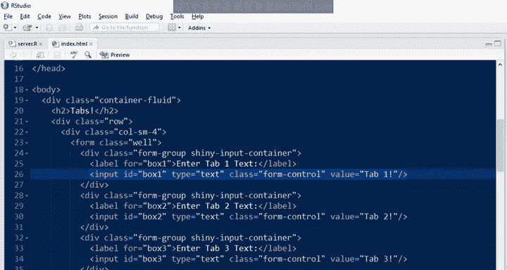
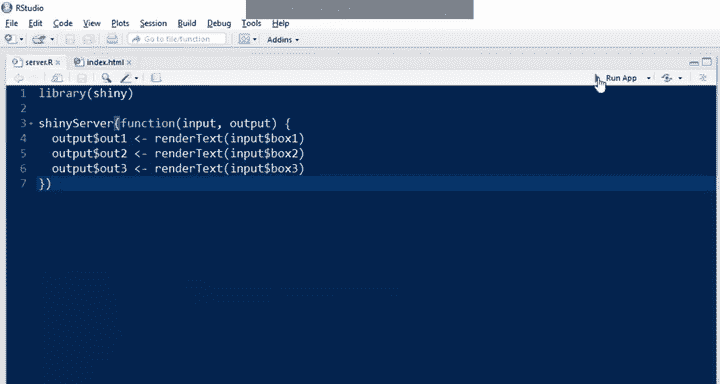
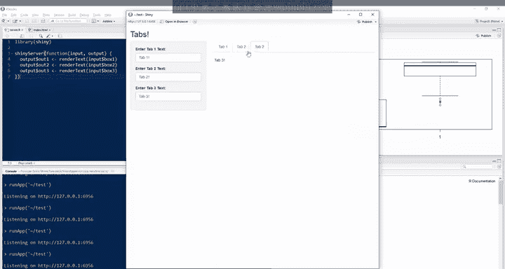
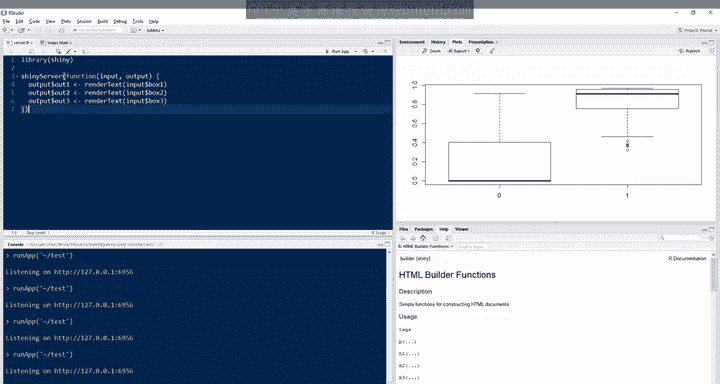

# 约翰霍普金斯大学《数据科学：统计和机器学习｜Data Science： Statistics and Machine Learning》中英字幕 - P118：10_Shiny 2 5.zh_en - GPT中英字幕课程资源 - BV1jsAAeNE3k

Okay， so I've promised repeatedly that I was going to show you how to just use your own HTML。

 and I have a very quick way to do that。 So right now， what I did was I。

Took our last example and I just saved the HTML that it was running。

 so I just did control you and Chrome copied the HTML and dumped it in a file， but importantly。

 where I dumped that file is in a file named indexex。 HTMLm in a subdirecty called Www。

 So there's my server。 R function and then in www the directory called WwW， I put the file index。

 HTMLm。

The index on HTML file， it has a lot of the preamble， most of which isn't necessary from the style。

 from the bootstrap style that it gets from that package。Okay。

 so you can get rid of a lot of that stuff and just have the style be whatever you want and you know maybe if you're not too familiar with working with you know web development。

 that sort of thing what you can do is do exactly what I did you know start with a simple shiny page。

 output the HTML， use that as your starting point and then build off from there。

 but I think if you're familiar with web development。

 you can just straight start with a straight index do HTML file， blank HTML file and work from there。

So the inputs just work just like rail old HTML input so here I have input ID equals box one。

 so it's just ID is the label just like we labeled it in the Ui。

R file okay so it works just like you would think and then you know so in this example we have three boxes labeled box1 box 2 and boxox 3 and so there's my input ID box1 here's my input ID equals box 2 and here's my input ID equals box3 and all these div statements are because you know shiny you know the Botap uses this particular CSS you style and all these divs are these nice little blocky structures that you see when for the default style okay and then for the output like out here right you can just see that it's referencing out to right？

And then the important thing is the class right， the class is shiny text output， Okay。

 so you can actually use。An existing shiny app， a shiny prototype app to get all these little things like。

 you know， probably what you if you're used to web development。

 what you wouldn't have known of off the bat is that the output class was called shiny text output。

 At any rate， this would give you， you know if you build a prototype。Grab the HTML。

 this will give you enough to go on。 And I think this will be pretty useful for you。

 know so for example， now， if I run my app， it should just look identical to what it was before because I just copied the same HTML and of course。

 you can see that it does look identical。 So I think this will be very useful for the people who。

Who know a lot of web development， and I think， you know when I talk to people who are in that camp。

 they certainly find using R as an intermediary for web development as quite annoying。

 So if you're in that camp， it's very easy to just use a straight HTML file rather than using R to actually put in your individual HTML elements。

