# 约翰霍普金斯大学《数据科学：统计和机器学习｜Data Science： Statistics and Machine Learning》中英字幕 - P11：10_05 01 变异性介绍.zh_en - GPT中英字幕课程资源 - BV1jsAAeNE3k

Hi， my name is Brian Kaffho and this is a lecture on variability as part of the statisticalistical In Coursera class。

 which is part of the data Science specialization from the Johns Hopkins Bloomberg School of Public Health Department of Biosstatistic。

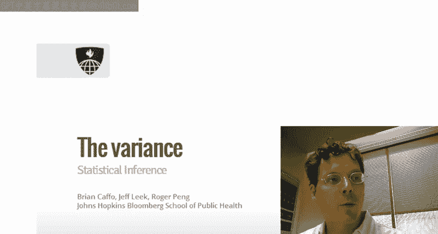

So in the last lecture we talked about the population mean。

 which talks about where the distribution is centered at， so if you were to think about a bell curve。

 that probability density function will move to the left or the right as the mean changes。

Another useful property is how fat or how thin how spread out or how concentrated。

The density is around the mean， and that's the variance。

So if x is a random variable that has mean mu， the variance is exactly the expected square distance the random variable is from the mean。

And I give the formula here， there's a nice shortcut one that is the expected value of x squared minus the expected value of x quantity squared。

So densities with higher variances are more spread out than densities with lower variances。

 and the square root of the variance is called the standard deviation。

 so the variance is expressed in the units squared whereas the standard deviation is expressed in the same units as x。

 which is quite useful。

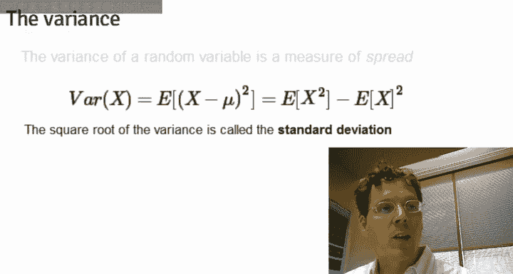

In this class we won't spend a lot of time calculating。

Expected values either means or variances of populations by hand。

 but I want to go through one such calculation。Recall from the last lecture。

 the expected value of x is 3。5 when x is the result of a toss of a die。

The expected value of x squared， I really haven't given you a formula how to do that。

 but really think of it as the expected value of the random variable that you get by rolling a die then squaring the result。

 and you can do that by simply taking the number， for example，1 squared， 2 squared。

 3 squared 4 squared 5 squared and multiplying by their associated probabilities and you get 15。17。

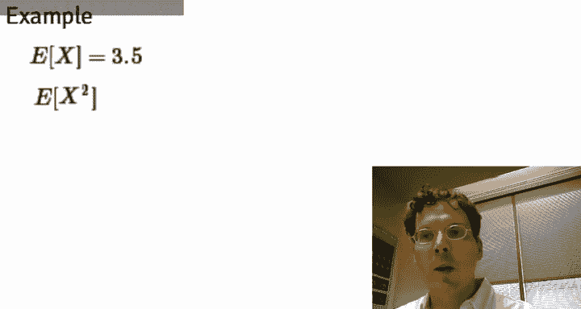

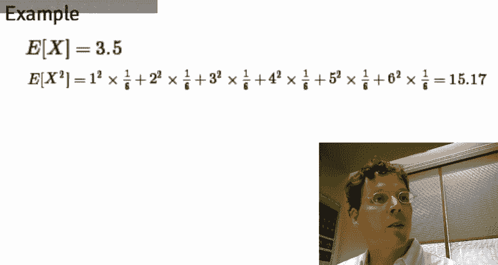

So if I were to subtract 15。17 minus 3。5 squared， Id get 2。92。

 which is the variance of this of a die roll。

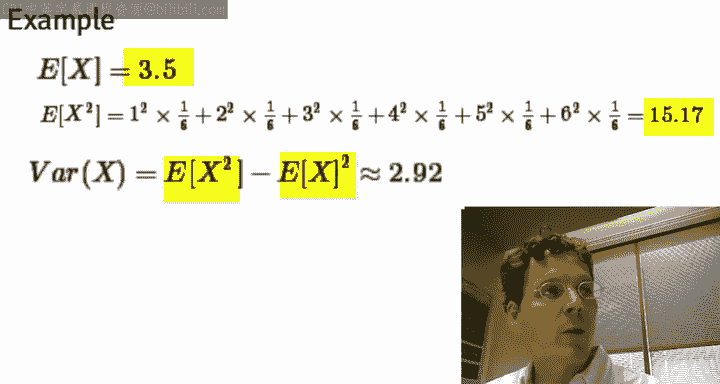

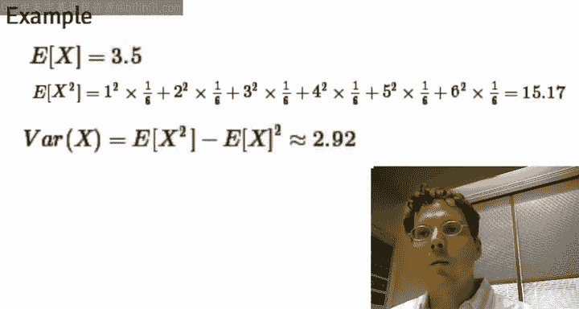

Since that was so much fun， let's do another example。

 so imagine the toss of a coin with the probability of heads of P。

We already covered that the expected value of a coin toss is P from the last lecture。

 and then let's think about the expected value of x squared。

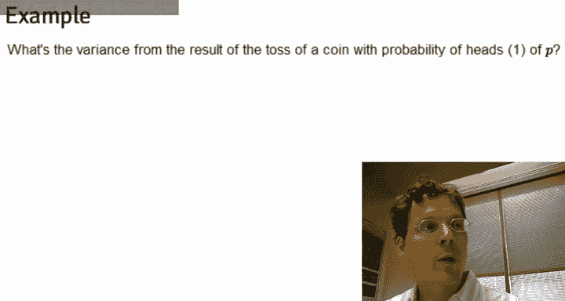

In this case，0 squared is 0 and1 squared is 1， so the expected value of x squared is exactly the expected value of x。

 which is p， and if we were to plug into our formula。

 we then get p minus p squared which works out to be p times 1 minus p。

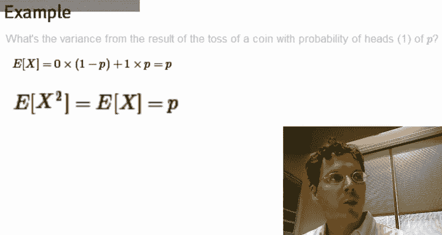

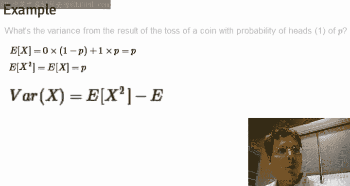

So in other words， the variance。The population variance associated with the distribution given by the flip of a coin。

 a biased coin is exactly p times 1 minus P。 This is a very famous formula and I'd recommend that you just committed to memory。

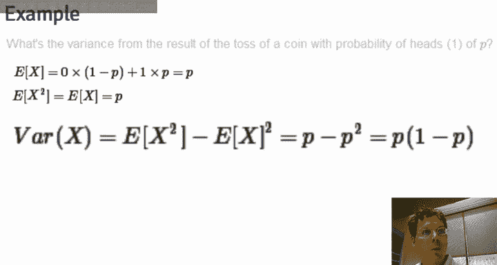

Here I'm giving you some examples of densities， population densities as the variance changes。

The salmon color density is a standard normal， which has variance one。As I go up。

 you see the variance increases， it squashes the density down and it pushes more of the mass out into the tails。

 so there' is more likely that a person say is beyond five， if for example。

 they are from the normal distribution with a variance of four than if they were from a normal distribution with a variance of three。

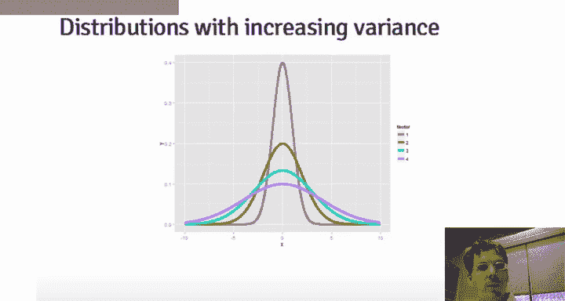

So just like the population mean and the sample mean were directly analogous。

 the population variance and the sample variant are directly analogous， so for example。

 the population mean was the center of mass of the population。

The sample mean was the center of mass of the observed data。

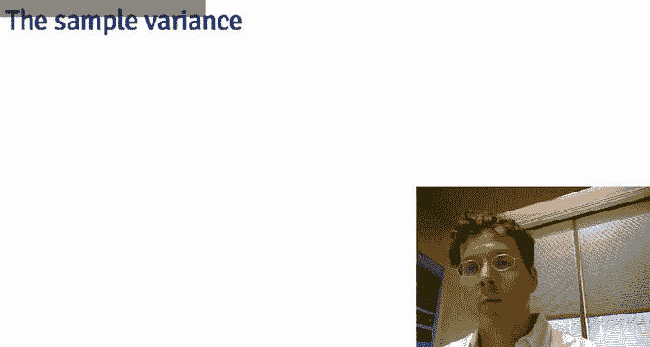

The population variance is the expected square distance of a random variable from the population around the population mean。

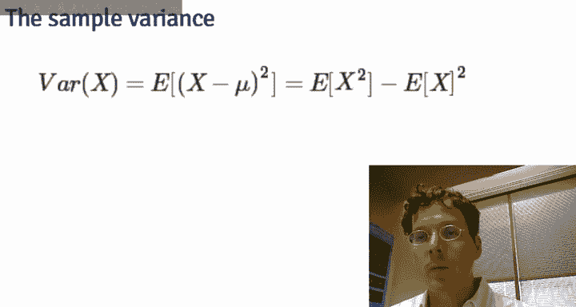

The sample variance is the average square distance of the date observed observations minus the sample mean。

So we do divide by n minus1 here in the denominator rather than n， and I'll talk about y in a minute。

But I also want to talk about a conceptually for me kind of difficult point which is to talk about the variance of the sample variance。

 so let me remind you that the sample variance is exactly a function of data。

 so it is also a random variable， thus it also has a population distribution。

That distribution has an expected value， and that expected value is the population variance that the sample variance is trying to estimate。

And as you collect more and more data， the distribution of the sample variance is going to get more concentrated around the population variance it's trying to estimate。

And then I also simply want to remind you that the square root of the sample variance is the sample。

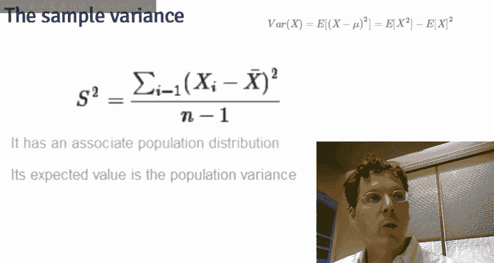