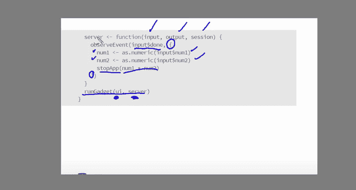
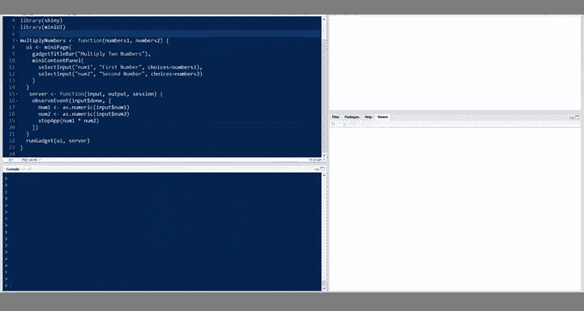
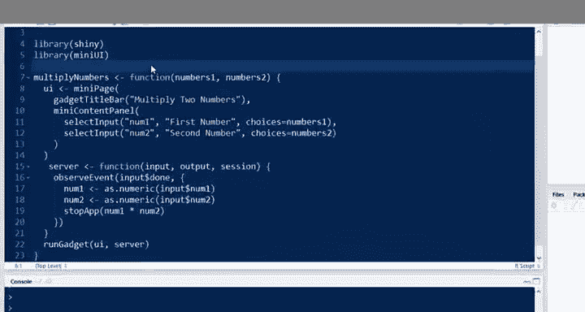
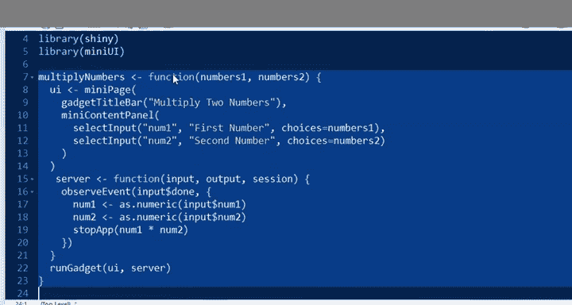
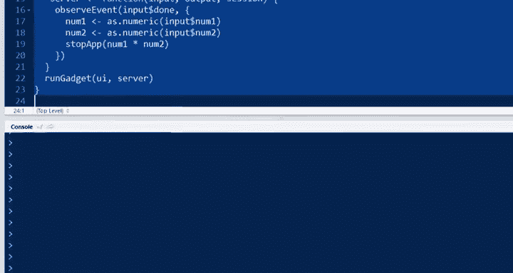
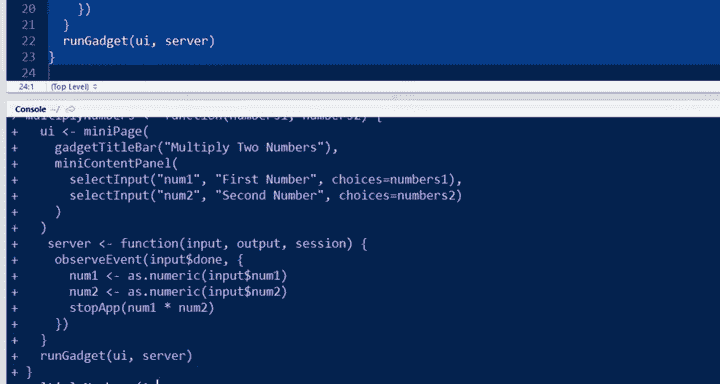
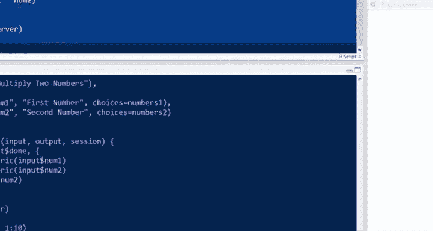
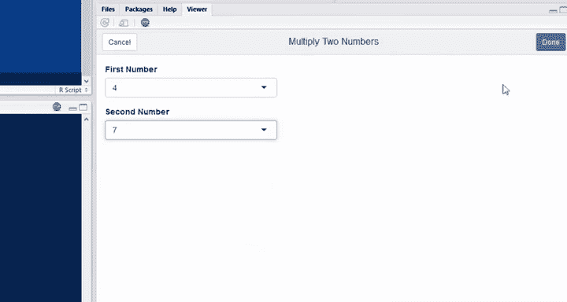
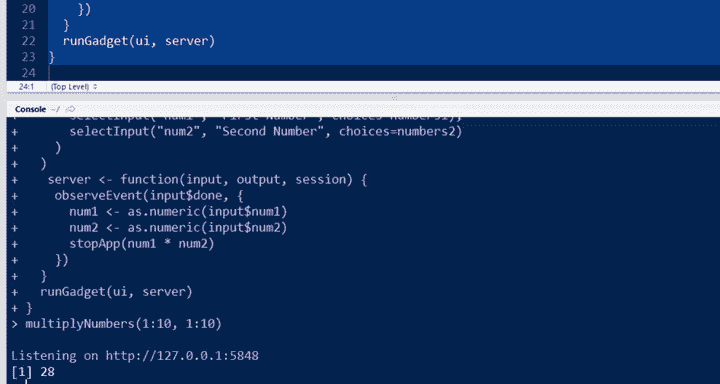

# 约翰霍普金斯大学《数据科学：统计和机器学习｜Data Science： Statistics and Machine Learning》中英字幕 - P121：13_Shiny Gadgets 1 2.zh_en - GPT中英字幕课程资源 - BV1jsAAeNE3k

Okay， so our last example was kind of silly in that the function really didn't do anything。

 It just had a button that you clicked and then it was done and it just took you back to the R prompt。

 It also has a cancel button by default that will stop the gadget and just return your R prompt to quit the server running Okay so now let's just show you how you can include some arguments and you're shiny gadget and we're going to do some just simple manipulations。

 of course just because we're going to try and show it and its simplest version and I think once you get the gist of how to code it then you can figure out how to do it with your own application。

So let's go through the code， the code here has two parts because it is just hard to fit on the screen。

 so here's the first part and then the second page is the second part so remember of course our Shi gadget has to have the UI part in this case we're again doing mini page。

And then the server part。Okay， and of course， we have to。We have to have our。

Our two libraries loaded up， so just make sure you have that。Okay， so。

Our gadget title is just going to be multiply to numbers are content panels。

 So this is new right here。 mini content panels。 So that's just going to be the main body of the little pane there and it's going to have selector input。

 which is going to be like a drag down box and it's going to have two variables。

 the variable one is going to be enabled labeled nu1 and nu2。 So if we have to reference them later。

 they're going to be have that name and then you know these are the display labels。

 and then the choices are right here and the choices come from these two arguments right here in the function so that's going to display our user interface。

And then。Our server， okay， again， it's going to have input， output and session。

 We're still going to have the input dollar sign done variable in the observe event just to let Shiny know that when it's done to quit it。

And then we're going to remember to have this curly braces here。

Remember that kind of odd syntax that shiny has。 So just， you know。

 probably the number one mistake everyone makes in codingding shiny applications is forgetting to put the curly braces in in the right spot or forgetting to close a brace and that sort of thing。

 Okay， so we're just going to actually name in this environment。

 a number one number one and numb two as the just。Input values just so that they are easier to work with。

 Okay， and then we're going to multiply them together。

 And this stop app function is just going to tell it to stop and display the result of nu1 multiplied times nu2。

 And remember， we have to have a run gadget in there。 And it specify what。

 what is the U I and what is the server。 So technically， you could name Ui and server something else。

 But by convention， I think no one， no one does that。 Okay。

 so let's go through the code demonstration and see how it works。

Okay， so I have my function that I copied from our markdown document。

 Let's just make sure I've got the two libraries loaded。 Okay， now let's run our function。

 I've already run it before。 I'm sorry， I already win over all the components before。

 but now let's actually see what happens when we run it。

Okay， so obviously nothing because this is just defining the function。 Now， let's do it up。

 There it is good。And let's give us choices， the numbers 1 to 10 and1 to 10。

 let's say we're learning our multiplication tables and we want this to help us check them。

 So I want to do  four and 7 hopefully it'll give me 28 And then when I click done go back into the R pane see it give you 28 Okay so this is just a baby step towards some really useful things。

 but we were able to put in some choices， select among them and then have R do some numeric manipulations and spit them out and I'm hoping now you can start to see the direction that shiny gadgets is going to go from here to actually be useful for you。

 So next we'll actually do a interactive graphic。

