# 约翰霍普金斯大学《数据科学：统计和机器学习｜Data Science： Statistics and Machine Learning》中英字幕 - P122：14_Shiny Gadgets 1 3.zh_en - GPT中英字幕课程资源 - BV1jsAAeNE3k

Okay， so one of the most useful things we can do with shiny gadgets is create interactive plots。

 Now I know many of you are familiar with shiny syntax because we've already done the modules on shiny so we're not going to spend a lot of time redoing that in the context of shiny gadgets。

 we're just going to go over one example and hopefully youll get you'll be able to build and generalize off of this using your knowledge of shiny and the little bit of extra syntax that we need for shiny gadgets to put the two together and do what you need in using shiny gadgets as will be useful for you。

So what we want to do in this example is。Ploot the the trees data set and plot the， say。

 girth by volume and have a crossha where we can select a rectangle and that will our function will then output a data frame of the trees from that rectangle。

 Okay， so let's try and do this。So again， we have。We， as always， have to。

Do library shiny and library mini UI our shiny gadget is a function。Okay。

 and we have to have a user interface， and it's going to be mini page from the mini UI。 We have a。

Title bar， gadget title bar， select points by dragging your mouse。

 and then in the mini content panel。 so just in the main content panel of our shiny gadget shiny app。

We're going to have a plot。And the name of that plot is going to be plot。 Okay。

 so and we'll refer back to that here in a second when we get to the second part of the of the code。

 Okay， we want the height to be 100% just because you know。

 that's going to make it look that's going to make it take up as much of the page as we can。

 And then this this is an option is to actually have the brush。

 that's going to be the crosshairs that select the point。

 but notably we're going to name the brush brush， okay。

So let's go to the server and remember those two things we name plot and brush。 Okay。

 where do those named outs。Where do those named inputs come in in our server function okay output star plot not star dollar sign plot is going to be this render plot statement and remember from shiny when we render a plot to be displayed it has to have this kind of reactive notation of a parentheses then curly braces and you've got to get them both otherwise it'll give you an error。

So we're going to plot the actual plot that we're going to plot is going to plot trees。

 the data set trees girth by volume。 The title is going to be trees。

 and it's going to have an x label of girth in a Y label of volume Okay。

 so that's the plot that's going to get passed back to the UI with the variable name plot Okay。

 and then observe event again， we're going to finish the app if it's done Okay。

 then we have our curly braces right here again。 and then we're going to stop the app。

After we collect the brush points， which is just after we select the rectangle from the trees data set。

And the input is dollar sign brush。 That's the variable from before when we declared in our plot statement in UI and named our brush brush。

 This is where we're using it here。 That's the input。

 And then the X var and the Y var here have to be named the same thing。

 and they have to be the correct names from the data set trees。 Okay。

 And then we have our run gadget statement。 So let's run this and see what it does。

 And hopefully you can see that this is kind ofs starting to become a pretty useful tool。

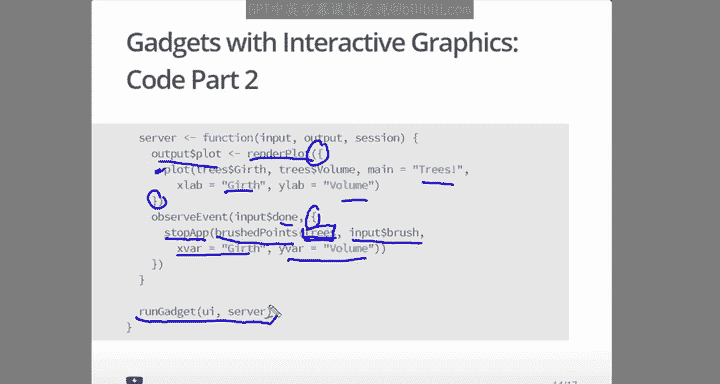

Okay， so we're going to load up shiny and mini UI and again you only have to do this once if you've done it before。

 if you have multiple gadgets， but I'm doing it every time because I'm often restarting the R server。

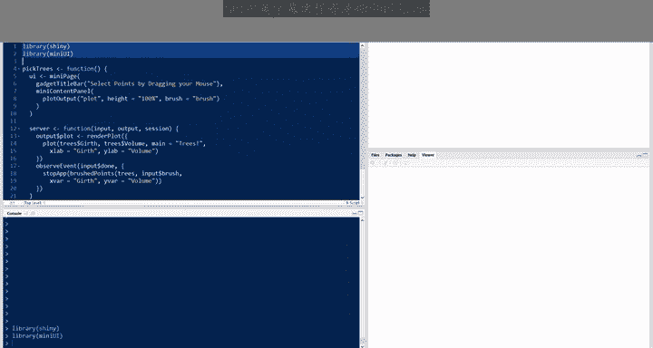

OrI'm sorry， I'm often restarting the R session。

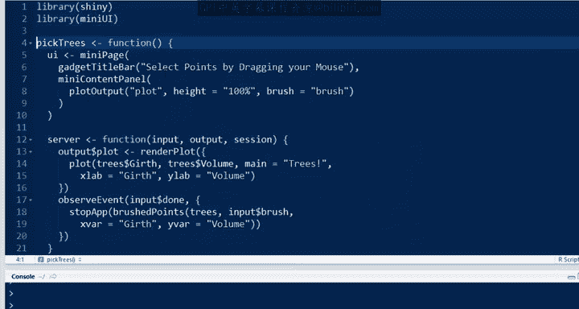

So here's my shiny gadget function， P trees。

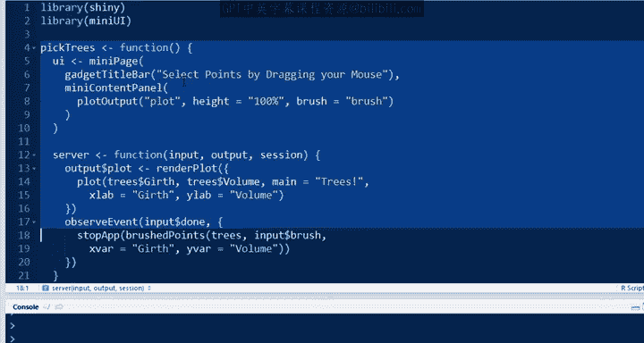

Okay。Now let me run it。

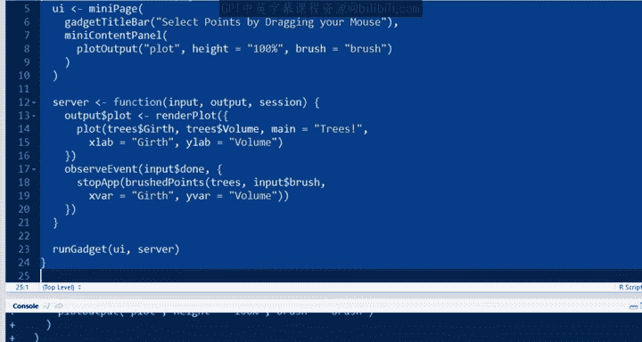

Doesn't take any arguments， there it is， starts at the little server， and here is my plot Okay。

 now what I can do is select， say this collection of points right here。

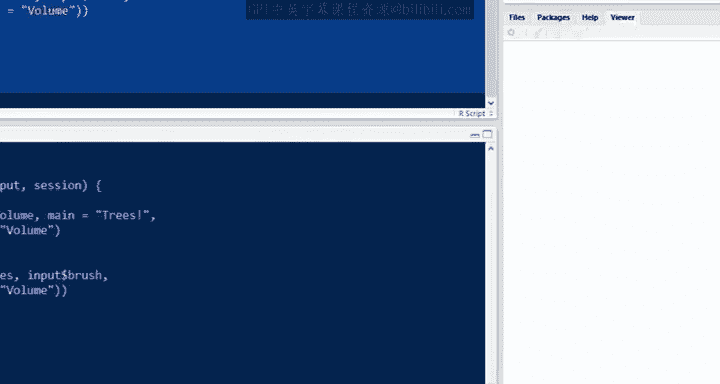

Okay， and now that I've selected it and I can actually move it around， by the way。

 But I want those points right there。 I want and you can。Move the box in。Okay。

 then when I click done。

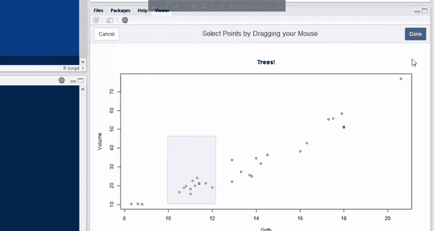

I go over here。 it's given me those data points so you could， for example， assign this to。Trees。

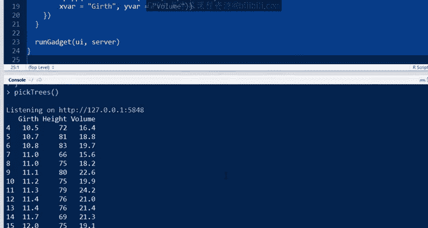

I picked。Okay， and then when I do it。

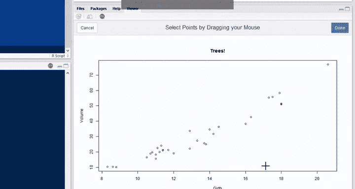

I click on， then if I do trees。Here we go。There they are， so that's a way that you can in this case。

 this might be useful， for example， if you wanted to pick outliers from a data analysis where you want to know specifically what points they were or notice it it's keeping the original data frame row numbers there so you could actually refer back to the data frame itself。

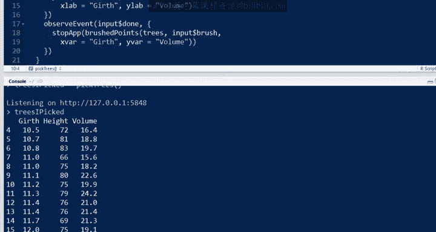

Okay， so， you know， just to be clear about the naming right， so if I had named this plot one。

 for example， instead of plot。

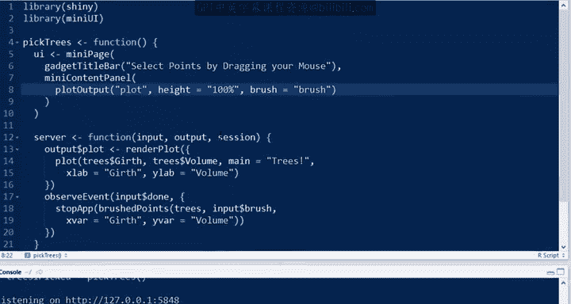

And I redid it。

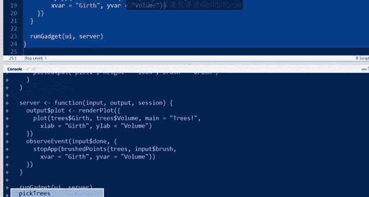

My plot doesn't show up。 And the reason is because I named my plot plot， not plot one。 Okay。

 so let's cancel that。 We have an error there。 So let's say， for example， if we。

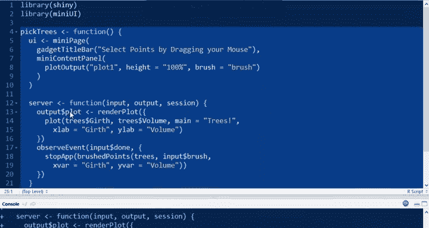

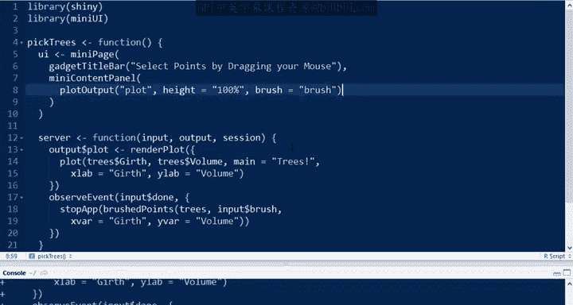

Name this brush one。Instead of brush， okay。

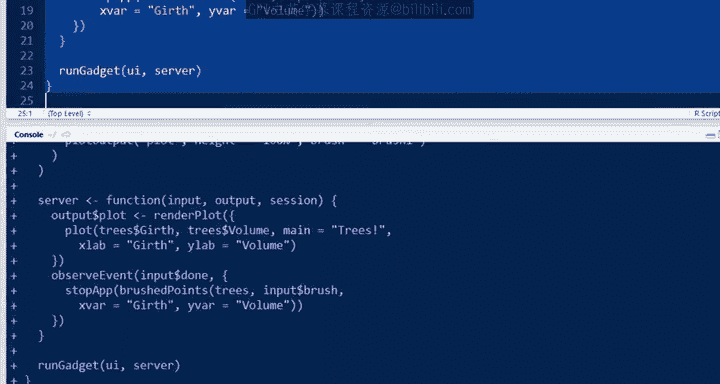

Let's do it， okay。

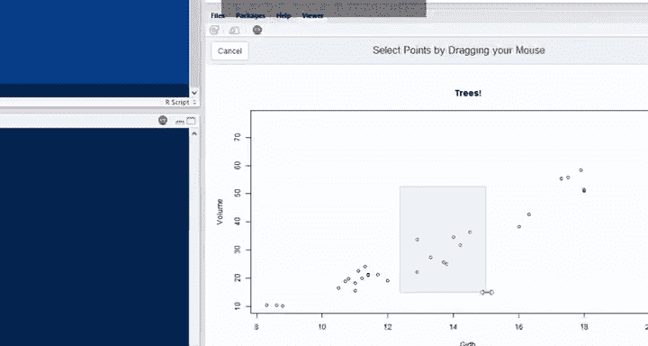

Now when I run it。It gives me no output why， because it's looking for input brush。

 not input brush one， and input brush had no input okay。

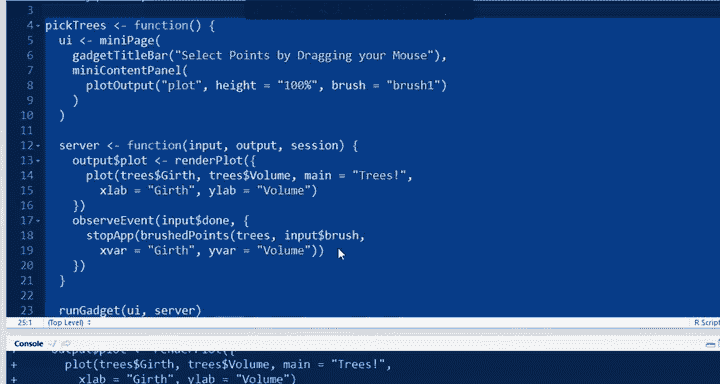

Okay， so I hope this gives you some tools that you can use and build on so that you can start building your own shiny gadgets。

 I think this is probably worth learning if only for the interactive graphics。

 because interactive graphics are so useful and it's not something that R has really done well internally and so having this add on through our studio is really a useful thing。

 So just for that reason alone， it's probably worth learning shiny gadgets and building that into your workflow。

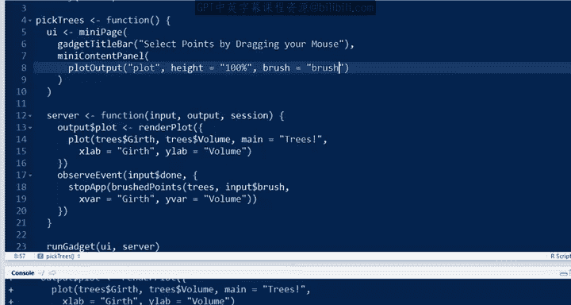