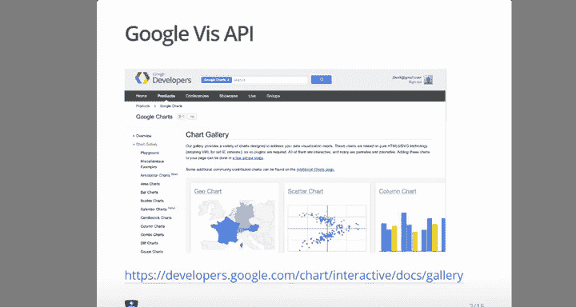
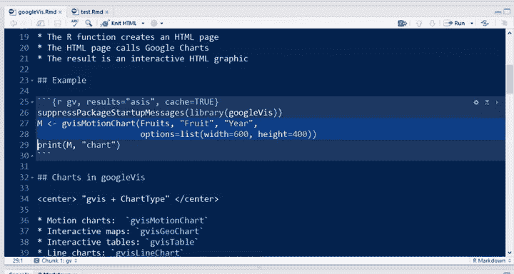
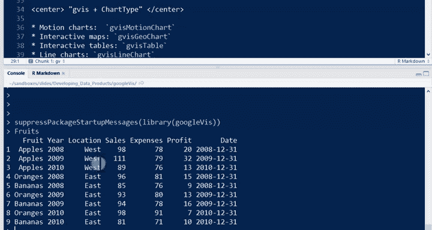
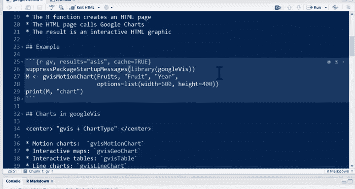
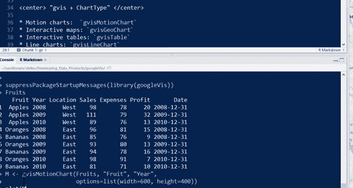
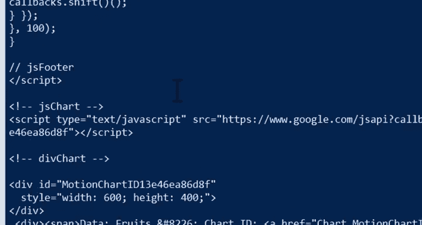

# 约翰霍普金斯大学《数据科学：统计和机器学习｜Data Science： Statistics and Machine Learning》中英字幕 - P123：15_GoogleVis 1 1.zh_en - GPT中英字幕课程资源 - BV1jsAAeNE3k

So Google Viiz is an amazing R package that connects R to Google's visualization API and its extremely it's an extremely well developeded R package and very well documented。

 So it's certainly worth considering in this class。

 So we're just going to go through a couple of examples of what you can do with Google Viz and I think from those you'll get the picture and hopefully you'll be able to build off of it。

 But it offers a pretty amazing way to create interactive graphics。

 leveraging the existing interactive graphics that Google already has。

 So let's go ahead and get started with some basic uses we'll go through over some maps we'll go over some plots and motion charts and things like that that are that are really would be really difficult for you to create on your own。

 but but connecting R with Google Viz makes it really easy。

 especially if you're familiar with R Okay so let's just get started with a motion chart。

So let's go ahead and create our first plot。 Now， a lot of the syntax in the way in which these notes。

 the R markeddown notes are are given is really geared toward actually having the chart embedded in the R markeddown slides。

 And if you load them up， you'll see that the Google Viz chart is actually part of the R marked of the H document that gets compiled when this documents gets knitted。

 Okay， but so I'm just instead going to show you how to get the chart by itself and then get the raw HTML。

 for example， Okay， so let's just say。We're doing library Google Viz that just suppress package startup messages。

 obviously just suppresses the package startup messages。 So let's go ahead and create our Google。

 our Gviz motion chart。 Okay， so fruits is a data frame。

Okay， there you go。 And you can see how it's set up， so fruits。

It's got the different kinds of fruits， apples， oranges， bananas， the year， location， sales， expense。

 profit date， okay？

And。You know， if you I think if you want to create a motion chart。

 you want to get it set up into something like this like a data frame like this。 Okay。

 so let's go ahead and run it。

And then the first thing you're going to want to see is you're going want to be able to do is just be able to plot it by itself and actually see it。

 So what we've done is we've assigned the output of our Gvi motion chart to a variable M。

 So if you now you you just type plot M now it'll bring up a browser window and here's our plot。

 And so this is a lot like the Hans rosling or it's exactly like the Hans rosling motion chart。

 So you can you can click play and it shows you it shows you things over time。

 and you can set what each of the scales are relative to the columns of your data frame。

 So maybe we want time on there。 and we want。

Profit。Okay， so let's see fruit profits over time。So you can see it going up or down。And you can。呃。

Select。Whether you just show one or multiple or which one's highlighted。See there you go。

 So I select apples， Okay， so it's a pretty clever little chart， Okay， and it actually also has。

Different， you know， bar charts and line charts all in the same graph。 Okay。

 so all of this is is a collection of jascript that is has been organized by the Gvisz R package。

 So if you want what you can do。

Is simply type print M。Okay， and then it it'll give you the relevant the relevant and basically an HTML page。

 So here here it is here you can see it defining the JavaScript data describing the JavaScript header and so on。

 okay， but if you go down here， you see it it actually creates the page where。

I can't see the beginning of the。Beginning of the HTML， but there you can see the end of the HTML。

 the end of the body， and so on。Okay， so just the object M by itself， Pri M will print out the page。

 or you can say， for example， print M file equals let's say test HTMLtml。

 and it'll create this page for you。 Okay I like to do plot。 And then of course。

 if you want to grab the HTML from from the page directly after you've done plot。

 you can of course do that。 But this is probably the way you're going to use Gviz either you're first going to create it and use plot or something like that to do bug it and get it looking right。

 and then you're just going want to grab the relevant HTMLm code and jascript code and embed it in a different web page。

 If you want to see how to embed it in， for example， slides or R markdown。

 then just look at the actual R markdown document for this lecture。

 Okay so your homeworkmark after this first。Example is to just recreate this motion chart。

 make sure you can visualize it， make sure you can see it in a browser window。

 get Google Viz installed， and play around with a little bit and then now we'll just work on to some other different types。

