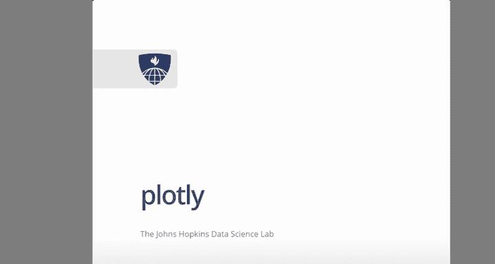
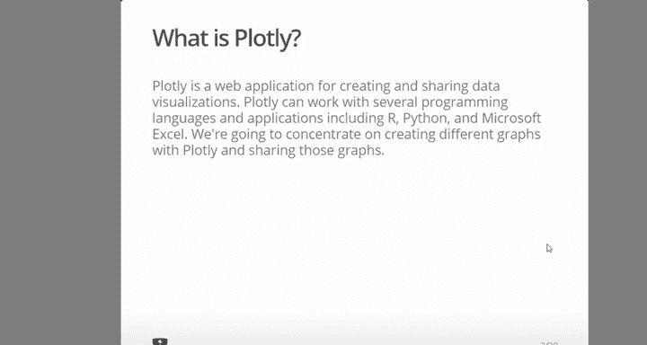
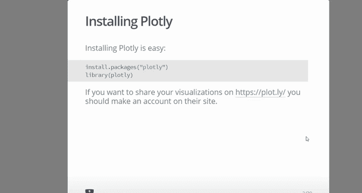
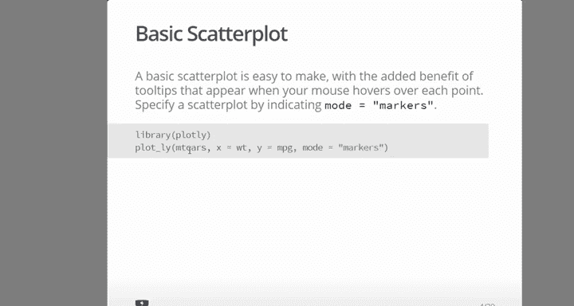
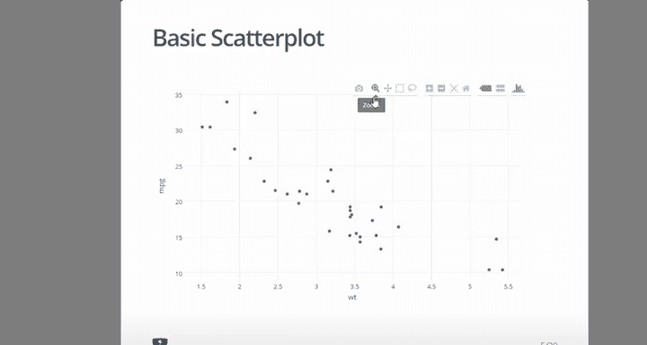
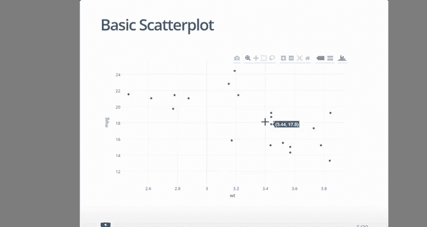

# 约翰霍普金斯大学《数据科学：统计和机器学习｜Data Science： Statistics and Machine Learning》中英字幕 - P125：17_Plotly 1 1.zh_en - GPT中英字幕课程资源 - BV1jsAAeNE3k

Hi， my name is Brian Kaho and this is theDevelop data products lecture on Ply。

 So Ply is a really nifty little web application and library for R that I had an old video on but it was early in there are development and I just went back and looked at it and I was really astounded at how much development has occurred since then and for creating interactive web graphics in R plotly is certainly something that you should look into the nice part is it integrates with a lot of different languages too So you know what is plotly Ptly is a web application for creating and sharing visualizations it can work with several languages off the top of my head I know that it works with Matlab。

 Python， Javascript and so on and they also have a web interface if you like to point and click your way to victory just uploading a CSV file or something like that。

 and you'll see I think in some of our first applications。

That we're going to do with code demonstrations that you know plotly is really easy to get up and going。

Especially if you work in our studio and in R now。

So installing plotly， I'm not going to do code demonstrations on this this should be familiar for you at this point in the class。

 installed up packages plotly， and then of course to bring it up you can do library or require plotly or something like that。

Later on as the last part of this lecture series I'll talk about sharing your plotly plots。

 which isn't specifically an R thing， it's more of a how do you share HTML graphics discussion and one of the ways is actually on the plotly site and they have free options and paid options if you want private private displays and user authentication and things like that so if you want to share your visualizations through plotly then of course you can do that but in addition they just make HTML graphics that you can create a webp page and share on your own without involving plotly at all other than the plotly R package but also you their web interface is pretty interesting it gives you a lot of nifty tools that even are not that easy to do an R like for example。

 interactively changing access labels so that's something that you can't really do in R you have to re。

On the code and that sort of thing in any rate at the plotly。

At the plotly web interface you can do things like that， so we'll show that at the end。

 but for right now we're just going to work in the R console and just show plotly when running things locally。

Okay so before I the code before I do the code demonstration。

 let me go through the slides a little bit here， the slides just go through creating the command or invoking the command plot underscore Lee the empty cars data set and just specify the X and the Y and then one thing I just want to show before we go through the code demonstration is this is actually embedded into this knitter document here so the R markdown document that got then knit into an HTML document。

 it is actually displaying the interactive graphic as part of the actual document in the actual slides so you can where zoom in。

 you can zoom in for example and things like that that you can't normally do with the static graph and this is all embedded in the slides so when you look at the R markdown document the commands are very simple to just。

Do that so one interesting application of plotly is embedding it in your slideify or our studio presenter or slidey just knitter documents Okay so let's do some code demonstrations where we go through a couple of different plotly type plots and then at the end we'll talk about how we share them。

