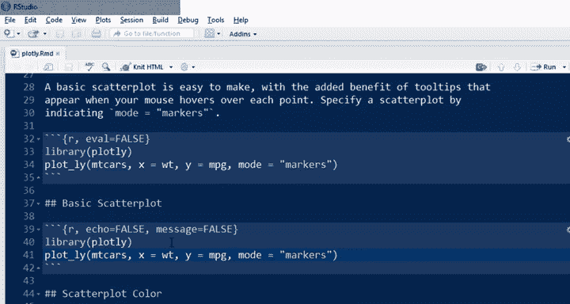
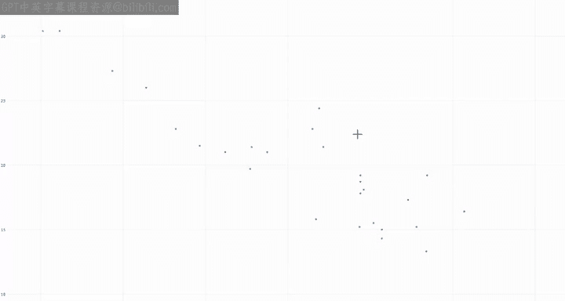
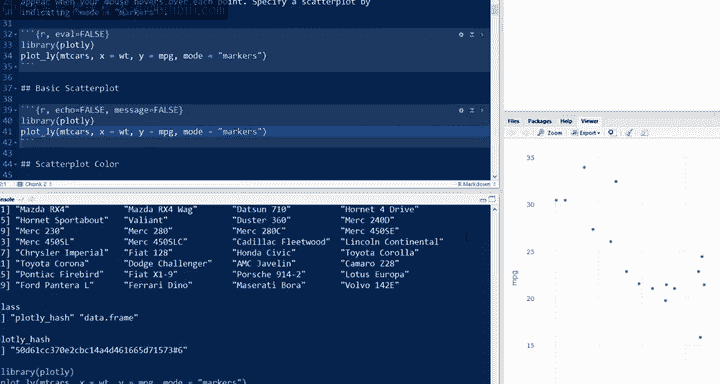

# 约翰霍普金斯大学《数据科学：统计和机器学习｜Data Science： Statistics and Machine Learning》中英字幕 - P126：18_Plotly 1 2.zh_en - GPT中英字幕课程资源 - BV1jsAAeNE3k

Okay， so here I have the R markdown document that's associated with the plotly lecture。

 I'm going to do library plotly of course after I've installed it。

 and then the command is really simple plot underscore Lee empty cars x is empty cars is a data set which is a data frame it's stored as a data frame the X' is weight。

 the Y miles per gallon mode is markers so that's just going to create create a scatter plot so you can copy that exact code for any data frame and it will give you a scatter plot okay and you can see your scatter plot in the R studio viewer pane it's interactive。

Right when as you hover over points， they're showing their X and Y values。

 but there's all these controls up here which include things like downloading as a PNG， rescaling。

 resetting the axes， changing what the hoverover action does and so on the publish button works as well you can publish this to our pubs just by clicking on this button which will create a web graphic for you。

 but we'll show you some other ways to publish it here in a little bit well one other easy way to publish it right here is when you click on export。

You can save it as an image。Copy it to clipboard， but let's just save his web page to show you maybe the easiest thing to do Okay。

 then you just need to pick a name， so let me just call it test。I already name something test。

 so there it goes， and then it brings up a web page with it with it on， and there's a file test。

 HTML。On your computer that you could reference and you could go in and actually look at the code。

 there's a bunch of， if you know some JavaScript， you'll understand it totally if you don't。

 you should just be able to clip out the parts that you need if you wanted to embed it。

So it's super easy to use plotly， so your first assignment is to create a simple scatter plot。

 try it with a different data， create a web page， create a graphic like a PNG and a PDF。

 maybe publish it to our pubs and so try that out and then we'll move on to some other examples。

