# 约翰霍普金斯大学《数据科学：统计和机器学习｜Data Science： Statistics and Machine Learning》中英字幕 - P127：19_Plotly 1 3.zh_en - GPT中英字幕课程资源 - BV1jsAAeNE3k

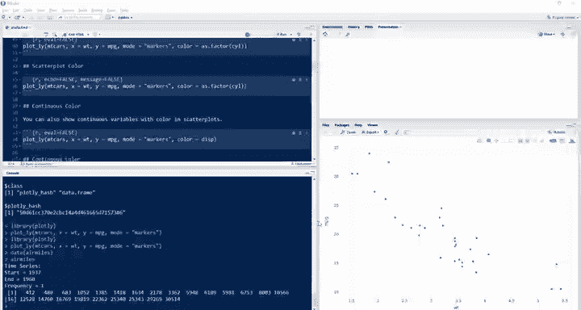

Okay， so let's cover some options for scatter ploting in plotlet and it will do this just because scatter plots are such an obviously common thing you might want to do。

 So here's one thing you can change the color of the points color is asdot Factor cylinder So in the empty cars data。

 let me come down here。

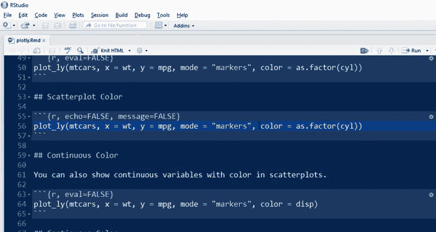

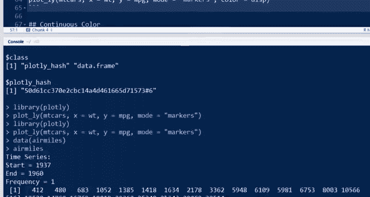

Head empty cars and show you。 So cylinder is is where is it cylinders right there。

 It's I think table。

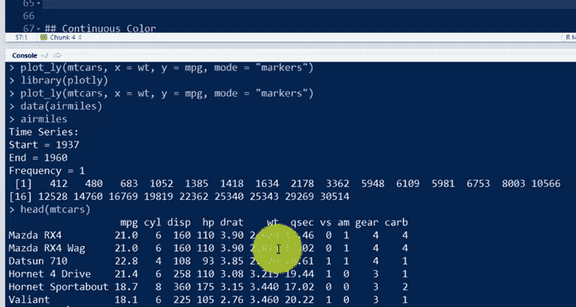

MP cars star。Dollar signs， cylinder。Let's see yeah， so 4。

6 and8 so is displaying the number of cylinders of the car obviously should have an impact on miles per gallon。

 which is our y variable， so we might want to display that as another dimension because it's effectively categorical right it's just the three values we could do it as color now it's not by default a factor variable。

 it's numeric so we're going to convert it to a factor variable by as dot factor cylinder and now let's run it and then you can just see now the colors represent cylinder and up here there's a legend by default it says8。

6 and4。

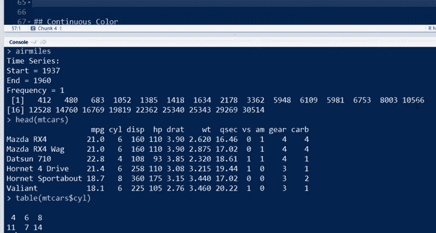

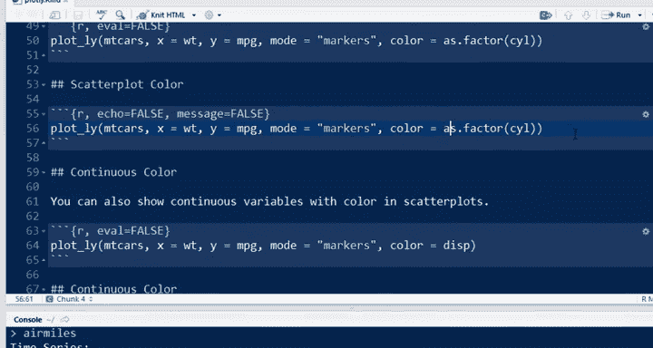

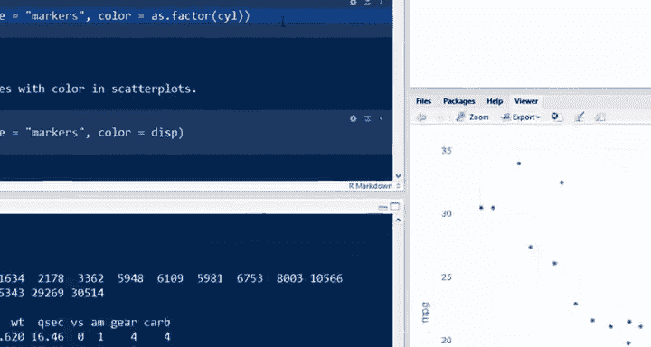

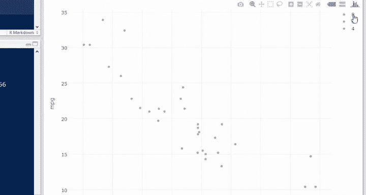

Okay。Now， let's try something that's continuous to display the colors。 So in this in this case。

 if you look at displacement。 So heading back down here， if you look at the empty cars data。

 the displacement is kind of a continuous variable， right so。

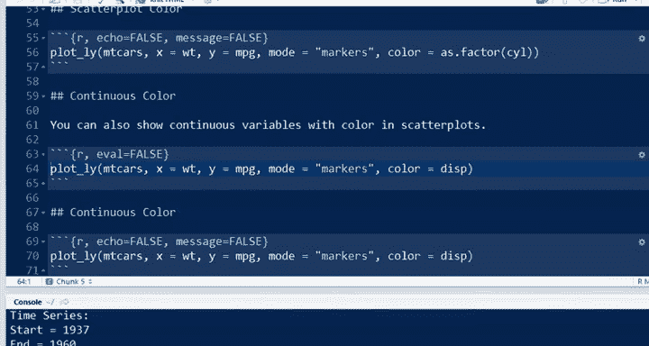

If we run that， plotly is smart enough to know that the color is a continuous variable。

 so it treats it as another dimension， a continuous dimension using a continuous color gradient。

 and then it displays very nicely displays the key to the gradient here on the side so that's another way you can use color。

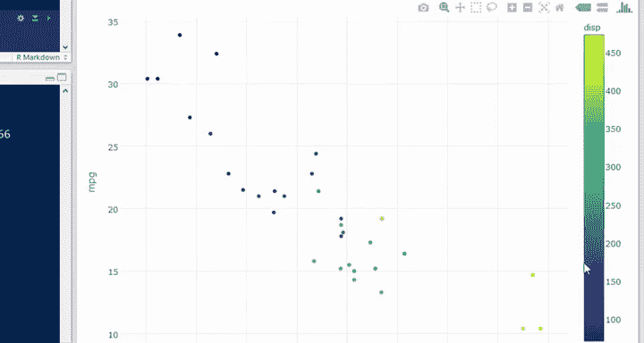

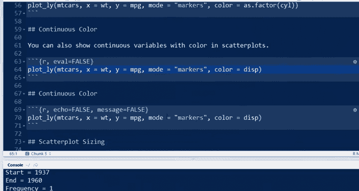

Let's。Let's change the size of the points。 I think when we look at this plot。

 the points to me are very small。 And then as you saw， maybe from the last lecture。

 when I outputted it to an HTML file， the points were almost invisible。

 So let's let's change the size。 Now， in this case， the。

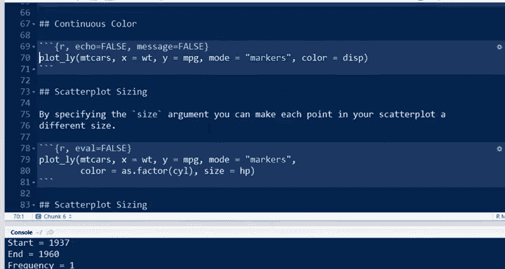

The size we're going to do is horsepower。 Okay， so horsepower is a continuous variable。

 So the size will be every point is just going to have a different horsepower。 Okay， I'm sorry。

 every point is going to have a different size。 Okay， so here the cylinder is the color， right。

 and horsepower。

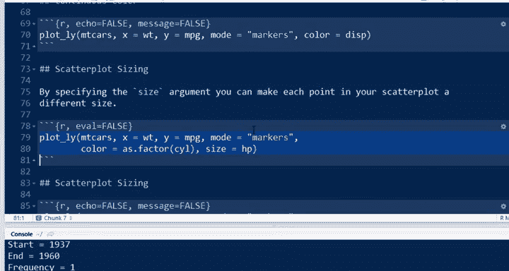

Is the size。So another interesting way， you know that you run out of dimensions， of course。

 in a 2D scatter plot， so you you know the only real dimensions you have are the the。

You knowThe two displayed dimensions， color， size of the points。

 and then the plotting point itself are the different kinds of dimensions you can display。

 So here it's nice that we're showing four dimensions， miles per golon， weight。

 cylinders and horsepower all in the same plot。

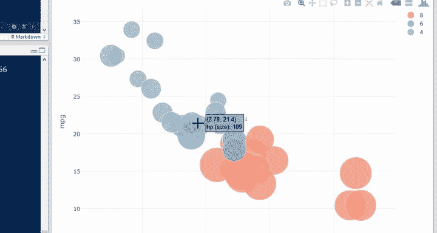

Okay。Now。

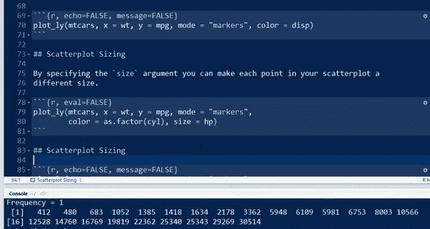

Now next， I would like to just briefly show a 3D scatter plot。

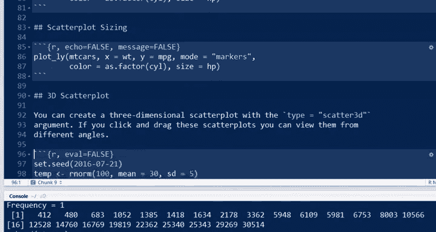

Now。

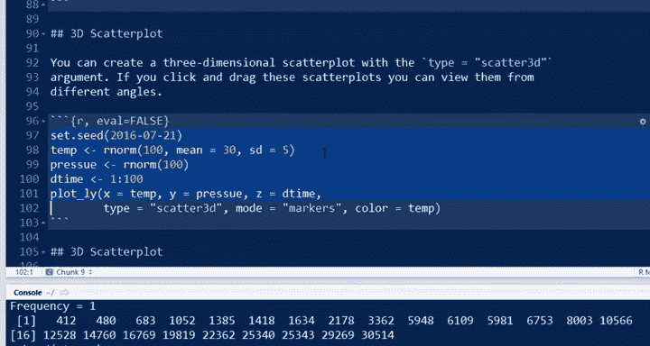

I'm going to run the code here and show you the plot and then we'll describe what it's doing。 Okay。

 so that's another， of course， this is another way you can add a dimension。

To a scatter plot so what it's doing here is it's using webGL。

 which is the a web based translation of the open GL graphics library okay and it's a way that you can have 3D interactive 3D graphics。

In embedded in web pages。 So again， this will all just display and be interactive like this when you output it as a web page as well。

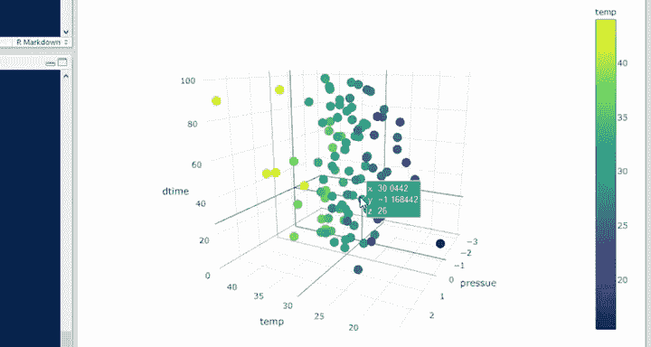

Okay， so here we have three variables， temperature， pressure and D time okay and。

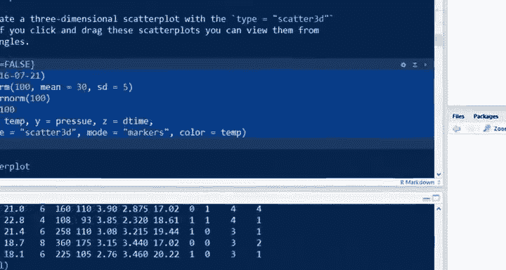

In this case we created like a very fictitious data so temperature was just 100 random normals。

 pressure was just 100 random normals and D time was just the numbers from one to 100 so there's 100 data points they have three different values okay and this just shows you plot underscore le。

 same command okay now we just specify three variables X， Y and z， so super easy。

Type equals scatter 3D mode equals markers and this the color equals temp just like before puts a color gradient on the points and then puts the actual key to the gradient on the side of the plot so that's all that we had to do to get this nice interactive 3D scatter plot。

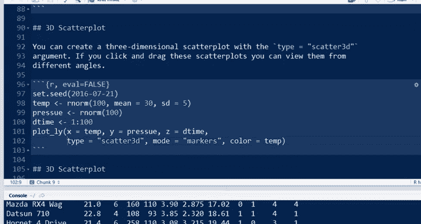

Okay， so your homework now so I feel like we've covered enough of scatter plots to get you started on scatter plotting in plotly。

 you can of course look at the further options that you can try and play around with。

 but so for homework what I'd like you to do is create a variety of different 2D scatter plots。

 changing the plotting attributes， you know plotting other dimensions using color。

 plotting other dimensions using different plotting points and so on and then try to do the same thing for a 3D scatter plot and just again output it as a web page so you know how to look at it as as you know how to work with these things as web pagess。

And if you want， publish them to RPUs or something like that， so you can， you know。

 you have a hosting a way to host it publicly。Okay。

 so try that out and then next we'll just go over some different some even。

 I think cooler applications of Ply。

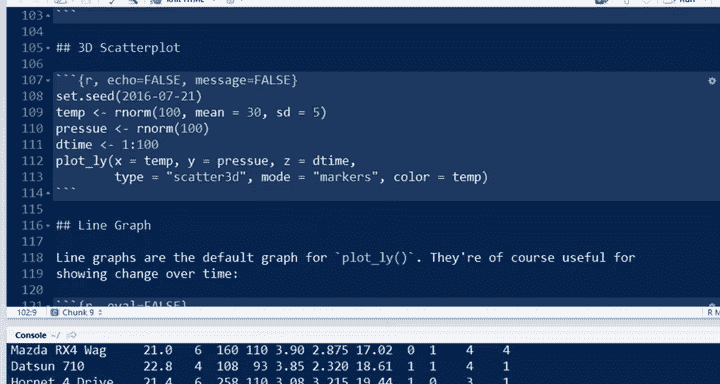