# 约翰霍普金斯大学《数据科学：统计和机器学习｜Data Science： Statistics and Machine Learning》中英字幕 - P128：20_Plotly 1 4.zh_en - GPT中英字幕课程资源 - BV1jsAAeNE3k

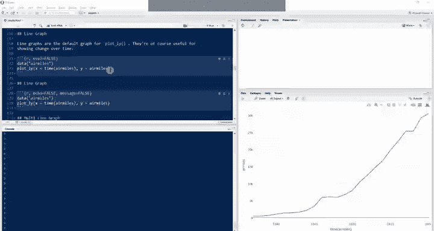

Okay， so let's talk about a different kind of graph that we can create a line graph Okay。

 so let's look at this data Air miles and then let's just briefly talk about it really quickly if I type in Air miles after I've done data Air miles you see that it's a time series theres a collection of values and if I do time Air miles it'll actually give me the associated times in this case the time is years。

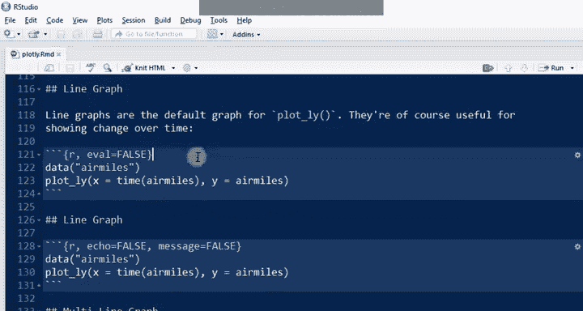

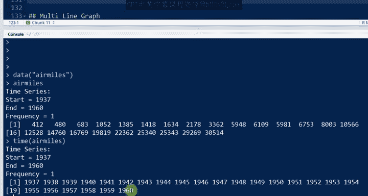

Okay， each data point corresponds to a year， So now if I do plot underscore le plotly's main plotting command x is time。

The time variable Y is error miles， so we haven't given it a data frame。

 We've just named the two arguments X and Y and the variables are in our environment。

 so R knows where to find them Okay， then we do that plot。

 we get this time series plot and knows wherever my mouse is。

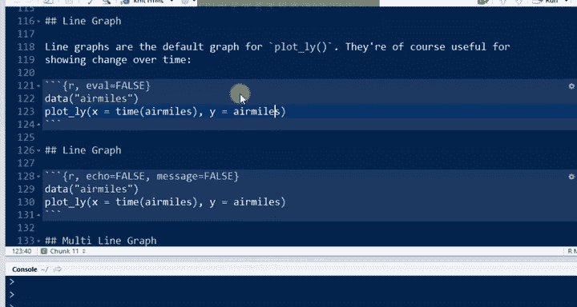

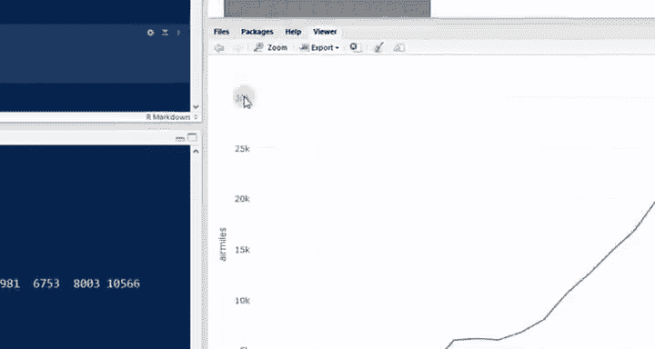

On the plot， it's giving me the corresponding X and Y value。

 And you've probably seen a plot like this。 If you ever looked at like a market index。

 like in the S& P 500 or something like that， they'll often have a plot like this where they'll have the index value over time。

 So why don't we actually create a multiline graph just like that。

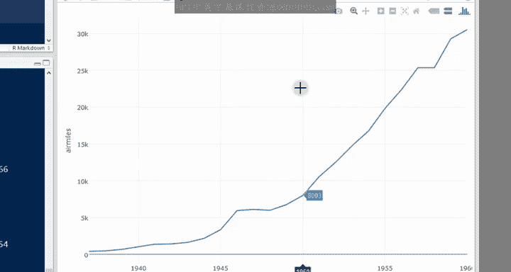

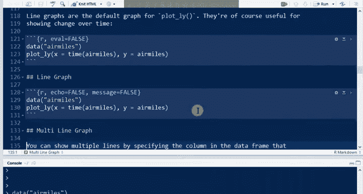

Using some。Some stock market data。 Okay， so we already have plotly loaded up。

 So we also just for some data manipulation， need ti R and Der。

 And I'll go through the commands that we're using from them。 Okay， so there's the data。

 Eu stock market。 So if I do Eu， let me do head。

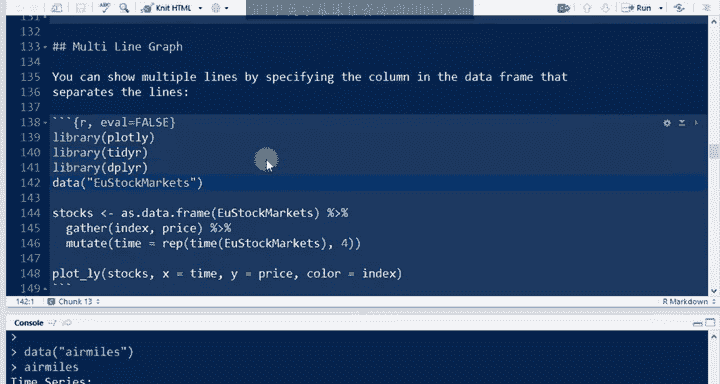

You you。Stock markets。 Okay， so there's the German， Swiss， French and British market indices。 Okay。

 and okay， so it's this is actually a time series type data set。

 So we need to convert it to a data frame。 Okay， so this first command stocks。

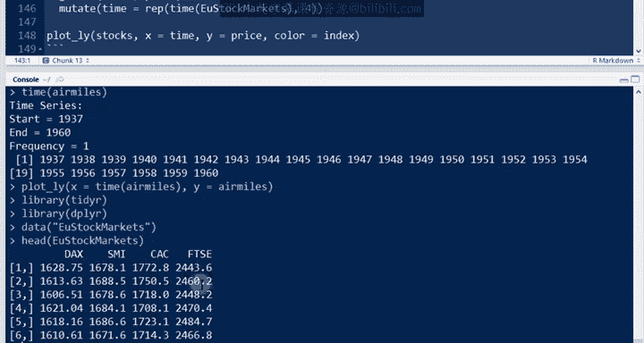

Assignment as dot data frame， Eu stock markets， that's just going to convert our our data as it is now into a data frame。

 Okay， then we're going to pass pass that into this gather command， gather index and price。

 And let me well actually， let me just first show you what this first command does。

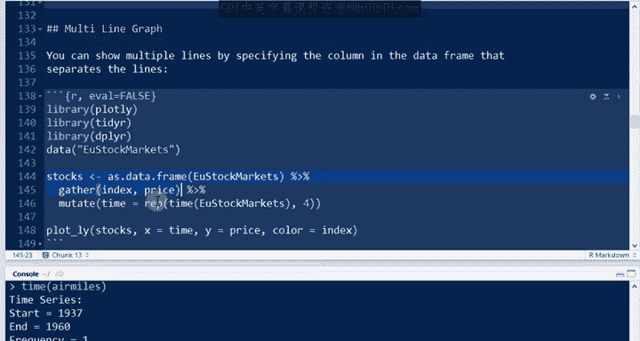

Which this one doesn't do much。 So stocks now if I do head stocks where all I've done is converted it to a data frame。

 now it's just printing out as a data frame okay。Notice if I did is dot data do frame our original data。

 even though it maybe looked a little bit like a data frame。E stock market notice false。

 it is not a data frame。

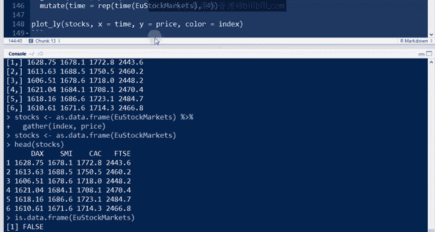

Okay。Now， when I go through the two commands where I turn it into a data frame and then I do the gather command。

 let me show now what I've done that second manipulation has done。

 notice what it's done is it's taken it from a long format。

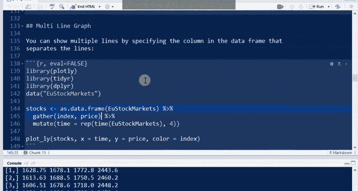

From a short format and converted it into a long format， so there's a variable index okay。

 and that index is was the column name of the data points from before okay。

So this is maybe a little bit less convenient for display purposes way to have the data。

 but is how plotly wants it in order to display multiple lines。

 it wants it as one giant single data frame with the line the things that demark the different lines as a single factor variable okay。

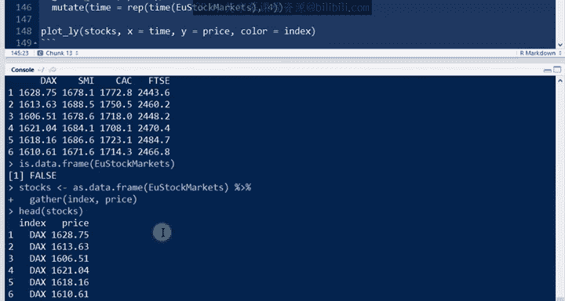

And then this final command is just going to create our time variable， okay。

 it's going to create our time variable， so if I do head stocks now there you go。

 time you see the time variable having been recreated。

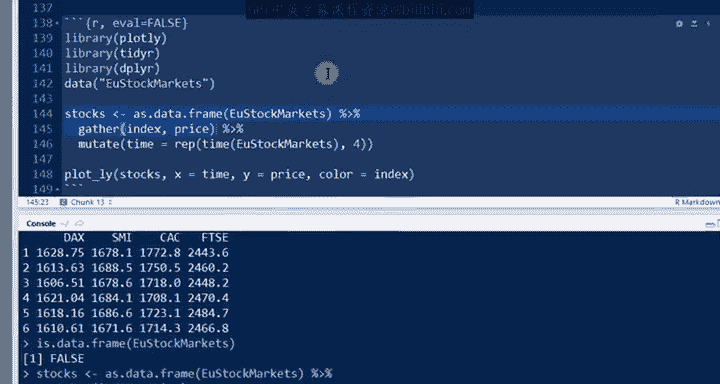

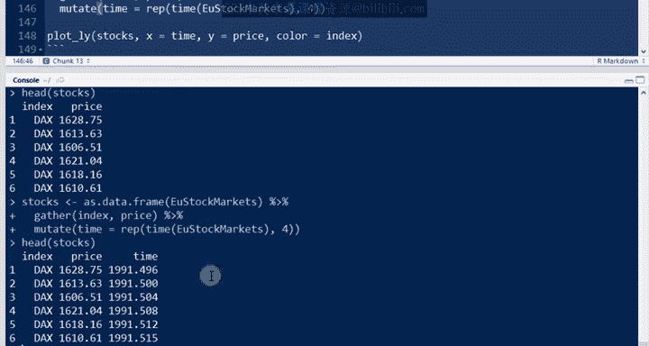

Okay， so now when we do plotly。

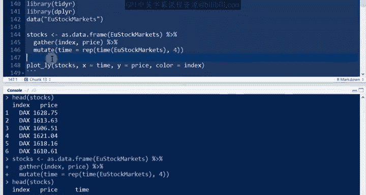

We can do plotly of the stocks。 X is time， Y is price， and color is which index it is。 Okay。

 then we when we do it， we see that it's plotted。

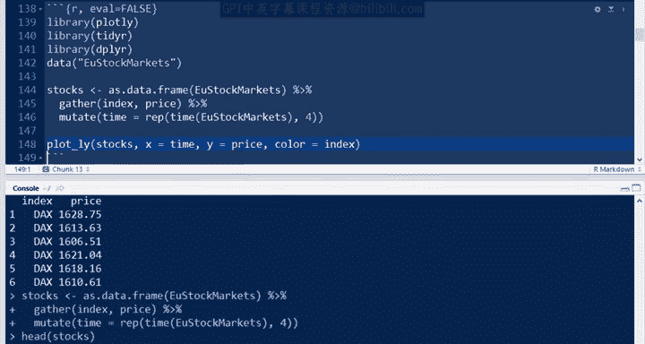

The four different index types here， it's given you a little key。To each of the colors。

 and then it also does the interactivity where as your mouse hovers over a particular point。

 it gives you the specific stock market value or the index value at that particular point in time so this is pretty similar。

 I would say to the stock market graphs， you just see if you Google for any of these indexes indices for example。

 just Google on the DAX andll you'll see exactly these kinds of plots。

 So it's really a handy plot and as you can see it's quite useful。

 and I can't also stress enough the importance of using tidyr and D per for doing some of these manipulations。

 switching from short to long format is a very common manipulation for data and ti R makes that super easy and Dpler for working with data frames is just essential so give it a try。

 you know maybe either use this data or try and find some other stock。

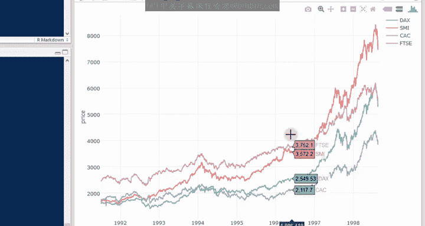

Market data to create a multiline stock market graph that and try and put it out on a web page。

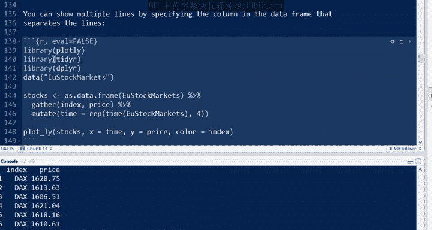