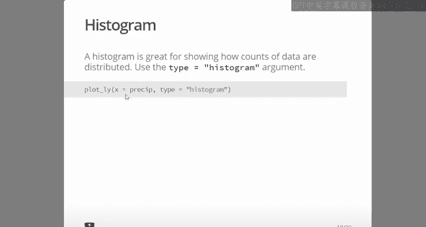
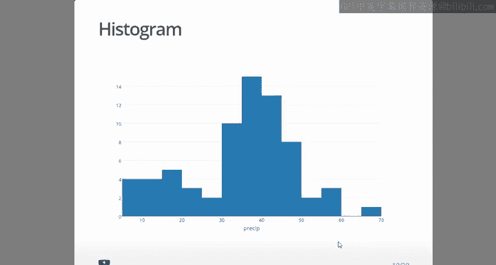
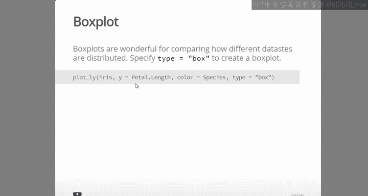
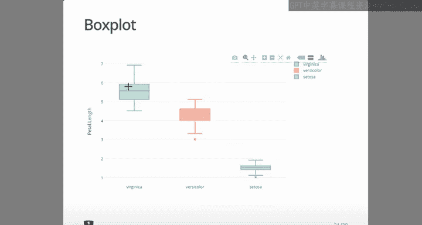
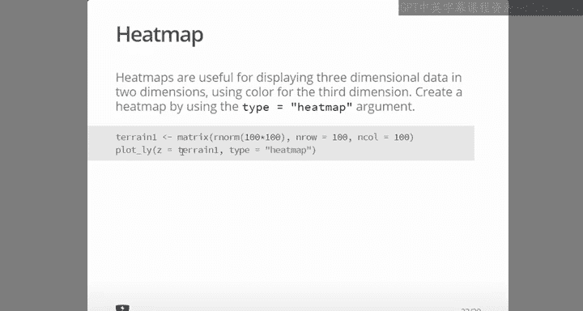
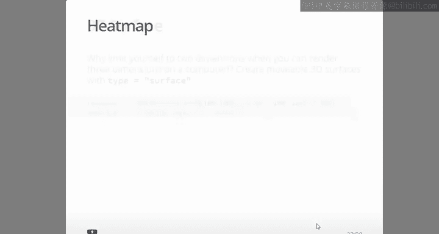
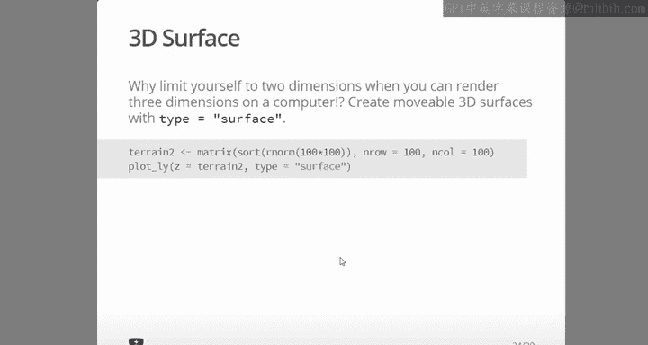
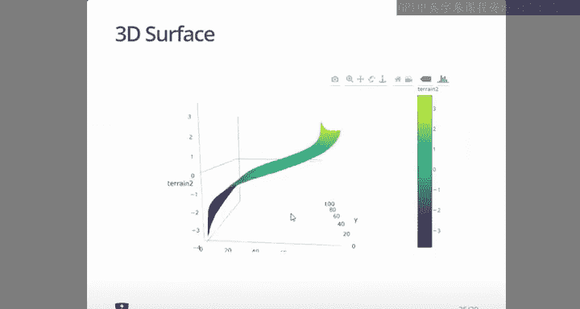
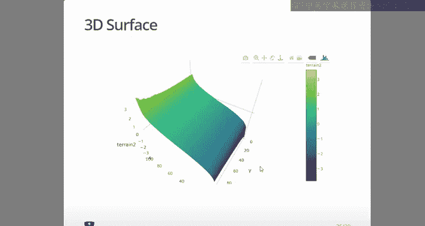

# 约翰霍普金斯大学《数据科学：统计和机器学习｜Data Science： Statistics and Machine Learning》中英字幕 - P129：21_Plotly 1 5.zh_en - GPT中英字幕课程资源 - BV1jsAAeNE3k

So the next couple examples are easy enough that I'm not going to do code demonstrations。

 I'm just going to show you the output， a histogram is easy enough you just do T equals histogram and you need one x variable。

how it looks like this， it'll actually show you the heart。

 the height of the bars as you move your mouse along， and you can change the colors。

 do side by side histograms and a variety of other things imp plotly and they kind of all work in the obvious way。

So for a box plot here， plotly data frame is iris in this case。

 y is petal length and then color is species in type equals box。

 so this is going to create separate box planks， box plots， one for each species type。

Okay and here it is our three species when you hover over the box it gives you the values for the box plot so this is the 25th percentile。

 the 75th percentile， the median and then the whiskers extend out to 1。

5 times the distance between these two values that was twokeys idea that references back to the normal distribution the 1。

5 times the inter quartile range so you know here's your box plot if you have an outlier like this it'll actually show you the little point for the outlier。

Okay。So this can get a little crowded if it's all squashed together like that one。

But still nice plot for almost no effort。

A heat map。So a heat map is basically just a graphical display of an image in this case our image is going to be a matrix that we create so pretty much all images。

 all raster images are just matrix right they rows and columns and then they have the intensity value as the value for each specific row and column combination so in this case let's just create a simple matrix where we have 100 rows and 100 columns and we just fill it in with random normals。

And that's what plotly is expecting for a heat map， okay the Z is just going to be this matrix。

And then the type is going to be heat map， okay， and then when it does that， it plots an image。

 you know， a heat map is ultimately just an image。Okay。

 just a raster image Okay and the nice thing about the way plotly does it is as you move your mouse around。

 it gives you the X and the y values and the z values。

 the intensity values and then the intensity values are given a color key here on the right。

 which is quite nice so you don't have to set that up Okay so that is a pretty easy way to generate a heat map and an interactive one at that。

So we could you could imagine taking that heat map and what if you wanted to plot Z instead of it is as just color。

 what if you wanted to plot it pulled up into a third dimension。

 well that would be plotting a surface。 So why don't we create the same data set this time with different random normals and then our z is the same thing our type is now surface instead of heat map okay and so the intensity value is going to be the z value and then the row and column values。

 it's just going to assign integers for those are just going to be the x and Y values and then when you do that。

 you get a nice。

3D surface。Now whenever you do a 3D surface like this， it's doing some smoothing。

Okay， so you need， you know， this is just to show you how the commands work。

 but of course you know if you want to do this for real。

 you are going to need to actually understand what the smoothing is doing。

