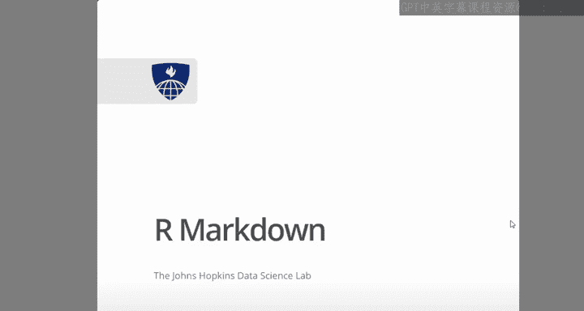
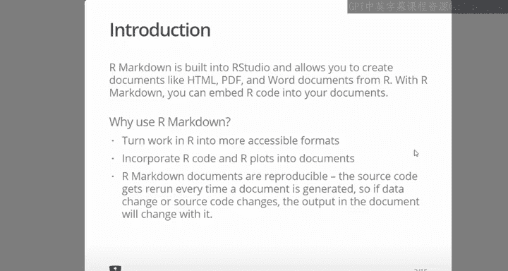

# 约翰霍普金斯大学《数据科学：统计和机器学习｜Data Science： Statistics and Machine Learning》中英字幕 - P133：25_R Markdown 1 1.zh_en - GPT中英字幕课程资源 - BV1jsAAeNE3k

So this lecture is going to talk about creating reproducible presentations using our markdown In previous versions of this class we covered a couple of the many different ways that you can do this our studio has this thing called our studio presenter。

 there's this thing called Sify and in this latest incarnation of the class we're just focusing on straight markdown。

Now our markdown is already covered in the data science specialization in the class on reproducible research。

 however， we're going to kind of focus here just on creating reproducible presentations。

 but we're going to recover some of the content that just justifies why you might want to do reproducible presentations or do reproducible documents in general。

So just a little bit about our markdown is our markdown is built into our studio and basically it allows you to create documents。

 particularly HTML documents from within R， but in such a way that it embeds the code and the results of the code and the plots and everything else that you're doing from your analysis into the document in one sort of big reproducible kind of mishmash。

That's incredibly useful because it changes this old workflow of having some analytic R code that is maybe documented。

 but probably not and then a separate document， say a Google document or a Word document or whatever。

 a latex document or whatever and the way you're combining them is by copying and pasting or saving files manually and inputting them into the documents。

 same thing with presentation you might have a PowerPoint presentation and you're running your code over here and then pasting or copying those things into the presentation and that leads to issues with version control it also leads to the problem that the person that you're giving the presentation to if you're handing them the file can't necessarily reproduce all the figures and graphs in it so again。

 this is just in general better way to do things if you're a concerned with doing with having things like reproducibility and having a nice consistent structure for generating your presentation。

I can imagine in instance in say a corporate setting where a particular report has to be given routinely。

 say every couple of weeks or something like that from data。

 important data that's being generated for the company and instead of regenerating that presentation instead of redoing that presentation and having the errorpro process of copying and pasting each time the idea of having a script that would generate the presentation with the latest numbers in a way that everything was traceable and version controlled would be an incredibly useful thing。

 so one way to think about our markdown in creating presentations like this is as a useful way for creating recurring presentations or automated presentations but。

It has a lot of uses and I want to emphasize this idea of reproducibility so this has received a lot of attention here。

 we talk about it a little bit in the slides。 This has received a lot of attention in the academic community now because mostly with regard to papers。

 people have put out papers and then independent groups have just tried to reproduce the results of the papers not redo the experiments just take the same data sets and try to reproduce the analysis and it turns out that that's often not possible and it creates disputes over who is right。

 the first people are the second people and now third group did it and they can't do they can't reproduce it so but they get something different than both the other two people So having a document that has the code embedded in it really improves the status of reproducibility of the document it's not perfect because there's probably some external files or data sets that you have to call some libraries there's probably differences between computing architectures and other things。

That may impact your results， but by and large this goes leaps and bounds towards creating more reproducible results in your documents okay so hopefully you've heard a lot of this before when you're talking about reproducibility as it pertain to knitter and things like that in your re reproducible research class that's part of the data science specialization。

 but if you're taking this class in Novo， then we're going just going walk you through a couple of examples focusing mainly on presentations and in this class we focus on presentations just because we like to think of this class as a products class so the idea that you're generating product and that your presentation will be your pitch for the product and we want your pitch to be created in one of these reproducible formats Okay so next we're just going to start going through some examples。

