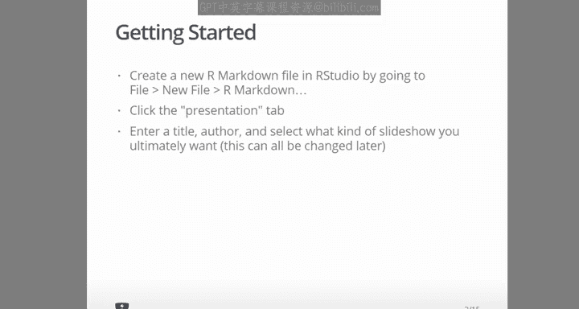
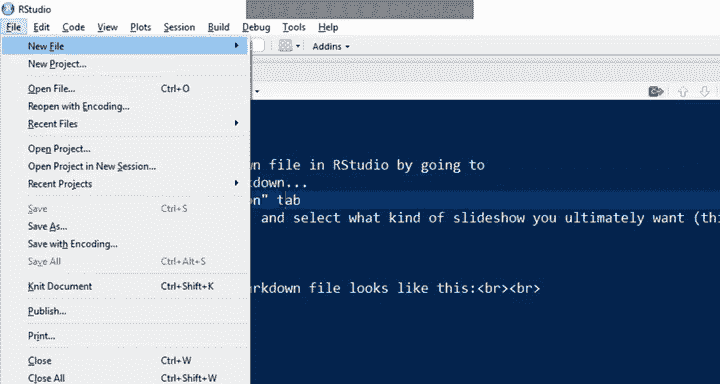
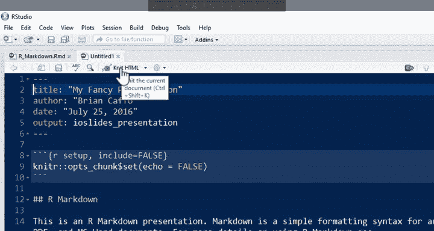
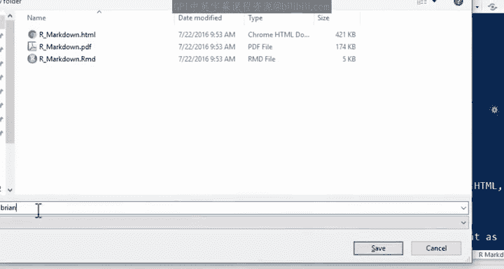
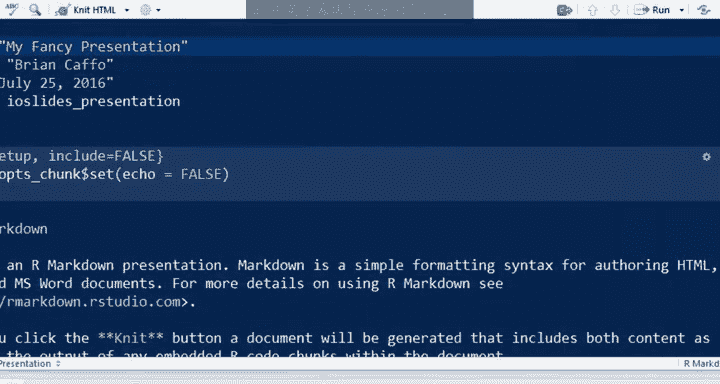
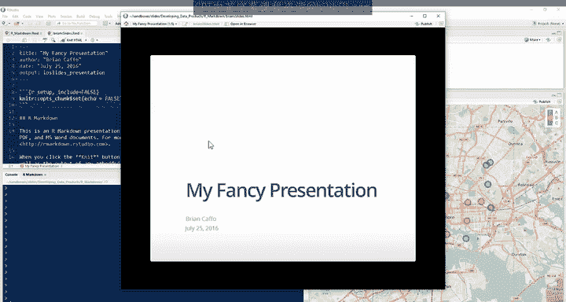

# 约翰霍普金斯大学《数据科学：统计和机器学习｜Data Science： Statistics and Machine Learning》中英字幕 - P134：26_R Markdown 1 2.zh_en - GPT中英字幕课程资源 - BV1jsAAeNE3k

Okay， so here's the slide that we're at in case you're keeping score now we're just going to go through and start doing a code demonstration of how to do this。

 so the next couple of slides actually just talk about doing this so instead of going through the slides I'm just going to show you in our studio。

It's worth noting that we actually practice what we preach and here's our slides for this class written in our markdown but so here's the RMD file for the class。

 but we're going to follow through the notes and create a new presentation。

 So look what it says it says file new file R markdown okay so you could just do that by all F。

F。Our markdown， that is M。 and then look here， I'm going to click on presentation title。

 I'm going to call it my。Fancy。Presentation。AndThe author is me。And then。You have different outputs。

 so this has a different。Different presentation style I'm just going to stick with IO slides right now Okay and then if you want PDF。

 this requires we'll go through this later， but it requires MItech being set up on Windows。

 which is a latete variant Mactech on OS 10 and then tech Live or something like that on Linux So each of these is pretty easy to install but they tend to be kind of big。

 we'll cover that later on in the lecture。 So right now let's just stick with the default which is IO slides kind of a format that was created I think from one of these Google presentations at one point。

Okay， so there you see it's untitled one。That's the name of the file that contains the R markdown commands。

 but we're。Right now we're just going to， we're just going to compile it once and see what it looks like。

 So if you click here and say knit。The current document。

 or it also gives you the command control Shi K。

There you go。Our markdown， let me name it， I'll name it a separate or markdown， I'll name it Brian's。

Slides， okay， there it goes。

It runs it。And there it is， my fancy presentation。Okay， so homework number one， just go through this。

Create a new presentation， a new template presentation， compile it once。

And then let's move on from there to fill it up with some content。

