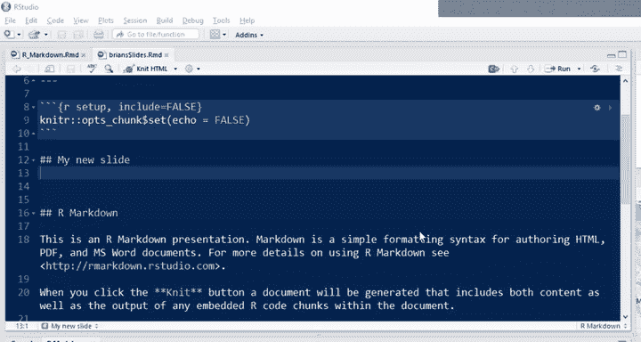
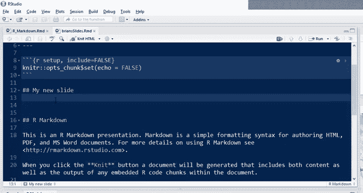
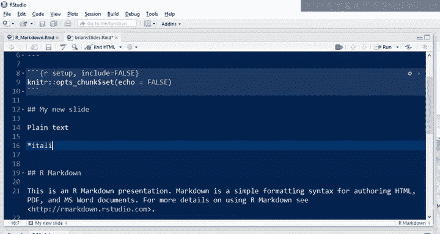
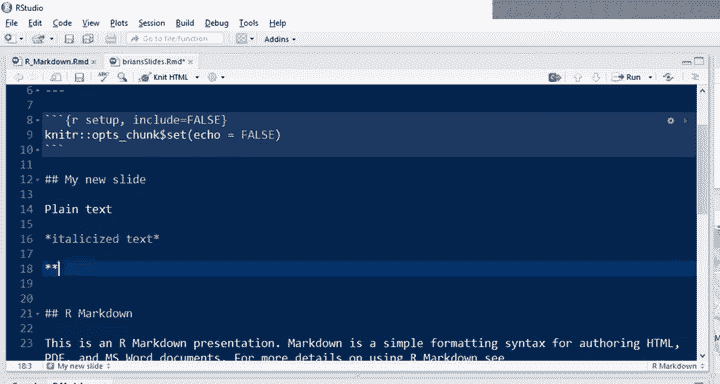
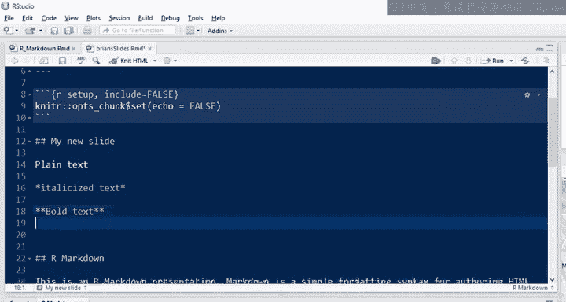
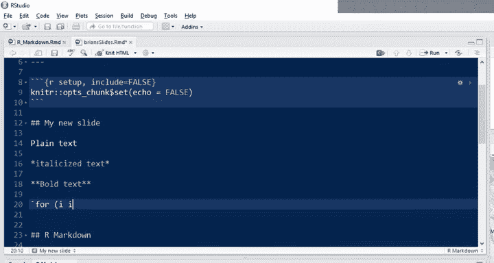
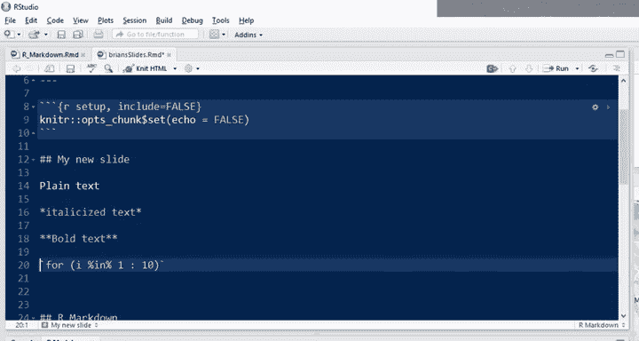
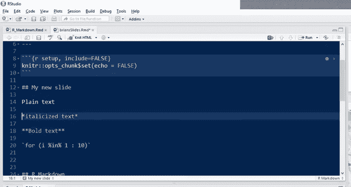
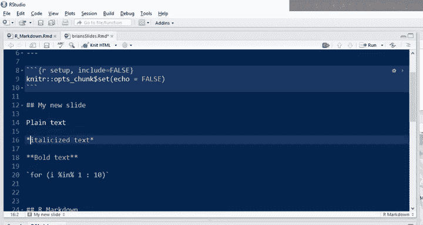
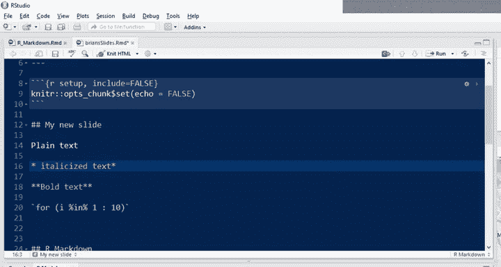

# 约翰霍普金斯大学《数据科学：统计和机器学习｜Data Science： Statistics and Machine Learning》中英字幕 - P136：28_R Markdown 1 4.zh_en - GPT中英字幕课程资源 - BV1jsAAeNE3k

Okay， let's show some formatting options。So if I just put in。

Plain text， then。alicized。

Tax。Notice it auto formats it。

Then， bulb。Text。OrI'm sorry， it syntax highlights that I should say。

And one。Here's some code， Okay， so the code has single right。

Facing quotation marks， boldold has two asterisk。

Itals has one asterisk and then plain， of course， has nothing。

 The asterisk has to be next to the leading character。 So if you if you do it like that。

 I noticed it doesn't work sometimes。 so have it next to the leading character。

 I think that's necessary。

And then let's run it。