# 约翰霍普金斯大学《数据科学：统计和机器学习｜Data Science： Statistics and Machine Learning》中英字幕 - P138：30_R Markdown 1 6.zh_en - GPT中英字幕课程资源 - BV1jsAAeNE3k

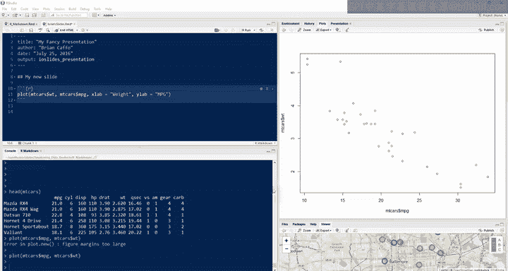

Okay， so I just want to show you a plot here I've created a plot， plot， empty cars weight。

 empty cars miles per gallon， X lab equals weight， Y lab equals miles per gallon。

 let's go ahead and show it。There we go。

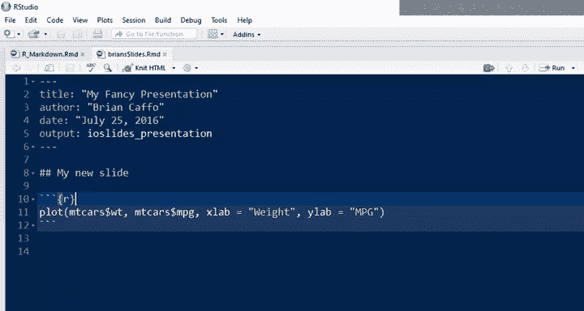

Okay， there it is。 Well， I kind of don't want the code like most often when you show a plot。

 you don't want to echo the code， So why don't I put。

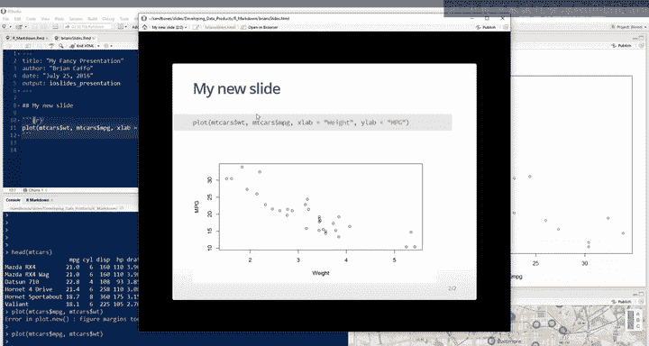

E go。Equals false。

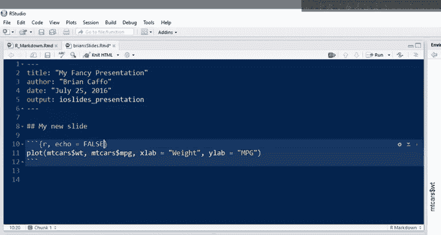

And then go ahead and rerun it。That looks much better。

 There's a bunch of other figure options in knitter so you can play around with those like。

 for example， Fig a align。

Probably center， okay， fig。Yeah， we can put a caption to say my。Awesome。Figure， okay。

 and then let's just show you how this looks。

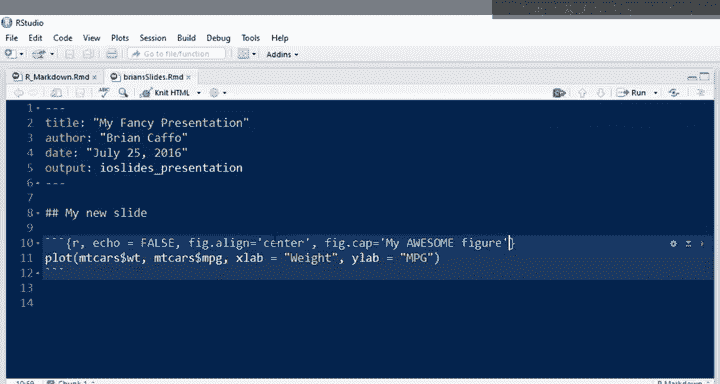

Yeah there's your figure caption and so on， so go through some of the options and play around them。

 there's options for controlling the height and width of the figure and so on。

So last thing I want to talk about is publishing your slides。

 So as soon as you knit it when you type knit HTML， it creates a file in your directory。 So。

 for example， this slide these slides are Brian's slides rmd the file extension standing for our markdown it creates a Brian slides hml file。

 So if you click on that， it'll bring it up bring up this presentation in a browser not in our studios browser window And in fact。

 you can make it easier just by clicking on open and browser here in the our studio preview window publish will publish it in our pubs。

 which is one of a couple of ways to publish it online you could also put it in a Dropbox public folder and just like you can kind of publish web pages in a Dropbox folder。

 but know I think probably my favorite way to publish it is in Github。

 So I want to show you a couple of things about Github real quick。

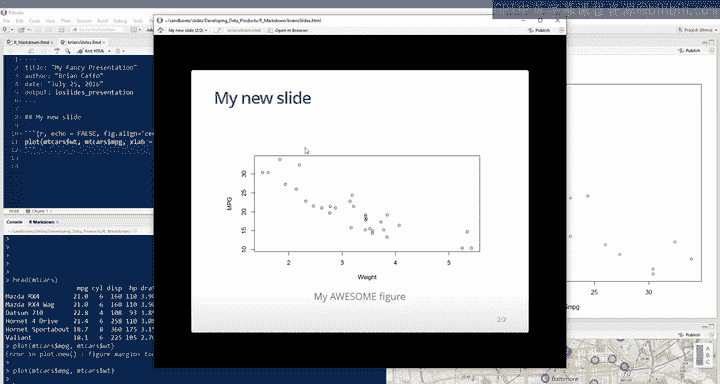

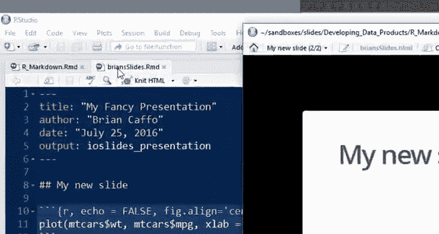

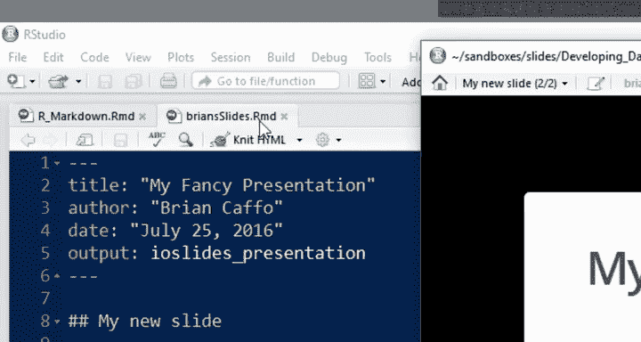

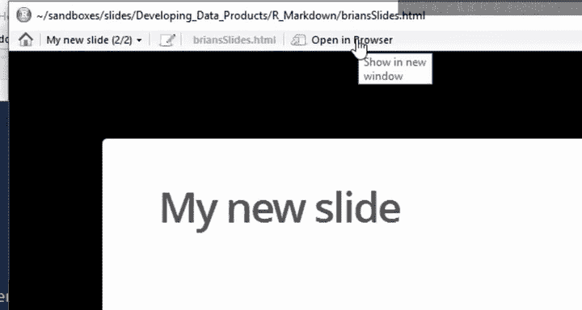

So these slides I got them well actually I'm sorry these slides。

 these temporary slides I'm working on I haven't pushed up to GitHub so why don't we look at the slides for the lecture which are in Sean Cross's GitHub repository I'll show you this in a second more closely but this is just in our markdown file and the associated HTML files pushed up into GitHub Okay so let's look at those。

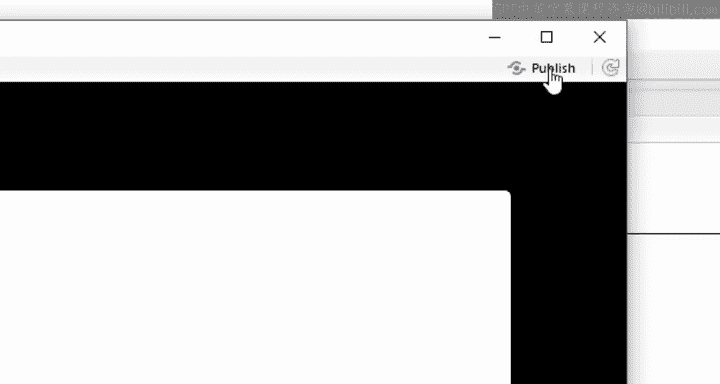

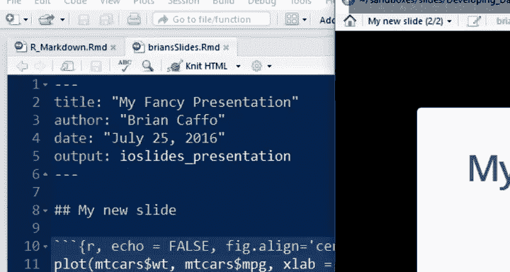

Okay， so here is the developing data products course page under slides in Sha Cross's Github repo。

 So I think I want R markdown right there。 Okay now here's the R markdown file and first thing I want to point out if you click on this in Github。

 it does a lot of the formatting for you。 it recognizes that it's an R markdown document。

 and it does a lot of formatting ahead for you， it's not going to run the code， of course。

 but it does a lot of formatting。 So you can see you know what the bullets and the various points are going to look like。

 Okay which is nice。 So often when I'm reading Sha's you know when I'm reading some of Sean's edit。

 I'll look just at the directly it is R markdown file。 Okay now let's click on the HTML file。

 There we go。 Now notice it does not render the HTML file， it is showing you the raw HTMLm。

Okay now for the HTML to be rendered there's a bunch of different ways to do this。

 in fact there's a Chrome add on and a Firefox add on that will go ahead and do this for you。

 but Sean's published this via GiHub pages and what this means is he has a branch called GH dash pages usually it requires a nojeel file in the root directory of your GiHub pages。

 but I noticed he didn't have that so maybe that isn't necessary。But now if I want to see it。

 it just means typing a different。嗯。You areI'm sorry。

 just mildly changing the URL and you can see it。Okay。

 but but the important thing is you have to have a branch called GH dash pages。

 That's the most important part。 And by the way， it's often I find it kind of annoying to have a GH pages branch and then a master branch。

 And I think Sean does too obviously so he just deleted the master branch Okay。

 so Github pages in a sense， is his master branch Okay so so if we look up here on the address。

 we have Github do Github forward slash Sean Cross， which is his username。

 what I want is Sean Cross do Github。Io okay so it's username Github io then slides and then blob and Gh pages are just internal things for Github。

 So we want to get rid of those and then we want just the path to the Hm file okay so in Seancrora's Github repository。

 It's in it's in the reos slides， the subdirectory developing data products。

 the subdirecty are markdown and then the file are markdown html and then notice these slides are now hosted on Github。

 this is extremely convenient way， especially for most of us that work in data science because we're usually pushing stuff up and back and forth to Github all the time。

 for me personally all my course stuff。 I just push up to public Github repos。

 all my private research stuff I push up the private Github repos and so on。

 so this is a very clean way to work for those of us that are already working in Github。

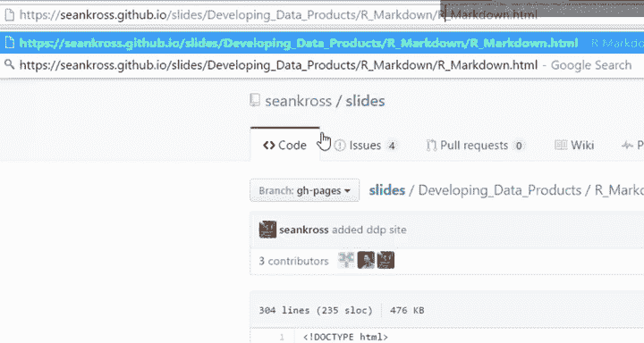

Okay so for this after doing this， I would like everyone to try to create a figure in your presentation。

 I'd like you to play around with the figure options。

 I'd like you to try and publish it to GitHub read up on GiHub pages if you're having some trouble or publish it to our pubs if you want that's another option just click on the publish button in our studio and see how that works that that's fairly selfexplanatory and I would also like you to verify that the HTML file gets created into your directory。

 click on that and see how you can host it on your computer and look at it on your computer so that way know you can always visualize it if you're working on an airplane or something like that but most importantly I think hosting it on GitHub is probably the most technically irritating of all the things I've talked about so go ahead and try doing that just so this way you can always publicly host your repositories in a way that's convenient that probably already fits into your workflow to begin with。

Well that's enough about our markdown， I think to suit our needs for this class when you develop your project。

 you're actually going to create a pitch in our markdown and you'll hopefully host it on GitHub or something like that so we can all look at it and see that your project is really awesome All right。

 thanks a lot for listening and we'll see you in the next。

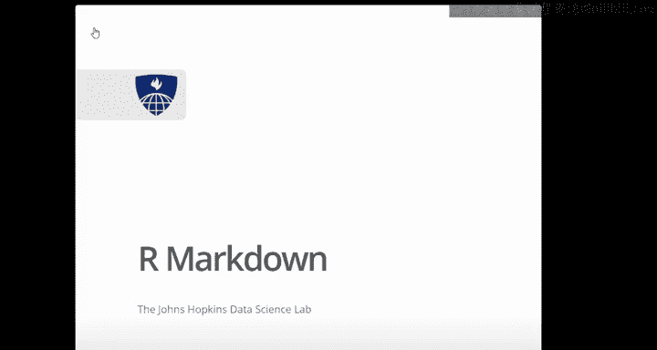