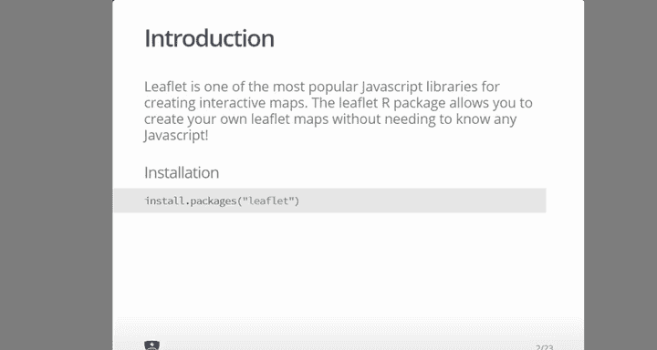
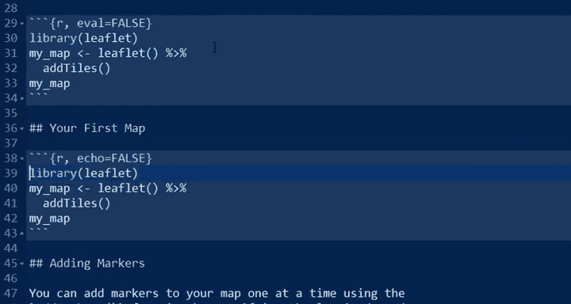
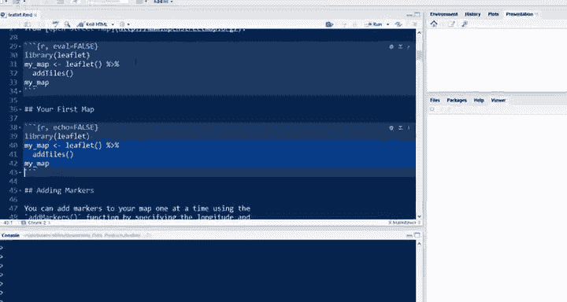
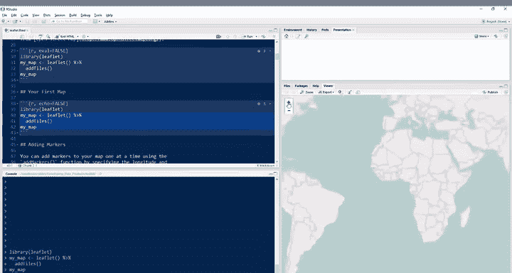
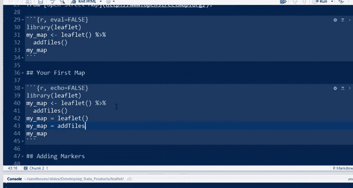
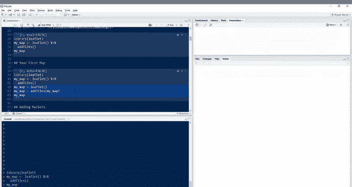
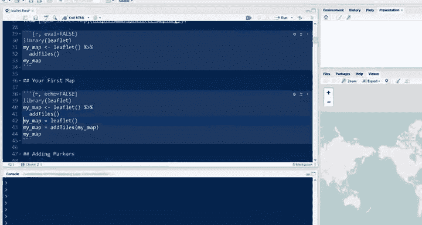
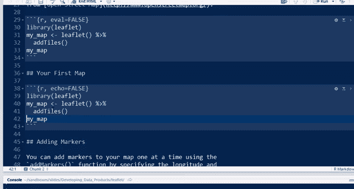

# 约翰霍普金斯大学《数据科学：统计和机器学习｜Data Science： Statistics and Machine Learning》中英字幕 - P139：31_Leaflet 1 1.zh_en - GPT中英字幕课程资源 - BV1jsAAeNE3k

An important aspect to developing data products is having a way to create interactive maps leafaflet is a JavaScript library and then there is an associated leaflet package for R that makes use of this JavaScript library to create interactive maps within your R environment and it's especially convenient within R studio because it brings it up in the R studio window。

So we're just going to go ahead and go through some leaflet examples and get you started with just with the bare minimum to get going on this and I think you'll be able to extend it rather quickly。

So and I should say there's several other ways to create interactive maps you know Google Viiz is another one and so I think leafaflet is worth covering on its own just because it's you know it's so widely accepted and widely used among the RCrowd。

 but again I would also say look up you know in our Google Viiz lecture we'll also talk about creating Maps using Google Viiz which directly access Google Maps and there's still some other ways but I think those two might be the two most popular。

So you want to make sure you install it first， I won't go through this just installed up packages leaflet now let's just go through a code example where we create our first leaflet map in our。

So here I have the R Markdown document for the next couple of slides。

 or I have the whole R markdown document， but here's the code for the next couple of slides。

 it has two separate sections， one that just displays it as code and one a separate one that evaluates it。

 so you have to call library leaflet。

And then let me just run these three commands and then。

We'll talk about them so the first thing I want to comment on so so I ran the commands and there you can see your map and then you can zoom in。

 of course。

As much as you'd like。 So it is a and this is in the R studio viewer pane。 So it's not a plot。

 It's in the kind of。Browser viewer that's in in our studio Okay。

 so the first thing I'd like to mention is something that we're going to use heavily in these set lectures。

 which is the piping notation。 So what this code basically is equivalent to is imagine if I wrote out my map is leaflet。

Okay， and then my map is add tiles my。

Okay， so let me get rid of。My map over here and then run these three lines。 Okay。

 and you'll see it does the same thing。 It generates the same map。 So this。

Code right here。Right is identical to this code right here。 That's what the piping notation is doing。

 It's taking this。Output my map， and then piping it to this next command。

 adding it as the first argument and then reassigning it to the to the。Variable here， Okay， so。

 and that's a lot cleaner code and easier to read once you get used to it than what I had written below。

Okay， so the first part leaflet just kind of generates the map and then the add tiles is adding the first set of content and we'll talk in a little bit about how to actually do some useful things like ad markers and so on but just first try to do this。

 just generate a world map， zoom around， make sure you can install the leaflet library and this is step one and then now we'll go on to some more interesting things。

