# 约翰霍普金斯大学《数据科学：统计和机器学习｜Data Science： Statistics and Machine Learning》中英字幕 - P13：12_05 03 均值的标准误差.zh_en - GPT中英字幕课程资源 - BV1jsAAeNE3k

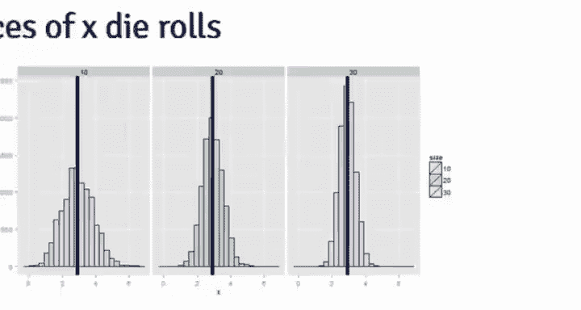

So now we've talked a lot about variances and even touched a little bit on the distribution of sample variances。

Now let's talk again about the distribution of sample means。

 so remember that the average of numbers that are sampled from a population is itself a random variable。

 it has its own population mean and population variance。

We know that that population mean it's the same as the original population。

We actually also have a result that relates its variance back to the variance of the original population。

 in fact， at sigma squared， the variance of the original population divided by n。

 so the variance of the sample mean decreases to zero as it accumulates more data。

 which is exactly what we know that the mean becomes more concentrated as we collect more data more concentrated about the population mean that it's trying to estimate。

This is very useful because we only get one sample mean in a given data set。

 we don't get lots of repeated versions to investigate its variability the way we do in these fabricated simulation experiments。

So we can estimate sigma squared and we do no n， so we actually know quite a bit about the distribution of the sample mean。

From the data that we observe。So the square root of the statistic is sigma over square root n is called the standard error of the mean。

 and we use this notation we call a standard deviation of the distribution of a statistic。

 we call it a standard error， so we talk about the standard error of a mean to imply a number that represents variability of means and the standard error of a regression coefficient talks about the variability in regression coefficients。

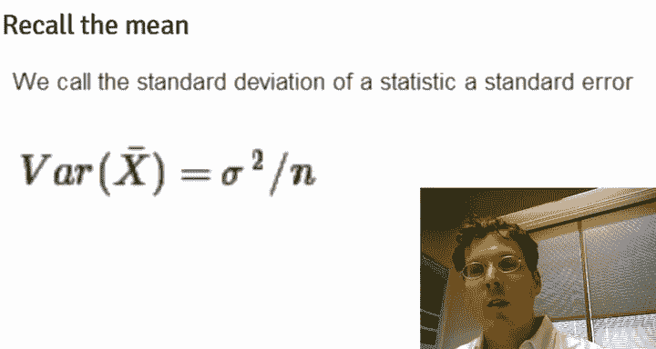

So let's summarize， so imagine a population that has mean mu and variance sigma squared。

 so a measure of spread sigma squared。

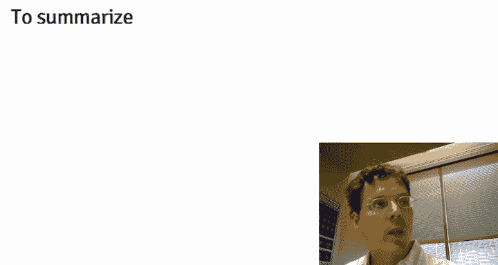

If we were to draw a random sample from that population and take the variance。

 that is an estimate of sigma squared if we' were to take the mean， that's an estimate of mu。However。

 S squared is itself a random variable and it has a distribution。

 we don't know much about that distribution， but we do know one thing it's centered around sigma squared and it gets more concentrated around sigma squared。

 the more observations that are going into that S squared value。

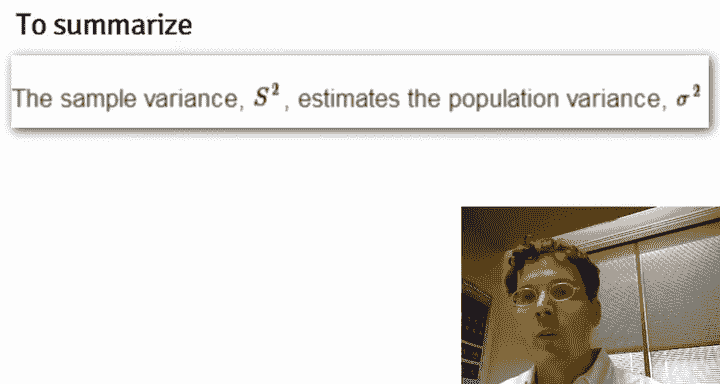

We also， we know a little bit more about the distribution of sample means from that population。

 we know that they're centered at mu and we also know it gets more concentrated around mu as more observations go into the means。

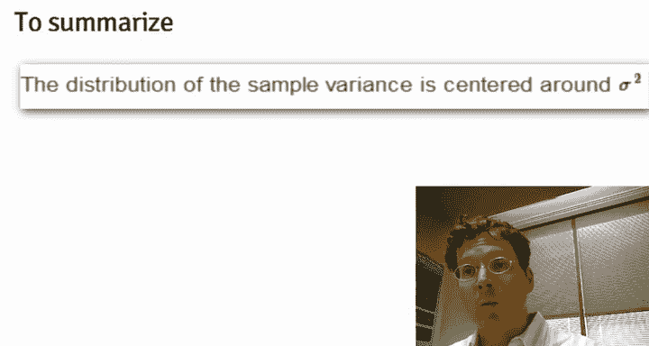

However， we also know exactly what the variance of the distribution of sample means is。Namely。

 it's sigma squared over n。Now in a given data set。

 we don't have repeated sample means to estimate this。

 but what we do is we have repeated draws from the original population in order to estimate sigma squared。

 so the logical estimate of the sample variance of the mean is S squared over n。

 and thus the logical estimate of the standard error is S over square root n。

 this quantity right here S over square root n is so important it's given its own name。

 the standard error of the mean or the sample standard error of the mean。

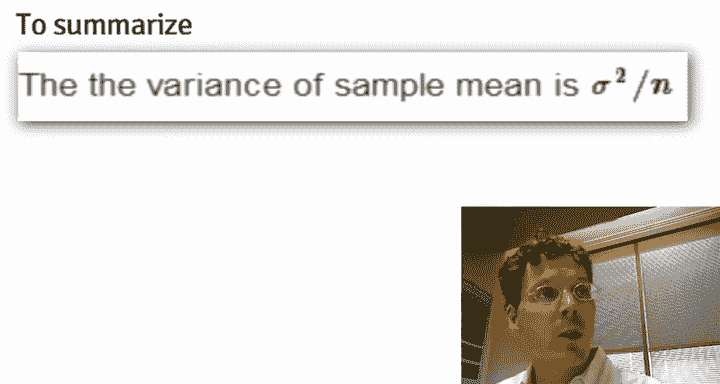

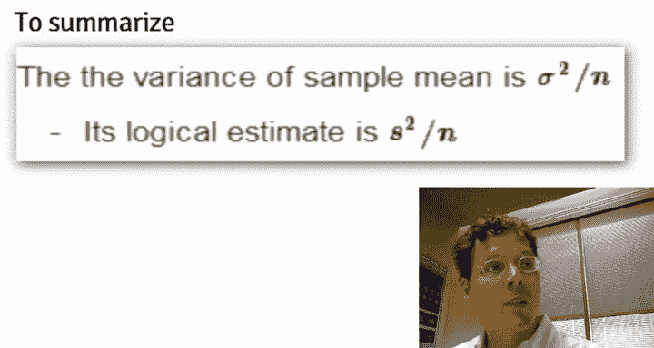

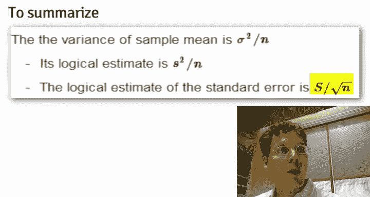

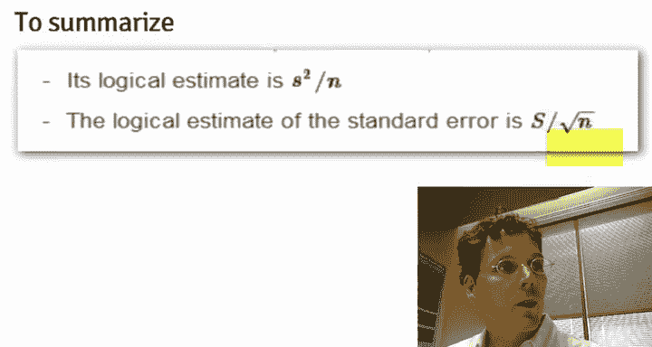

So S。The standard deviation is really an estimate of how variable your population is。

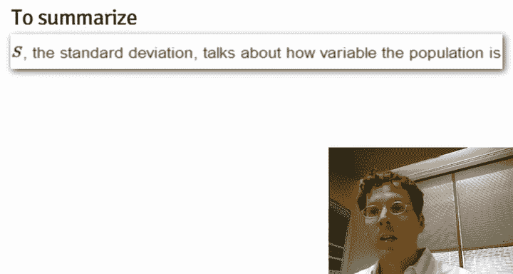

S over square root n， the standard error。Is really talking about how variable averages of random samples of size n are from the population。

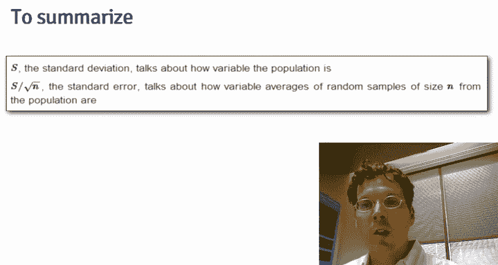

Let's go through some simulation examples。Standard normals have a variance of one。

Then that means they have a standard deviation also one because the square root of one is one。

So means of n standard normals， if our math is right。

 should have a standard deviation of1 over square root n。

 so let's say my number of simulations is 1000。

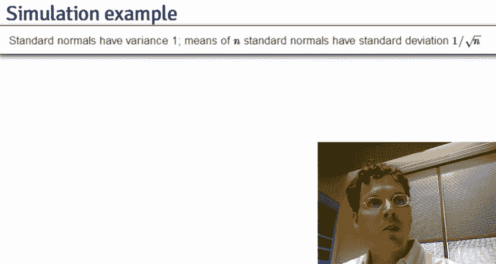

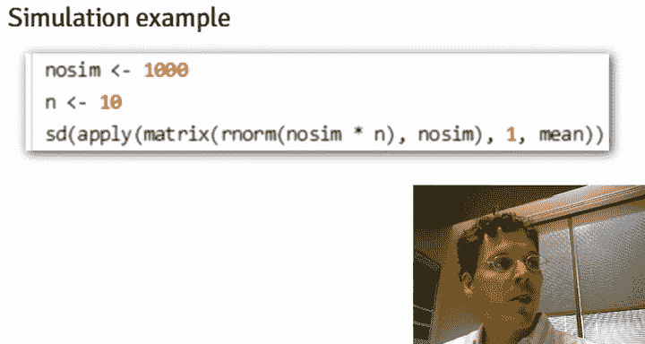

My n is 10 and here what I'm going to do。You can sift through this code a little bit。

 but let me tell you the gist of what I'm doing when I simulate our norm numbers number of simulations type n。

 I'm simulating 10 times 10 draws from a random normal distribution and I'm arranging them in a matrix and then with。

1 thousand rows and 10 columns， then for each row I'm calculating the mean。

 thus each row is the mean of 10 IID draws from the standard normal distribution。Okay。

 and I've done that lots of times， so when I take the standard deviation of this。

 this should be a good approximation of the standard deviation of averages of 10 draws from the standard normal distribution。

 and if you don't think so then maybe add a couple extra zeros to the number of simulations but not too much because your computer will get stuck。

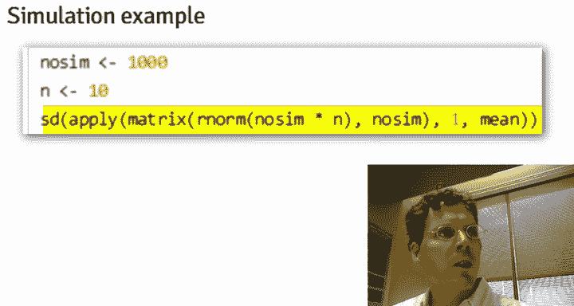

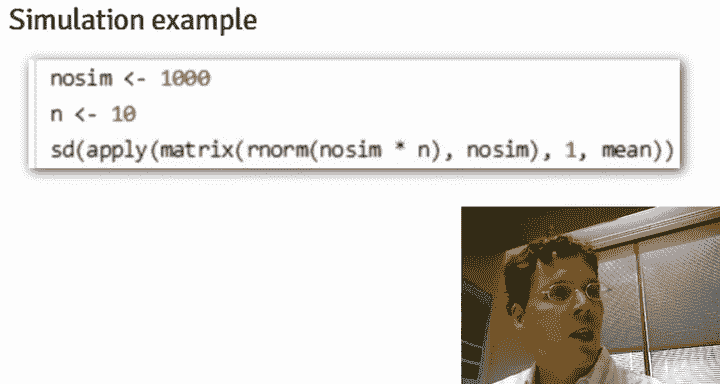

So if you do that you get 0。31 or point around 0。32 if you just take one over square root n。

 that's 0。31 or around 0。32 so they have to be the same。

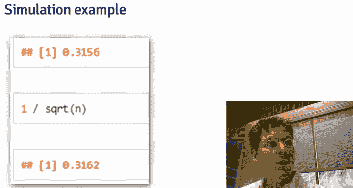

Let's try it again， standard uniforms remember that density that's a flat line between zero and1。

That turns out that has a variance of 112。 So let's take means of random samples of n uniform。

 So what we're going to do is we're going to simulate in this case，10 uniforms。

 take their average and then do that over and over again， and then take the standard deviation of。

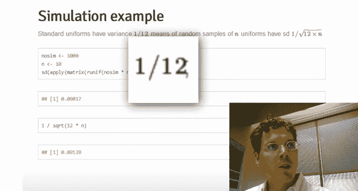

The collection of averages of 10 uniforms and that will tell us about the distribution of averages of 10 uniforms from this population。

 our math says that it should be1 over square root 12 times n So if we do this we get 0。

09 and if we just take one over square root 12 times n we get 0。09。

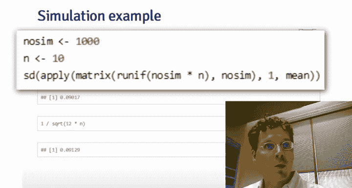

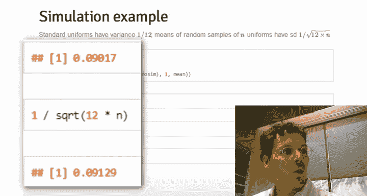

Poysons 4 have a variance of four， so Poson is a distribution that we'll cover later on in the class。

 but for the time being， just think it's a discrete random variable that happens to have a variance of four。

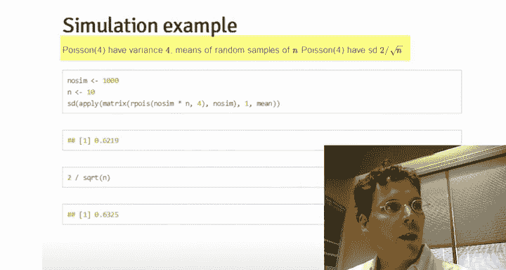

So means of random samples of n Poson 4 then must have standard deviation 2 over square root n according to our rule okay so here I do it and I get 0。

62 when I empirically simulate lots of averages of size 10 of Poson 4s I take the standard deviation of thousands of them。

 I get 0。62 if I do  two over square root n I get 0。

63 so maybe off by a little bit but maybe beef up the number of simulations and you'll get it much closer。

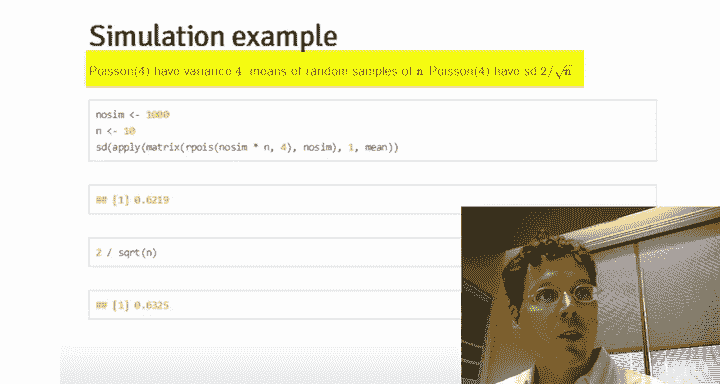

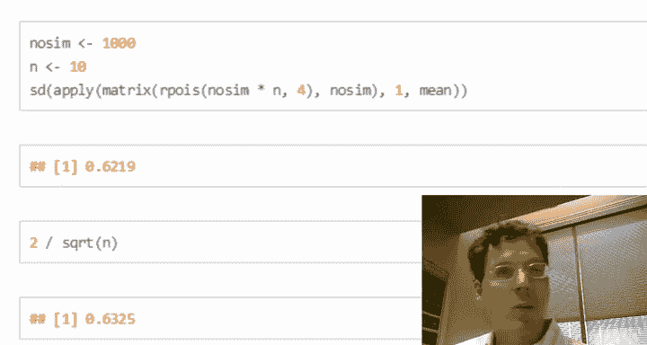

So let's go through one more example， remember that coin flips。

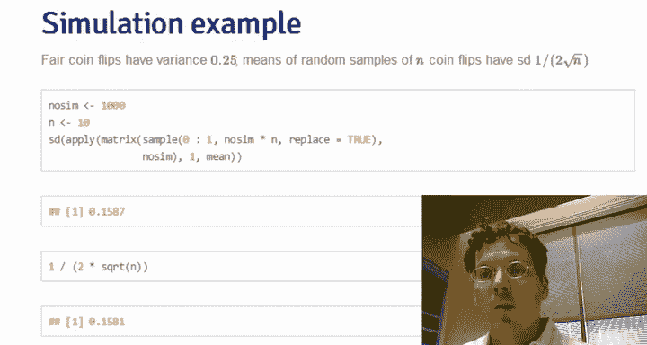

For a bias coin have a variance p times1 minus p when p is a half that gives you a 0。

25 is the variance。

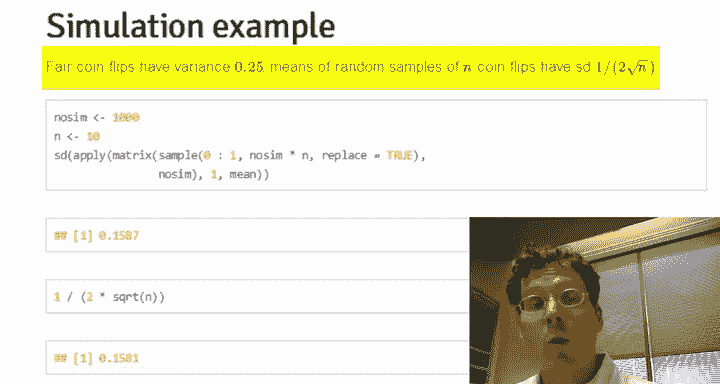

Means of random samples of end coinin flips， according to our theory should be1 over two square root end fair coinin flips。

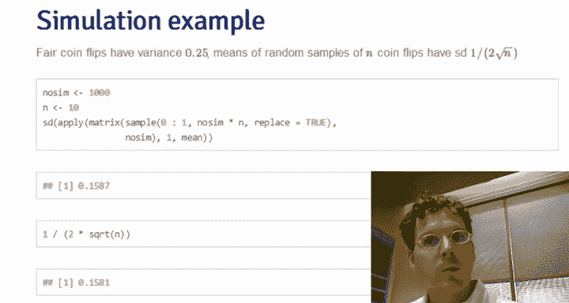

So what I've done here is I've flipped a coin 10 times and taken the average of the 10 coin flips。

 and I do that thousands of times and I'm going to look at the variability in that distribution。

 I'm going to look at the standard deviation because I like standard deviations better than variances。

And so I get 0。16 when I do that， the theory tells me it has to be about 0。

16 when I do one over two times square root n， I get about 0。16 so again。

 the only time you'll ever have to do these simulation experiments is in a class like this where you're learning about what the standard error of the mean is actually implying。

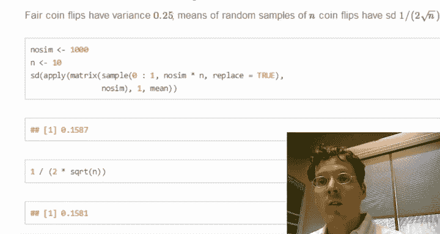