# 约翰霍普金斯大学《数据科学：统计和机器学习｜Data Science： Statistics and Machine Learning》中英字幕 - P140：32_Leaflet 1 2.zh_en - GPT中英字幕课程资源 - BV1jsAAeNE3k

So that was pretty quick we were able to actually generate a map。

 a JavaScript widget basically without actually knowing any JavaScript。You know， just to reiterate。

 the leaflet function you can think of is just actually creating like if you're familiar with Photoshop。

 it's almost like creating a layer or something like that Okay it's basically just creating the background and then you have to add the actual content on top of it so add tiles is adding them specifically the mapping data from OpenStreetM。

Okay and that so then when we display that map， then we have a map that we can zoom around in and look and you can see I was kind of zooming in towards Baltimore there which is where Hopkins is at but we probably want we probably actually want to do things like add markers add some direct interactivity and so the command to add a marker is really easy。

 it's just add markers and you just the first one we're going to do is we're going to add one that at a specific longitude and latitude and we're going to give it a little label okay so let's do that。

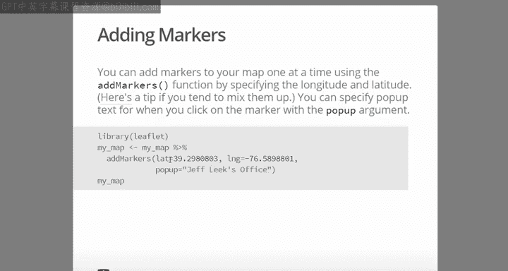

Okay now the first thing I want to mention is that the variable MyMap has already been defined so and and I'm going to go through the piping notation once again because it's a little bit strange here and then after this I'm going to quit going through the piping notation so but let's just run it once and see it and then we'll talk about what the code is actually doing。

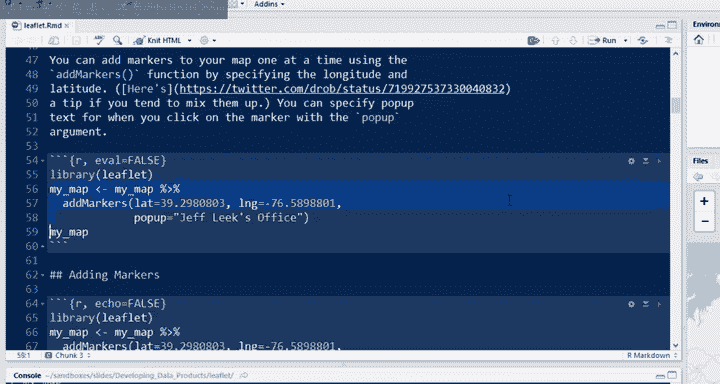

Okay， so there we ran it and now we see here is Johns Hopkins Hospital and if we click we have this little marker。

 if we click on it we see Jeff Leak's office， but let's actually zoom in and see if we can find Jeff Leak's surf from the internet。

There we go， actually， so we're in the Bloomberg School of Public Health， there it is right there。

Actually the oldest school of public health in the country。Okay。Allright， so let's go through。

The code。So the piping notation once again I'm going to just show you the equivalent so remember my map and I'm going to just redo it。

 my map is already defined from up here from when I ran it from the first from the code from the first set of slides so let me redo that so I've overwritten it back to where it's just added the content with no markers okay。

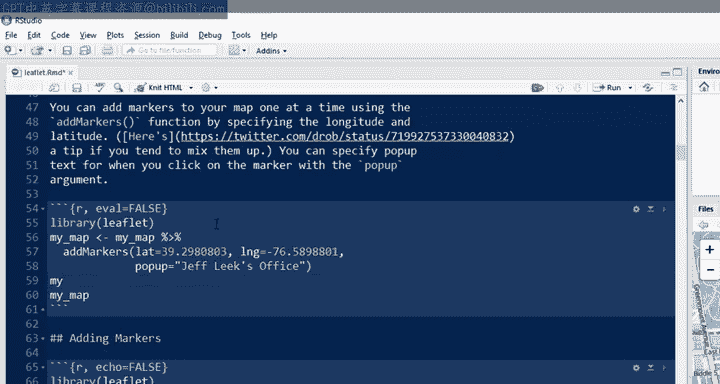

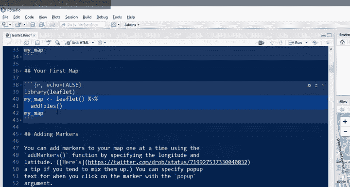

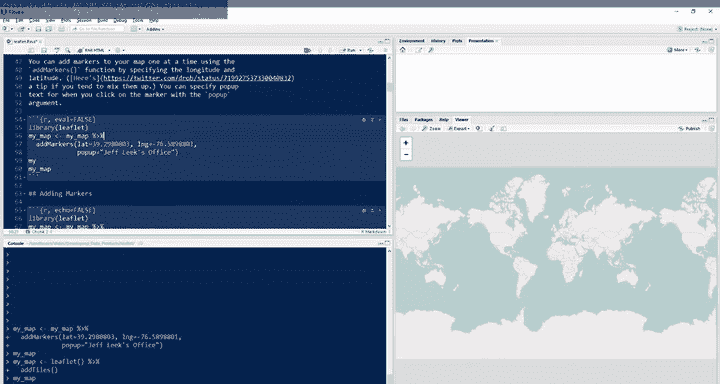

Now， this set of commands that we did to add the marker is equivalent to saying that my map。

 which I've already defined， is equal to add markers。

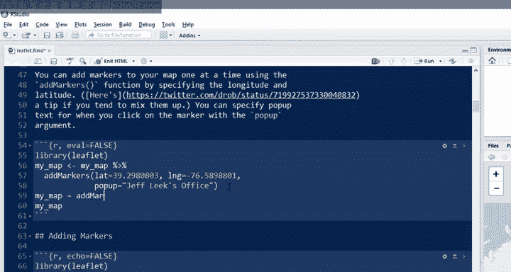

My map， and then I'm just going to copy this code because。I don't want to have to retype it。

Bring this up here。Okay， okay， so this one line here。

 these these lines are equivalent to this one line here。And。There we go。 Okay。

 so you can see it does the same thing。 Okay， so what is it doing， Okay， so first， we have to。

 we have to assign my map to itself， which seems ridiculous。

 But it does just so you can do the piping。 And it's just saying I'm piping this variable now into the first argument of the。

Function add markers。 Okay， and then we're still going to assign it back to the original variable that's on the leftmost side of all my assignments。

 Okay， and you might think this is a ridiculous thing to do， especially because Brian。

 you just managed to put this whole thing in one line。

 Why we replacing one line with all these other lines。 Firstt of all， I。

Got rid of some line breaks that probably are better being there anyway。

 but the reason is because piping piping is very powerful and it's something that you want to get used to。

 especially when you're doing chained operations and Dlier for example。

 and in some of these mapping circumstances like this。

 you create this variable and you're adding lots of layers and markers and things like that and it can get tedious to keep retyping out the same set of commands and so the only reason we actually have this first line is because we didn't we have it separated from these sets of lines up here。

 if you wanted to do it the way you would likely do it， you would have done you would have done this。

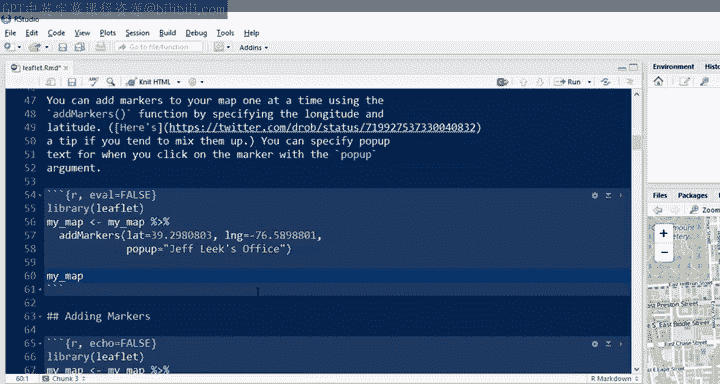

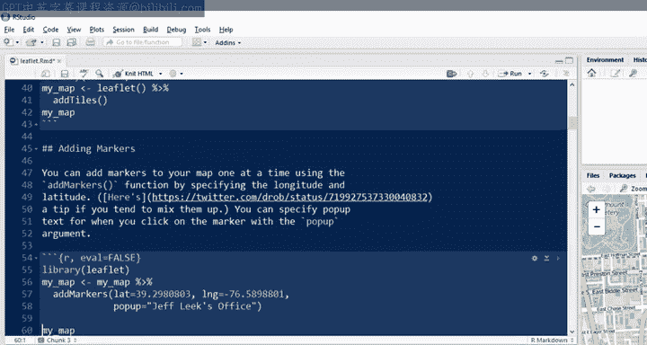

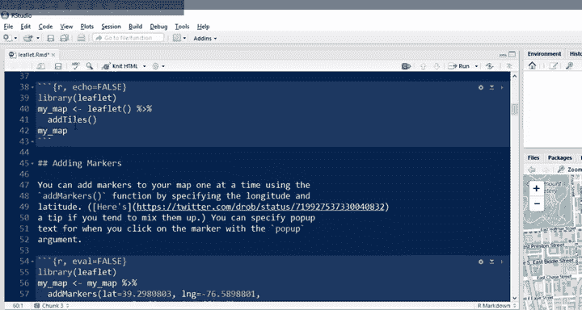

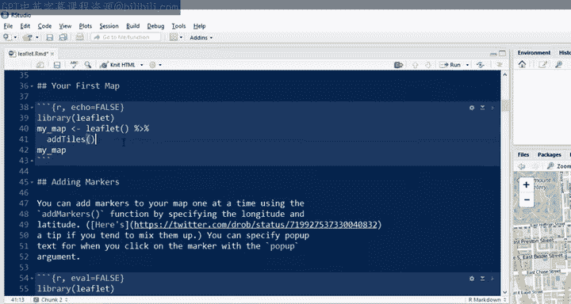

Let me and if just give me stick with me one second here， you would have done something like this。

 You would have done my map。

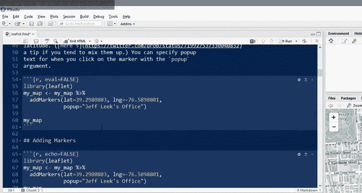

Is that and then you would have done。Like this。Okay。啊。啊。

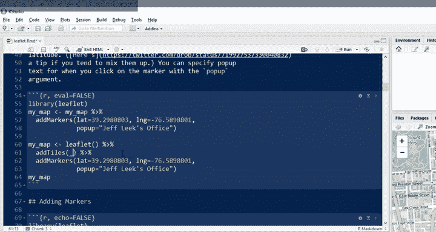

failil at typing。 Okay， there we go。 So this， this would be a equivalent total set of commands。

 And there you can see now the chaining is really useful， right， It's simplifying。

 it's simplifying the code， okay。And。So here right。

 we just created it once and we're not having to reassign this variable over time。

 we're just chaining it through each time and it just creates for nicer code。

 if you've used it in D plier， the same rationale for using it in D plier applies here in leaflet okay and that's why the code is this way and you should get used to it and so from now on we're not going to talk about this。

 we're just going to go through the leaflet commands。

 Okay now to further expand on the leaflet commands okay。

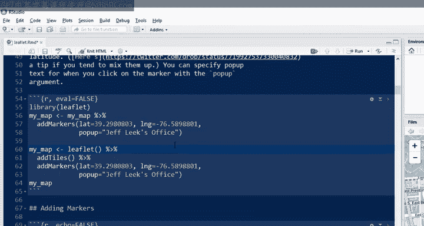

All that we had to do for the ad markers right the first thing is is because of the chaining。

 the first argument is going to be your map variable。

 but then after that you just have to give it the longitude and latitude the specific coordinates that you want for your marker and then the pop up just gives you the text for the pop up so that when you click on it and I'll click on it over here。

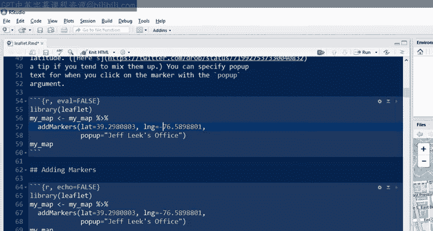

You actually see that it says Jeff Le's office， okay？All right。

 and so you could think you can imagine if you're making a fairly complicated map。

 you might have lots and lots and lots of markers added and we'll go through some examples。

