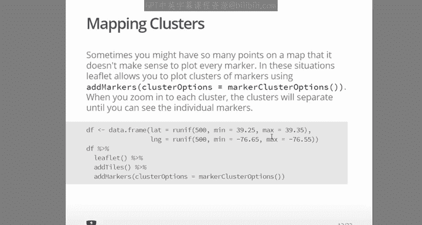
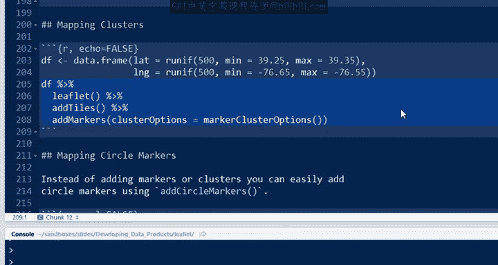
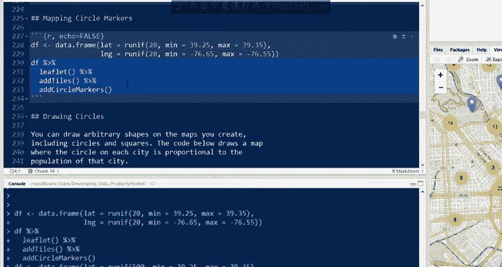

# 约翰霍普金斯大学《数据科学：统计和机器学习｜Data Science： Statistics and Machine Learning》中英字幕 - P143：35_Leaflet 1 5.zh_en - GPT中英字幕课程资源 - BV1jsAAeNE3k

So sometimes you have enough points that when they all appear close together。

 you can't really differentiate them and leaflet has a pretty nice solution to this and that's to cluster them together and then at different resolutions they'll break apart so let's go through an example like this and I think you'll see immediately why it's useful。

Okay， so let's just go through the code。 let's define a data frame with 500 latitude and longitude points that are kind of close together。

 Okay， and then I'm going to take my data frame and pass it as the argument to leaflet。

 Then I'm going to pass the output of the leaflet evaluated at the data frame to the add tiles command。

 and then I'm going to pass the output of that to the add markers command。

 and then it's just going to have default cluster options。

Okay。And then we go and look at that now we see the cluster and it gives you the number of points in this cluster。

 so let's look at this big one。Actually， I like， I want to do this 96 one since it's up。

 see there you go。It's right in the center of Baltimore， look at that。Zwe， that's cool。Okay。

 see how they all bunch back together。At different resolutions。There's all 500 of them。

 they're all in Baltimore and as I zoom in， I could just do this forever Okay。

 all right now let's move on to the next thing since it's really quick。

 I'm not going to really introduce it。Instead of adding clusters or standard pop ups。

 you can add circles and the the way to do that is just add circle markers。

 see this command right here Okay， so let's do the same thing here we're just going to do。嗯。

A couple of 20 markers that we're going to add， and then we're just going to add circle markers Okay。

 and there they are and see now they look like little circles。

