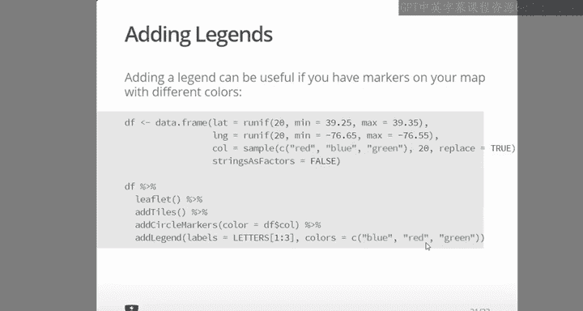
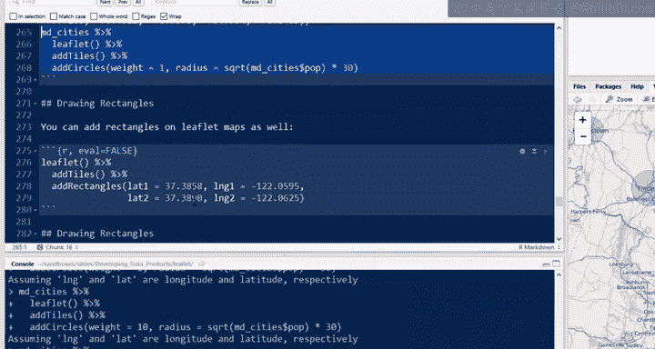
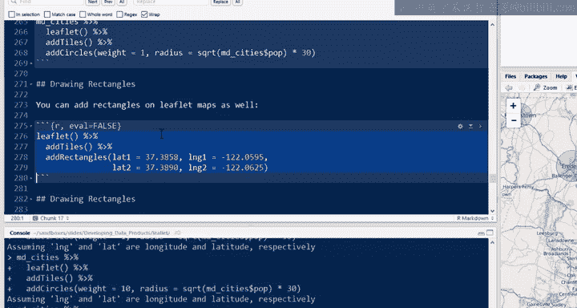
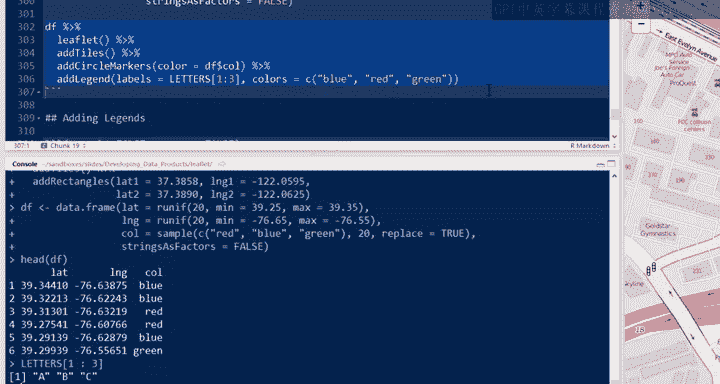

# 约翰霍普金斯大学《数据科学：统计和机器学习｜Data Science： Statistics and Machine Learning》中英字幕 - P144：36_Leaflet 1 6.zh_en - GPT中英字幕课程资源 - BV1jsAAeNE3k

So the last thing we're going to really talk about is that you may want to actually manually draw not manually digitally。

 I guess， draw shapes on your map okay， so here we're going to show you how to draw some circles and it will be pretty obvious how you do that and then we'll show you how to draw some rectangles。

And then we'll show you how to add add a legend。 So these these couple of commands will get you started。

 and then there's obviously more these couple cans will get you started on really annotating and kind of drawing on your map in very useful ways。

 And we're going to give you an example of at least drawing with a circle in a way that you might actually want to do Okay。

 so let's go ahead。

Okay。So this is a nice example because it's sort of along the lines of something you might really want to do so here what we have is a collection of cities so we have the cities。

 their names are Baltimore， Frederick Rockville， Githerwick。

 these are all cities right around Baltimore okay and it gives you the population here okay。

And it gives you little latitude and the longitude。Okay。

 so now we're going to take our city data set。We're going to pass it to leaflet。

 We're going to pass the output of that to add tiles。 Okay， now it's got our mapping data。

 and then we're going to add circles。 So remember， we talked about the add circles command in the last。

In the last lecture， Okay， but now we're going to pass it some important options。

 So the weight will show you how well show you what happens when we change that。

 But we want the radius to be scaled relative to the population of the cities。 Okay。

 so this is a more reasonable use of adding circles than just having them as， as the markers。 Okay。

 so here let's go ahead and do it。 I got to actually run。Get the cities。There we go。All right。

And then see here， so we've got Baltimore is a much larger city。

 say than Annapolis in terms of population， okay？And so the size of the circle is representative of the population。

 let's change that weight。To let's say 10。 And that's the way to really look at options is just make them much bigger。

 Okay， there。 And now you see what weight does。 It does the kind of the。The outline of the circle。

 Okay， just to make it even more apparent。 Let's do it to 100。 So yeah。

 when you're looking at options， just make them as extreme as you can。

 And then that'll show you what they're doing。 Okay， so that's that looks terrible。

 But now we understand what the weight does， okay。There we go。

 let's get it back just cause it looks way better at way to go1。Okay。

Now， let's just try doing a rectangle just to show you what adding a rectangle looks like。

We're going to take leaflet。Add tiles and then we're going to add a rectangle but this time just to show you we're going to give you one rectangle and in this case with the rectangle you're just giving it two corners okay so remember all you need for rectangle is two opposite corners。

 it can't be two corners on the same line， two opposite corners okay。

There is a rectangle。All right， so apparently we're rectgling the Mountain View corporate Center。

Okay。Now let's cover the final thing， which is adding a legend。

 So it would be very common task where you want to add circles or add annotations like these rectangles and circles。

 but you want them to be of a different color and then you want a legend so that the user of the map can understand what each of the separate annotations means。

 Okay， so here we have a data frame that's got 20 points。And the colors are going to be red， blue。

 and green， and。So there we go。 Okay， so let let's just look at this data frame real quick。

 Head data frame。 will do that for us。 Okay， so we've got a bunch of latitude and longitude points in colors。

 blue， red， green， and so on。 Okay， now we're going to take our data frame。

 We're going to pass the delete leaflet。Add the mapping data Now we're going to add the circle markers only now the only difference is we're going to have them be colored by their random color that we generated。

 Now， of course， when you're doing this on your own you're going to want your in colors to be important like like this county is going to tend to vote Democrat in this other county is going to tend to vote Republican or something like that。

 And in that case you of course， want the colors to not be assigned at random Okay so hopefully that point's not that hard。

So now the last thing and the only thing we want to talk about is adding a legend。

 Okay so adding a legend operates a lot like the legend command in base R plotting Okay so the labels are just letters one to3 and that's not anything in specific we just made up we just made up we made up labels in this case。

 So if you type letters that's just predefined vector in in R。 So if you type letters one to3。

 it just gives you ABc okay so there we're just making up you would obviously want this to be set。

 say for example， to Decrat， Republican other or something like that。

 and then the colors are blue blue red and green。 So let's go ahead and run this and then you'll see your legend right up here so that tells you what the colors of your dots means。

 And of course in your example， you'll have more meaningful colors in more meaningful dots。

 but now you know how to do it。

Okay， so I hope this was the last lecture on leaflet。

 I hope you found it useful honestly I think leaflet is probably one of the most useful things we'll cover in this class and you can use leaflet in conjunction with Shiny to create some really amazing amazing applications and nonetheless I think this is one of the easiest interactive plotting utilities that you have in R and certainly is worth your time to learn。

Okay， thanks， and I look forward to seeing you in the next。

