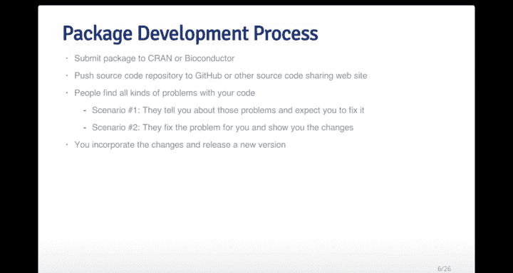

# 约翰霍普金斯大学《数据科学：统计和机器学习｜Data Science： Statistics and Machine Learning》中英字幕 - P145：37_R 包 第1部分.zh_en - GPT中英字幕课程资源 - BV1jsAAeNE3k

Hey everyone， this lecture is going to be about building R packages。

 so this is really a key product that you can build that implements any kind of statistical or other methodology that you develop on your own。

 and it's a great way to distribute your approaches to other people who use are because there are a lot of centralized platforms and repositories that you can take advantage of so I'm going to talk about what are the basic aspects and pieces for building an R package and so that you can kind of know what goes into building it and what how it can be done。

So first what's an R package The basic idea is that it's a mechanism for extending the basic functionality of R So when you download R。

 you know you get a couple of base packages， things like graphics and GR devices that are kind of implement this kind of fundamental functionality。

 but there's all kinds of functionality that's not included in the basic R distribution and that's because it's basically impossible to kind of include all everything that everyone might need in a single package So there's an extension mechanism called the package system that allows other people to write functions and to write other kind of functionality and then so that other users can kind to add it on or tack it on to the kind of base R installation and so typically it's a collection of R functions or data objects that are kind of wrapped together with some other kind of elements like documentation。

The goal of the R package system is to kind of organize this stuff in a systematic way so that anytime you get an R package。

 there are a couple of things that are kind of common to all packages that the same things are always in the same places and you always access certain things like help files in the same way so there's a certain amount of consistency that's there so that users can kind of manage their expectations anytime they get a new R package there are literally thousands of R packages written by people all around the world。

So where can you find our packages well typically you might go to a central repository such as the comprehensive archiveive network or CrN。

 there are another big repository is called bioioconductor。

 which contains a lot of tools for bioinformatics and genomics those kinds of areas。

There are also a lot of packages that are hosted on source code sharing websites like GitHub。

 Bit bucketet， Cious， and so you can attempt to install packages from those repositories also packages from Crran or bioconductor can be installed with the installed dot packages function that kind of comes with R and all you need to do is specify the name of the package and the repository where it's coming from and it will install download and install the package for you。

Packages from GitHub， for example， can be installed using the install GitHub function from the Devb Tools package。

 so that's a very handy tool。If you're building a package。

 you don't have to put a package on a central repository in order to distribute it to other people。

 but you can just kind of send them a file or whatever makes whatever is easy for you。

 but putting the packages on a central repository is useful because it allows anyone to really find your package and to install it if they want。

So what's the purpose of making an R package I mean。

 why would you want to go through the effort of doing this when you could just kind of send someone a file with your code in it And so there are a number of advantages of having an R package available for other people first of all it's a structured format that other people kind of understand if they use other R packages。

 second of all， documentation is required in an R package So it forces you to write some documentation and to explain how your functions should be used to other people you have to document the arguments and you have to document the kind the return values Another thing is that it allows you to kind of create a welldefined API or application program or interface so you can specify what functions the users should be calling and what functions in particular the users should not be calling and so that way you can say okay well here if you're going to make some functionality available to people and and you only want them to access it through using a single function then you can say in your our package this is the only function that that you can access that way you can hide and abstract a lot of the implement。

Details away from the user so that if you need to change them in the future。

 you can change them without having without ruining the interface that you've given to the public and for users to use it's also typically easier to maintain and our package because the structure and the documentation required if for some reason you decide you don't want to maintain your package or you can't maintain it you can always kind of pass it off to someone and the structure is already there for them。

 I think one advantage I think is that there's some standards for kind of reliability and robustness that people will have faith in so they know that at least if it's on cran and past number of checks and that it will load properly and kind of not have a problem immediately on your system。

So the basic package development process kind of goes something like this。

 it may vary across different people， but there's usually some element of this process here。

 so you typically you write some R code in a script or in a R file and that's fine and you kind of write your functions。

 you kind of debug things， you try things out and then you decide and maybe this code is very useful to you that at some point you might decide that you want to make this code available to others or you might just want to kind of make it available to yourself in a much more structured way maybe you're going to kind of finish up a project and kind of want to leave it in a state that's kind of maintainable。

And so the idea is that typically you'll take the R code that you've written。

 which is in these R files and you'll incorporate it into the R package structure。

 which I'll talk about more in a second。 then the next thing you typically do is write some documentation for the function for the user functions。

 these are the functions that are kind of public and available to the user and then you might think about including some other material like examples or demos or datas or tutorials or vignettes Once all that's done。

 you package it up and you've got your R package。So once you've got your R package。

 you could just stop there， you could have it installed on your system。

 you could kind of email it to a friend or if you want， if it's not that big。

 but the most logical thing to do often is to submit it to a repository like Crran or Bconductor you can also push the source code to something like GitHub。

 a source code sharing site so that other people can look on end and modify the source code。

And typically the scenario there are two scenarios that you will run into once you make your package public to the or available to the public the first is that other people will use your code。

 they'll tell you about problems that they encounter and they'll just let you know and then they'll expect you to fix it The other possibility is that they will look at your package。

 they'll look at your code and if there's some problems。

 maybe they'll figure out what the fixes and they'll fix it for you and then they'll show you the changes and then you can incorporate their changes either way I think it's useful to have other users looking at your code and helping you to improve it so this is a real benefit of making your code available to the public and then once you've incorporated these changes these fixes into your package you can kind of release a new version。

