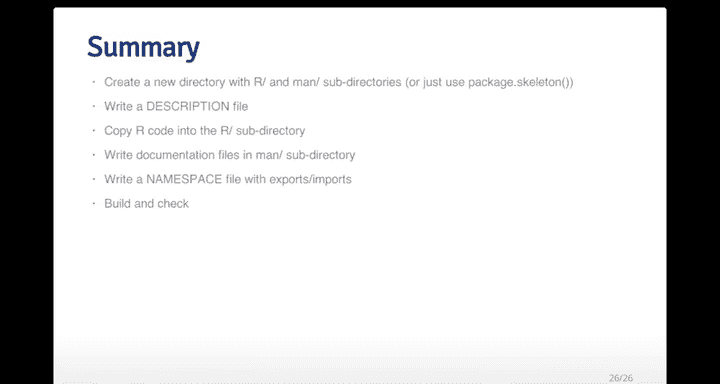

# 约翰霍普金斯大学《数据科学：统计和机器学习｜Data Science： Statistics and Machine Learning》中英字幕 - P146：38_R 包 第2部分.zh_en - GPT中英字幕课程资源 - BV1jsAAeNE3k

So what makes up an our package So there are a couple of essential elements and then there are a number of optional elements。

 So the first thing you do when you create an R package is you need to create a directory on your file system and so this is done in a variety of different ways depending on what platform you're on but it always starts out with a directory and it's typical to name the directory to be the same as the name of the package So if name if your package is my package and then you would name the directory My packages not and so so that's a convention pretty much amounts all R packages the next thing that you need to have in a package is what's called a description file and this has some metadata about the package of course you need some R code and an R subdirecty you need to have some documentation for the R code this typically in the man subdirecty。

A namespace file is optional， but it's very common I encourage you to have a namespace file。

 and then if you want to know what all the full requirements are。

 you can look in the Writing R extensions document that's available on the R website。

So what is the first thing is the description file after you've created your directory you can put a description file in there and these are the elements that you need to have in the description file first of course is the name of the package。

 the title is a slightly longer kind of description of the package beyond just the name and then the description field is even longer description this could be a sentence or maybe even a sentence or two and then the version number which is going usually in the format of a major number do minor number dash and then patch level it doesn't have to be in that format if that's common the name of the author so this could be the person who wrote the original code it may not be you if someone else wrote the original code but it could be you the maintainer is very important because this will be the name of the person who maintains the package and their email address if there ever any problems with the package there's an email attached to the maintainer and that person has taken responsibility for addressing any problems and then finally。

Just as important as the license for the source code and so the license describes you know one of the terms that the source code being the source code is being released under and some common licenses for source code for R code or things like the Ganew General public license or a BSD license or an MIT license you typically。

A kind of a standard open source license is used。Other fields that you can put into the description file that are optional but but are commonly used are depends and this is a list of R packages that your package will depend on so often if you're writing R code you will use code from other packages and that needs to be listed here in the depends field suggests is another list of R packages that you may want the users to have installed but are not strictly essential to writing the R code and then the date it just indicates the release date for the package if your package has a homepage you can list the URL for the homepage I often list the link to the Gitthub repository for for each of the packages and then you can add other fields to the description file just for your own benefit but these will generally be ignored by R。

So here's an example description file from the GPC Lib package。

 so here you can see the name of the package is GPC Lib。

 the title is the General Polygon Cping library for R。

 the description is the general Polygon Cping routines for R based on this C library by Alan Merrtta。

 the version we're currently at 1。5-5 so I am the author but there have been a number of contributions from other people。

 Im also a maintainer。And so there's my email address there for the maintainer this package has a special license and so the details of which are found in the license file。

 so that's why I've got this file license there it depends on our being at least version 2。

14 and so that's a fairly old version most people will have had a version that's greater than that and it also depends on the methods package I import functions from the graphics package I'll talk more about that when I talk about the namespace file and then the release date for this package was April 1s。

 2013 and then there's the URL for the website the website on the kind of underlying C library there and the Github repository。

OnceOnce you've written up your description file， the next thing you want to do typically is copy your R code into the R subdirecty Now there can be any number of files in this directory you don't have to have all your R code in a single file furthermore but you don't have to have one file per every function so you can organize it however you want doesn't matter what the number of files is。

 but you typically want to separate， have a separate file for kind of logical groups of functions so all the functions that read data go in one file and all the functions that maybe fit models go into a different file so your R code should be included here and anything that you want to make available through the package and you should not include R code in any other part of the package。

The namespace file is useful because it indicates essentially the API for your function。

 it also lists all the dependencies， so code that your package uses from other packages。

So there's two kinds of things， the first is the export。

 so you want to indicate which functions in your package are exported。

 so these are available to the user， these are the public functions。And so non-exported functions。

 the functions that are not listed in this file are cannot be called directly by the user。

 are unless they kind of use some special functions to access that code。

 so these are not available in general to the public and this allows you to hide the implementation details from users and makes for a generally cleaner package interface。

The other thing that you can indicate besides exports is imports。

 you can import functions from other packages and so this allows your package to make use of other packages without making other packages visible to the user so typically if you load a package and it depends on a lot of other packages。

 you don't necessarily want all those other packages to be loaded into the search list for example。

 for the user to see and so this allows you to use the functionality of other packages without having to load every other package onto the search list。

And so importing a function loads the package namespace， but it doesn't attach it to the search list。

So a couple of key directives for the namespace file or the export where you can export a function import is for importing a package and then import from is for importing a function for a specific function from a package。

 so this allows you to kind of very specifically describe the dependencies and the public API for your package if you're using S4 classes and methods then some important directives are the export classes directive and the export methods one。

 although these things look like R functions it's important to realize that they're not exactly R functions。

So here is a sample namespace file from the MVTS plot package this package only has one function that's exported。

 it's called MVTS plot， it's a applying function for multivariate time series and so that's the only function that the user can call when this package is loaded it imports the access function from the graphics package and it also imports the all the functionality of the splimes package so that's basically it's a very simple namespace file。

Here's another slightly more complicated namespace file from the GpClib package that we just saw。

 there are two functions exported here， the read polyfile and write polyfile。

 we import the plot function from the graphics package and then there are two S4 classes that are exported to the user this gpc。

poly gpc。poly。nohole and then there are a number of methods that are exported to the user including the show method and getbbB box et cetera so these are methods that apply to these new classes that are defined this gpc。

poly class and these are all the methods that are available to the user for this class。

Once you've got the description file， the R code and the namespace file。

 the next thing to deal with is documentation， So documentation is very important because it allows the user to kind of understand how your function is supposed to be used and documentation files typically have in a capital R and then D extension and they are placed in the manned subdirecty of the package directory structure theyre written in a specific markup language which I'll show in just a second in a documentation file is required for every exported function and so that provides another reason to limit the number of functions that you export to the user because for every function that you export。

 you have to write a documentation for it， but in the functions that are not exported。

 you don't need to have any documentation for because they're not meant to be used by the user you can also document things that are not functions you can document data sets you can document kind of basic concepts or you can provide a package overview so these are all things that you can provide as documentation。

So here's a simple help file This is from the line function this is just part of the kind of the base R installation you can see that there's a name for for the documentation。

 there's an alias this is something that will call up this documentation file even if if you do question mark line then anything that's in the alias will call up this documentation file so if you do question mark residuals2ki line you'll also get this help file and you can see that the title is robust line fitting and there's a description which is a slightly longer description than just the title after the description you typically have a usage section which describes shows how the function is called on its arguments so this function only has two arguments X y and so that's how you call it。

After that you have to describe what the arguments are， and so the two arguments are X and y。

 and you can see that they are the arguments can be of any way of specifying X Y pairs。

After you describing in the arguments there's a detail section where you typically see go into more detail about various aspects of the function here there's just a few kind of notes that are added and then lastly there's the value section。

 the value section describes what is returned by the function so some functions don't necessarily return anything useful in particular plotting functions often don't return anything。

 they just have the side effect of kind of creating a plot and so here in this case the line function returns an object of class to key line。

Finally at the end， you might have something you might have some references， so for example。

 if you're implementing a method， a statistical method or something along those lines。

 and it has a reference like a paper or a book in this case it' a book。

 you can put those references in the help file so the people will know if they want to explore this thing a little bit more。

 they want to read more about it， they know where to look。

So that's that's kind of how the help files look Once you've got your R code， your help files。

 your description and your namespace， then you can start by building the package and there's a command line tool that comes with R it's called R command build and it creates the package archive file which typically has ara。

gZ extension once you've built the package you can run a battery of tests on the package so you can use this you can do this by running the R command check command line program and this runs a whole set of tests to make sure that there's that everythings kind of consistent within the package structure and you haven't for example forgotten any documentation or that kind of the exports and the imports are kind of appropriately to specify you could run R command build and R command checked from the command line using a terminal or a command shellll type of application you could also run them from within R using the system function in this way。

Our command check runs I said I mentioned already runs a battery of tests。

 basically it checks for example if the documentation exists if every exported function has documentation。

 it checks to see whether your code can be loaded， it also it checks the kind of the coding style so that there's no kind of basic problems there's actually a code checker in one of the tests it checks for any errors that may a common coding problems that may occur。

 if you have any examples in your documentation it will run the examples to make sure that they actually run it will check that the documentation of the arguments in your documentation matches the arguments that are in the code or for example sometimes you might modify the argument list of a function in your code but then forget to modify the argument list in the documentation and so it will check for that kind of mismatch。

And in particular， this is important because if you want to put a package on Crran。

 it has to pass all of the tests in our command check without any warnings or any errors。

So that's the basic idea behind our packages if you want to get started a handy function to look at is package dot skeleton and what this does is it basically。

Creates the skeleton or a directory structure。 So itll create the directory。

 if you pass it the name of a function。 So that's usually the first argument to package skeleton。

 it will create the directory。 It'll create the R directory， the man directory。

 it will create a of a dummy description file for you to fill out。

 It will also create a namespace file that you can kind of flesh out and it will put some documentation files in the man directory。

 if you have any functions that are visible in your workspace。 So by default。

 it takes all the functions that are in your workspace and write them out to the R directory and the man directory。

 So if you have any if you have a lot of extraneous functions in your workspace。

 you don't want to run this function， But if all the functions that you kind of have in your workspace are you want to put into the package then it will automatically do all that for you。

 So then all the documentation stubs are in the man page。

 you just have to edit them to kind of customize them to your need。

 And so you need to fill in all this extra stuff。So the basic summary is that our packages are a systematic way to make our code available to others。

 it's very useful and it's a standardized way that kind of people understand the standards are important because they ensure that the packages have a minimal amount of at least some documentation and have some robustness to kind of problems and you typically obtain our packages from Crran。

 bioconductor GitHub or other types of repositories。

The basic checklist for creating an R package is basically create a new directory。

 create the R and the Man subdirectories， you can also use package Skes in for this。

 you need to write a description file， you need to put your R code into the R subdirecty。

 you need to write documentation files into the Manned subdirecty。

 create a namespace file which defines your exports and imports。

 and then build it and check your package to make sure it passes all the checks。

 and so that's your basic template for building an R package。

