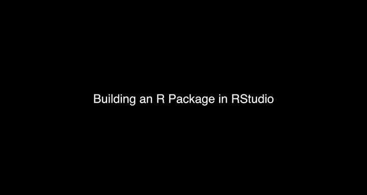
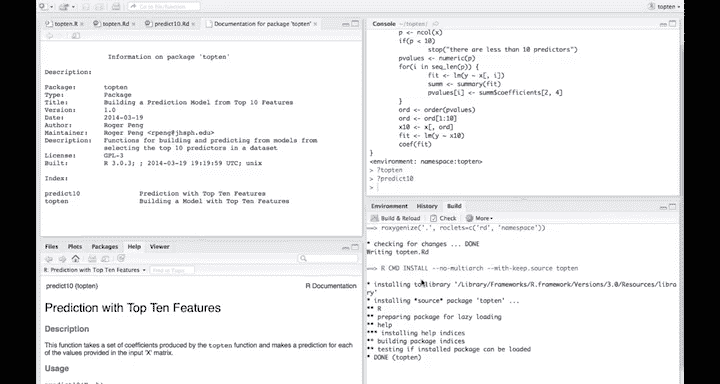

# 约翰霍普金斯大学《数据科学：统计和机器学习｜Data Science： Statistics and Machine Learning》中英字幕 - P147：39_构建 R 包演示.zh_en - GPT中英字幕课程资源 - BV1jsAAeNE3k

Hey everyone， this lecture is going to be about building an actual R package so we've already seen kind of what is an R package and what are the different components of the package So I thought in this lecture I'd like to do a little demo ands going to show exactly how to put each all the pieces together in particular how to do it in our studio which makes it actually very convenient So the package we're going to build today is just going to be a very small package is only going be two functions and the functions in the package we're going to be are going to build a prediction model for a high dimensional data set using just the top 10 predictors So if you want a little bit of background what the rationale for this model is I'll put a link up。

 you can look at the link in right here and you can to read more about it So that's the package we're going to build it's going to be called the top 10 package and so let's do that we'll do that in our studio and you can see how everything is done。

Okay， so the first thing we need to do is start up our studio， so let's start it up here。And。

I as well just make it full screen while we're at it。Okay。

 so this is the kind of the default screen for our studio。

 the first thing we want to do when we start our project sorry our package project is to kind of start a new project。

 I'm going to open up the project menu here and say new project。

And we want to start this product in a new directory， so I'll click on that。

And then what we want to do is build an our package and then the name of the package。

 you can create whatever name you want， but I'm just going to call it the top 10 package because that's the predictor model that we're building and it's going to be a subdirecty of my home directory here which is fine so I'll just hit create project。

Okay， so you can see that。It puts me in the directory here where。

Where the package files are going to live。 You can see these are the package files here。

 and you can see it's kind of put a bunch of default files in there iss a description file。

 a namespace file。 And then if you look in the R directory， there's a file there's a code file there。

 but you'll notice that there's actually nothing in it。

 So we'll have to fill that up in just a second。 let's just navigate this file directory a little bit more in the top level director you see there's a description file that we talked about if we open it up you can see it's prefiled a bunch of the fields for you and put the package name in there for me But we're gonna have to fill out know with the title。

 the author， the maintainer， the description etc。 So why don't we do that just right now。

 So the title， this package is going be the top excuse me。Just the。We'll call it。Building a。

Prediction model。From the top 10 features。And version 1。0 is fine， the date is fine， who wrote it。

 so it's going to be me， let's say。The maintainer is going to be me， but the important thing。

 of course， about a maintainer is that there has to be an email address there， so to be me again。

And then description is just a little bit longer than the title。嗯。It's all to say， you know。

 build functions for。Prediction models。From selecting。Actually building， let's say。

 building and predicting from。Models。From selecting。The top 10 predictors。なてるさ。

So something like that doesn't have to be too long and then a license will just choose a nice open source license like G new GPL。

So let'lls just call that GPPL version  three， and that's our description file。

So I'm just going to save that。And by hitting command S and then I'll just close it up since we don't need it anymore。

 So I think at this point， there really aren't any other files that we can fill out。

 so we might as well just start coding away Okay so。

The first thing we're going to want to do is build our top 10 functions， so。Let's call a top 10。

And it'll take two arguments X and Y。So the x is going to be the kind of matrix of predictors and y is going to be the vector of responses。

 so p is the number of columns， it's going to be p predictors。

And I think it doesn't really make sense to look at the top 10 predictors if there aren't at least 10 predictors。

 so we're going to check to see if P is at least 10。And if it's not。We'll just stop。

So the way this model works is basically for each predictor in your kind of matrix of predictors。

 we fit a univariate regression model of the response on each individual predictor。

 and then for each individual predictors so there's going to be all these regression models that we fit and for each predictor there's going to be a P value associated with that given predictor depending on how strong the association is。

So so for every predictor we're going to have a P value and then what we're going to do is we're going to sort the P values from kind of smallest to largest and then we'll take the top 10 smallest。

 in this case P values which indicate kind of the predictors of the strongest association。

 so we'll take those top 10 predictors and then we'll fit a separate regression regression model with those 10 predictors in it and that will be kind of the final prediction model。

All right， first so we've already checked to see there's at least 10 predictors and we'll initialize our vector of P values here。

Thiss going to be an empty vector of zeros， and then we're just going to loop through each of the predictors。

And univari regression models will fit LM。Y till the x integral is I。

And then we want to get the P values out， so we need a summary of that model fit。

And then the P values for that predictor， P value for that predictor。It's just gonna be the。

Can the coefficients element。And it's the fourth column here。

And so we're going to accumulate all those P values。 And then once we've done that。

 we want to sort the P values。 So when to look at the ordering of all the P values。And order。

By default， we'll sort them give you the indices from the smallest to the largest。And then。Okay。

 so then， and then we just want to take the top 10。 So so the。The order。

 what we really want just as one through 10 here。And then we want to so then we'll create a new data set called X10 with the kind of top 10 predictors。

From the old data in the original data set and fit this final linear model。

And then grab the coefficients from the model。 and so that's kind of what the top 10 function returns。

So we've got our top 10 function which kind of fits the model it goes through all the P values and picks the top 10。

 so I'm going to write one more function that takes the coefficients from the final fitted model and it takes some kind of additional input vectors and gives you a prediction for the new values right so it takes the coefficients and some data and gives you predictions the predicted response for each one。

So that let's call predict 10。And it's going to take a matrix of predictors。 Now。

 this matrix can only have 10 predictors in it because that's what the model final model says。

 and then a vector coefficients is called B。And then it's pretty simple we're going to do。

 the first thing we're going to do is're going to add the intercept。To this matrix。

And then we're going to do a matrix multiplication of the new kind of data and the coefficients from the model。

 so I'll do X。Times B is a matrix multiplication。 and then I want to drop the dimension。

AndSo that gives me a vector for a drop， so this just returns a vector of predicted responses。

Okay so we've got our code for the package it's pretty straightforward just this two functions but in order to have a package。

 of course we need a bunch of other stuff， we need some documentation and we need to be able to specify the namespace file So the way that we're going to do documentation in this package is we're going to use the oxygenygen2 package and so what's nice about this format is that it allows you to put all the documentation in the code file itself and then what the oxygenygen2 package does is it strips out the documentation that you put in the code file and it makes the man page it formats it in the appropriate way so you don't have to worry about documenting separate writing out separate documentation files two nice things about this is one is that it kind of keeps you focused in one file you don't have to kind constantly switch back and forth and the other thing is that since the documentation is actually close physically close to the code there's a better chance that the documentation will stay up to date because you'll be able to see if there are any discrepancies between the documentation and the code itself so let's。

Go ahead and do that。So the first function I want to document here is the top 10 function and so so I need to give it a so the first I'm going to do is give it a little hash and then the kind of apostrophe there and I'll give it a title。

 so I'll call it building。A model with top 10 features。

And you can see that our studio nicely kind of inserts those extra hashes for you。

 and I'll give a little description here。 So this function。嗯。Develops a prediction。Algorithm。

Based on the top 10 features。In x that are most predictive of y， okay， seems reasonable。

And then we want to start documenting some of the arguments。

 So the first we can use the parameter directive here。

 say there's an X argument and say this is a M by P。Mattrix of N observations。And P predictors。

There's another parameter here， a Y。And this is a vector of length N。Representing the response。

And then we'll save the return value。Is a vector of。Coeics。From the final fitted model。为。

Top 10 features。There's a couple of other things we can fill out， such as the author， that's me。

If there's some extra details we can write out， some maybe write some details here for the reader。

 I'll say this function。Rs a。Unnivari。Regression。Of Y on each predictor。X。To calculateulates。Pがゆ。

Includinging。The significance。Reciation。And the final set。And predictors。嗯。T。From the 10 smallest。PW。

 okay， so's a little description there。You might want on direct readers to the。To the L N function。

 just in case they want to know how the linear models fit。嗯。Now。

 what's important actually important about this function， first of all。

 it's going to be a function that we want to export。

 so we want to make sure that it gets exported in the namespace file。

 so we've got to put the export directive here and then furthermore。

 because this function uses the LM function， which comes from the stats package we need to import that function so that we can use it so we need to import from the stats package。

 the LM function so that's going to go into the namespace file。All right。

 so that's our documentation for the top 10 function。

Now let's go down here and look at the predict 10 function。

 So we got got to kind of got to do the same thing here。 start little documentation。 So prediction。

With the top 10 features。And then this，'s say， this function。A set of coefficients。Produced by the。

Top 10 function。And makes a prediction。For each of the。The valuesals。Proed。Input X matrix。

OkayIt's a that little description there， so what parameters does this function have？Well， there's X。

B。And then we know it returns。A numeric vector。Chaining the predicted values。All right， so what's x。

 this is a M by 10 matrix。Containing and new observations。And then what is B， B is a vector？

Of coefficients。Obtained from the。Chaop 10。All right。So then， of course。

 we also want to export this function， so we hit the export directive。

 This function doesn't import anything special， so we don't need an import directive。All right。

 so let's save that with a command S here。Okay， so we've written our R code。

 we've written some documentation in the R code， and so now it's going to be time to kind of process this information and start building our package。

 so let's see how we do that in our studio。So in our studio， we can go over here to the build tab。

And you'll notice that this build tab only exists if you've created a project that's specifically an R package。

 okay， so let's try to build our package and then load it into R okay。

So you can see that at top in the top window here， the R session has restarted and then the top 10 package has been loaded okay so one of the things to'll notice if you go over here to the left。

In the files， let's go in the man directory here。Oh。

 and you can see that there there's a default kind of a documentation file here that just kind of describes the package。

 but you notice that the documentation files have not been created by the Roxgen tube package and so what we actually have to do we've got to go into here。

And configure our build tools。And then we want to generate documentation with oxygen and we want to create the RD files for the manual。

 let's create the namespace file from the documentation that we wrote and then we'll do it when we build and reload。

Okay。This over here on the left， this package documentation file is not required。

 so I'm just going to delete it because I don't feel like you're writing it。All right。

 so let's build and reload our package again。And you'll notice now that the。

The two documentation files here for our code have been written so if you look in the top 10。

rd file you can see all this information has been extracted from the documentation that we wrote in the R file。

 so this is all the stuff that we just wrote and from the predictt 10 function again。

 another set of documentation here。So。Let's take a look at our top 10 package here， I can do library。

 it's already been loaded， but let's just take library help top 10。

You can see here's the description file that we wrote out， there's a bit of information。

 these are the exported functions over here。If I look I can print out the code for top 10。

And you can see that's the code that we wrote if I do question mark top 10。

You'll see that the documentation file that has been built is right here。

 so it's formatted nicely here， we can look at the documentation for predictd 10。

And you can see that here's a documentation that we wrote to be all familiar to us。

So we'll bring this down。And so that's our package is pretty much most of the way there if you want to check to see if it passes our command check。

 it's very simple you can just click the check button here and it will run our command check it will build the package and then run our command check and so you can see all the tests are going by。

Okay， so you can see that our command check finished and it looks like we passed all of the tests。

You see everything is okay over here。So that is a good sign。

And so I'm not going to upload this package to Crran because it's not a particularly useful package。

 but we could upload to Crran because we see that we pass all the tests in our command check。

So this very simple R package we just wrote a little bit， we wrote two functions。

 but you can see that in R studio there are a lot of handy tools for putting a package together and for building documentation files and so I encourage you to try out and write some functions maybe take some of the homeworks that you've done already and build an R package out of the functions that you've written it's not too hard and particularly when you use the tools in ourSt it can go very quickly。

