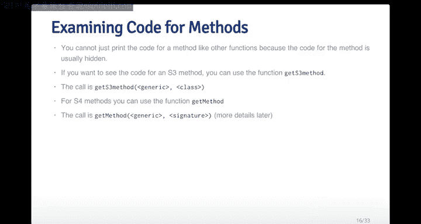

# 约翰霍普金斯大学《数据科学：统计和机器学习｜Data Science： Statistics and Machine Learning》中英字幕 - P148：40_R 类和方法 第1部分.zh_en - GPT中英字幕课程资源 - BV1jsAAeNE3k

Hi everyone this lecture is about writing classes and methods in R the basic idea behind writing classes and methods in R is that you want to represent new kinds of data or new data types that R doesn't kind of by by default support so for example if you think of a basic data type like a list this is kind of inherent to R。

 there's all kinds of functions and kind of processes that you can do to lists that's all kind of built in and comes with R but if you can imagine thinking of a new data type so for example a new field emerges and they come up with their own data。

 this is not something that the original designers of R。

Foreseen and so you need to develop a new structure to support that data。

 a new set of functions to kind of apply to that kind of data type and so that's what the idea behind writing classes and methods in R is So anytime something new comes up our system can adapt and kind of support new types of data and new data structures so that's what we're going to talk about in this lecture。

The classes and method system in R is basically a system for doing object oriented programming in years ago when R was first coming out。

 it was quite an interesting language because it was both an interactive system that supported a kind of a formal system for object orientation and so many other languages at the time。

 things like things that have very kind of well-known object oriented programming infrastructure like C++ and Java were generally not considered kind of interactive languages。

 those are the kinds of languages where you write programs you compile them and you un run them and not the kind of thing where you type things in the command line and execute things one at a times like you do in R。

So lot of the a lot of the code in R for supporting developing the development of classes and methodsthod was written by John Chambers himself。

 so he was the creator of S and has written a lot of the code in the R system。

 and so the basic ideas are documented in his book programming with data。

And and so the idea behind the class and methods system in R is to kind of allow people to cross over from being a user to being a programmer if you recall from the basic overview of the R language that I talked about in the R programming class John Chambber's original idea for the S language is that people would start off as users have slowly as they became more familiar with the language they would cross over and become programmers as they try to customize the system for themselves so R has the basic the same basic philosophy which is that people could start off users kind of execute functions and then as their needs grow and as their needs kind of outgrow the R system。

 they could become programmers and develop new things in R and that's the basis of classes and methods。

So apptoring programming is a little bit different in R than it is in most of the languages。

 So if you're familiar with the language like C++ or Java， that is helpful。

 but some of the ideas in R are a little bit different。

 Sos you might want to pay attention to some of the details here。

So in R there are basically two styles of classes and methods and this is a function of kind of historical development there's kind of an older style and then there's a newer style so sometimes we'll see the older styles referred to as S3 classes and methods so that corresponds with version3 of the S language and these classes and methods are informal。

 they're a little cllugy and they're kind of not very formally rigorous but they get the job done and they work quite well and a lot of the basic functions that you use in R are kind of built on S3 classes and methods so we know that they're very quite useful and they're not going away anytime soon。

But the more formal and rigorous system for writing classes and methods it's called usually referred to as the S4 system and that became because it came with the version 4 of the S language and it was introduced into R version 1。

4。0， which is in December of 2001 these are sometimes called new style classes and methods and for new projects it generally encouraged for people to kind of use the S4 classes and methods if they're going to be developing new types of classes and methods。

So these two systems for the foreseeable future will be living side by side just because of the kind of history of R and a lot of the kind of built in functionality that's written in S3 but the S3 and S4 systems are separate and the sense that you don't typically mix them together as you are programming new things so the systems are fairly independent of each other and so developers are encouraged to use the S4 style classes and methods that's used extensively for example in the bioconductor project but the S3 classes and methods are sometimes useful because they're very quick and dirty。

 they're a little bit easier to program and for kind of shortterm types of projects you may be tempting to kind of build up some S3 classes and methods in the first go but for the most part we'll focus on I'll talk a little bit about the S3 system just so you're familiar with it but I'll talk mostly about developing in the S4 system so one thing that's important to know is that all of the implementation for the object orient system in。

Four classes and methods is implemented in the methods package the methods package is usually loaded by default。

 so if you just start up R from a clean installation， the methods package will usually be loaded。

 but if it's not， you can always load it with the library function by calling library methods。

So the basic idea an object during your programming R is that you have classes and you have methods as you may have guessed already。

 so a class is basically a description of something and the thing will usually be some new thing like a new data type or a new idea and a class can be defined using the set class method in the methods package and then you have objects which are instances of that class and objects can be created using the new function or although often there can be created using other types of functions。

So then a method is a function that operates on a certain class of objects。

 and so methods are functions that are specific to certain classes。

And then finally you have a generic function which is an R function that dispatches methods。

 so a generic function is usually tries to encapsulate a generic kind of concept and we'll see a few of these a little bit later for example。

 the plot function is one of them probably the most used generic functions and the plot plotting is a fairly generic concept and what how you make a plot may depend on the kind of data that you're plotting and so there are many different plotting methods that can be applied to different data types and the plot functions job is to look at the data types and dispatch specific methods on those different data types so generic functions do not actually do anything they don't do any computation they don't do any sort of work their main job is to dispatch methods and we'll talk about what that means more specifically in a second。

And so a method is the implementation of a generic function for an object of a particular class。

 so the basic concepts are class， object， method and generic function here。

So as you're working your way through learning the system。

 there are a number of help files in the methods package that may come in handy so the primary documentation are in the help file so you can look at the classes and methods help pages。

 you can also look at the help pages for set class set method and set generic some of this gets very technical so you may want to just kind of skim through it right now。

 but as you learn the system it will make more sense in the future。

So every object in R has a class and the class of that object can be determined with the class function。

 so if I just take the number one here， you may recall an R the numbers by default are are kind of real numbers or double precision numbers。

 and so they're considered a numeric class and so that's what you see here logicals have their own class or true and false or logicals。

If you generate some random normal numbers， those are numeric that again is a numeric vector the missing value NA is by default the logical。

 but you can have missing kind of a numeric kind of missing integer， et cetera。

 and then this a character string will have in the class of characters so that's all fairly straightforward these are kind of atomic classes。

But you can go beyond the atomic classes， for example。

 I can fit a linear model and the output from the LM function is an LM class。

 so if you think about it the output from fitting a linear model is not what you would think of as a standard data type like numeric or integer or character but it is a data type there are certain ideas that are kind of encapsulated and from the output of a linear model if you are familiar with statistics and so。

And so it may deserve its own data type， and so therefore we call it the LM data type or class。

So that's the idea behind classes in our， so generics and methods are these types of functions that you'll write to implement functionality for certain types of classes。

And S4 and S3 style generic functions will look different。

 but they are kind of conceptually the same， they play the same role and so when you program you can write new methods for an existing generic so there may be a generic like plot that's already out there and then you'll write a new method for a new type of data。

 but there may be new generics that you create so you might create a new generic function for doing a new operation and then you'll have to read the generic and the method for a given data type。

So here are a few generic functions， these are S3 generic functions and so these are probably functions that you've seen already。

 the mean is a generic function and print is a generic function and so you see when I print out these functionss almost no code associated with them the only code that comes out of the mean function is this use method mean and similarly for the print function generic function all you see is use method print and so the basic idea is that these generic functions their job is to find an appropriate method for whatever data type is being passed to them。

So you can see what methods are available for the mean generic function by calling the methods function。

 you can see there's a mean function for dates there's a default method and there's one for di time。

 Pos CTt and Pos LT Now as you add as you kind of load packages into the R environment。

 those packages may add methods for the mean So as you kind of load packages throughout your work in R this set of methods that are available to the mean function may change over time。

 And so this list can grow as you add more packages。So here's an example of an S4 generic function。

 And so this is from the methods package。 it's called show and it's the equivalent of print。

 but it's the S4 version。 And you can see there's a lot more stuff that gets printed out when you when you。

When you print out the body of the show function， the basic idea is the same。

 the code for show is the standard generic and then show and it just tries to identify the class of the object that's being passed to it。

 and then it will dispatch the appropriate method and so。Most of the time in R。

 you don't call the show function or the print function because objects will be auto printed at the command line。

So here you can see what methods are associated with the show generic function and you can see that there are a number of methods here。

 one is for these are all in the methods package， so you can see there's one for the NRF class is one for functions。

 is one for generic functions etcter， so all these different types of objects have a special print or show method。

So the basic mechanism by which generic functions and methods interact with each other。

I goes as follows。 So the first argument for any generic function is an object of a particular class right。

 there may be other arguments， but the first object is important the first argument is important。

 And so the way the process works is that the generic function will check the class of that object。

 so we'll try to identify the class。 it will the generic function will essentially do a search to see if there is a method that is specific for that class。

 If there is a method for that class， then it will call the method on that object and then the generic functionss job is done。

 the method will do the rest of the work。If there is no method for that class。

 then the generic search will see if there's a default method。

 so it kind of catch all method that always gets applied if there's no other kind of more specific type of method。

 if there's a default method then the default method is called and then it does all the work。

 if there's no default method， then there's an error because the generic function doesn't know what to call and there's no default method so it can't do anything by itself。

So a lot of times you may want to look at the code for methods。

 but it's important to know that it's generally not possible to kind of print the code of a method function just like you might print the code of any other function So some functions that are not generics or methods you can just type the name of the function in the command line and you'll see the body of the function you can look at the code that's not always the case with S3 or S4 methods and so the appropriate way to look at the code for a method is to use either the get S3 method or the get method function so get S3 method is S3 generic methods and the get method function is for S4 and the basic idea is that you pass this function。

 the first argument is the name of the generic and the second argument is the class of the object。

