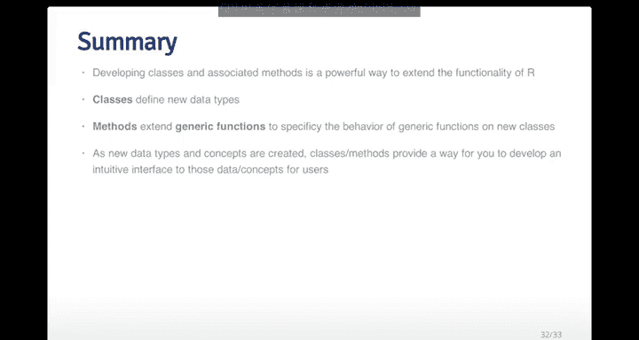

# 约翰霍普金斯大学《数据科学：统计和机器学习｜Data Science： Statistics and Machine Learning》中英字幕 - P149：41_R 类和方法 第2部分.zh_en - GPT中英字幕课程资源 - BV1jsAAeNE3k

So here's a simple example of an S3 class and method。

 so in the top here I'm generating some random normal data and I'm calculating the mean so here the mean is minus 0。

0307 so that's not particularly complicated， but there's actually a lot of stuff going on behind the scenes。

And so first of all the class of x， which is this random normal vector， is numeric。

 so I call the mean， which is a generic function on this numeric vector。

 it will search to see if there's a specific mean method for numeric objects。

 but there is as it turns out there's no method for a numeric objects so it will call the default function for mean which calculates the sum of all the elements and divides by the length of the vector。

So you can look at the default method for the mean function by using the get S3 method function。

 and you can see that there are other arguments， there's this trim argument， NA。rm。

 and as you go through the function。You can see that it checks a number of things and look if you're doing a trimmed mean。

 it takes care of that first， and then ultimately at the very bottom it calls some internal C code that actually calculates the mean for efficiency purposes。

So that's the mean is a simple example here is a slightly more complicated example。

 I've generated some data in a data frame now， and I'm s applyinging the mean function over the data frame。

 So one of the things that is important to know about data frames is that each column could potentially be of a different class so you can have the first column be numeric like we have here and then the second column be integer So when we s apply over the columns and we call the mean function for each column。

 the mean will check the class of that column and see if there's an appropriate method So for the first column it's numeric it will check for a numeric method。

 there isn't one so it will call the default and then the second column is actually integer so it will check for an integer method again there's no integer method so it will call default for that column too So if if you have a large data frame and every column is a slightly is a different class the mean function we' check each column to see if there's an appropriate method for that class。

So in some cases it's possible to call a method directly。

 so you may so some S3 methods are visible to the user so you may， so for example。

 the mean dot default function is impossible to call that directly without actually calling the generic function。

But in general， the rule is you should never call methods directly。

 you should always call the generic function and let the appropriate method be dispatched automatically and this results in cleaner air code and of a slightly more robust that way if the name of the method it changes a little bit you won't have to worry about the underlying details with the S4 system。

 this isn't a problem because you cannot call the methods directly for the most part at all。

So one last method example for an S3 class method， so here's the plot function and again I'm generating some random normal data so when I plot it again it looks for a numeric method for plot since there isn't one。

 it just calls the default method for plot and it makes a little scatter plot as you probably would expect。

However， this is a slight variation generating some random normal data and then I'm converting it into a time series object so I use the as dot Ts function to convert it into a time series Now you'll notice I plot I call plot exactly the same way as I called it in the previous slide but now you can see the plot is totally different instead of a plot with a bunch of circles on it it actually creates a time series kind of plot where all kind the lines are connected and also you'll notice on the X axis there's a label on it called time which is different from the X axis that was called for the default function in plot so here you can see that there is a special plotting method for TS objects or time series objects and that plotting method is actually being called here and not the default method。

So if you want to write new methods for new classes。

 often if you create a new class to represent a new data type。

 you'll probably end up writing methods for printing or showing。

 you'll probably may write a method for summary， often you'll write a method for plotting because there won't be a plot method for a new type of data and so。

There are basic ways that you can extend are with the classes and method system。

 you can create a new class and then write a method for an existing generic function like print or plot。

 or you can write new generic functions and new methods for those generics for your new class。

So for the rest of this lecture， I'm going to talk about S4 classes and so one basic question is you know why would you want to create a new class right so what's wrong with vectors and lists and numerics and integers and logicals etc。

 And while it's possible to survive on just the basic data types often it's easier and more compact to think of at a higher level about more complex data types So for example。

 you might want to represent new types of data like gene expression data， spatial temporal data。

 hierarchical data that you might want to represent a sparse matrix。

 these are all data types that don't exist in R and so you have to create a new class to represent them there are often a new concept that haven't been thought of yet。

 So you can think of like there's a linear model type of class。

 but you can think of point process models a different kind of class a mixed effects models and another type things like that that haven't been thought of that haven't been kind implemented yet in R。

And also you might want to hide certain implementation details from the user and so you may be able to kind of represent a new type of data using lists and vectors。

 but then there may be a lot of ugly details that are exposed to the user that you would rather not the user know about and so。

And one thing to emphasize that when I say creating a new data type。

 I don't necessarily mean that the data type has never been seen before。

 all I mean is that it's not known to R and R doesn't have any special handling for those data types。

So creating a new class is done with the set class function at the very minimum you can get away just specifying the name of the new class。

 but often when you specify a new class， there will be data elements associated with this class so these are called slots and then you can define methods for this class using the set method function so at a loose level you can think of a class as like a list every class has a bunch of slots so these are kind of like elements of a list。

 but each slot it's a little bit more specific because each slot is an object of a certain class so you can't just put arbitrary data into any slot of a class you have to put the specific type of data into each slot of a class。

So for example here， I have a simple example of creating a polygon class so there's no polygon data object in R so you can think of a variety of ways in which you might represent polygon data so you think of a polygon is a set of vertices and or it's just a set of vertices and thinking of lines connecting the vertices So here I'm creating a polygon class and in the representation I create two slots one is called x which contains the x coordinates of all the vertices and then another slot is called Y and that contains the y coordinates for all the vertices you see so I specify that the x and the y slots are to be numeric values so if I create a polygon object the x and the y slots they have to have numeric data they can't have characters they can't have integers etc。

So now I've I created a polygon class， the next thing I probably want to do is create a method for。

 for example， for plotting this polygon。And so when you call the set method function。

 you have to specify a generic function such as plot and then you have to specify something called the signature and so the signature is basically the set of classes on which the on which the method will operate so in this case I'm going to want to create a method for the plot generic function and the signature is basically going to be this polygon class that I just created。

嗯。So here's my method for the plot generic， I call the set method function。

 the first argument is the name of the generic and the second argument is the signature in this case it's polygon and so you can see in this function I takes an x and a Y argument and then the dot dot dot is for kind of other arguments and so you can see that within so the X argument is just the polygon object。

 the Y argument is missing there's no Y argument here。嗯。

And so I can see that within the function I actually call plot again right so here I'm calling I'm creating a method for the polygon object and then within the method I actually call plot again。

 but then that's going be the default method for plot because I'm just plotting some numeric vectors in that case So what this function does is it plots the vertices and then it says to set up the plotting window and then it kind of wraps the vertices around themselves so that they kind of connect and then it uses the lines functions to kind of connect the dots and then that makes my little polygon here and so that's the plotting method for polygon objects。

And you'll notice that the plot since plot already existed as a generic function。

 I didn't have to create a new generic function。And notice that when I want to access the slots of an object in an S4 class。

 I use the at symbol， so it's kind of like a listsp instead of using the dollar sign I use the at symbol。

So after I call the set method function， if I call show Me on plot。

 you can see that the polygon method has been added to the list here。

 and then in addition to the polygon method， there's also this any method。

 which is the default method。So here I creating a simple polygon using the new function to create a polygon an object from the polygon class。

 I create the X vertices and I create the Y vertices。

 and now when I call plot on you can see that it doesn't just call the default plot method。

 it actually calls my method that I just created and you can see it it draws this little triangle by connecting the dots。

So that's a very simple example on how to create a new class and develop some new methods in general。

 developing classes and methods is a very powerful way to extend the functionality of R and so just to summarize their classes to find new data types so they allow R to represent new types of data。

 methods extend generic functions to specify the behavior of generic functions on these new classes that you developed and as you develop these new data types and these new concepts and make them familiar to R。

 the classes and methods give you a way to develop kind of an easier interface for users to kind of interact with new types of data and so it's really a handy way to kind of create to allow users to interact with new kinds of data without having to get bogged down a lot of the implementation details and one of the most popular ways to kind of make new classes and methods available to users is through our packages and so most commonly you'll see。

These types of things embedded within in our package。

