# 约翰霍普金斯大学《数据科学：统计和机器学习｜Data Science： Statistics and Machine Learning》中英字幕 - P14：13_05 04 方差数据示例.zh_en - GPT中英字幕课程资源 - BV1jsAAeNE3k

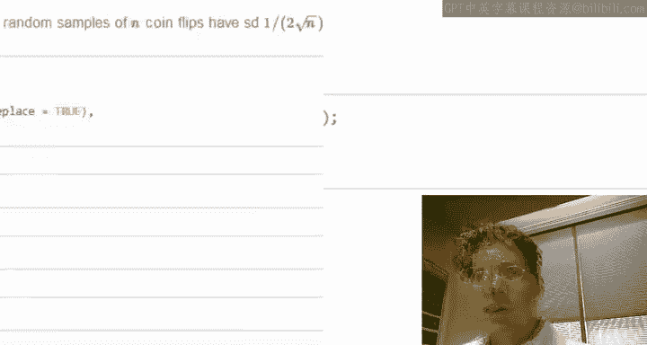

And so let's actually go through a data example。Here I'm going to use the father son data from the using R data set and I'm going to grab the sun's height and n is going to be the number of observations like always。

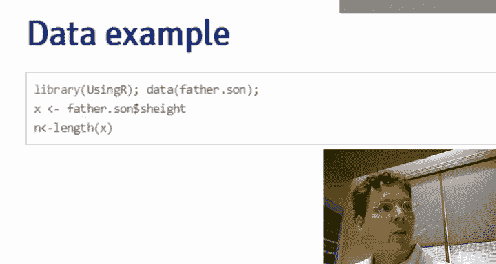

If I were to plot a histogram of the sun's heights。

 I get this distribution right here and I overlaid the histogram with a continuous density estimate。

It's quite Gaussian looking。

Now this density estimate is an estimate of the population density。

 we don't have the population density because we didn't collect an infinite amount of data。

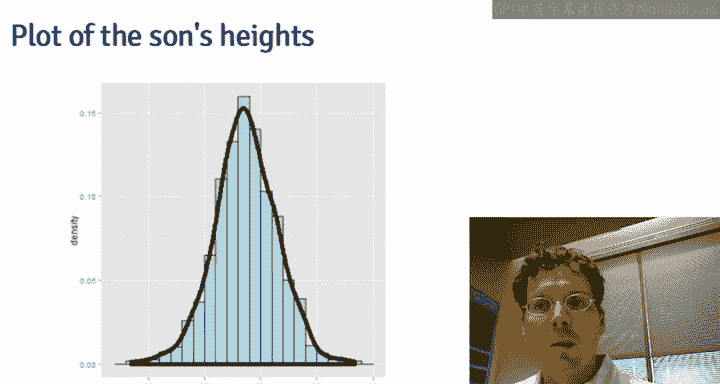

Variability of this histogram， which is what the sample variance is calculating。

 it's estimating the variability of sun's heights from whatever population this was drawn from let's assume that it was a random sample。

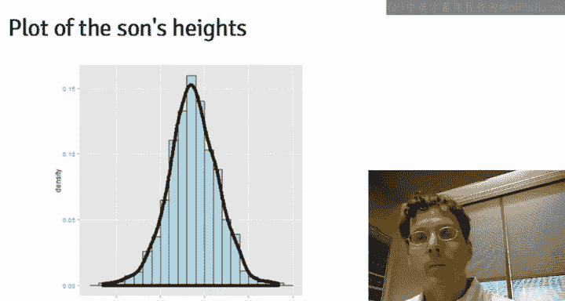

Let's just go through a couple of the numbers we can calculate here so here I took variance of x。

 variance of x divided by n， standard deviation of x。

 standard deviation of x divided by square root n， and I rounded all the numbers to two decimal places。

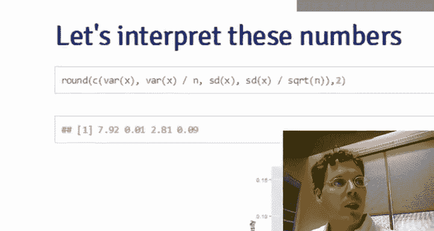

So 7。92 and 2。81， the variances of x and the standard deviation of x are simply talking about the variability in sun's heights from this data set。

 which are estimates of the variability， the population variability of sun's heights if you're willing to assume that these suns are a random sample from some meaningful population。

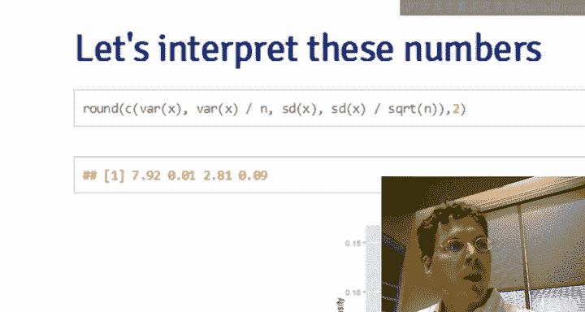

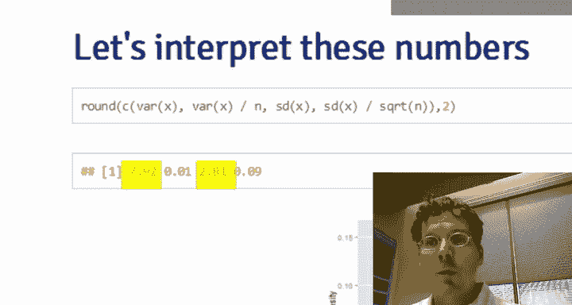

I like 2。81 in this case over 7。92 because 7。92 is expressed in inches squared and 2。

81 is expressed in inches， so I like to work in the units rather than the unit squared。

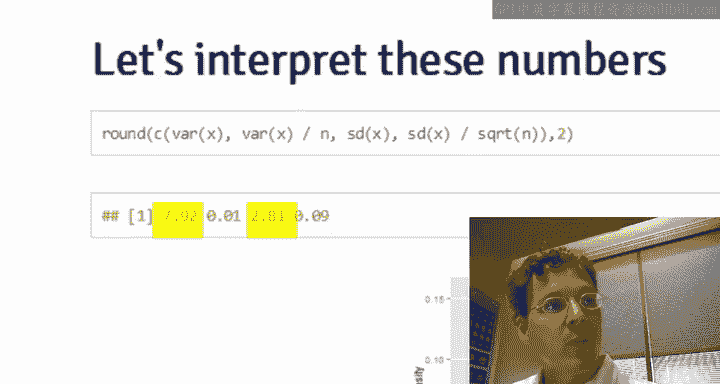

。in01 and 0。09 are no longer talking about the variability in the children's heights。

 it's talking about the variability in averages of 10 children's heights。

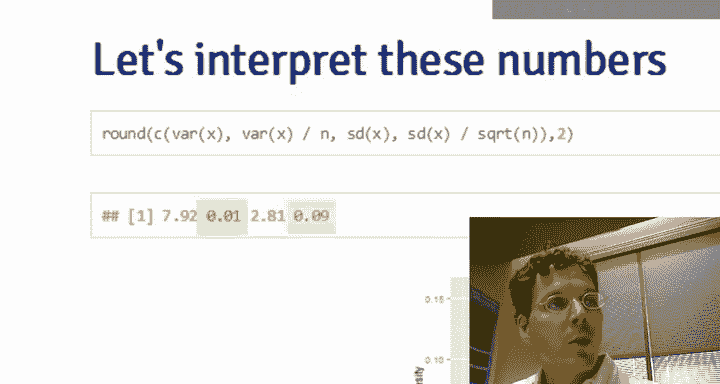

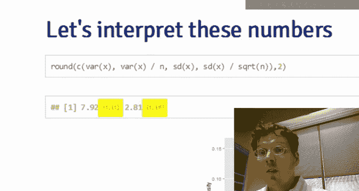

So 0。09 is probably the most meaningful one and it's the standard error， or in other words。

 the standard deviation in the distribution of averages of N children's height。And again。

 in this case， it's an estimate of that， but it's the best estimate we have from the data that we have。

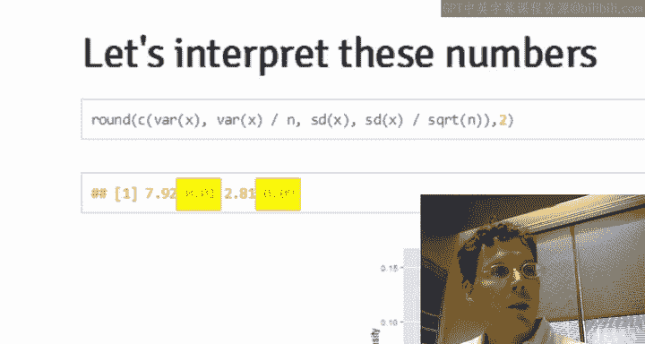

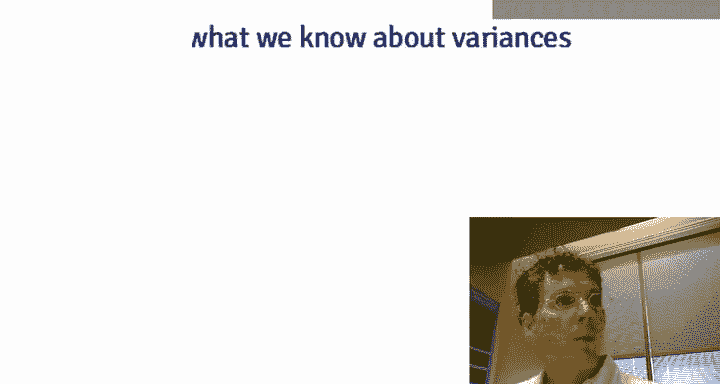

So let's summarize what we know because we covered a lot of somewhat complicated topics in this lecture and I would say fundamentally what differentiates understanding statistics from not understanding statistics is understanding variability。

 so if I were to say what's the most important lecture， it might be this one。

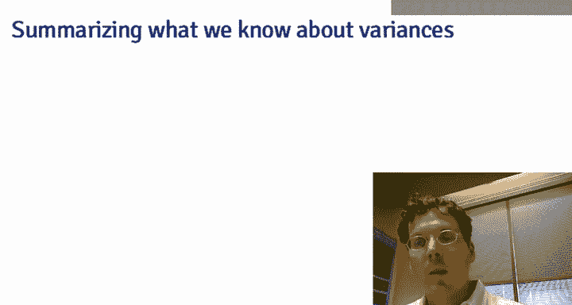

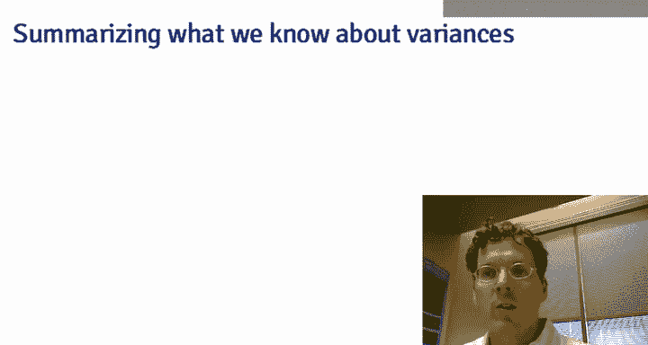

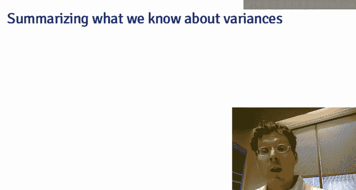

So let's summarize what we know the sample variance is an estimate of the population variance。

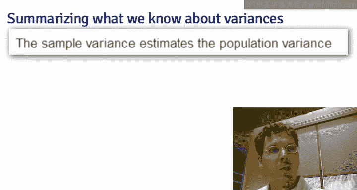

The distribution of the sample variance is centered at what it's estimating。

 this is a good thing this means that it is unbiased。

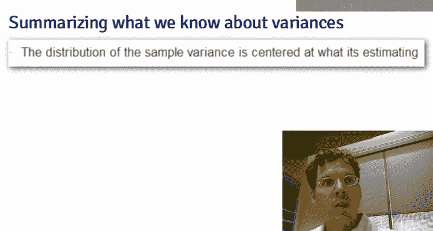

And it gets more concentrated about what it's estimating as you collect more data again。

 this is a good thing， this means if we go to the trouble of collecting more data。

 we get a better estimate that the distribution of the sample variance is more concentrated about what it'sestimating。

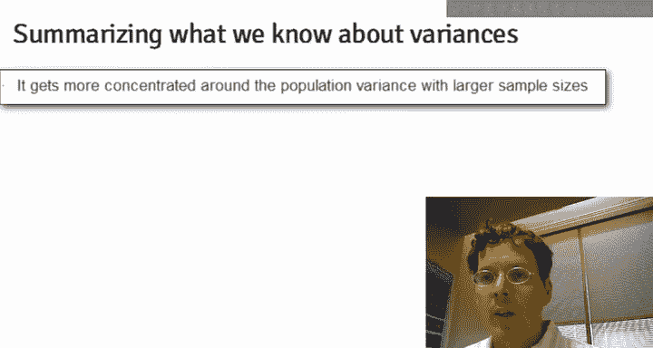

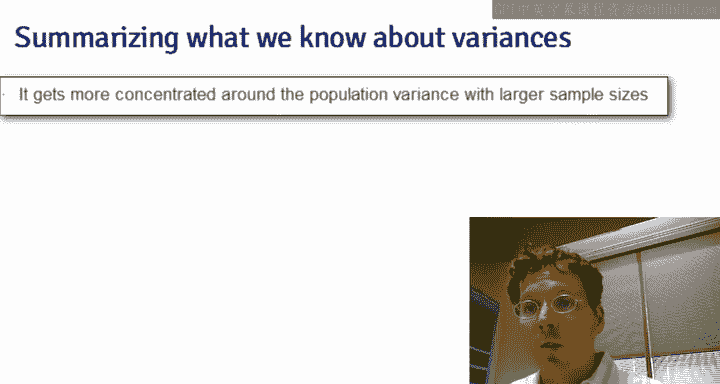

We also know a lot about the distribution of sample means。

 we know whether they're centered at from the last lecture。

 but we also know in this lecture that the variance of the sample mean is the population variance divided by n and the square root of it sigma divided by square root n is the so-called standard error。

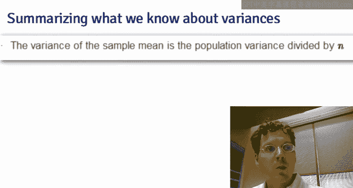

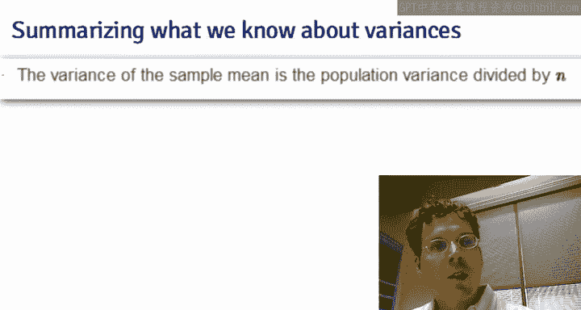

These quantities represent how variable averages are drawn from this population。

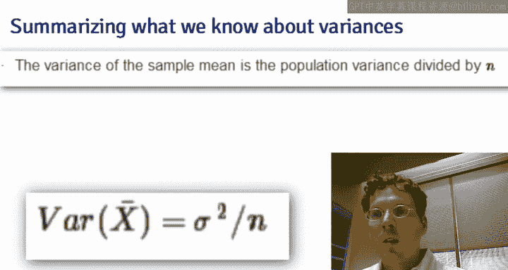

And it turns out that we can say a lot about the distribution of averages from random samples。

 even though we only get to look at one on a given data。

 and this gives us a lot to work with and it forms a lot of the foundation of ways in which we can perform。

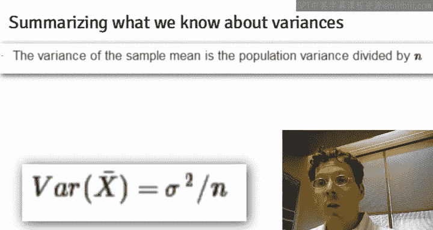