# 约翰霍普金斯大学《数据科学：统计和机器学习｜Data Science： Statistics and Machine Learning》中英字幕 - P151：43_Swirl 1 2.zh_en - GPT中英字幕课程资源 - BV1jsAAeNE3k

Now I'll show you how you can write your own swirl courses and lessons。

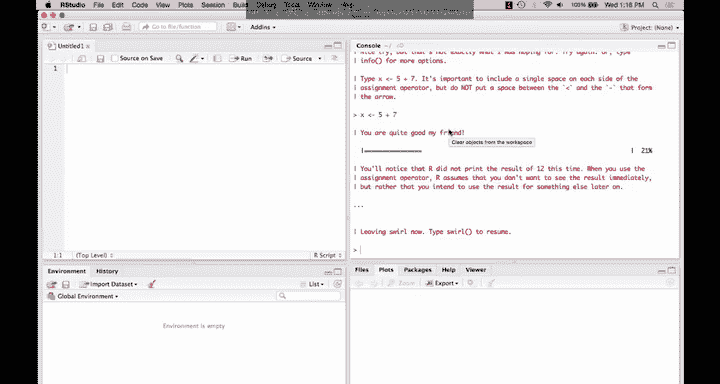

In order to do that， you're going to need a package called Slify， which I'll load up right now。

All right， so Sify is always aware of your current working directory。

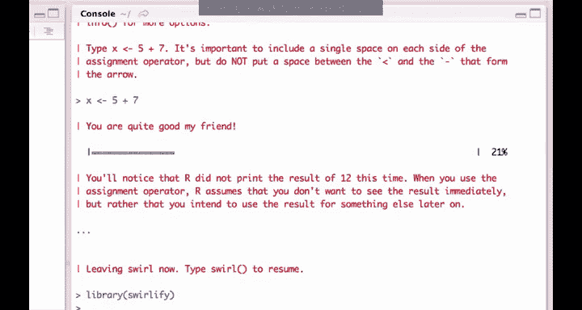

My working directory right now is just my home folder， so I'm going to set my directory。

 I have a special directory on my desktop。

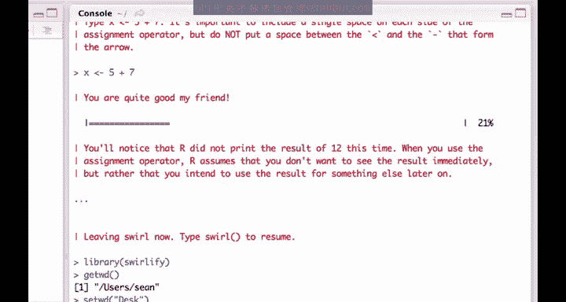

Called courses， where。I like to keep some of my swirl courses and develop them。So you can start。

Writing a new scroll course and a new lesson with the new lesson function。

I'm going to name this lesson。Lessson1。And I'll name the course。My first course。

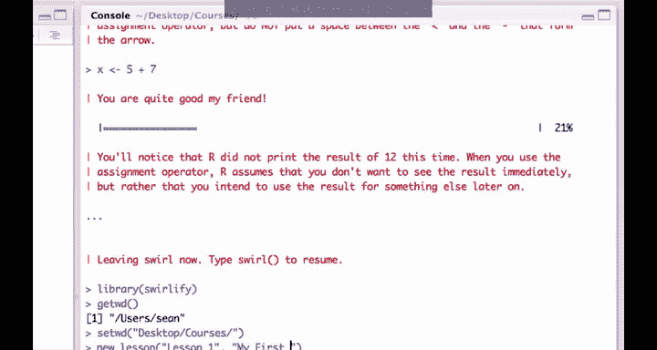

All right， so。Executing that function。Did several things。

 The first thing that it does is that it opens up this yaml file。

 All swirl lessons are written in Yaml。 Yaml is a fairly easy to understand mark up language。

 The way that Sl uses it is in this way where each question is decateated by a hyphen。

 and then there is a set of key value pairs。That specifies each type of question and what goes into that question in your swirl lesson。

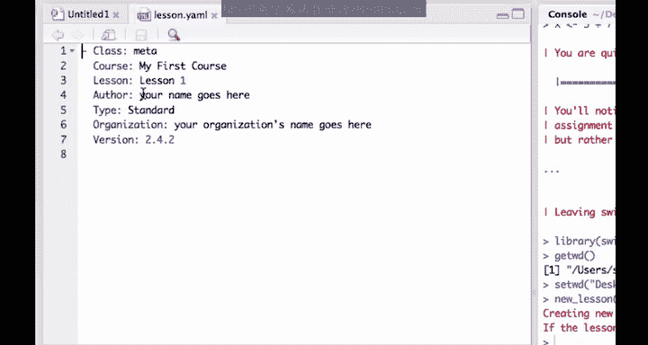

So just to show you， just to sort of give you a look。

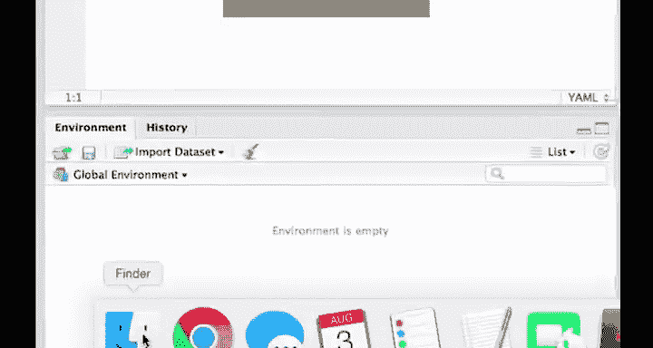

A。

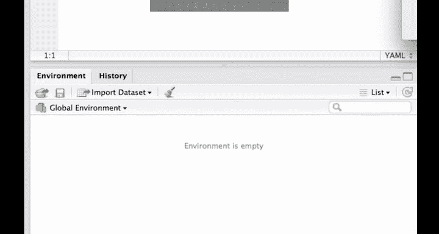

Let's go to my courses folder。

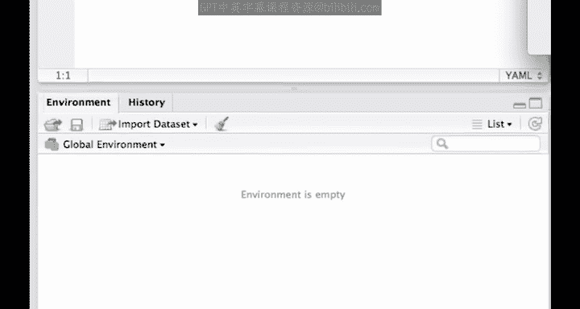

So this is the course I just created called my first course。Opening it up。

 there's one lesson inside of it called lesson one。

 and that each course is its own folder and each lesson is its own folder inside of a course。

And then that new lesson function created a couple files。The first file， custom testest。

 R is where you can specify your own functions for testing。The correctness of swirl questions。

 we'll talk about answer testing a little bit later。Depends on TXT is a text file of that。

You can use to list the names of。Functions， excuse me， the names of。

A packages that are on Cram that SR will check to make sure our installed before the lesson begins。

And net lesson do R is。An R script and whatever you write in that R script will happen before。

A lesson starts so you can load a data inside of innilessson。

 R or you can create functions that the student will then use in the lesson。

 and then this lesson do Yal file is exactly what we're looking at here inside of our studio。

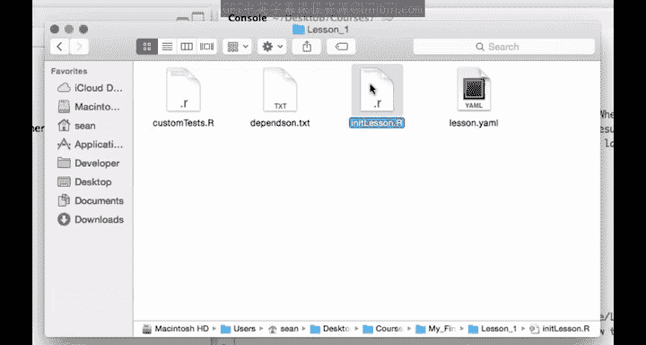

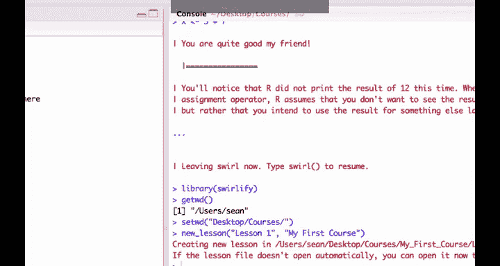

I like using our studio for writing Srel lessons because having a text editor and an art console next to each other on the same screen works for me。

 I certainly recommend using our studio， but different people have their different workflows。

So I have this new lesson all set up。Now I want to start adding questions。

 so you can use the WQ series of functions that come with Slify， And as you can see。

 there are several different kinds of questions that you can include in a lesson。

 The most simple kind of question that you include is what's called a message question。

 So I'm just going to execute this WQ message function and go over to my lesson diaml file。

 and as you can see， it's added the template for a message question。

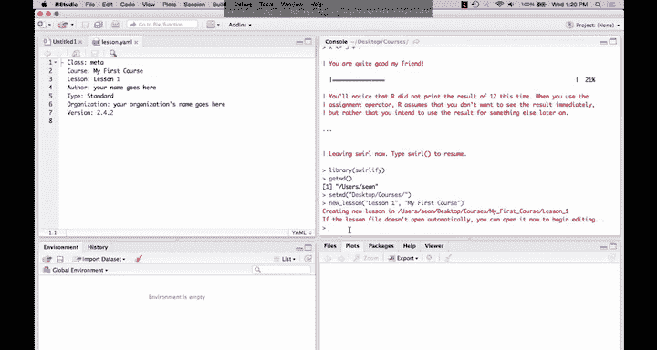

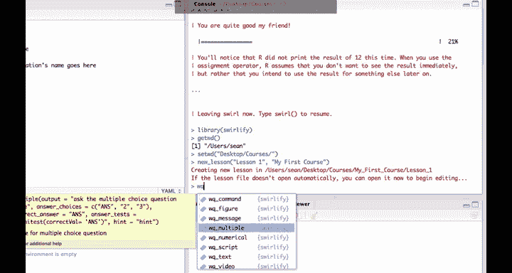

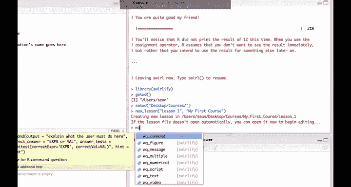

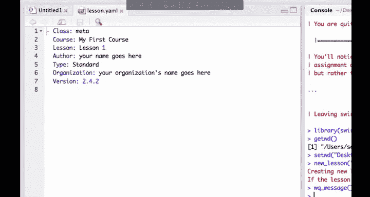

So I'm going to edit this message question and say。Welcome to lessonson 1。And then。

That's all I need to do in order to write a simple message question。

 Im then going to add another question This time， a command question。

 So a command question will prompt。

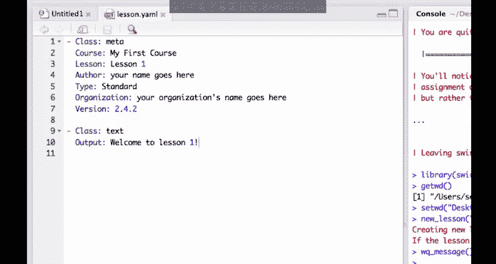

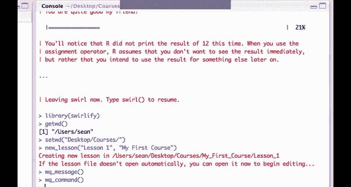

The student to actually enter some R code into the R console。And as you can see。

The question template is added to the lesson dot Yal file。

 So I'm going to ask a student a simple question， like。Add。2 and 2， using。The plus operator。

And then the correct answer is the very simple R expression of2 plus 2。And then。

This answer test is a function that tests the correctness of what the student enters into the console。

 Omni test is a function that comes packaged in swirl and for 80 to 90% of the questions you're going to be asking you want to use omni test。

So in this case， I'm just going to write  two plus 2 inside of and inside of this correct expression argument。

 And then I'm going to give a very simple hint to the user and say， just。Type。2 plus 2。All right， so。

I've written some questions now time to start testing this lesson。

Whenever I add a lesson to a course， you should add it to。

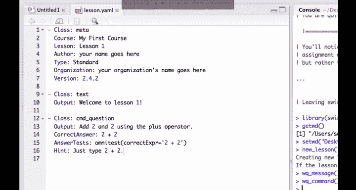

What's called the course manifest， You can do this very easily by using the add to manifest function and just to show you what that did is that created this manifest file。

 This is so we're inside of the course directory right now， that is the course。

 which is my first course and this manifest， excuse me， this manifest file just。

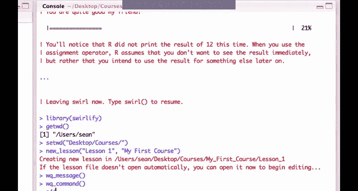

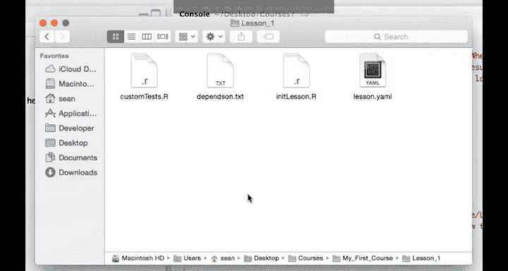

Keeps track of the order that you want your lessons to be displayed in。

 and it also keeps track of what the lessons in the course are that way。

 if you want to put data or other files inside of this course folder。

 you can do that and those files won't show up。As a lesson that the student can can select when theyre going。

 when they're choosing a lesson to work on inside of swirl。

 So this manifest file just kind just just keeps things organized。

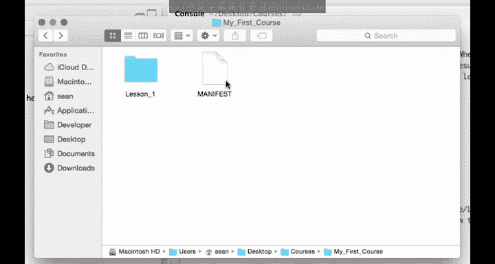

So I've added this lesson to the manifest。 Now I'm now let's test out this lesson。

 So just to check the general formatting of this lesson， I'm going to use the test lesson function。

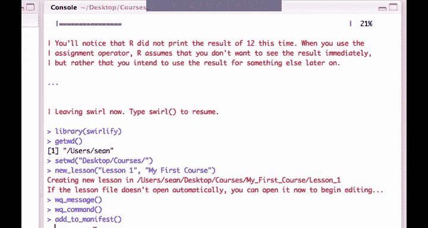

And。If I didn't get any warnings or any messages。 So that means that this。

 that means that this lesson passed some of some formatting checks that come with swirllify。

 then I want to actually。Use this lesson inside of swirl。 so'm going to use the demo lesson function。

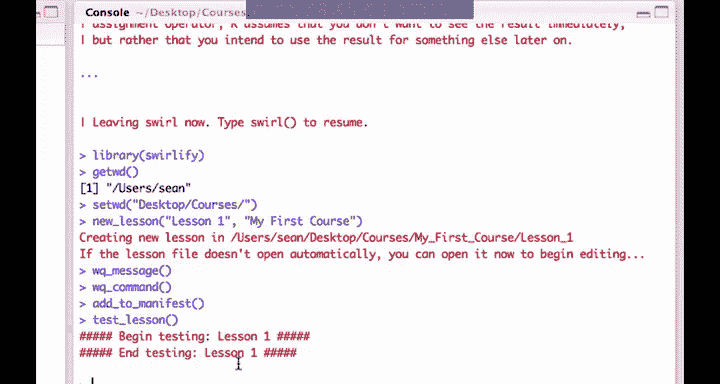

And as you can see， that takes us right into the lesson that we're writing。

 and I don't need to go through swirls menus。 So welcome to lesson 1 is the first question。

 Add two and 2 using the plus operator。 I'll do that。

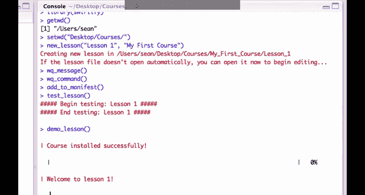

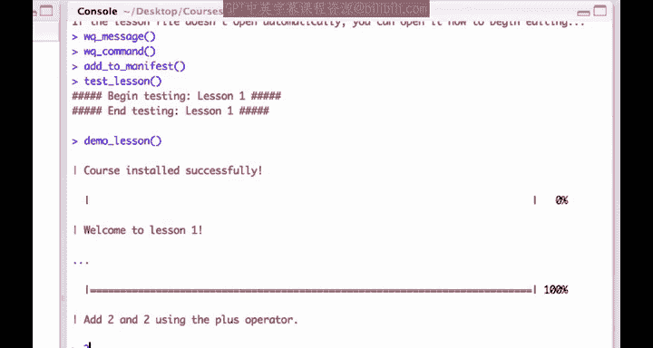

And then that's the end of the lesson。

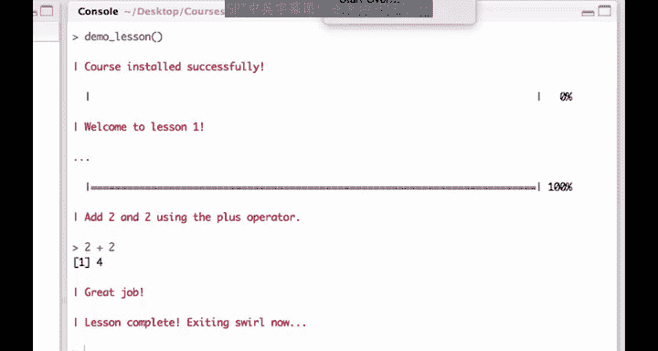