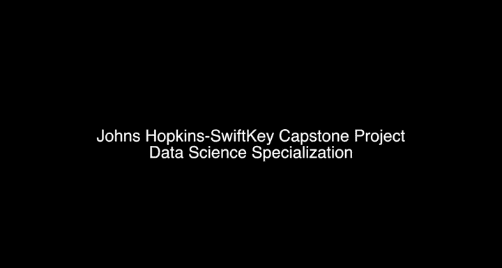

# 约翰霍普金斯大学《数据科学：统计和机器学习｜Data Science： Statistics and Machine Learning》中英字幕 - P155：2_你现在是一名数据科学家.zh_en - GPT中英字幕课程资源 - BV1jsAAeNE3k

Hey everyone， welcome to the Capstone Project with the Johns Hopkins Data Science specialization at this point you've made it through all nine courses in the specialization and this is the culminating experience where you can really show off what you've learned。

We're so excited at how many of you have managed to actually finish all nine classes。

 and we're just extremely pumped up about the response we've seen to the specialization。😊。

This capstones project is designed to mimic the experience of being a real data scientist。

 so you might see a type of data that you haven't seen before in the previous classes。

 but you'll get to bring all the skills that you learn to bear on this new problem and really show off your creativity and your independence。

So throughout this capstone project we really want to simulate what it's like to be a data scientist。

 but we're not going to just lead you out there all by yourself throughout the whole course。

 Jeff Bryan and I will be there helping you out and we'll have other experts kind of enrolled in the course to kind of help you along with your projects and kind of help you when you get stuck。

And when you're finished after graduation， we would love to hear from you and how this program has helped you professionally。

 so if you could。Send us a tweet on Twitter or some other social media and let us know that helps us keep the program going。

😡，Good luck on the capstone。