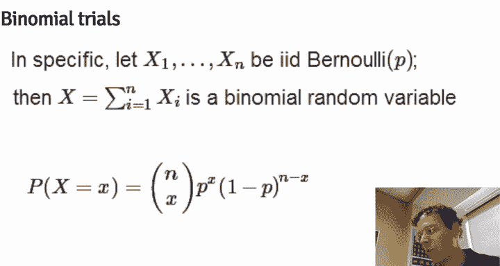
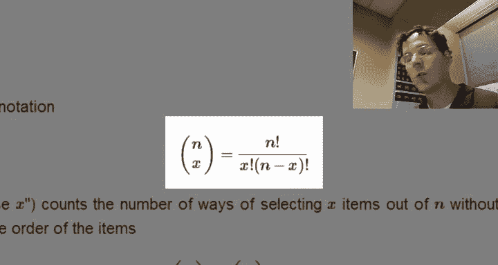
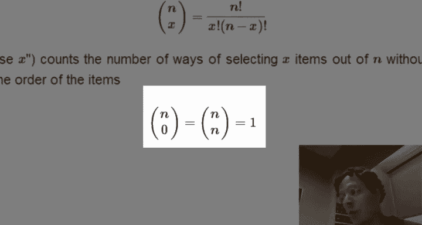
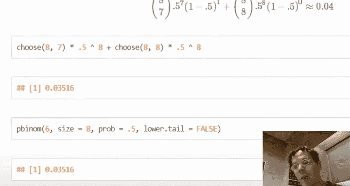

# 约翰霍普金斯大学《数据科学：统计和机器学习｜Data Science： Statistics and Machine Learning》中英字幕 - P15：14_06 01 二项分布.zh_en - GPT中英字幕课程资源 - BV1jsAAeNE3k

Hi， my name is Brian Cathho and welcome to the lecture on some common distributions in the statistical inference Coursera class as part of our data science specialization。

The specialization is co taught with my co instructorors， Jeff Lee and Roger Pg。

 we're all at Johns Hopkins University in the Department of Biosstatistics and the Bloomberg School of Public Health。

 Let's start with perhaps the simplest distribution， the Bernoulli distribution。

The Bernoulli distribution is named after Jacob Bnoulli。

 a famous mathematician who actually comes from a family of famous mathematicians and if you're interested you can read up on the Bernouls。

 they have lots of Wikipedia pages， for example。

So the Bernoulli distribution rises out of a coin flip。

 save with a zero for a tail and a one for a head。And you have a potentially biased coin with probabilities P for a head and1 minus P for a tail。

We usually write the Bernoulli probability mass function as p to the x1 minus p to the 1 minus x。

The mean of a Bnoulli random variable is P， and the variance is p times 1 minus P。

 we've seen these facts before。And if we let x be a Bulli random variable。

 we typically call x equal1 as a success， regardless of whether or not the outcome is successful in some sense of the word。

 an x equal to zero as a failure。Now that we've discussed the Bernoulli distribution。

 let's talk about the binomial distribution。The binomial random variable is obtained as the sum of a bunch of IID Purdu random variables。

So ostensibly， a binomial random variable is the total number of heads on the flips of a potentially biased coin。

Mathematically， let's let x1 to xn be Bernoulli P， then x。

 the sum of them is a binomial random variable。The binomial mass function looks a lot like the Bernoulli mass function。

 though with N X out front。

Recall that the notation n choose x stands for n factorial over x factorial n minus x factorial。

 and n choose0 and N choose n are both1。

This solves a particular combatorial problem of counting the number of ways of selecting X items out of end without replacement disregarding the ordering of the items。

Let's go through a quick example of a binomial calculation。

Suppose you have a friend who has eight children， seven of which are girls and none are twins。

If each gender has an independent 50% probability for each birth。

 what's the probability of getting seven or more girls out of eight births？Well。

 let's plug right into the binomial formula。That's the probability of 7， which is 827。5 to the 7。

1 minus 0。5 to the 1。Plus 8 choose 8。5 to the 8，1 minus 0。5 to the 0。

 which works out to be about a 4% chance。Here I give you the R code for performing this calculation。

Also， as with most of the common distributions， there's an r function and P byome gives you these probabilities。

