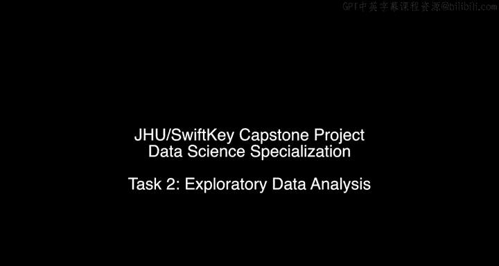

# 约翰霍普金斯大学《数据科学：统计和机器学习｜Data Science： Statistics and Machine Learning》中英字幕 - P160：7_任务2介绍：探索性数据分析.zh_en - GPT中英字幕课程资源 - BV1jsAAeNE3k

The next task is to do some exploratory data analysis the basic goal here is to develop an understanding of the various statistical properties of the data so that you can build a good prediction model down the road and so two key questions to consider here are how frequently do certain words appear in the data and how frequently do certain pairs of words appear together once you've consider these basic questions you can move on to kind of more complex ones like how do triplets of words appear together。

Now， before you start digging around the data， I'd encourage you to take a moment and do a little bit of thinking。

Thinking is important and the reason is because it helps you build expectations about the data。

 and that's important because when you have expectations about a data。

 it helps you to know when certain features or certain observations are unexpected Okay now these unexpected things might be errors or anomalies in the data or they might be really interesting features that you have to account for。

Now your initial expectations might be wrong， of course。

 but as you look at the data and you see observations。

 you can kind of calibrate and refine your expectations as you go Now the key thing is that when you don't have any expectations about a data。

 then when you start looking at the data， everything will kind of seem correct and it can be difficult to sort out what's useful and what's not useful in the data。

So this is a key task in developing your prediction model for this project。

 so I encourage you to take the time to get to know your data really well。

