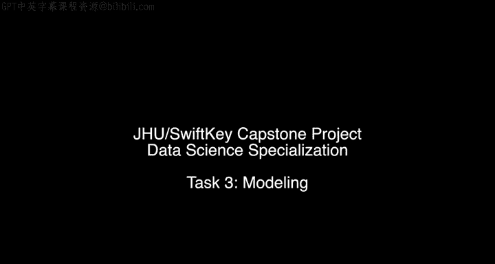

# 约翰霍普金斯大学《数据科学：统计和机器学习｜Data Science： Statistics and Machine Learning》中英字幕 - P161：8_任务3介绍：建模.zh_en - GPT中英字幕课程资源 - BV1jsAAeNE3k

This task is about developing a statistical model for the data。

 this is serious business and the work you do here will be the foundation of your project。

The basic goal of this task is to build an NG model which will allow you to predict a word given the previous one。

 two or maybe three words Now this will be based on combinations of words that you observe in your data however。

 sometimes people will want to type combinations of words that you've never seen before even in your massive data and so you're going to have to figure out a way to handle these cases when they come up。

We've put some links in the task description to help you get started about thinking about these problems。

 but of course we encourage you to do your own research and see what you can find out there。

A couple of things to keep in mind， first is you're going to have to think about a way to evaluate the performance of your model in terms of its accuracy and predicting words。

Also， you want to keep in mind the overall performance of your algorithm and so that it runs in a reasonable amount of time without taking up too many resources like memory Good luck with this task。

 we look forward to seeing what you can come up with。

