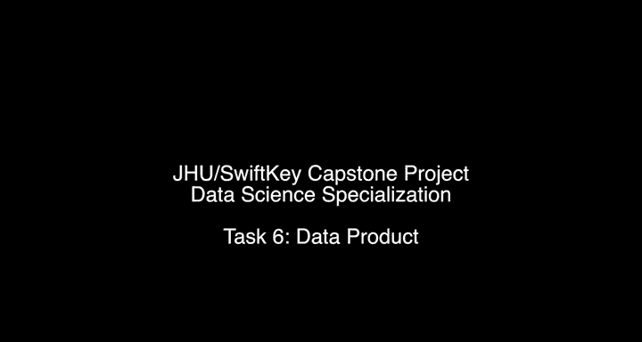

# 约翰霍普金斯大学《数据科学：统计和机器学习｜Data Science： Statistics and Machine Learning》中英字幕 - P164：11_任务6介绍：数据产品.zh_en - GPT中英字幕课程资源 - BV1jsAAeNE3k

Okay， you've come down a long road to get here and now it's time to show off your stuff。

 So the goal of this task is to build a front end that can be used by a wide audience to demonstrate how your predictive algorithm works。

 There are a couple different settings in which you might have to do this。 For example。

 you might have to demo a prototype to your colleagues to show them the potential of your work and to convince them to devote more resources to it。

 you might have to demonstrate to potential users and customers。

 all of the cool features that you've developed or maybe you just want to distribute your software to the world and you want to build a simple web interface for people to access whatever the reason。

 the goal here is to build something that other people can easily use。

 because if other people can use your software， then they'll have the opportunity to convince themselves of how cool it is。

 and that just makes your job a lot easier。😊，So this is the final task in this project。

 the final movement so to speak， and I want you to take the time to think about what you've built and to try to make it really sing。

We're all looking forward to seeing what you can do。

