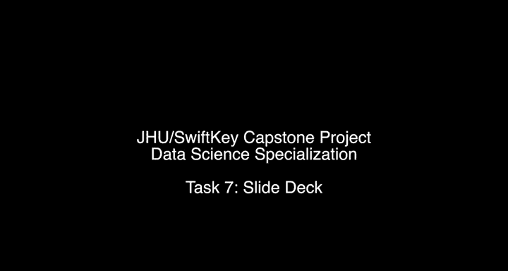

# 约翰霍普金斯大学《数据科学：统计和机器学习｜Data Science： Statistics and Machine Learning》中英字幕 - P165：12_任务7介绍：幻灯片演示.zh_en - GPT中英字幕课程资源 - BV1jsAAeNE3k

Now that you've built your data product， it's time to make your pitch。

 One last thing that you need to do is build a slide deck that present your work and explains why someone should be interested in it。

 This slide deck should you no more than five slides and should be built using our studio's presenter tools。

In this presentation you want to give a little background about the problem you're trying to solve。

 you want to describe the approach you took to solving that problem。

 and then you want to talk about your app， talk about your product， and how someone can use it。

 and then highlight some of the really cool features of your product。

Imagine that you're giving this presentation to a boss or a manager or even some potential investors。

 and you want to get across all the amazing work that you've done in a clear and concise manner。

Good luck on creating your presentation。