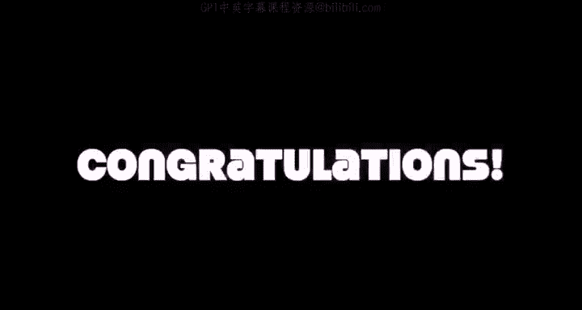
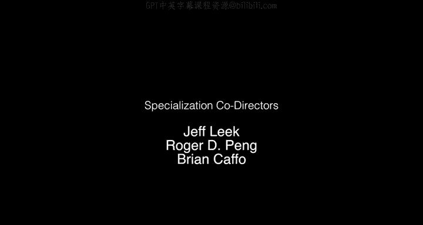

# 约翰霍普金斯大学《数据科学：统计和机器学习｜Data Science： Statistics and Machine Learning》中英字幕 - P166：13_恭喜.zh_en - GPT中英字幕课程资源 - BV1jsAAeNE3k

Congratulations graduates we're so excited that you finished the whole data science specialization it's been a really long road and you've been through a lot of courses up until now and' really impressed impressed with what you've accomplished in just a short period of time we've had a chance to look at some of the capstone projects and it's we've been really impressed with creativity that you've shown and the technical expertise that you've demonstrated from all your work so we've had a lot of fun interacting with you throughout the specialization and we've had a chance to even meet some of you virtually and so we're just really looking forward to what you can accomplish in the future。

So be sure to post your credential to LinkedIn in addition you'll be getting an email from me to join in the LinkedIn group that is only for the completers of the specialization and that's a great place to do networking。

 post jobs and find jobs and also show all the other great things you're doing with the specialization。

Now we're constantly working on new courses and new specializations here at Hopkins and so we've got a lot of things under development。

 and so if you want to keep track of what the three of us are working on。

 please follow us on social media where we'll be regularly posting updates on what we're doing。

Awesome job it was great having you all on the specialization and we really look forward to seeing what you're going to do next Now go drop some science on that data。

It's ruined。したい。Congratulations graduates， we're so excited that you finished the whole data science specialization。

よし。😊，All right， so you， then me， then you， and then back to me and then back to you as Matt。

So be sure to post your credential to LinkedIn and in addition。😀あ。I'm sorry。

Can we have Brian go partisan work？That was the most robotic like youre talking me like talking me。

Now go drop some science on that data。Yeah， no， no， gotm we got this， you got this。

 but you're going to have to give me minutes just like deep right。怎么改？The go drop some die。It's over。

